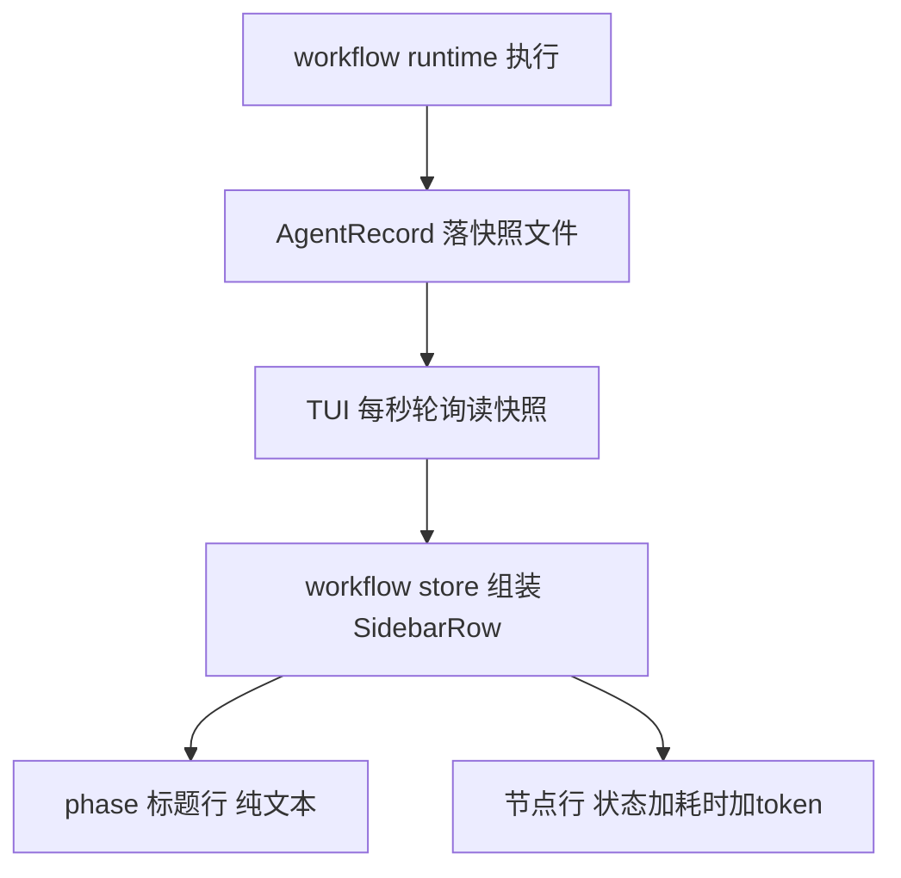
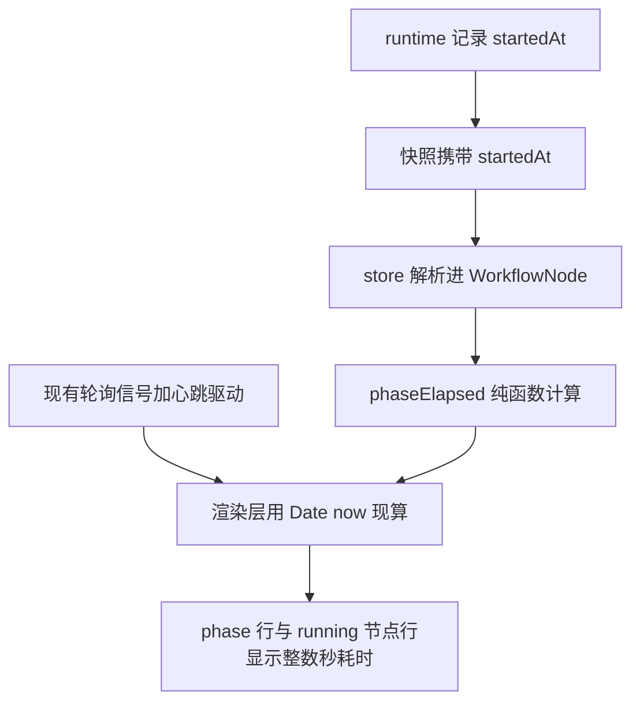

# TUI Workflow Tree Phase 耗时实时显示 — 可行性报告

> 需求：workflow 树里每个 phase（阶段）标题文本旁边显示耗时，running 时实时递增，
> 能看到"当前 phase 已经执行了多久"。
> 结论先行：**可行，改动小（纯观测通道加可选字段，不动执行链路），估半天工作量**。
> 核心缺口只有一个：AgentRecord 缺 startedAt 绝对时间戳；刷新直接复用现有轮询信号，
> 显示格式取整数秒（不带小数）。

---

## 1. 现状数据链（已核实）



关键事实：

| 事实 | 位置 | 对本需求的意义 |
|------|------|----------------|
| phase 行只有 title 文本 | workflow-store.ts SidebarRow | 显示位置现成，加一段文本即可 |
| AgentRecord 只有结束态 durationMs | types/index.ts:36；runtime 结束时才写（344/378 行） | running 节点与 phase 无任何时间数据 —— **主要缺口** |
| runtime 内部已有 agentStarted 时间戳 | workflow-runtime.ts:234 `const agentStarted = Date.now()` | 数据源头现成，只是没落到 record |
| TUI 已有 1 秒轮询信号 | plugin.tsx:107 POLL_INTERVAL_MS=1000 | 实时递增的刷新驱动现成 |
| 快照心跳 3 秒（防失联） | run-snapshot.ts RUN_SNAPSHOT_HEARTBEAT_MS=3000 | 快照内容至少 3 秒变一次 time 字段 |
| 节点行耗时只在完成态显示 | plugin.tsx:185 formatDuration(node.durationMs) | running 态节点也不显示耗时（同源缺口） |

## 2. 缺口与补齐

### 缺口 1：没有起始时间戳（唯一硬缺口）

类比理解：现在的记录像运动会只记"每名选手跑了多少秒"，没人记"几点几分开跑"。
要算"接力赛（phase）现在跑到第几分钟"，光有各棒用时不够，必须有发令枪时刻。
`agentStarted` 在 runtime 里已经拿着，只是没写进成绩单（AgentRecord）。

补齐：AgentRecord 与 WorkflowNode 各加一个可选字段：

```ts
startedAt?: number   // 该 agent 开始执行的绝对时间戳（毫秒）
```

runtime 在 agent 启动处落一行 `record.startedAt = agentStarted` 即可。

### 缺口 2：刷新驱动复用现有轮询（决策：不加独立 tick）

plugin.tsx 的 applyProgress 用 key 去重：快照内容不变则不更新信号，渲染不重跑。
快照心跳 3 秒让 time 字段变化一次，因此 phase 耗时的实时粒度约 3 秒一跳，
已满足"实时看到执行了多久"的观察需求；不新增独立 1 秒 tick 信号，
渲染层直接在每次重渲染时用 Date.now 现算即可。

**显示格式决策：整数秒，不带小数**（区别于节点行已有的 20.9s 小数格式）：

```
23s / 1m05s
```

## 3. 方案设计

### 3.1 phase 耗时口径

```
phaseStart = min(该 phase 所有节点的 startedAt)          发令枪：组内最早开跑的节点
phaseEnd   = max(该 phase 所有节点的 startedAt + durationMs)  冲线：组内最后完成的节点
进行中     = Date.now() - phaseStart（存在 running 节点时）
已完成     = phaseEnd - phaseStart
```

并行节点重叠时段不重复计费，口径与"该阶段墙钟耗时"一致。

### 3.2 渲染形态

```
调研阶段 · 23s              <- running：随轮询递增（约 3 秒一跳），整数秒
  ● 文件盘点 ·12.1s ·9.9k tok
  ◐ 网络核查 ·8s            <- （可选顺手项）running 节点实时耗时，同样整数秒
汇总阶段 · 1m05s           <- 完成：定格最终耗时
```

改动点两处渲染位置：plugin.tsx sidebar 树（223 行 phase 分支）与全屏路由（433 行）。
节点行已有完成态小数格式（·20.9s）保持不变，仅新增的耗时用整数秒。

### 3.3 数据流与实时机制



## 4. 改动清单

| 文件 | 改动 | 规模 |
|------|------|------|
| types/index.ts | AgentRecord、WorkflowNode 加 `startedAt?: number` | 2 行 |
| runtime/workflow-runtime.ts | agent 启动处落 `record.startedAt` | 1 行 |
| tools/run-snapshot.ts + tui/run-snapshot-reader.ts | RUN_SNAPSHOT_VERSION 1 -> 2（跨进程契约两处同步） | 2 行 |
| tui/workflow-store.ts | 解析 startedAt；新增 phaseElapsed 纯函数与整数秒格式化 | ~35 行 |
| tui/plugin.tsx | phase 行耗时文本（两处渲染点）；（可选）running 节点实时耗时 | ~20 行 |
| tests/ | phaseElapsed 纯函数 + 快照形状解析用例 | ~40 行 |

版本号纪律说明：快照文件头部注释规定"形状变化必须 bump"。加可选字段严格说
也是形状变化，bump 到 2 后旧 TUI 读新快照会静默丢弃（观测降级到完成态兜底）。
本插件 server 与 TUI 同包同版本发布，单机无错配窗口，bump 安全。

## 5. 边界与风险

| 场景 | 表现 | 处理 |
|------|------|------|
| journal 回放节点 | 无 startedAt（回放不真实执行） | 所在 phase 耗时缺省不显示（宁缺毋滥，不造数） |
| 老 run 的旧快照（v1） | 版本不匹配被丢弃 | 已有降级：完成态 metadata 兜底 |
| 快照失联（>8s 未更新） | 耗时冻结在最后快照值 | 已有失联标记机制，无需新处理 |
| 时钟偏差 | startedAt 是 runtime 时钟，显示用 TUI 时钟 | OpenCode 插件同进程族，偏差可忽略 |
| 无 phase 的 workflow | 树中无 phase 行 | 无影响；（可选）节点级实时耗时照常生效 |
| 嵌套 run（B1） | 各自树各自 phase | 互不影响 |

风险总评：**低**。全部改动在纯观测通道（快照 + 渲染），执行链路零改动；
所有新字段可选，读端宽松解析，老数据不炸。

## 6. 验证方案

1. 单测：phaseElapsed 纯函数（进行中/完成/混合回放节点/无 startedAt 四类）
2. 手工：examples/sample-project 跑 tui-progress-test.js（多 phase 脚本），
   观察 sidebar 树 phase 行耗时随轮询递增（约 3 秒一跳）、完成后定格；对照各节点耗时求和口径
3. 回归：全屏路由 /workflow 同步显示；完成后 Esc 返回再进不闪烁

## 7. 实施记录（已完成）

- 2026-09-16 实施落地，三个提交：
  - c376382 主体：startedAt 字段（runtime 真实执行才落，回放不产生）、phaseElapsedMs
    墙钟口径纯函数、整数秒 formatElapsed、两处 phase 行渲染、running 节点整数秒实时耗时、
    快照版本 1 到 2、验收脚本 phase-elapsed-test.js
  - 2f46f51 修复：快照读取通道（run-snapshot-reader 独立解析）补 startedAt，
    否则运行期 phaseElapsedMs 恒 undefined 不显示（三条数据通道只补了 metadata 通道的遗漏）
  - 40d06ea 修复：progressViewKey 混入快照 time，心跳 3 秒触发重渲染，
    否则无状态迁移期间耗时定格不刷新
- 真机验收通过：phase 行 · Ns 约 3 秒一跳递增，完成后定格；running 节点整数秒耗时、
  完成态节点一位小数不变；并行重叠不重复计费。

## 8. 引用说明

- 本仓源码：
  - src/tui/workflow-store.ts（SidebarRow phase 行、formatDuration、节点解析）
  - src/tui/plugin.tsx:107/152（1 秒轮询信号）、223/433（两处 phase 渲染分支）
  - src/types/index.ts:15-68（WorkflowNode 与 AgentRecord 形状）
  - src/runtime/workflow-runtime.ts:234（agentStarted 已有未落盘）
  - src/tools/run-snapshot.ts:27-31（心跳与失联阈值、版本纪律）
- 设计依据：Docs/02_设计与说明/TUI实时通道优化方案.md（快照三道防线与轮询架构）
