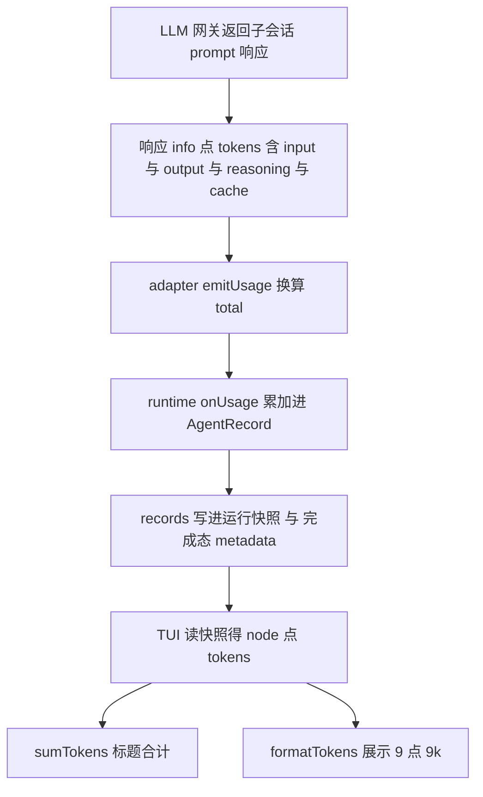

# TUI Token 统计口径说明

> 对应功能：TUI sidebar 与 /workflow 全屏路由的节点 token 与标题合计（commit 6ce59eb 起）
> 本文回答：一个数字从 LLM 网关到 TUI 屏幕上 `·9.9k tok` 经过了哪些环节、算进了什么、没算什么
> 核查基线：本仓库源码逐行核对（引用行号为当前版本）

---

## 1. 全链路数据流



## 2. 逐环节计算规则

### 环节 1 数据来源：子会话的 prompt 响应（不是主会话）

每个 agent() 调用经 adapter 在**独立子会话**里执行一次 `client.session.prompt`（opencode-session-adapter.ts）。token 数字来自该响应的 `info.tokens` 字段（server 返回，源码形状 PromptResponse）：

| 字段 | 含义 | 是否计入我们展示的数字 |
|------|------|------------------------|
| input | 本轮输入 token | 计入 |
| output | 本轮输出 token | 计入 |
| reasoning | 推理 token（如 o 系与 glm 思考模式） | 计入 |
| cache.read / cache.write | 缓存读写 token | **不计入**（见第 3 节口径差异） |

### 环节 2 adapter 换算（opencode-session-adapter.ts emitUsage）

```
多 step 消息：total = Σ(step-finish part 的 input+output+reasoning)   // 见第 6 节上游缺陷补偿
单 step 消息：total = input + output + reasoning                    // cache 两项被排除
cost  = info.cost                                                   // 仅网关上报了才透传
```

三条路径共用：原生结构化 与 schema 降级 与 普通文本，都在 prompt 返回后调 emitUsage。

### 环节 3 runtime 累加（workflow-runtime.ts:265-268）

```
record.tokens += usage.total        // 该 agent 的累计值
record.cost    += usage.cost
```

**多 attempt 累加语义**：重试或降级路径下同一 agent 可能成功返回多次 prompt 响应（如先 400 再降级成功不会；但 checkpoint 不会；retry 会），record.tokens 是**求和**不是取最后一次。常规单次成功就是那一次的 total。

### 环节 4 落盘两条通道（同一份 records）

- 运行快照：src/tools/run-snapshot.ts，records 原样进 `agents[].tokens`
- 完成态 metadata：src/tools/workflow-progress.ts，同样原样

### 环节 5 TUI 展示（src/tui/workflow-store.ts）

- 节点行：`node.tokens` 有值才显示（无值不显示该段）
- 标题合计：`sumTokens = Σ node.tokens`（缺省按 0）
- 格式 `formatTokens`：`999` 原样；`>=1000` 转一位小数 k（`9876 -> 9.9k`）；`>=1,000,000` 转一位小数 m（`1234567 -> 1.2m`）

## 3. 口径差异：与 OpenCode 内置 Context 面板对比

| | 本项目 TUI 树 | OpenCode Context 面板（内置 sidebar） |
|---|---|---|
| 统计对象 | 该 workflow 全部 agent（各子会话）的消耗**合计** | 当前会话**最后一条** assistant 消息 |
| cache token | **不计入**（计费相关口径） | **计入**（上下文占用口径，cache.read + cache.write 加总） |
| 用途 | 回答"这次 workflow 烧了多少" | 回答"当前上下文占了模型窗口多少" |

两者的数字本就不该相等：一个看花销，一个看窗口占用。若未来需要展示含 cache 的口径，在 emitUsage 里把 cache 两项加进 total 即可（数据已在上游可得）。

## 4. 边界情况

| 场景 | token 表现 | 原因 |
|------|-----------|------|
| 运行中（◐）的节点 | 通常无 token | usage 在子会话 prompt **返回时**才上报，运行中拿不到 |
| journal 回放（·缓存）节点 | 无 token | JournalEntry 只存 hash 与 result 与 model（persistence/journal.ts），token 不落盘、不回放 |
| schema 降级路径 | 正常 | 降级是纯文本单 step，info.tokens 即真实消耗 |
| 原生 json_schema 路径 | 已补偿（见第 6 节） | server 端 info.tokens 被最后一步覆盖，adapter 按 step-finish parts 求和还原 |
| cost | 部分 agent 可能没有 | info.cost 仅网关上报时透传（本项目网关常见 cost=0） |
| 后台 run | 同前台 | 走同一 onAgentUpdate 与同一 records |
| 主会话自身的消耗 | 不含 | 只统计 agent 子会话；主会话消耗看 Context 面板 |

## 6. 上游缺陷：json_schema 多 step 消息的 info.tokens 只剩最后一步（已在本仓补偿）

OpenCode server（本地源码 session/processor.ts:452-459）在 step-finish 事件里执行：

```
ctx.assistantMessage.cost   += usage.cost     // 累加
ctx.assistantMessage.tokens  = usage.tokens   // 覆盖！
```

AI SDK 多 step 流里每个 step-finish 只带**该 step** 的 usage，finish 事件的累计 totalUsage
未被 processor 采用（case "finish" 直接 return）。而 json_schema 路径（toolChoice required
+ StructuredOutput 工具带 execute）必然两段式：

```
step1  模型生成结构化 JSON 作为 tool call 参数（output 大头在这一步）
  ->   StructuredOutput.execute 捕获 structured
step2  模型收到 tool result 后收尾输出几个 token
```

最终 info.tokens = step2 的 usage，step1 的 output 全部丢失——这正是「schema 返回格式时
token 偏小」的根因。普通文本路径通常单 step，不受影响。

**补偿实现**（src/adapters/opencode-session-adapter.ts emitUsage）：prompt 响应 parts 里
每个 `type: "step-finish"` part 携带该 step 完整 tokens（schema v1/session.ts:240-256
StepFinishPart），对 stepTokens.length >= 2 求和还原；单 step 时与 info.tokens 一致，
不回归。上游修复需把 processor.ts:459 改为累加或改用 finish 的 totalUsage。

## 5. 展示位置速查

| 位置 | 内容 | 示例 |
|------|------|------|
| sidebar 节点行 | 该 agent 累计 | `● config ·20.9s ·9.9k tok` |
| sidebar 标题行 | 全树合计 | `tui_progress (5/5) | 35.6k tok` |
| 全屏路由节点行 | 同 sidebar | `● config ·20.9s ·9.9k tok · [Enter 进入]` |
| 全屏路由 header | 全树合计 | `completed · 5/5 done · 35.6k tok` |

## 6. 引用说明

- 源码（本仓库）：
  - src/adapters/opencode-session-adapter.ts:263-274（emitUsage 换算与 cache 排除）
  - src/runtime/workflow-runtime.ts:265-268（record 累加）与 219-222（回放不回 token）
  - src/types/index.ts:7-24（AgentUsage 与 AgentRecord.tokens 形状）
  - src/tools/run-snapshot.ts 与 workflow-progress.ts（records 落两条通道）
  - src/tui/workflow-store.ts（formatTokens 与 sumTokens）与 src/tui/plugin.tsx（三处展示接入）
- 对照实现：thirdparties/opencode packages/tui/src/feature-plugins/sidebar/context.tsx（OpenCode Context 面板含 cache 的口径）
- server 响应字段：thirdparties/opencode packages/opencode/src/session/prompt.ts（info.tokens 组装）
