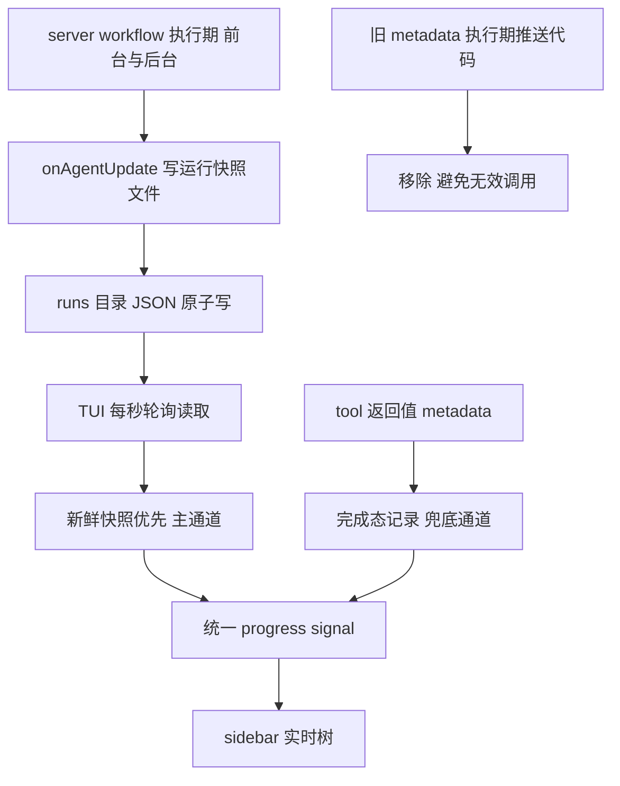

# TUI 实时通道优化方案（v1 审查稿）

> 实施状态：**已实施并真机验收通过**（2026-09-08，V-01 至 V-05 全过；验收中补增 3 秒心跳修复后台闪烁，已回写本方案 3.2 与 4.x 心跳条目）
> 目标 修复 workflow 执行期 sidebar 不实时的问题（当前仅完成态可见）
> 依据 Docs/04_参考实现/00-05 六份研读文档 + 数据库事件表排障实证
> 关联需求 Docs/01_需求与规划/TUI增强需求文档.md 5.1 与 5.2（已按本方案修订至 v0.3）

---

## 目录

1. [问题定性与证据](#1-问题定性与证据)
2. [方案总览](#2-方案总览)
3. [通道设计 文件镜像](#3-通道设计-文件镜像)
4. [server 侧改动](#4-server-侧改动)
5. [TUI 侧改动](#5-tui-侧改动)
6. [数据合并与降级规则](#6-数据合并与降级规则)
7. [测试计划](#7-测试计划)
8. [验收标准](#8-验收标准)
9. [风险与对策](#9-风险与对策)
10. [实施顺序与文件清单](#10-实施顺序与文件清单)
11. [非本期范围](#11-非本期范围)
12. [类比理解](#12-类比理解)
13. [引用说明](#13-引用说明)

---

## 1. 问题定性与证据

当前现象 前台 workflow 执行期间 sidebar 无实时树 仅完成后出现终态 5 与 5。

两个独立根因（均有实证）：

| 侧 | 根因 | 证据 |
|----|------|------|
| server | 插件 tool 执行期内 context.metadata 推送未产生任何 message.part.updated 事件 | opencode.db event 表 该会话执行期 workflow part 只有 pending 与 running 与 completed 三次状态变化 无一次携带 metadata 中间写入 |
| TUI | 事件触发后回读 api.state 的路径脆弱（message 与 part 分存 执行期 store part 为空） | 诊断日志 dump 显示执行期 assistant 消息 parts 空数组 |

社区参考的旁证 五个参考实现没有一个依赖插件 tool 的 context.metadata 做实时更新（详见参考实现 00 文档第 3 节）。

## 2. 方案总览

### 2.1 选型修正说明

参考实现 00 文档曾建议 A 事件负载为主 B 文件镜像为辅。本方案细化后修正为 **B 镜像为唯一执行期主通道**，理由：

1. 镜像快照含全部所需信息（phases 与 labels 与 sessionId 与 status 与耗时与计数）A 事件通道只有扁平 agent 列表拿不到 phase 分组
2. 双实时源合并需要去重与优先级裁决 复杂度高收益低
3. 1 秒轮询延迟相对 agent 粒度变化（秒到十秒级）完全够用
4. B 同时覆盖前台与后台 一套机制解决需求文档 5.1 与 5.2 两个场景

### 2.2 三通道分工



| 通道 | 角色 | 状态 |
|------|------|------|
| B 文件镜像 | 执行期与后台实时主通道 | 新增 |
| C tool 返回值 metadata | 完成态记录（前台） | 已工作 保留 |
| 旧 context.metadata 执行期推送 | 无效代码 | 移除（完成态返回值路径不动） |

### 2.3 不做的事

- 不引入 A 事件追踪器（deferred 见第 11 节）
- 不动 runtime 与 adapter（sessionId 已回填 records 齐备）
- 不改完成态返回值路径（已验收可用）

## 3. 通道设计 文件镜像

### 3.1 快照文件形状

路径 `<项目目录>/.opencode-workflows/runs/<runId>.json`

```jsonc
{
  "version": 1,                        // 形状版本号 改形状必须 bump（omo 约定）
  "runId": "run-mts0xewc",
  "parentSessionId": "ses_f83fd0dd",   // TUI 按 sidebar 会话过滤的键
  "name": "tui_progress",
  "status": "running",                 // running 与 completed 与 aborted 与 failed
  "time": 1788832893806,               // 写入时刻 毫秒
  "phases": ["Analyze", "Summarize"],
  "agents": [                          // 即 AgentRecord 数组 已含 sessionId
    { "id": "run-x:0", "label": "config", "phase": "Analyze", "status": "ok",
      "sessionId": "ses_f83f1c9b", "durationMs": 20931, "tokens": 9876 }
  ],
  "running": 2, "completed": 1, "failed": 0, "total": 5
}
```

### 3.2 关键参数（照抄 omo 常量纪律 全部集中定义）

| 常量 | 值 | 依据 |
|------|-----|------|
| POLL_INTERVAL_MS | 1000 | omo 同款 agent 粒度变化频率下够用 |
| STALE_MS | 8000 | 心跳语义 running 快照超过 8 秒没更新视为失联（server 崩溃或写失败）降级 |
| VERSION | 1 | 初版 |

写入频率 onAgentUpdate 每次状态迁移写一次，外加 **3 秒心跳定时器**（验收中发现的必要项：并行 agent 执行期可能数十秒无状态迁移，无心跳会被 TUI 误判失联导致 sidebar 闪烁消失——omo 原设计 2 秒心跳正是防此）。终态写入后 finally 清定时器。

### 3.3 写入的三道防线（照抄 omo）

1. 原子写 tmp 加 rename（Windows rename 覆盖失败时 unlink 后重 rename 兜底）
2. 版本号 TUI 读者不认识即丢弃
3. 新鲜度 running 态超 8 秒未更新 TUI 视为失联降级到 C 通道

### 3.4 清理策略

新 run 启动时删除同 parentSessionId 的全部终态快照（completed 与 aborted 与 failed）。活快照不动（支持同会话并发后台 run）。目录里始终最多残留每个会话一份终态。

## 4. server 侧改动

### 4.1 新模块 src/tools/run-snapshot.ts（纯函数 可测）

```ts
// 常量
export const RUN_SNAPSHOT_VERSION = 1

// 组快照对象（复用 buildProgressMetadata 的序列化再补镜像专有字段）
export function buildRunSnapshot(input: {
  runId: string
  parentSessionId: string
  name?: string
  status: WorkflowProgressStatus
  records: ReadonlyArray<AgentRecord>
  time: number
}): RunSnapshot

// 原子写入 <dir>/.opencode-workflows/runs/<runId>.json（mkdir recursive tmp rename）
export function writeRunSnapshot(directory: string, snapshot: RunSnapshot): void

// 新 run 启动前清理 同 parentSessionId 的终态快照
export function cleanupRunSnapshots(directory: string, parentSessionId: string): void

// TUI 与测试共用的读取 目录列举 加 解析 加 校验
export function readRunSnapshots(directory: string, parentSessionId: string): RunSnapshot[]
```

类型 RunSnapshot 即 3.1 形状的 interface 放本文件（TUI 侧用结构校验不 import 此类型 见 5.1）。

### 4.2 workflow.ts 前台路径

- 已有 progressRecords 与 pushProgress 保留 records 维护逻辑
- **新增** runStart 时 cleanupRunSnapshots 与 onAgentUpdate 里 writeRunSnapshot
- **移除** pushProgress 对 context.metadata 的调用（执行期推送已被证实无效）
- 保留 三处终态写快照 成功 return 前 status completed 中断分支 aborted 异常上抛前 failed
- 保留 完成态 return 值带 metadata 终态快照（C 通道 不动）

### 4.3 background-runs.ts 后台路径

- onAgentUpdate 维护 info.records 之外（现有）增写快照
- 三个终态分支（completed 与 aborted 与 failed）各写终态快照
- 后台无 C 通道 镜像是其唯一可视化来源 由此后台 run 首次获得实时树（提前覆盖需求 5.2 的 MVP 期目标）

## 5. TUI 侧改动

### 5.1 新纯模块 src/tui/run-snapshot-reader.ts

不复用 server 的 run-snapshot.ts（TUI 禁止 import server 侧 按结构自行校验 防崩原则同 workflow-store）：

```ts
// 宽松校验 version 与 parentSessionId 与 agents 数组 与 workflow-store 同款防御
export function parseRunSnapshot(raw: unknown): RunSnapshotView | null

// 列目录 读全部 匹配会话 按 time 降序
export function listSessionSnapshots(directory: string, sessionId: string): RunSnapshotView[]

// 失联判定 status running 且 Date.now 减 time 超过 STALE_MS
export function isStale(snapshot: RunSnapshotView, now: number): boolean
```

RunSnapshotView 转 WorkflowProgress 的映射函数 toProgress（补 name 缺省与计数派生）。

### 5.2 plugin.tsx 改造

getOrCreateProgress 内部由双驱动单 signal：

```
初始 computeBest()
事件驱动（现有四类 message 事件 加 30ms 去抖）-> computeBest()
轮询驱动 setInterval 1s -> computeBest()
onDispose 反订阅 加 clearInterval

computeBest 逻辑（纯函数 可测）
  snapshots = listSessionSnapshots(session.directory, sessionId)
  取最新快照 latest（time 最大）
  if latest 且 非失联 -> 返回 toProgress(latest)        // B 通道
  else -> 返回 parseWorkflowMetadata(现有 C 路径)        // 兜底
```

- session.directory 从 api.state.session.get(session_id) 取 缺省 api.state.path.directory
- setProgress 前算 viewKey（runId 加 status 加 total 加 completed 加 running 加 failed 拼串）不变不写 signal 避免无谓重渲（omo viewKey 差分）
- 诊断日志保留到验收后统一拆除

### 5.3 workflow-store.ts

现有 parseWorkflowMetadata 与 findWorkflowMetadata 与 buildSidebarRows 与 formatDuration 全部不动（C 兜底与渲染层复用）。

## 6. 数据合并与降级规则

| 场景 | B 镜像 | C metadata | sidebar 显示 |
|------|--------|-----------|--------------|
| 前台执行中 | running 快照 1 秒内更新 | 无 | 镜像实时树 phase 分组 |
| 后台执行中 | 同上 | 无 | 同上（新增能力） |
| 前台完成 | 终态快照 | 完成态 metadata | 镜像终态（与 C 一致 镜像优先） |
| 后台完成 | 终态快照 | 无 | 镜像终态 |
| server 崩溃或写失败 | running 快照失联(大于 8 秒) | 无 | 降级显示 C 或隐藏 |
| 旧会话重开（快照已被新 run 清理） | 无 | 有（前台历史会话） | C 终态 5 与 5 现状行为 |
| 同会话并发后台 run | 多活快照 | 无 | 显示 time 最新的一份（标题栏可含 runId 区分） |

## 7. 测试计划

### 7.1 server 侧 node:test

新 tests/run-snapshot.test.ts：

- buildRunSnapshot 字段完整与 version 与计数
- writeRunSnapshot 原子写与目录自动创建 与 Windows rename 覆盖路径
- cleanupRunSnapshots 只删终态与只删同会话
- readRunSnapshots 过滤与排序与坏文件跳过

改 tests/workflow-progress.test.ts 补快照与 metadata 形状一致性（同 records 两处产物字段对齐）。

### 7.2 TUI 侧 node:test

新 tests/run-snapshot-reader.test.ts：

- parseRunSnapshot 非法形状返回 null（version 不符 缺字段 agents 非法）
- isStale 边界
- toProgress 映射与缺省回退

改 tests/workflow-store.test.ts 或新文件测 computeBest 优先级（新鲜镜像大于失联镜像大于 C 兜底）与 viewKey 差分。

### 7.3 真机验收（人工）

在 examples/sample-project 按 TUI测试指南.md 用例 1 与用例 5 重跑 用例 5 预期从负向改为正向（后台也出实时树）。

## 8. 验收标准

| 编号 | 标准 |
|------|------|
| V-01 | 前台 workflow 执行期间 sidebar 实时树更新（状态迁移后 1 到 2 秒内图标与计数变化）phase 分组正确 |
| V-02 | 后台 workflow 执行期间 sidebar 实时树（新能力 对应需求 TA-01b 提前落地） |
| V-03 | 前台与后台完成后 sidebar 保留终态 与完成前行为一致 |
| V-04 | Esc 中断后 sidebar 显示中止快照（已完成 agent 与中止 agent 状态正确） |
| V-05 | 删除 runs 目录模拟写失败 sidebar 降级为 C 通道或隐藏 不崩不卡 |
| V-06 | npm run typecheck 三段全绿 npm test 全绿 |
| V-07 | 现有 70 个测试无回归 |

## 9. 风险与对策

| 风险 | 概率 | 对策 |
|------|------|------|
| Windows 原子写 rename 覆盖失败 | 中 | unlink 加 rename 兜底 测试覆盖该分支 |
| server 与 TUI 时钟差导致误判失联 | 低 | 同机时钟 失联只降级不隐藏 |
| 快照目录与 journal 目录同处无冲突 | 低 | runs 与 journal 平级子目录 互不读写 |
| 多 opencode 实例同项目并发写 | 低 | 文件按 runId 命名天然隔离 |
| 大 workflow（500 agent）快照过大 | 低 | 单条约 200 字节 500 agent 约 100KB 轮询读取无压力 |
| .opencode-workflows 目录权限或被清理 | 低 | 读写均 try 降级 失败即走 C 或隐藏 |

## 10. 实施顺序与文件清单

| 步骤 | 文件 | 动作 |
|------|------|------|
| 1 | src/tools/run-snapshot.ts | 新建 常量 与 build 与 write 与 cleanup 与 read |
| 2 | tests/run-snapshot.test.ts | 新建 覆盖 7.1 |
| 3 | src/tools/workflow.ts | 接入快照写 移除执行期 metadata 推送 保留终态返回值 |
| 4 | src/tools/background-runs.ts | 接入快照写 三终态分支 |
| 5 | src/tui/run-snapshot-reader.ts | 新建 解析与失联与映射 |
| 6 | tests/run-snapshot-reader.test.ts | 新建 覆盖 7.2 |
| 7 | src/tui/plugin.tsx | computeBest 双驱动单 signal 加 viewKey 差分 加轮询定时器 |
| 8 | 全量 typecheck 与 test 与 build | 验证 V-06 与 V-07 |
| 9 | 真机验收 | V-01 至 V-05 |
| 10 | 拆诊断日志 需求文档 5.1 与 5.2 按本方案修订 | 收尾 |

预估改动量 server 约 150 行 TUI 约 120 行 测试约 200 行。

## 11. 非本期范围（Deferred）

| 项 | 触发条件 |
|----|----------|
| A 事件负载追踪器（秒内瞬时更新 与镜像失联时的会话级兜底） | 1 秒延迟实际体感不佳 或镜像通道故障率高时 |
| session_prompt_right footer 状态条 | 参考 04 文档 V 验收后按需 |
| workflow 全屏路由 MVP-3 | 独立排期 |
| 诊断日志拆除 | V-01 至 V-05 验收通过后立即执行（步骤 10） |

## 12. 类比理解

现在的架构像餐厅的出餐口 服务员（context.metadata 事件）喊单但后厨根本听不见（推送无效） 顾客（sidebar）只能等到结账（tool 返回）才看到账单。

新方案是后厨放一块出菜看板（runs 目录快照文件） 每做好一道菜（onAgentUpdate）就在看板上更新（原子写） 顾客每秒抬头看一眼（轮询） 点的什么菜 哪道在做 哪道上齐（phases 与状态与计数）一目了然。结账单（完成态 metadata）照旧保留 看板擦了还能对账（降级兜底）。后台打包（后台 run）也用同一块看板 不用再单独雇个报菜员。

## 13. 引用说明

- 参考实现研读 Docs/04_参考实现/00-总览与选型结论.md（通道对比与选型）05-oh-my-openagent实现解析.md（文件镜像完整范式 三道防线 与 viewKey 差分 与常量纪律）01-opencode-subagents-view实现解析.md（signal 按 session 缓存 与 纯 reducer 可测）
- 排障实证 本对话内 opencode.db event 表查询（执行期无 metadata 事件）与 TUI 诊断日志（执行期 store parts 空数组）
- 关联需求 Docs/01_需求与规划/TUI增强需求文档.md v0.2 第 5 节（实施后修订）第 9 节（新增 9.8 镜像通道条目）
- omo 源码 thirdparties/oh-my-openagent/packages/omo-opencode/src/features/tui-sidebar/（mirror-manager 与 mirror-io 与 constants）
