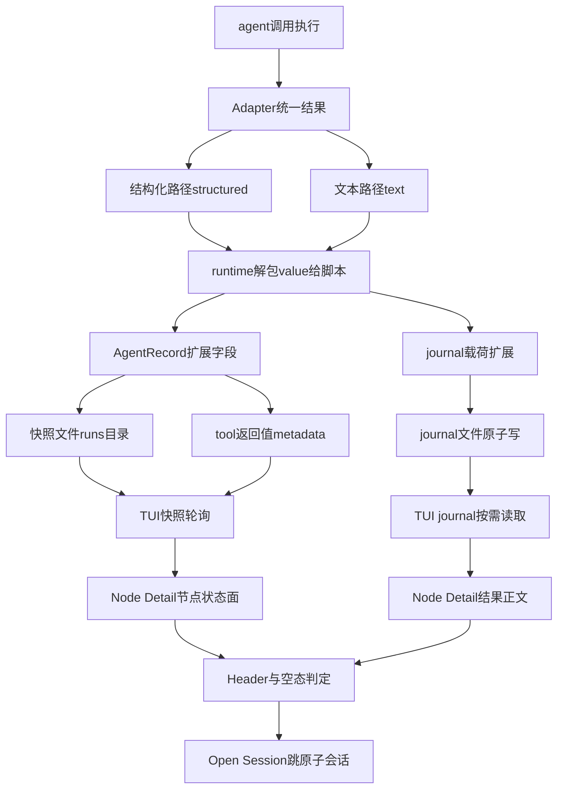

# TUI 节点详情与结果展示设计（Workflow Node Inspector）

> 需求来源：`Docs/01_需求与规划/TUI节点详情与结果展示需求.md`（第一版 = FR-1~FR-6 全部 + FR-7 数据结构）
> 本文记录实现落地后的契约面与通道设计，供后续维护对照。

## 一、一句话架构

**节点状态走快照通道（runs），result 内容走 journal 通道（journal），Node Detail 视图把两者拼成一张「节点详情页」。**

类比理解：快照像是工地门口的进度看板（谁在干、干完没有、花了多久），journal 像是每道工序完工后归档的验收单（干出了什么、成品长什么样）。详情页 = 看板上点一个工位，把它的验收单调出来看；验收单永久归档（journal 不清理），看板会被新项目翻页（快照有生命周期）。

## 二、数据通道全景



三通道分工不变，只是各自变厚：

| 通道 | 内容 | 生命周期 | Node Detail 中的角色 |
|---|---|---|---|
| B 快照（runs/`<runId>`.json） | AgentRecord 全字段（新增 outputPreview 等） | 新 run 启动时清同会话终态快照 | 节点状态、Header 元数据、自动刷新驱动 |
| C tool 返回值 metadata | 同 AgentRecord | 随 tool 返回永久 | 快照不可见时的兜底 |
| journal（journal/`<runId>`.json） | result 全量 + 展示元数据 + executions 历史 | 永不清理 | Result 正文（唯一内容源） |

## 三、关键契约

### 3.1 标识符体系（FR-1）

```
runId        run-mtuwapx9          一次 workflow 运行（时间戳 base36）
nodeId       run-mtuwapx9:3        图上逻辑节点 = AgentRecord.id = journal 主 key
executionId  run-mtuwapx9:3:2      一次真实执行（retry 的第 2 次尝试）
sessionId    ses_xxx               OpenCode 子会话（服务端生成）
```

label 只作展示，禁止参与任何索引（parallel 同 label 是常态）。

### 3.2 AgentExecutionResult（FR-2，Adapter 与 runtime 的注入缝）

```ts
type AgentExecutionResult =
  | { type: "text"; value: string; sessionId: string }
  | { type: "structured"; value: unknown; sessionId: string }
```

- Adapter 的 run() 四个出口统一包装（schema 原生 / schema 缓存降级 / schema 400 降级 / 纯文本）
- 对 workflow 脚本的 agent() 仍直接返回 value，公开 API 零变化
- 这是内部注入缝的 breaking change：fake runner 需用 tests/helpers.ts 的 textResult/structuredResult 包装

### 3.3 AgentRecord 扩展（FR-3，三通道共用的序列化契约）

新增可选字段：`executionId` / `attempt` / `outputType` / `outputPreview`（2KB 截断已脱敏）/ `inputTokens` / `outputTokens`。

全部可选，老快照与老 metadata 无这些字段时读端解析为 undefined，不崩。快照 version 保持 1（纯增量）。

### 3.4 JournalEntry 扩展与两条不变量

新增可选字段：`label` / `phase` / `agentType` / `prompt`（4KB 截断）/ `sessionId` / `outputType` / `executionId` / `attempt` / `startedAt` / `durationMs` / `usage` / `executions[]`（cap 10）。

**不变量 1（resume 主键安全）**：journal 主 key 恒为 `runId:callIndex`；executionId 只是 entry 内的附加维度，绝不下沉为主键。

**不变量 2（回放正确性）**：`hash`/`result` 只在 agent 成功时写入；失败 attempt 只进 `executions[]`（经 `recordExecution`，同 executionId 去重、绝不写 hash）。仅含 executions 无 hash 的 entry 在 resume 时必然 miss 重跑——有专门单测锁死。

journal 原值永不脱敏（resume 要把原值喂给脚本），脱敏只发生在展示面（快照 preview 与 TUI 渲染副本）。

### 3.5 journal 原子写

append/recordExecution 均走 tmp+rename（Windows 下 rename 覆盖失败先 unlink 再重试，范式同 run-snapshot.ts）。IO 失败静默降级不阻断运行；非法 runId 属调用方 bug 直接抛错（不与 IO 降级混为一谈）。

## 四、TUI 侧结构

```
src/tui/
  plugin.tsx              唯一 solid 文件；新增 NODE_DETAIL_ROUTE + NodeDetailView
  workflow-store.ts       WorkflowNode 扩展 + findSelectedRunNode
  run-snapshot-reader.ts  parseRunSnapshot 提取新字段
  journal-reader.ts       新增：journal 只读端（宽松解析，跨进程契约）
  result-view.ts          新增：ResultView 抽象（四态判定 / pretty-print / 20KB 截断 / 脱敏）
```

硬约束：新文件必须登记 `src/tui/index.tsx` 的 IMPLEMENTATION_FILES（npm 安装方式下 vendor 复制清单，
漏登记静默失败）；有守卫单测 tests/tui-vendor-files.test.ts。

### Node Detail 视图（FR-4）

- 路由：`opencode-dynamic-workflows.node`，params `{ sessionID, runId, nodeId, returnRoute }`
- 进入口：sidebar 节点点击（无条件，running 也可进）与 /workflow 列表 Enter
- 键位：`Enter`/`o` Open Session（sessionId 取自节点）；`Esc`/`q` 返回 returnRoute
- 数据：节点状态复用 getOrCreateProgress 共享信号（1s 轮询 + viewKey 差分，完成后自动刷新）；
  journal 为组件私有 signal（挂载即读 + 1s 轮询 lastRaw diff 守卫 + 节点 status 翻转 effect 立即重读）
- 快照被清理时（新 run 启动）：Header 由 journal entry 元数据合成最小节点（历史 result 仍可看）
- 空态三分：failed 显示 `Error: ...`；running 显示 `No result yet`；终态无 result（含 schema 合法 null）显示
  `No result returned`；journal 不可用但有快照预览时显示预览并标注来源

### ResultView（FR-5）

- text 原样 / structured JSON pretty-print（渲染前脱敏）/ 序列化失败退化 String()
- 超 20KB 截断并提示 `Result truncated, original size: xx KB`；UTF-8 码点边界安全
- 脱敏正则（双侧同语义副本：src/runtime/agent-result.ts 与 src/tui/result-view.ts，跨进程禁 import 需人工同步）：
  `api[_-]?key|secret|token|password|authorization|credential`（大小写不敏感，深度 4，数组 cap 50）

## 五、测试资产

| 层 | 文件 | 覆盖 |
|---|---|---|
| 单元（140 用例） | tests/agent-result.test.ts | 截断边界 / 脱敏 / 预览 |
| | tests/result-view.test.ts | 四态 / pretty-print / 20KB / 脱敏渲染 |
| | tests/journal-reader.test.ts | server 写 TUI 读 roundtrip（跨进程契约）/ 宽松解析 |
| | tests/node-execution-e2e.test.ts | 同 label 唯一性 / 乱序保序 / tool 全链路 journal 落盘 |
| | tests/tui-vendor-files.test.ts | IMPLEMENTATION_FILES 登记守卫 |
| | workflow-runtime / workflow-journal / workflow-store / run-snapshot-reader 追加 | executionId / 载荷 / recordExecution / resume 安全 / 新字段提取 |
| 手工（T01~T12） | examples/sample-project/NodeDetail测试指南.md + scripts/node-detail-*.js x7 | 真机交互与数据一致性 |

发版门：`npm test` 全绿 + typecheck 三份 tsconfig 通过 + T01~T12 全 PASS；T01 永久保留为回归用例。

## 六、明确不做（第一版边界）

1. [Copy Result]（宿主未暴露剪贴板插件 API，不发明 API）
2. FR-8 错误分类 UI（原样显示 record.error）
3. retry 多 execution 翻页 UI（仅 Header 显示第 N 次执行；完整历史在 journal.executions）
4. ResultView 增强（数组表格化、文件列表、Markdown 渲染）
5. journal 演进 JSONL（tmp+rename 已满足原子性）
6. Node Detail 键盘滚动正文（仅滚轮，不发明 scrollbox 键盘 API）
7. workflow 脚本可见 API / resume 语义 / 快照 version：全部不动

## 七、引用说明

- 需求文档：`Docs/01_需求与规划/TUI节点详情与结果展示需求.md`（FR-1~FR-8、T01~T12、Release Gate）
- 问题定案：`Docs/05_问题与注意事项/多模型编排agent详情内容为空问题-注意事项.md`（schema 正文空白的 2x2 与 6-agent 实验数据）
- 实现计划（审批版）：`C:\Users\zhangqi95\.claude\plans\foamy-bubbling-dragonfly.md`（分步实施、两条不变量、破坏面清单）
- 验收指南：`examples/sample-project/NodeDetail测试指南.md`（T01~T12 逐用例判定表与报告格式）
- 相关代码：`src/types/index.ts`（契约单源）、`src/runtime/workflow-runtime.ts`（executionId 与载荷）、
  `src/persistence/journal.ts`（原子写与 recordExecution）、`src/tui/plugin.tsx`（NodeDetailView）、
  `src/tui/journal-reader.ts` / `src/tui/result-view.ts`（TUI 读取端）
