# TUI 节点详情方向键导航可行性分析

> 需求原话：现在 tui 进入到子 agent tui 中，是按 esc 退出，能不能改成按 up 按键返回，
> 然后 left 和 right 按钮，通过左右方向按钮可以直接切换到上一个子 agent 和下一个子 agent。
>
> 状态（2026-09）：已实施。up 返回、left/right 沿 j/k 同一序列循环切换；实测发现并修复一个隐藏坑：
> OpenCode 插件路由同路由换参是响应式更新 props 而非重挂（tui/src/app.tsx 的 render({ params: route.data.data })），
> 因此同 run 内切节点时 journal 的 lastRaw diff 守卫会拦住重读——新增 runId/nodeId 变化时重置守卫重读的 effect。
> 手工验收（2026-09）：通过。验收脚本 examples/sample-project/scripts/node-detail-nav-test.js
> （6 个自标识节点，覆盖文本与 schema 双通道、循环回绕、up 返回）。

## 1. 结论先行

**可行，且改动面很小（预计 20-30 行，集中在 plugin.tsx 单文件）。**
唯一不可行的区域：Open Session 之后进入的 OpenCode 原生子会话视图——那是核心 keymap，
插件层无法覆盖其方向键与 Esc。本方案的所有改动只作用于插件自己的节点详情视图。

## 2. 现状梳理（三层键位归属）

| 层 | 视图 | 键位归属 | 现有绑定 |
|---|---|---|---|
| 主列表 | /workflow 路由（插件自有） | 插件 keymap 层 | up,k / down,j 选择，Enter 进详情，Esc,q 返回 |
| 节点详情 | NODE_DETAIL_ROUTE（插件自有） | 插件 keymap 层 | Enter,o 开子会话，Esc,q 返回；正文滚动靠滚轮，方向键空闲 |
| 原生子会话 | OpenCode session 视图 | OpenCode 核心 | 方向键=光标/滚动，Esc=返回；插件不可改 |

关键事实：详情视图是插件注册的自有路由（src/tui/plugin.tsx:42 NODE_DETAIL_ROUTE），
其键位经 focus 作用域 registerLayer 注册（plugin.tsx:589 附近），up / left / right 均未被占用。

```mermaid
flowchart TD
    A[workflow 列表 j k 选择] -- Enter --> B[节点详情视图]
    B -- up 或 Esc 返回 --> A
    B -- left --> C[上一个 agent 详情]
    B -- right --> D[下一个 agent 详情]
    C -. 同路由换参重挂 .-> B
    D -. 同路由换参重挂 .-> B
    B -- Enter 或 o --> E[原生子会话视图]
    E -- 键位属核心 插件不可改 --> F[方向键与 Esc 保持 OpenCode 原生行为]
```

## 3. 方案设计

### 3.1 up 返回

详情层键位数组加一条：`{ key: "up", cmd: "workflow.node.back" }`。
Esc/q 原绑定保留（肌肉记忆兼容，不破坏旧习惯）。

### 3.2 left / right 切换相邻 agent

数据与导航函数全部现成，零新增依赖：

- 节点序列：`buildMultiRunRows(progresses())` + `selectableNodeKeys(rows)`
  （主视图 j/k 用的同一份，含跨 run 顺序与回绕语义）
- 定位当前：`selectionKey(runId, nodeId)`（详情视图 props 自带 runId 与 nodeId）
- 移动：`moveSelection(keys, current, -1 / +1)`（已实现循环回绕）
- 落位：`api.route.navigate(NODE_DETAIL_ROUTE, { sessionID, runId, nodeId, returnRoute })`
  ——同一路由换参数，render 吃新 params 重挂组件，journal 内容按新 nodeId 重读

### 3.3 附带同步

- 详情页 footer 提示行（plugin.tsx:694）加 left/right/up 说明
- 头注释键位说明（plugin.tsx:456）同步更新

## 4. 风险与验证点

| 风险 | 说明 | 验证或对策 |
|---|---|---|
| 同路由换参是否重挂 | OpenCode 路由对相同路由名不同 params 的导航行为需实测 | 若被去重不重挂，备选：详情视图内部用 signal 管当前节点 key，路由 params 只作初始值 |
| 滚动位置丢失 | 换节点即重挂，正文回到顶部 | 可接受（换看的就是另一个 agent） |
| 轮询与 journal 重读 | 重挂后 getOrCreateProgress 复用与 onDispose 清理 | 现有机制已处理，回归多树同显用例即可 |
| 键位占用先例 | 未来若想用 left/right 做横向滚动会冲突 | 先占先得，本文档记录在案 |

## 5. 类比理解

详情视图像一本相册：Esc 是合上相册放回书架，up 也合上（顺手往上一推）；
left/right 是翻上一页下一页——页（agent）的顺序就是书架上 j/k 走过的那条序列。
而 Open Session 相当于把照片原件抽出来放到博物馆展柜（OpenCode 原生界面），
展柜的灯光开关（键位）归博物馆管，我们只能在自己家里定翻页规则。

## 6. 引用说明

- src/tui/plugin.tsx:42（NODE_DETAIL_ROUTE 路由名）、302（主视图键位注释）、353-364（主视图键位层）、
  456（详情键位注释）、589-596（详情键位层）、694（footer 提示行）、735-750（路由注册）
- src/tui/workflow-store.ts:190-197（selectionKey / selectableNodeKeys / moveSelection）
- 需求文档惯例：Docs/01_需求与规划/（实现时如立项可另存需求文档）
