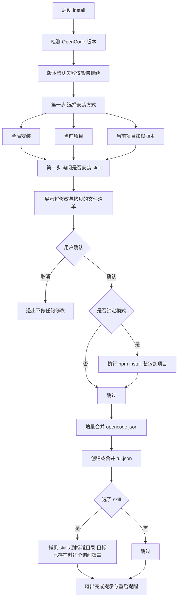
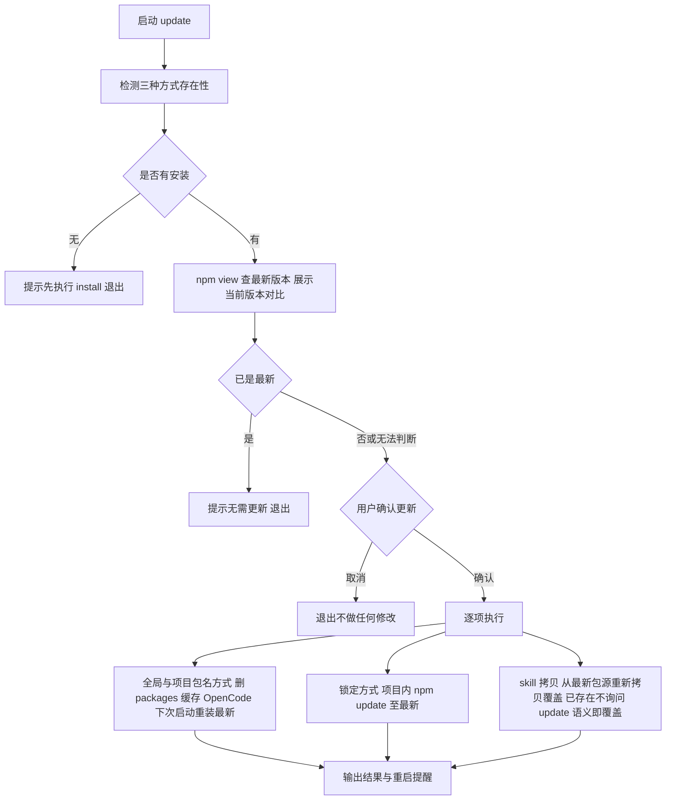
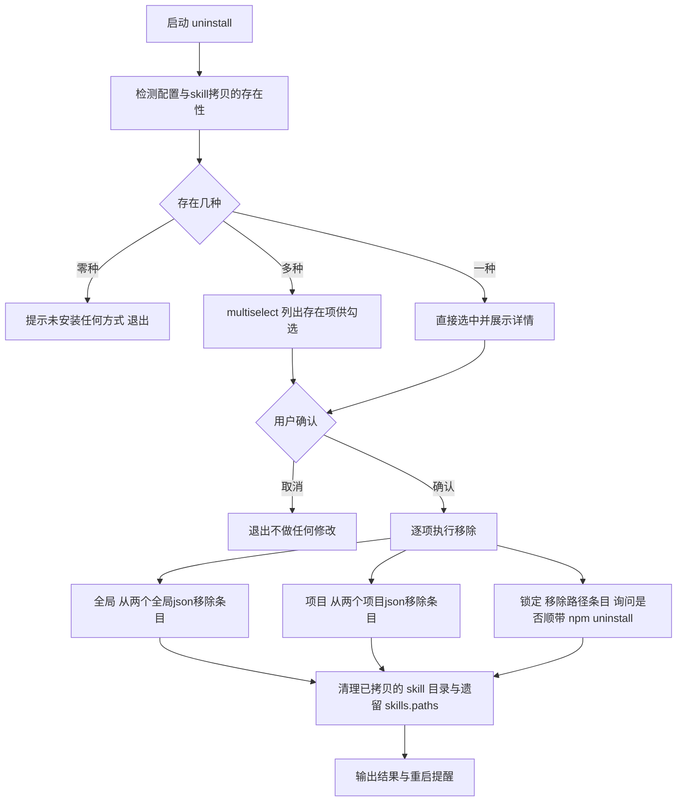

# npx CLI 交互式安装器 实施方案

> 依据《npx cli安装方式需求.md》制定。用户要求：交互式询问优先，uninstall 必须支持"先检测三种安装方式是否存在，再列出可卸载项，询问用户卸载哪个"。
> 本文档为执行蓝图，确认后才动代码。

## 1. 交付形态

用户只需要记一条命令（npm bin 机制：包内唯一 bin，npx 包名即执行 CLI）：

```powershell
npx @mickorz/opencode-dynamic-workflows install     # 交互式安装（默认命令，首次自动拉最新）
npx @mickorz/opencode-dynamic-workflows update      # 插件本体与 skill 升级到最新
npx @mickorz/opencode-dynamic-workflows uninstall   # 交互式卸载
npx @mickorz/opencode-dynamic-workflows doctor      # 环境排查
npx @mickorz/opencode-dynamic-workflows             # 无参数时等同 install
```

> npx 无版本号时首次拉取 latest，之后命中 npx 缓存可能复用旧版 CLI；由于插件运行体由 OpenCode 按包名自行拉取（始终 latest），CLI 旧版影响仅限排查能力。update 指令负责把已安装的插件本体与 skill 刷到最新（它自身跑在旧缓存上也无碍，做的事不依赖新逻辑）；CLI 自身升级仍靠 `@latest` 强刷，install/update/doctor 均内置版本自检提示。

## 2. 三种安装模式定义（install 与 uninstall 共用）

| 模式 | 交互 label | 写哪些文件 | plugin 条目值 | skill 安装（第二步询问后执行） |
|------|-----------|-----------|--------------|------------------------------|
| global | 全局安装，所有 OpenCode 项目生效 | `~/.config/opencode/opencode.json` + `~/.config/opencode/tui.json` | 包名 `@mickorz/opencode-dynamic-workflows` | 拷贝到 `~/.config/opencode/skills/<skill名>/`（OpenCode 原生扫描，无需 skills.paths） |
| project | 当前项目，仅本项目生效 | `<cwd>/opencode.json` + `<cwd>/tui.json` | 包名 | 拷贝到 `<cwd>/.agents/skills/<skill名>/`（同上） |
| locked | 当前项目加锁版本，适合团队协作 | 先 `npm install` 装入项目，再写 `<cwd>` 两 json | `./node_modules/@mickorz/opencode-dynamic-workflows` | 同 project（源改为项目 node_modules 内的包） |

**skill 拷贝实现（参考 vercel-labs/skills 库，提取其 OpenCode 分支简化）**：

- 拷贝源：CLI 自身包内 `skills/`（npx 运行时即包本体，安装即用，不依赖 OpenCode 缓存是否已装；实施时对原方案的简化：首次 install 时全局缓存尚未拉包，原方案源不存在，CLI 自身源始终可用且版本即当前发布版）
- 拷贝目标（与 vercel-labs/skills 的 OpenCode 定义一致，agents.ts:550-557）：
  - global → `~/.config/opencode/skills/<skill名>/`
  - project / locked → `<cwd>/.agents/skills/<skill名>/`
- 方式：整目录递归 copy，**不用 symlink**（Windows 无特权建不了；vercel-labs 库 symlink 失败也是 fallback copy，我们直接 copy 免平台分支）
- 目标已存在同名 skill 时 `p.confirm` 询问覆盖或跳过
- **免配置原理**：OpenCode 原生扫描 `~/.config/opencode/skills/**/SKILL.md`（OPENCODE_SKILL_PATTERN）与 `.agents/skills/**/SKILL.md`（EXTERNAL_SKILL_PATTERN，向上遍历至 worktree），拷贝即生效，**不再写 skills.paths**（原 paths 方案废弃，依赖全局缓存路径易断链）

**存在性判定规则**（uninstall 检测与 doctor 共用，避免两套逻辑）：

- `global 存在` = 全局 opencode.json 或 tui.json 的 `plugin` 数组中存在匹配条目
- `project 存在` = cwd opencode.json 或 tui.json 的 `plugin` 数组中存在匹配条目
- `locked 存在` = project 存在且条目为 node_modules 路径形式；或 `<cwd>/node_modules/@mickorz/opencode-dynamic-workflows` 目录存在

**条目匹配规则**（plugin 数组里哪种算"我们的插件"）：

1. 等于 `@mickorz/opencode-dynamic-workflows`（包名形式）
2. 等于 `./node_modules/@mickorz/opencode-dynamic-workflows`（相对路径形式）
3. 以 `node_modules/@mickorz/opencode-dynamic-workflows` 结尾的任意路径（容错）

**skill 存在性判定**（供 uninstall 列表与 doctor 共用）：

- global skill 存在 = `~/.config/opencode/skills/workflow-authoring/` 或 `workflow-optimize/` 目录存在
- project skill 存在 = `<cwd>/.agents/skills/workflow-authoring/` 或 `workflow-optimize/` 目录存在
- 另检测遗留的 skills.paths 配置（`~` 前缀缓存路径或 node_modules 相对路径），uninstall 时一并清理

## 3. install 交互流程



交互文案要点（@clack/prompts）：

- `p.select` 安装方式三选一，带 hint 说明
- `p.confirm` 是否安装 skill / 是否确认修改
- `p.note` 展示将修改的文件绝对路径清单
- locked 模式的 `npm install` 用 `spawn("npm", ["install", PKG], { shell: true, stdio: "inherit" })`（Windows 下 npm 是 cmd shim 必须 shell）

## 3.1 update 交互流程（插件本体与 skill 升级）



要点：

- 与 install 的 skill 交互差异：update 覆盖已存在的 skill 目录**不再逐个询问**（update 语义就是刷到最新），但会列出覆盖了哪些
- 全局缓存删除动作：仅删 `packages/@mickorz/`，不动其他插件缓存
- 边界说明：update 自身若跑在 npx 旧缓存上，执行的仍是旧版逻辑，但上述动作（删缓存、npm update、拷 skill）不依赖新逻辑，效果等价；CLI 自身升级仍靠 `@latest`

## 4. uninstall 交互流程（核心需求）



细节：

- 检测阶段同时收集**证据**（哪个文件的 plugin 数组命中的、skills 路径是否配置、node_modules 是否装包），multiselect 的 option hint 里展示，例如：`全局安装（命中 ~/.config/opencode/opencode.json + tui.json）`
- 移除条目只删匹配规则命中的元素，其他插件条目（如 `@langfuse/...`）原样保留
- skills.paths 移除后若数组为空，保留空数组不删 `skills` 对象（最小侵入，避免误伤用户结构）
- locked 卸载时的 `npm uninstall` 默认 No（配置移除即可恢复原状，依赖是否删由用户决定）
- **skill 清理**：勾选任一方式后一并清理对应 skill 拷贝目录（global → `~/.config/opencode/skills/{workflow-authoring,workflow-optimize}`；project/locked → `<cwd>/.agents/skills/{...}`），并清理配置中遗留的 skills.paths 条目（兼容今天手工配置过的写法）；skill 目录删除前 `p.confirm` 逐个确认（目录内可能有用户改动）
- 卸载不删 `~/.cache/opencode/packages/` 全局缓存（跨项目共享，doctor 提示可手动清）

## 5. doctor 检查清单

按序输出 `[OK] / [WARN] / [FAIL]` 行（纯文本，不用 emoji），最后给汇总：

| 序 | 检查项 | 判定 |
|----|--------|------|
| 1 | Node 与 npm 版本 | 输出版本号，不判定 |
| 2 | OpenCode 版本（`opencode --version`） | 命令不存在 WARN；major 非 1 WARN |
| 3 | npm 最新版本（`npm view <pkg> version`） | 网络失败 WARN；同时与 CLI 自身版本比对，缓存为旧版时提示建议 `@latest` 重跑 |
| 4 | 全局 opencode.json plugin 是否含插件 | 含则 OK |
| 5 | 全局 tui.json plugin 是否含插件 | 含则 OK |
| 6 | 当前项目两 json 配置状态 | 无配置输出"未在项目级安装"（中性） |
| 7 | 全局缓存 packages 安装与版本 | 读包 package.json 的 version |
| 8 | Temp vendor 目录（`vendor-0.1.*`） | src 三实现文件 + node_modules junction 齐全才 OK |
| 9 | skill 拷贝目录 | `~/.config/opencode/skills/` 与 `<cwd>/.agents/skills/` 下两个 skill 是否齐全；不齐全 WARN |
| 10 | 遗留 skills.paths 配置 | 存在则提示已废弃建议 uninstall 清理 |

doctor 只读不写，任何一项 FAIL 不阻塞后续检查。

## 6. 文件结构与变更清单

新增（5 个文件，全部 UTF-8，注释与日志中文，禁止 emoji）：

```text
src/cli/
├── index.ts       入口 命令分发 install默认 update uninstall doctor help
├── config.ts      JSONC读写 merge 移除 检测函数 路径与包名常量
├── install.ts     交互式安装流程
├── update.ts      插件本体与 skill 升级流程（复用 config 检测）
├── uninstall.ts   交互式卸载流程（存在性检测 multiselect）
└── doctor.ts      排查清单
tests/
└── cli-config.test.ts   config.ts 的 merge 移除 注释保留 用例
```

修改：

| 文件 | 变更 |
|------|------|
| `package.json` | 1. `bin: { "opencode-dynamic-workflows": "./dist/cli/index.js" }`；2. dependencies 新增 `@clack/prompts`、`jsonc-parser`（已执行安装，需确认版本落盘）；3. files 已含 dist 无需改 |
| `README.md` | 安装章节顶部加"一条命令"入口，三种手动方式降级为"手动配置参考" |
| `tsconfig.json` | 无需改（include src 已覆盖，exclude 仅 src/tui） |

index.ts 头部按项目规范加 ASCII 流程图注释（命令分发结构）。

## 7. JSONC 读写与增量合并规则（config.ts 核心）

类比：配置文件像一本**别人写好批注的书**，我们不能重印一本（JSON.parse 后 stringify 会烧掉所有批注），而是用**铅笔在原书上做最小修订**。jsonc-parser 的 `parse` + `modify` + `applyEdits` 就是这套铅笔工具，只动目标行，注释与格式尽量保留。

规则：

1. 读文件文本；文件不存在视为空配置（写回时创建，带 `$schema` 行）
2. `parse(text)` 取值；`modify(text, ["plugin", index], value, { formattingOptions: { tabSize: 2, insertSpaces: true } })` 逐项编辑后 `applyEdits` 写回
3. **install merge**：plugin 数组不存在则创建；匹配规则命中的条目已存在则跳过（不重复添加）
4. **uninstall remove**：仅过滤匹配条目；同时清理遗留 skills.paths 条目
5. 每次写回前原文本备份为 `<file>.bak`（同目录，卸载/合并出错可手工恢复）
6. skills.paths 的 merge 逻辑不再需要（skill 改为拷贝到标准目录），仅保留 remove 兼容清理

## 8. 关键技术决策与风险

| 决策/风险 | 处理 |
|----------|------|
| 全局配置目录定位 | 优先 `~/.config/opencode/`（本机实测生效，含 memory/全局插件）；不存在时回退 `%APPDATA%/opencode`；两者都无则创建 `~/.config/opencode` |
| OpenCode skill 标准目录 | 拷贝到 `~/.config/opencode/skills/` 与 `.agents/skills/`，OpenCode 原生扫描（skill/index.ts:22-24 常量已核实），无需 skills.paths；参考 vercel-labs/skills agents.ts:550-557 的 OpenCode 定义 |
| skill 拷贝用 copy 不用 symlink | Windows 无特权建不了 symlink；vercel-labs 库 symlink 失败也 fallback copy，直接 copy 免平台分支；代价是升级插件后 skill 文件不会自动更新，install 重跑覆盖（已存在时询问） |
| OpenCode 版本检测 | `opencode --version` spawn 失败（如仅装桌面版）不阻塞，输出 WARN；major 非 1 输出 WARN 并要求 confirm 后才继续改配置 |
| Windows spawn npm | 必须 `shell: true`（npm 是 npm.cmd） |
| JSONC 格式化副作用 | applyEdits 会规范化目标行附近缩进，注释保留但空行分布可能微调，.bak 兜底 |
| npx 运行目录 | `process.cwd()` 即用户项目根，project/locked 模式以它为基准；检测 cwd 无 package.json 时 project/locked 模式给出 WARN |
| 包体积 | dist/cli 约 30 至 50KB，进 npm 包可接受 |

## 9. 测试计划（node:test + tsx，与现有 94 用例同框架）

tests/cli-config.test.ts 覆盖 config.ts 纯逻辑（临时目录注入，不碰真实配置）：

1. 空 JSONC 创建 plugin 数组并写入包名
2. 已有其他插件条目时增量追加不覆盖
3. 重复安装不产生重复条目（幂等）
4. JSONC 注释在 merge 后保留
5. uninstall 移除仅删匹配条目，其他条目保留
6. tui.json 不存在时创建、存在时合并
7. 三种条目匹配规则（包名 / 相对路径 / 结尾容错）
8. skills.paths 遗留条目的清理
9. skill 拷贝（copyDirectory）到临时目录验证目录树完整

交互流程（install/uninstall/doctor）不做自动化测试，验收走真实目录手工清单。

## 10. 版本与交付

- 版本：`0.2.0`（新功能，不 patch）
- 发布：`npm publish --access public`（用户执行，2FA）
- README 更新后随 0.2.0 一起上 npm

## 11. 明确不做（与需求文档的差异已确认）

- OpenCode v2 分支（AGENTS.md 铁律 v1 only，版本不符仅 WARN）
- `init` 别名（install 即初始化）
- 非交互 CI flags（后续有需求再加，本次交互优先）

注：update 已从砍除清单移入正式交付（用户确认新增，见 3.1 节）。

## 12. 引用

- npm bin 与 npx 机制：https://docs.npmjs.com/files/package.json#bin
- @clack/prompts 交互组件：https://github.com/bombshell-dev/clack
- jsonc-parser（VSCode 同款 JSONC 增量编辑）：https://www.npmjs.com/package/jsonc-parser
- OpenCode 插件配置文档：https://opencode.ai/docs/plugins/
- 本仓库 thirdparties/opencode/packages/opencode/src/skill/index.ts:22-24（SKILL_PATTERN 常量：`.agents/skills` 与 `{skill,skills}` 原生扫描）
- vercel-labs/skills（thirdparties/skills/）src/agents.ts:550-557（OpenCode 的 skillsDir 定义）与 src/installer.ts（copy 实现）
- 本仓库 Docs/npm插件分发TUI加载失败问题-注意事项.md（doctor 检查项来源）
