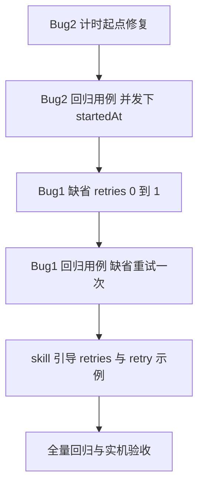

# 两个 Bug 分析与修复可行性报告

> 来源：Docs/2个bug.txt（用户实测反馈）
> 结论先行：**Bug 2 是实锤的代码缺陷，修复方案明确、低风险（1 小时级）；Bug 1 机制存在但默认值与引导缺位，属于设计取舍问题，建议最小行为变更 + skill 引导（2 小时级）**

---

## Bug 1：phase 阶段内 agent 失败不重试，直接进入下一阶段

### 现象还原

用户描述：agent 执行失败后没有重试，流程继续走下一阶段。

### 代码路径分析（workflow-runtime.ts agentImpl）

```text
agent 可恢复失败（网络/超时/限流）
    ↓
retries 生效判定：normalizeAgentRetries(scriptOptions.retries ?? shared.agentRetries ?? 0)
    ↓
attempt >= maxAttempts（retries=0 时 maxAttempts=1，即一次失败即终）
    ↓
record.status = failed，log 一行，return null
    ↓
parallel/脚本层拿到 null 继续执行 —— 用户看到的「直接下一阶段」
```

### 事实核查

| 用户感知 | 实际情况 |
|---------|---------|
| 「没有地方设置重试」 | **有但默认 0**：工具入参 `agentRetries`（schema 已暴露）、单 agent 选项 `retries`（上限 3）均存在；缺省 `?? 0` 使大多数用户从未触发 |
| 「不会重试」 | 默认 retries=0 时确实一次失败即返回 null；**可恢复失败才会重试**，非可恢复（校验错/超限）本来就立即终止 run |
| 「继续执行下一阶段」 | 设计语义：可恢复失败返回 null 与 Pi 一致；但默认 0 + Main Agent 生成的脚本不带 retries，放大了「静默吞掉」体感 |

**定性：非纯 bug，是默认值策略 + 引导缺位的组合问题。**

### 修复方案对比

| 方案 | 改动 | 效果 | 风险 |
|------|------|------|------|
| A. 缺省 retries 0 -> 1 | workflow-runtime 一行（`?? 0` 改 `?? 1`） | 可恢复失败自动多试一次，符合直觉 | 真失败任务多烧一轮 token；与文档「缺省 0」表述需同步 |
| B. skill 引导关键 agent 带 retries | skill 文档一句话 | 生成脚本质量提升，零运行时风险 | 依赖 LLM 遵循，非强制 |
| C. phase 级重试原语 | 已有 `retry(fn, {attempts, until})` 可包住任何节点/整段 | 现成能力，无需开发 | 用户不知道存在（文档引导问题） |

**推荐：A + B 同时做**（A 改善缺省体感，B 补长期引导；C 在 skill 里点名示例）。回归点：现有测试「超时重试耗尽返回 null」断言依赖显式 retries，不受默认值影响；需新增「缺省可恢复失败重试一次后成功」用例。

### 补充需求（2026-09-24 用户追加）：阶段失败闸门

> 重试后仍失败 → **当前阶段执行完成后，不进入下一阶段，终止 workflow 并把失败报告返回给主 agent**

这是行为变更（原语义：失败返回 null 静默继续），设计如下：

```text
agent 重试耗尽
    ↓
置 shared.phaseFailed = true（记录失败明细：label / phase / error）
    ↓
同 phase 其余 agent 与运行中的并行槽位照常完成（阶段收尾）
    ↓
下一个 phase() 调用 → 闸门触发，抛 WORKFLOW_FAILED（附失败清单）→ 脚本终止
    ↓
workflow 工具以错误形式把失败报告返回主 agent（含 resumeFromRunId 提示）
```

**边界规则**：

| 场景 | 行为 | 理由 |
|------|------|------|
| 失败发生在最后一个 phase，脚本正常 return | runWorkflow 终检发现 phaseFailed → 同样抛 WORKFLOW_FAILED 报告 | 最后阶段失败不能静默成功 |
| fallback() 候选失败但另一候选成功 | **清除 phaseFailed**（降级成功 = 失败已被吸收） | 否则 fallback 语义报废 |
| race() 有败者但有 winner | 同上清除 | 败者被吸收 |
| 脚本内 try/catch 自行消化失败 | v1 无法感知，run 仍会终止（文档写明） | runtime 不可见 |
| 兼容逃生口 | 工具入参 `continueOnAgentFailure: true` 恢复旧静默语义 | 旧行为脚本迁移缓冲 |

**影响面**：workflow-runtime（agentImpl 置位 / phase 闸门 / runWorkflow 终检 / fallback+race 清除）、errors 新码、workflow.ts 新工具参数、skill 双语文档、测试 6 个新用例。约 3 小时 + 实机验收。

**风险**：默认行为变更，依赖 null 容错的旧脚本会开始显式失败——正是需求要的暴露语义，且有逃生口；实机验收重点跑 fallback/parallel/组合流回归。

---

## Bug 2：并发限制下未开始的 agent 一直在计时

### 现象还原

用户描述：agent 还没开始执行（排队中），TUI 上却一直在累计耗时。

### 代码路径分析（实锤缺陷）

```text
agentImpl(...)
    ├─ 创建 record { status: "running" }          <- 此时尚合理（需要 TUI 可见）
    ├─ record.startedAt = Date.now()               <- 第 460 行：排队前就打时间戳 [缺陷点]
    └─ shared.scheduler.run(async () => { ... })   <- 并发满时在这里排队等待
           └─ 真正执行...
```

TUI 侧 `nodeLine()`：`status==="running" && startedAt!==undefined` 即显示 `Date.now() - startedAt` 递增计时。

**后果链**：
1. 排队中的 agent 显示不断增长的计时（用户看到 8 个「没开始」的 agent 全在计时）
2. 完成后 `durationMs = now - agentStarted` 含排队等待，**执行耗时虚高**
3. `phaseElapsedMs` 用组内最早 startedAt，phase 耗时同样虚高

### 修复方案（明确、低风险）

把 `record.startedAt` 的赋值从排队前移到 `scheduler.run` 回调内部首行（拿到并发槽位后）：

```text
scheduler.run(async () => {
    const dispatchedAt = Date.now()
    record.startedAt = dispatchedAt      // 计时从真正 dispatch 开始
    shared.onAgentUpdate?.(record)       // 通知 TUI 计时启动
    ...原有 attempt 循环，durationMs 一律改为 now - dispatchedAt
})
```

**兼容性核查**：
- TUI `nodeLine` 已有 `startedAt !== undefined` 条件——running 且无 startedAt 的排队节点**自然不显示计时**（无需改 TUI）
- `phaseElapsedMs` 同样跳过无 startedAt 节点——phase 耗时自动变准
- journal 回放路径本就不设 startedAt，不受影响
- 快照/metadata 透传 startedAt 原样，旧快照兼容（缺省容忍已具备）

**回归点**：现有测试不断言排队期 startedAt；需新增「并发 1 下两个 agent，第二个 startedAt 在第一个结束后」的用例钉死。

### 顺带改进（可选，不强制）

排队态目前显示为 running（与真执行不区分）。彻底方案是引入 `status: "queued"`（TUI 显示「排队中」无计时）——涉及 AgentRecord 类型、TUI 三处过滤、快照兼容，改动面 5+ 文件。建议本期只修计时起点（最小修复），queued 状态作为后续观测增强。

---

## 修复工作量与顺序



| 项 | 工作量 | 风险 |
|----|--------|------|
| Bug2 修复 | ~30 分钟（含 2 处 durationMs 口径与 onAgentUpdate） | 低 |
| Bug1 修复 | ~15 分钟（一行 + 文档同步） | 低（token 消耗略增） |
| 测试 | ~30 分钟 | — |
| 合计 | 半天内完成并实机验收 | — |

## 类比理解

Bug 2 像餐厅叫号屏：客人（agent）取号时（创建 record）就把进店时间记上了，但店里满座（并发上限）只能在外排队——屏幕上「用餐时长」一直在走，其实人还没上桌。修复就是「上桌那一刻才开始计时」。

Bug 1 像外卖平台的自动重拨：骑手接单失败（可恢复失败）平台默认不重拨直接标记失败（retries=0），商家觉得单子被静默吞了；打开默认重拨一次（retries=1）体感立刻正常，真失败的单多等一轮也能接受。

## 引用说明

- 排队计时缺陷锚点：`src/runtime/workflow-runtime.ts` agentImpl 中 `record.startedAt` 赋值先于 `shared.scheduler.run`
- TUI 计时条件：`src/tui/workflow-store.ts` nodeLine / phaseElapsedMs 对 `startedAt` 的判空处理
- retries 机制与 Pi 对齐说明：workflow-runtime.ts 头部常量注释（MAX_AGENT_RETRIES=3 为上限而非缺省）
- 现成 retry 原语：skill `workflow-authoring/references/runtime.md` 的 retry 小节
