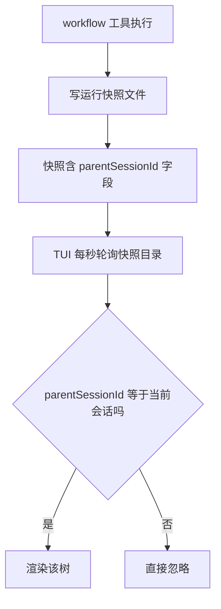

# 嵌套 workflow 的 TUI 显示可行性报告

日期：2026-09-14
背景：三层嵌套链（root -> middle -> leaf）实测通过（见 examples/sample-project/嵌套workflow测试指南.md），但 TUI 主会话视图只显示 root 树，经子代理触发的嵌套 run（middle / leaf）不显示。本报告分析根因与可行方案。

## 一、问题现象

主会话 sidebar 只能看到 root run 的 2 个节点（子workflow:middle、根汇总），middle 与 leaf 两个 run 的树完全不可见。全屏 /workflow 路由同样按当前会话过滤，结果一致。

## 二、现状显示链路（TUI实时通道优化方案 的 B 通道）

关键代码路径：

1. server 端 workflow.ts：快照以 `parentSessionId = context.sessionID` 写入（调用 workflow 工具的那个会话的 id）
2. TUI 端 run-snapshot-reader.ts 的 listSessionSnapshots：只保留 `parentSessionId === 当前视图 sessionId` 的快照
3. sidebar_content / session_prompt_right 插槽均按当前视图 session_id 挂载；metadata 兜底通道（C 通道）也只在当前会话消息里找 workflow tool part

## 三、根因

三层链中各 run 快照的归属：

| run | 快照 parentSessionId | 主会话视图能否看到 |
|-----|----------------------|-------------------|
| chain_root | 主会话 | 能（现状看到的那棵树） |
| chain_middle | general 子代理会话（子workflow:middle） | 不能 |
| chain_leaf x2 | 各自的 general 子代理会话 | 不能 |

过滤条件 `parentSessionId === 当前会话` 是为"一个会话自己的多个 run 多树同显"设计的（多树同显改造），没有考虑嵌套链：嵌套 run 的 parent 是子代理会话，不是主会话，天然被过滤掉。

补充事实：经 Node Detail 的 Open Session 进入子代理会话视图后，sidebar 会以该子会话 id 挂载，理论上能看到挂在其名下的嵌套树（机制上成立，未实测验收）。即数据都在，缺的是主会话的聚合展示。

## 四、可行性分析

数据完备性：快照文件已包含建立层级关系所需的全部信息（嵌套 run 的 parentSessionId 就是上层树中某个节点的 sessionId；AgentRecord 里也有该 sessionId）。所以"能否支持显示"的答案是：能，且不需要动 OpenCode 平台层，全部在本插件 server 侧与 TUI 侧内部解决。

### 方案对比

| 方案 | 思路 | 改动量 | 效果 | 结论 |
|------|------|--------|------|------|
| A TUI 侧递归聚合 | TUI 读当前会话快照后，拿节点 sessionId 再查嵌套快照，递归拼树 | 大（渲染、导航、多树行全要动） | 层级树 | 不推荐先做 |
| B1 server 写血统字段加 TUI 宽匹配（推荐） | 快照增加 rootSessionId（祖先主会话），TUI 匹配条件放宽为 parentSessionId 或 rootSessionId 命中 | 小（三个文件各几行） | 主会话平铺多树全可见 | 推荐首选 |
| B2 层级嵌套树 | 在 B1 数据基础上把渲染改成树中树 | 大 | 展示最直观 | 二期可选 |
| C journal 事后聚合 | 不动实时通道，/workflow 路由读 journal 目录拼层级 | 中 | 仅事后查看，无实时性 | 不满足需求 |

### 推荐方案 B1 详细设计

核心思路：server 侧维护进程内血统注册表（子代理会话 id -> 本 run 的 rootSessionId），嵌套 workflow 工具执行时查表透传 root，写进快照；TUI 侧放宽匹配。

改动点：

1. 新增进程内注册表（可放 src/tools/ 下小模块）：Map<agentSessionId, rootSessionId>
   - workflow.ts 里 runWorkflow 的 onSessionCreated 回调已有（record.sessionId 回填处），在那里把子会话 id 注册到本 run 的 rootSessionId
   - run 结束（finally）注销，防长期泄漏
2. workflow.ts 的 execute 开头：`rootSessionId = registry.get(context.sessionID) ?? context.sessionID`，随 buildRunSnapshot 传入
3. run-snapshot.ts：RunSnapshot 增加可选字段 rootSessionId；向后兼容，不 bump 版本号（TUI 宽松校验本就忽略未知字段，旧快照缺字段回退 parentSessionId）
4. cleanupRunSnapshots：清理条件从同 parentSessionId 扩为"同 rootSessionId"，保证主会话新 run 启动时连带清掉历史嵌套终态快照
5. run-snapshot-reader.ts：parseRunSnapshot 解析 rootSessionId；listSessionSnapshots 过滤条件改为 `parentSessionId === sessionId || rootSessionId === sessionId`

效果：主会话 sidebar 与 /workflow 全屏路由按 run 创建时间平铺显示全部树（root、middle、leaf x2 共 4 棵），PromptFooter 的 running 摘要也会包含嵌套运行中的树。层级关系暂不直观（平铺），但全部可见、可进 Node Detail、可 Open Session。

### 风险与边界

- 进程重启丢注册表：rootSessionId 缺省回退自身，行为退化为现状（只显示直接 run），不劣化
- resume 续跑：resume 不改会话归属，rootSessionId 判定不受影响
- 后台 run（BackgroundRunManager）：同经 workflow tool execute 路径，自动受益
- 多层并发：middle 并行两个 general 各自跑 leaf，注册表按子会话 id 为 key，天然不冲突；leaf 的 rootSessionId 层层透传，最终都指向主会话
- 清理语义变化：只影响终态快照删除范围扩大，活快照（running）不动，并发后台 run 安全

### 验证计划

1. 单测：run-snapshot-reader 的 listSessionSnapshots 宽匹配用例（带 rootSessionId 命中、不带回退）；run-snapshot 的 cleanup 扩围用例
2. 端到端：examples/sample-project 跑 chain-nested 命令，TUI 主会话 sidebar 应出现 4 棵树；Esc 中断后再跑观察清理
3. 回归：多树同显测试指南（scripts/multi-tree-a.js + b.js）行为不变

## 五、类比理解

把快照想成监控摄像头，parentSessionId 是摄像头标牌上写的"所属机房号"。TUI 是保安，主屏幕只调阅标牌写着"主机房"的摄像头。嵌套 run 的摄像头把标牌写成了"分机房"（子代理会话），保安的主屏幕自然看不到它们——不是摄像头没开，是调阅条件太窄。方案 B1 就是给分机房的摄像头再补贴一张"主管属主机房"的标签（rootSessionId），保安按新标签调阅，画面全部上屏。方案 B2 则更进一步，把主屏幕从"一排单画面"升级成"画中画树"。

## 六、实施状态

- B1 已于 2026-09-14 实施并验收（e2e 三层链：middle 与 leaf 快照均带 rootSessionId=主会话，159 个单测全过）。新增 src/tools/run-lineage.ts；workflow.ts 与 background-runs.ts 前后台两路注册血统；run-snapshot.ts 契约与清理扩围；TUI 侧 run-snapshot-reader.ts 宽匹配。
- B2 已于 2026-09-14 实施并数据级验收（真实快照驱动层级装配，middle 嵌 root 触发节点下、leaf 嵌 middle 扇出节点下）。workflow-store.ts 新增 splitRunsByParent 与 buildNestedRunRows（孤儿提升、旧数据退化平铺）；plugin.tsx sidebar 递归 RunTree 与全屏视图层级行；162 个单测全过。

## 七、工作量估算

B1 全部改动约 5 个文件、百行以内（含测试），半天内可完成并走完验证计划。B2 需另行设计渲染与导航，估 2 到 3 天，建议在 B1 落地并实际使用后再评估是否值得。

## 引用说明

- src/tools/workflow.ts：快照写入与 cleanupRunSnapshots 调用处、onSessionCreated 回调
- src/tools/run-snapshot.ts：RunSnapshot 契约、原子写、清理语义
- src/tui/run-snapshot-reader.ts：listSessionSnapshots 过滤条件（根因所在）、pickAllProgresses 多树合并
- src/tui/plugin.tsx：computeProgresses、sidebar_content 与 session_prompt_right 插槽按当前会话挂载
- Docs/02_设计与说明/TUI实时通道优化方案.md：B 通道设计原意
- examples/sample-project/嵌套workflow测试指南.md：嵌套链测试背景
- thirdparties/opencode/packages/opencode/src/agent/agent.ts：general 代理权限（嵌套可行性的前提）
