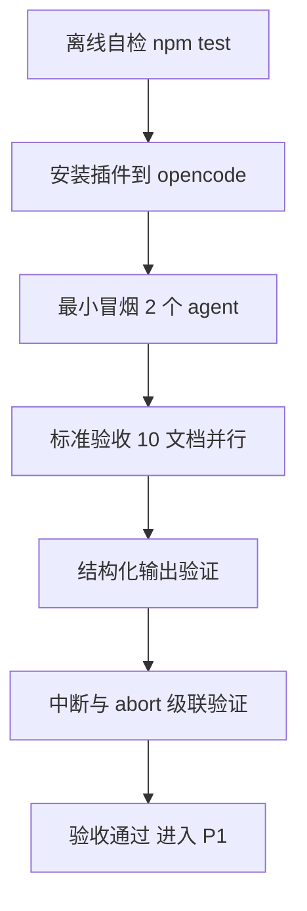

# opencode-dynamic-workflows 测试指南

> 对应需求文档 v0.2 的阶段 1 验收（A-01 ~ A-03、A-07、A-08）+ R-07 观察点
> 前提：OpenCode 已安装且配置了可用的 provider/模型（能正常对话）

---

## 目录

1. [测试总览](#1-测试总览)
2. [第一步：离线自检（不需要 OpenCode）](#2-第一步离线自检不需要-opencode)
3. [第二步：安装插件](#3-第二步安装插件)
4. [第三步：最小冒烟（2 个 agent）](#4-第三步最小冒烟2-个-agent)
5. [第四步：标准验收（10 个文档并行分析）](#5-第四步标准验收10-个文档并行分析)
6. [第五步：结构化输出验证 A-07](#6-第五步结构化输出验证-a-07)
7. [第六步：中断验证 A-08](#7-第六步中断验证-a-08)
8. [检查点清单](#8-检查点清单)
9. [常见问题排查](#9-常见问题排查)

---

## 1. 测试总览



| 验收项 | 内容 | 对应标准 |
|--------|------|---------|
| 冒烟 | workflow tool 可调用，2 agent 并行返回 | 前置 |
| A-01 | 整链路：Main Agent 生成脚本 -> 10 子会话 -> 汇总返回 | 阶段 1 核心 |
| A-02 | 主上下文只出现 workflow 调用与汇总，无子会话上下文 | 阶段 1 核心 |
| A-03 | 10 agent 全部完成，返回含各自摘要与 token 数 | 阶段 1 核心 |
| A-07 | schema 模式返回合法 JSON | 后续验收 |
| A-08 | Esc 中断后无孤儿会话 | 后续验收 |
| R-07 | 观察 schema 违规时是否自动重试 | 观察点 |

---

## 2. 第一步：离线自检（不需要 OpenCode）

在插件仓库目录执行：

```bash
cd E:/WorkProjects/opencode-dynamic-workflows
npm install
npm run typecheck   # 预期：无输出（通过）
npm test            # 预期：18 pass 0 fail
npm run build       # 预期：产出 dist/
```

全部通过才继续。如果修改过代码，重新 `npm run build` 后再进入下一步。

---

## 3. 第二步：安装插件

方式一（推荐，用 examples 测试工程）：

1. 仓库根目录先构建：`npm install && npm run build`
2. 进入 `examples/sample-project`，启动 OpenCode——该目录的 opencode.json 已配好 plugin 与 skills.paths（相对路径 `../..` 指向仓库根；若加载失败换成绝对路径）

方式二（在任意项目里装）：编辑目标项目的 `opencode.json`：

```json
{
  "plugin": ["E:/WorkProjects/opencode-dynamic-workflows"],
  "skills": {
    "paths": ["E:/WorkProjects/opencode-dynamic-workflows/skills"]
  }
}
```

**安装检查**：

1. 启动 OpenCode，开一个新会话
2. 问 Main Agent："你现在有哪些工具？"——确认列表里有 `workflow`
3. 问："你有哪些 skills？"——确认有 `workflow-authoring`

两个都出现即安装成功。缺一个见[第 9 节排查](#9-常见问题排查)。

---

## 4. 第三步：最小冒烟（2 个 agent）

对 Main Agent 说（直接粘贴）：

```
用 workflow 工具执行以下脚本，原样执行不要改动：

export const meta = { name: 'smoke_test', description: '最小冒烟：2 个 agent 并行' }

phase('Scan')
const info = await agent('列出你当前目录下的文件，只输出前 10 行')

phase('Echo')
const results = await parallel([
  () => agent('用一句话说明什么是工作流编排'),
  () => agent('用一句话说明什么是确定性重放'),
])
return { info, results }
```

**预期结果**：

- tool 输出形如：`工作流 smoke_test 完成：3 个 agent，耗时 X.Xs，共 N tokens（runId: run-xxx）`
- 下方有 3 行 agent 摘要（label + token 数）
- `## 结果` 里是 JSON：`{ info: "...", results: ["...", "..."] }`

**通过标准**：3 个 agent 状态全为 `成功`，结果 JSON 完整。

---

## 5. 第四步：标准验收（10 个文档并行分析）

标准验收集已内置在 `examples/sample-project/docs`（10 个 OpenCode 官方文档 mdx），对应脚本在 `examples/sample-project/scripts/acceptance-10docs.js`（也可直接让 Main Agent 读取该文件执行，无需粘贴）。

在 examples/sample-project 启动 OpenCode 后，对 Main Agent 说：

```
用 workflow 工具执行以下脚本，原样执行不要改动：

export const meta = { name: 'acceptance_10docs', description: '标准验收：10 个文档并行分析' }

phase('Scan')
const files = await agent('列出当前目录 docs 下的 .mdx 文件，按文件名排序取全部 10 个，输出文件名，每行一个，不要任何其他内容')

phase('Analyze')
const findings = await parallel(
  files.split('\n').map(s => s.trim()).filter(Boolean).map(file => () =>
    agent('阅读 docs/' + file + '，用 3 句话总结：主题、关键 API、适用场景', {
      label: file
    })
  )
)

phase('Synthesize')
return await agent('综合以下 10 份文档摘要，输出一页总览，包含：共同主题、出现的 API 清单、使用注意事项\n\n' + findings.join('\n\n'))
```

**逐项检查（对应验收标准）**：

| 检查 | 操作 | 预期 |
|------|------|------|
| A-03 | 看 tool 输出头部 | `10 个 agent` 全部成功，含 token 总数 |
| A-03 | 看 agent 摘要 | 10 行，每行 label 是文件名 + 各自 token 数 |
| A-01 | 看 `## 结果` | Synthesizer 输出的一页总览 |
| A-02 | 在父会话内用 subagent 导航切换 | 能看到 10 个子会话，各自只有自己的分析内容 |
| A-02 | 回主会话看消息历史 | **只有**一次 workflow tool 调用 + 一份结果，没有任何子会话的中间过程 |

**A-02 是本插件存在的意义，务必确认**：主会话上下文里没有 10 份分析的原文，只有汇总。

**预期现象（不是 bug）**：
- Main Agent 通常不会在回复里复述 findings，只会指「见上方 JSON 输出」——综合总览在 workflow tool 结果的 ## 结果 JSON 块里（return 值被 JSON.stringify 转义）；想让它展开就说「把 workflow 结果里的总览完整复述出来」
- Synthesizer 收到的拼接 prompt（含全部 findings）属于子会话输入，主上下文永远看不到——这正是隔离目的；想看细节用 subagent 导航切到对应子会话

---

## 6. 第五步：结构化输出验证 A-07

对 Main Agent 说：

```
用 workflow 工具执行以下脚本，原样执行不要改动：

export const meta = { name: 'schema_test', description: '结构化输出验证' }

const report = await agent('分析当前目录的 package.json，输出名称、版本、依赖数量', {
  label: '结构化分析',
  schema: {
    type: 'object',
    properties: {
      name: { type: 'string' },
      version: { type: 'string' },
      dependencyCount: { type: 'number' }
    },
    required: ['name', 'version', 'dependencyCount']
  }
})
return report
```

**预期**：`## 结果` 里的 JSON 严格符合 schema（三个字段都有、类型正确），而不是自然语言文本。

**已知限制（实测）**：公司 bailian 网关（glm-5.2）对 json_schema 请求返回 400（OpenCode 的 json_schema 走 StructuredOutput 工具 + toolChoice required，网关不支持）。表现：agent 0 token 失败、workflow 返回 null、摘要含 provider_bad_request。处理：
- 有支持 tool_choice required 的模型时，脚本里加 model 重测
- 否则 A-07 标记为 provider 依赖，P1 出 Adapter 降级方案，跳过继续

**R-07 观察点**：如果偶尔返回了不符合 schema 的内容或报错 `info.error`，记下来——这说明服务端的 retryCount 可能未生效（需求文档 R-07），需要把 Pi 的 extractValidated 兜底搬过来。

---

## 7. 第六步：中断验证 A-08

1. 重新执行第 5 步的 10 文档脚本
2. 分析阶段进行中（agent 摘要还在增长时）按 **Esc** 中断主会话
3. 检查：
   - tool 结果显示 `工作流被用户中断`
   - 用 subagent 导航查看子会话，正在运行的子会话应停止（不再产生新内容）
   - **过 1 分钟后再看**，确认没有"孤儿会话"还在继续跑

**通过标准**：中断后没有任何子会话继续消耗 token。

---

## 8. 检查点清单

全部打勾即阶段 1 验收通过：

- [x] `npm test` 通过（20/20，含后补的插件形状测试）
- [x] OpenCode 中可见 workflow tool 与 workflow-authoring skill（修复 id 导出后）
- [x] 冒烟脚本 3 agent 全部成功（612 tok / 11.6s）
- [x] 10 文档验收：12 agent 全部成功（A-01/A-03，49742 tok / 95.6s）
- [x] 主会话上下文无污染（A-02）
- [x] schema 模式返回合法 JSON（A-07：bailian 网关不支持，挂起待 P1 降级，见已知限制）
- [x] Esc 中断无孤儿会话（A-08）
- [x] R-07 观察记录：json_schema 在 bailian 网关 400（能力缺失非重试问题），落档需求文档 R-07

---

## 9. 常见问题排查

| 现象 | 原因 | 处理 |
|------|------|------|
| 工具列表里没有 workflow | opencode.json 的 plugin 路径不对，或没 build | 确认路径指向仓库根目录；`npm run build` 后**重启 OpenCode** |
| skill 列表里没有 workflow-authoring | skills.paths 未配置或路径不对 | 检查 opencode.json 的 skills.paths；重启 |
| 插件加载报错 `must default export an object with server()` | dist 过旧或入口不对 | 删掉 dist 重新 build；确认 package.json main 指向 ./dist/index.js |
| 脚本报错 `meta` 相关 | Main Agent 改动了脚本或加了围栏 | 提示词里强调"原样执行不要改动"；围栏会被自动剥离，但首条语句必须是 export const meta |
| 脚本报错"不可用"（Date.now 等） | 脚本里用了被禁 API | 把时间/随机值改为通过 args 注入 |
| `session prompt 失败` | provider 未配置或模型不可用 | 先确认普通对话能用；schema 模式对模型 tool-calling 有要求，换支持结构化输出的模型 |
| agent 全部失败返回 null | 网络/provider 波动（可恢复失败） | 重跑一次；频繁出现则加 `agentRetries: 2` 参数 |
| 子会话在会话列表里看不到 | **这是正常的**（平台过滤所有 parentID 会话） | 在父会话内用 subagent 导航切换查看 |
| 中断后子会话还在跑 | abort 级联未生效（bug） | 记录复现步骤，提交 issue |

---

## 引用说明

- 需求文档：`Docs/01_需求与规划/opencode-dynamic-workflows需求文档.md`（第 10 章验收标准、第 11 章风险 R-07）
- 安装与架构：仓库根目录 `README.md`、`AGENTS.md`
- 平台行为依据：本地 `thirdparties/opencode` 源码（TUI 过滤 parentID 会话、tool 输出截断 50KB、abort 不级联等，证据见需求文档第 3.2 节）
