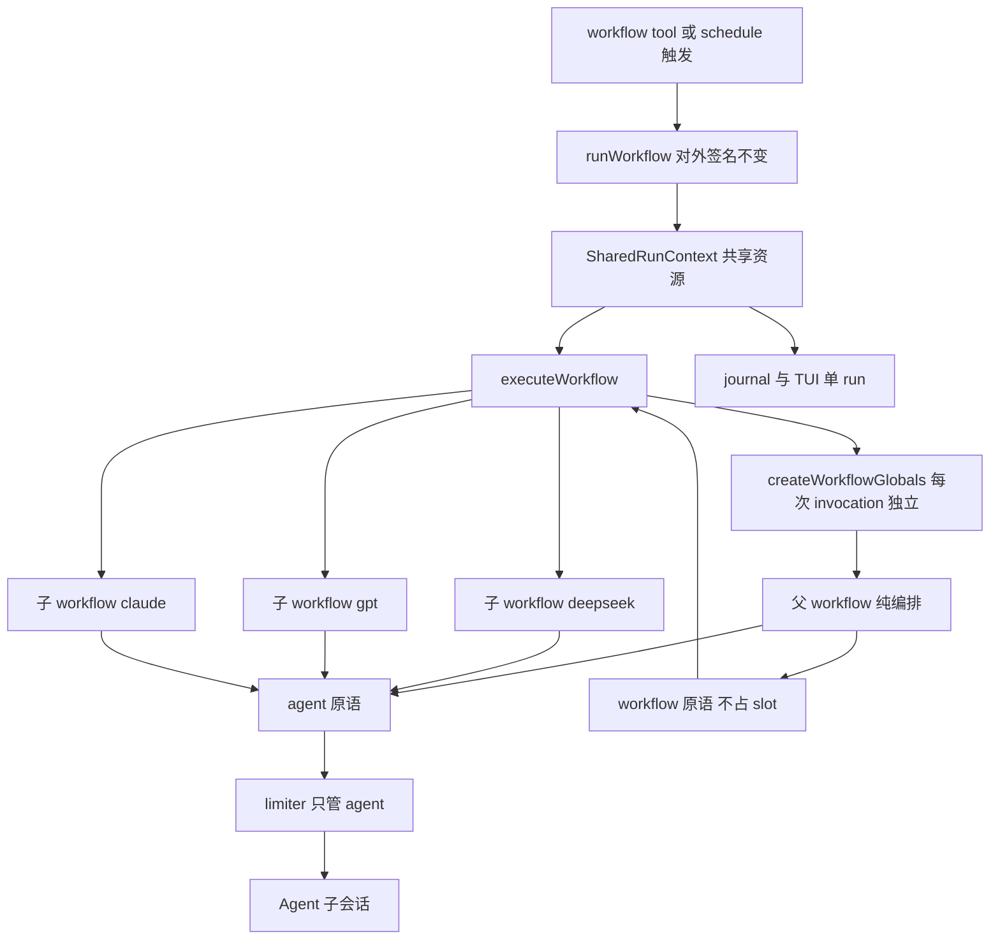

# Native 子工作流 workflow() 原语——执行计划（v2 开发版）

> 需求来源：用户提供的外部分析两轮（Native Workflow Composition 方向 + 六点开工前修订）+ 仓库现状核对
> 定位：把现有"agent 间接嵌套 workflow"升级为 runtime 一级 DSL 原语
> 排期：Schedule P1（v0.7.0）之后，目标 v0.8.0
> v2 变更：childSeq 独立计数、label 实例身份、每 child 独立 globals/args、limiter 只包 agent、
> self-reference 前置检查、parallel child 升 P1 正式验收、P1.5 增 WorkflowExecutionRecord（wall-clock）

## 1. 背景与问题

现状嵌套路径（v0.5.0 引入，README 已文档化）：

```
父 workflow -> agent(general) -> [LLM 决策] -> workflow tool -> 子 workflow
```

中间的 general agent 没有业务价值，只是"runtime 转发器"，代价：

| # | 问题 | 根因 |
|---|------|------|
| 1 | 多一轮 LLM 调用与 token 消耗 | agent 转发本身要过 LLM |
| 2 | 多一个 OpenCode 会话 | agent 子会话 |
| 3 | 可能不按 prompt 调 workflow / 转述结果 | LLM 不确定性 |
| 4 | 父脚本要写 parseJsonLoose() 容错 | 结果经文本往返 |
| 5 | timeout 要套两层 | 父子 run 各自超时 |
| 6 | 父子 run 分离，统计要"扫最近 10 个 run + 去重 + 按 label 猜" | 无共享 run 上下文 |
| 7 | abort / resume / maxAgents / concurrency 不能整体管理 | 独立 run 各一份 |

目标形态（与 agent/parallel/pipeline 平级的原语）：

```js
// 对象形式（带实例 label）
const sub = await workflow({ scriptPath: './workflows/03-code.js', label: 'deepseek' }, { module, lane, modelId })
// 字符串快捷方式（label 缺省用 meta.name）
const sub = await workflow('./workflows/03-code.js', { module })
```

## 2. 定案设计

### 2.1 核心架构：一个 Run，多个 Workflow Scope

```
Root Run（一个 runId、一份 journal、一个 TUI 树）
 ├─ Parent workflow（纯编排，可以零 agent）
 ├─ Child [deepseek]  = code_parallel_lanes_sub（同名定义，不同实例）
 ├─ Child [gpt]       = code_parallel_lanes_sub
 └─ Child [claude]    = code_parallel_lanes_sub（可 parallel 并发）
```

> **逻辑上一个 Run，内部多个 workflow scope。**
> 禁止实现成 `workflow() 内部调 runWorkflow()`——那会让每个 child 各建一份 limiter/quota/abort，并发与预算控制全部失效（父 8 + 子A 8 + 子B 8...）。

### 2.2 核心数据结构（v2 定稿）

```ts
interface SharedScheduler {
  /** 唯一的并发闸门：仅 agent dispatch 进入；workflow/phase/parallel 等编排原语永远不进入 */
  run<T>(task: () => Promise<T>): Promise<T>
  getConcurrency(): number
  setConcurrency(value: number): void
}

interface SharedRunContext {
  runId: string
  /** 并发闸门与配额：父子共用一套（limiter+concurrency 封装为 SharedScheduler，两份状态不可能失同步） */
  scheduler: SharedScheduler
  maxAgents: number
  agentCount: number
  /** 整棵 run 的中断信号 */
  signal: AbortSignal
  /** 会话执行器（OpenCodeSessionAdapter 注入缝） */
  agentRunner: AgentSessionRunner
  /** 汇总面：全部 agent 记录、run 日志、phase 列表（带前缀入列） */
  agents: AgentRecord[]
  logs: string[]
  phases: string[]
  resolveTier?: (tier: string) => string | undefined
  /** checkpoint 人工通道（整 run 一个） */
  confirm?: (text: string) => Promise<unknown>
  /** journal 回放与逐 agent 落盘 */
  resumeJournal?: Map<string, JournalEntry>
  onAgentJournal?: (entry) => void
  onAgentExecution?: (payload) => void
  cwd: string
  /** P1.5：子 workflow 执行记录（wall-clock 统计源） */
  workflows?: WorkflowExecutionRecord[]
}

interface WorkflowScope {
  /** Workflow Definition Identity：脚本 meta.name */
  name: string
  /** Workflow Invocation Identity / UI 名：调用方传入，缺省 = name */
  label: string
  scriptPath?: string
  depth: number                 // root=0，P1 上限 1
  /** phase 前缀：child 为 "▸ <label> / "，root 为空 */
  phasePrefix: string
  /** scope 私有：phase 游标 */
  currentPhase?: string
  /** scope 私有：agent / DSL 调用序号（journal key 用） */
  callSeq: number
  /** scope 私有：child 创建计数（keySegment 专用，与 callSeq 严格分离；
   *  分配必须在 workflow() invocation 同步阶段、任何 await 之前完成；失败不回收编号） */
  childSeq: number
  /** journal key 段：root 省略，child 为 "wf0"/"wf1"...（childSeq 生成） */
  keySegment?: string
  parent?: WorkflowScope
}

/** P1.5：子 workflow 执行记录（shared.workflows）。
 *  status 只描述 runtime 执行状态（正常 return 即 "ok"），
 *  不解析或推断 child 返回值里的 ok/success/status 等业务字段（{ok:false} 仍是 status="ok"） */
interface WorkflowExecutionRecord {
  name: string
  label: string
  keySegment: string
  /** 展示身份（label 链，给人看） */
  displayPath: string[]
  /** 稳定身份（wfN 链，给机器识别；同 label 冲突时唯一） */
  scopePath: string[]
  startedAt: number
  endedAt?: number
  durationMs?: number        // wall-clock（≠ agent duration 之和）
  status: "running" | "ok" | "failed" | "aborted"
  error?: string
}
```

三身份严格分离，不得混用：

```
name       = 定义身份（脚本 meta.name，同名可多实例）
label      = 实例身份（调用方传入，UI 显示与统计分组）
keySegment = journal 身份（childSeq 编号，resume 稳定性）
```

模型对比场景实例：

```
name=code_parallel_lanes_sub  label=deepseek  keySegment=wf0
name=code_parallel_lanes_sub  label=gpt       keySegment=wf1
name=code_parallel_lanes_sub  label=claude    keySegment=wf2
```

### 2.3 资源继承规则（语义定死）

| 能力 | Parent / Child |
|------|----------------|
| concurrency / limiter | **共享**（setConcurrency 影响全局；**limiter 只限制 agent() dispatch，不限制 workflow()/phase()/parallel() 等编排原语**，见 2.4） |
| maxAgents / agentCount | **共享**（子 dispatch 计入同一配额） |
| AbortSignal | **共享**（一处 abort 整棵停） |
| agentRunner / resolveTier / confirm | **共享** |
| agents / logs / phases / token / cost | **共享**（汇总到 root） |
| runId / journal / TUI 快照 | **共享** |
| cwd | 共享（scriptPath 相对基准 = 项目目录，与 tool 层 scriptPath 语义一致） |
| currentPhase / callSeq / childSeq | **独立**（scope 私有） |
| args / DSL globals / VM sandbox | **独立**（见 2.5） |
| workflow 返回值 / label | **独立** |

### 2.4 编排并发 ≠ Agent 并发（死锁防线）

```
workflow() / phase() / parallel() / pipeline()
    ↓ 不占并发额度（纯编排，await promise 即可）

agent()
    ↓
shared.limiter   ← 唯一的并发闸门
```

若 workflow() 占 slot：`concurrency=2` 时两个 parallel child 占满 2/2，各自的 agent 永远等不到 slot——**经典自死锁**。P1 实现与测试都把这条语义写死（新增死锁回归用例：concurrency=2 + 2 个各含 1 agent 的 parallel child 必须完成）。

### 2.5 workflow() 是真正的调用边界：args/result 结构化克隆

`executeWorkflow()` **每次 invocation 构造独立 DSL globals**：

```ts
// 入参克隆：child 拿到的 args 与 parent 传入对象无引用共享（child 内 mutation 不外溢）
const childArgs = structuredClone(args ?? {})
const globals = createWorkflowGlobals(shared, scope, childArgs)
const result = await runScriptInVm(body, scope.label, globals)
// 返回值克隆：child 返回对象不与 VM 内引用共享
return structuredClone(result)
```

约定：**workflow() 的 args 与 return 必须 structured-clone-compatible**（object/array/string/number/boolean/null；禁止 Function/class instance/Promise/复杂 host object）——超出时 throw 明确错误。

同时禁止 `shared.globals.args = childArgs` 式复用；SharedRunContext 只共享**资源**（scheduler/quota/journal/agents），绝不共享 args/currentPhase/globals。

### 2.6 phase 不共享，前缀命名

child 内 `phase('生成代码')` 实际写入 `"▸ <label> / 生成代码"`（前缀用 label，不是 name——同名三实例的前缀分别为 `▸ deepseek / `、`▸ gpt / `）。agent 记录的 phase 字段带前缀，TUI 现有按 phase 分组渲染天然兼容：

```
模型对比
▸ deepseek / 清理旧产物
▸ deepseek / 并行双端
▸ gpt / 清理旧产物
...
```

P1 的 TUI 形态即此（flat agent list + 前缀辨识）；真正的 Workflow 子树（workflowPath 分组）在 P1.5。

### 2.7 Scoped Journal Key（比 workflow() 本身更重要）

现状 key：`runId:callIndex`（workflow-runtime.ts:597）。定案：

```
root agent：run-123:0        ← 与现状完全一致（旧 journal 零迁移兼容）
child agent：run-123:wf0:0   ← wfN 由 parent.childSeq++ 生成
多层（P2）：run-123:wf0:wf1:0
```

- **wfN 必须来自 childSeq**，不得复用 callSeq：parent 在创建 child 前多一个 agent()/verify()/retry() 调用，若用 callSeq 编号会导致 child 从 wf0 变 wf1，后续所有 child key 级联漂移
- **childSeq++ 必须在 workflow() invocation 的同步阶段完成、发生在任何 await 之前**（resolve/parse 等异步之前）：否则 parallel 下编号按完成顺序分配，journal 不稳定；**失败的 child invocation 仍消耗其 wfN，不回收编号**（调用位置决定身份，不由执行完成顺序决定）--scoped journal 的稳定性被破坏
- `callSeq` scope 私有：child A 加一个 agent 不偏移 child B 与 parent 的 key
- `firstMiss` scope 化（各 scope 独立推进回放边界）
- resume 语义不变：仍按 agent 调用内容 hash 匹配回放；子脚本**非 agent 部分**的变更不触发重跑（与现有 resume 立场一致，文档明示）
- P1 就把 key 结构定死，避免后续 painful 迁移

### 2.8 Self-reference 前置检查（P1 就做）

一层深度限制只是"最终挡住"（child 已执行了部分语句才在再次 workflow() 处报错）。P1 加廉价检查——创建 child 前沿 scope 链比对已解析路径：

```ts
const resolvedPath = canonicalWorkflowPath(ref, shared.cwd)
for (let s = scope; s; s = s.parent) {
  if (s.scriptPath && canonicalWorkflowPath(s.scriptPath, shared.cwd) === resolvedPath) {
    throw new WorkflowError(`Workflow 不能调用自身或祖先：${resolvedPath}`, SCRIPT_VALIDATION_ERROR, { recoverable: false })
  }
}
```

路径比较统一走 `canonicalWorkflowPath()`：`path.resolve` + 存在时 `fs.realpathSync.native`（解 junction/symlink）+ Windows 大小写归一——否则 `C:\Project\a.js` vs `c:\project\A.js` 或 junction 可绕过判定。

多层（P2）天然已备好（沿链检查即环检测）。

### 2.9 其他定案

| # | 规则 | 说明 |
|---|------|------|
| API | `workflow(ref, args?)`；ref 为 `{scriptPath, label?}` 或字符串（label 缺省用 meta.name） | 复用 tool 层 scriptPath 解析语义 |
| 返回值 | 直接 return child 的 return 值 | 不包 runId/agents 等元数据；元数据留在 run 汇总面 |
| 错误 | 原生 throw 语义 | 路径错误/解析错误/自环/maxAgents/abort 直接抛，父 try-catch 自理；**不做 parallel() 那种失败返 null** |
| 嵌套深度 | P1 上限一层（`scope.depth >= 1` 时 throw） | 多层打包给 P2 |
| 纯编排合法 | "至少一个 agent"从 workflow 级放宽为 **root run 级** | `agentCount === 0` 校验（652 行）改为 runWorkflow 出口检查 shared.agentCount |
| **parallel child** | **P1 正式支持并验收**（串行 + parallel 内并发 child） | 这是 Native Composition 最大价值场景，且一次验证 limiter/scoped key/args 隔离/childSeq 确定性/abort 全部核心设计 |
| B1 血统/TUI 快照 | 零改动 | native child 不创建新会话，agent 子会话仍挂 root |
| 旧 agent 间接嵌套 | 保留可用，文档标记 legacy | native 为推荐路径 |

## 3. 仓库现状核对（重构映射）

| 现状（workflow-runtime.ts） | 行号 | 去向 |
|------|------|------|
| `state`（logs/phases/currentPhase/agents/callSeq/warnedTiers/firstMiss） | 144-160 | 拆分：agents/logs/phases 进 shared；currentPhase/callSeq/firstMiss 进 scope |
| `createLimiter(concurrency)` + setConcurrency | 120-143 | shared.limiter + shared.concurrency（setConcurrency 改 shared） |
| `agentCount` / maxAgents 检查 | 117/多处 | shared.agentCount |
| abort 链（throwIfAborted/isAborted） | 162-170 | shared.signal |
| `journalKey = runId:callIndex` | 597 | `${shared.runId}:${scope.keySegment ? scope.keySegment + ":" : ""}${callIndex}`（callIndex 来自 scope.callSeq） |
| globals 注入点 | 629 | 移入 `createWorkflowGlobals(shared, scope, args)`，加 `workflow` 原语 |
| `agentCount === 0` 校验 | 652 | 移到 runWorkflow 出口，判 shared.agentCount |
| 对外 `runWorkflow(script, options)` 签名 | 111 | **不变**（tool 层/测试/schedule 零改动） |
| callSeq 两处递增（234 DSL 键 / 596 agent 键） | — | 都改 scope.callSeq（DSL 组合键同步 scope 化，确定性保持） |

## 4. 分阶段计划

### P1：原语 + SharedRunContext + parallel child（约 3.5 天）

| # | 任务 | 说明 |
|---|------|------|
| 1.1 | 拆 `createSharedRunContext` / `createRootScope` / `createChildScope`（childSeq 生成 keySegment、label、phasePrefix）；`runWorkflow` 主体迁为 `executeWorkflow(script, args, shared, scope)`；**每次 invocation 构造独立 `createWorkflowGlobals(shared, scope, args)`** | 对外签名不变；200 现有测试做重构回归网 |
| 1.2 | `workflow(ref, args?)` 原语：**同步阶段首行 `childSeq++` 生成 keySegment** -> 解析 scriptPath（含 `canonicalWorkflowPath`：resolve + realpath + Windows 大小写归一）-> parseWorkflowScript -> self-reference 沿链检查 -> depth 检查 -> childScope -> `executeWorkflow`；args/result `structuredClone` 进出 | ref 支持 `{scriptPath, label?}` 与字符串；返回 child return 值；错误直接抛；**不占 scheduler slot** |
| 1.3 | Scoped journal key（childSeq 生成 wfN）+ scope-local firstMiss | root key 格式不变（旧 journal 兼容） |
| 1.4 | `agentCount === 0` 改 root 级校验 | 纯编排父合法 |
| 1.5 | vm 注入点接入 `workflow`（globals 内）；DETERMINISM 不受影响 | vm.ts 无改动 |
| 1.6 | 测试（约 15 用例）：串行 child / **parallel child 正式验收** / args 隔离（parallel 双 child 各自 args 不串）/ globals 独立 / label 与 name 三身份 / 返回值直通 / 错误上抛 / 深度限制 / **自环拒绝（root 调自身）** / 纯编排父合法 / journal key 格式与 childSeq 稳定性（parent 前置 agent 不漂移 child 编号）/ 共享配额（maxAgents 打满 child 内 dispatch 报错）/ 共享 abort / **limiter 死锁回归（concurrency=2 + 2 个 parallel child 各 1 agent 必须完成）** / resume 跨 scope 回放 | |
| 1.7 | 实机验收 A：三段式流水线（1-spec -> 2-design -> 3-code，父零 agent，串行） | 单 run / 单 journal / TUI 一棵树（前缀分组）/ token 含 child |
| 1.8 | 实机验收 B：三模型对比（parallel 三 child 同脚本不同 label+args） | **对照旧 agent 转发版**：会话数、token、耗时、统计方式（免"扫 10 个 run 去重"） |

**P1 验收标准**：验收 A + B 均单 run 完成；parallel child 并发正确且无死锁；三实例同名的 label 区分清晰；父脚本无 parseJsonLoose。TUI 形态 = flat agent list + `▸ label / phase` 前缀辨识。

### P1.5：workflowPath + TUI 子树 + wall-clock 统计（约 1.5-2 天）

| # | 任务 | 说明 |
|---|------|------|
| 2.1 | `AgentRecord.workflowPath?: string[]`（displayPath：scope 链 label 数组；机器识别用 scopePath 在 WorkflowExecutionRecord 里） | root 的 agent 为 undefined |
| 2.2 | `SharedRunContext.workflows: WorkflowExecutionRecord[]`：child 启动/终态时写入 | **wall-clock durationMs**（≠ agent duration 之和——parallel 下 10min wall vs 18min sum） |
| 2.3 | TUI 按 workflowPath 分组渲染真子树（最小改动：按 path 排序缩进，不重做节点模型） | |
| 2.4 | 子 workflow 级统计：按 displayPath / label 聚合 wall duration / token sum / 状态；**status 只描述 runtime 执行态，不解释返回值业务字段**（`{ok:false}` 仍 status="ok"） | 模型对比报告直接 `workflows.filter(w => w.label === 'deepseek')` |
| 2.5 | 测试 + 实机（三模型对比报告改 native 版对照） | |

### P2：完整嵌套（按需，约 3+ 天）

- 多层 nesting（depth > 1）+ 环检测强化（沿链检查已在 P1 具备，P2 补图遍历语义）
- nested resume 完整语义（子脚本变更影响面、跨 scope 回放）
- workflow name registry（`.opencode-workflows/workflows/` 按名引用，与 Schedule 的 Registry 复用）
- journal 流式回放下的并发 child 稳定性专项
- TUI `RunNode = WorkflowNode | AgentNode` 正式抽象

## 5. 风险与坑

| 风险 | 等级 | 对策 |
|------|------|------|
| 737 行单函数重构回归 | 中 | 对外签名冻结；200 测试先行跑绿再动刀；小步提交 |
| ~~parallel child 互相覆盖 args~~ | 已消除 | 2.5 独立 globals + structuredClone 双向隔离（P1.1/P1.2 写死） |
| ~~编排原语占 limiter slot 自死锁~~ | 已消除 | 2.4 SharedScheduler 封装，结构上不可写错 + 死锁回归用例 |
| ~~parallel 下 child 编号按完成顺序漂移~~ | 已消除 | 2.7 childSeq++ 同步首行、失败不回收 |
| 闭包状态改对象传递时遗漏某处引用 | 中 | TS 类型约束（interface）+ 严格 typecheck |
| journal key 双格式（root 无前缀/child 带前缀）解析 | 低 | 追加写入单向兼容；读取侧按整串 map 查找，无解析逻辑 |
| phase 前缀与用户显式 phase 名冲突（视觉） | 低 | 前缀固定 `▸ ` 起头，TUI 层按前缀识别 |
| child scriptPath 指向不存在/非法脚本 | 低 | 直接 throw，错误信息带路径 |
| 与 Schedule 的交互 | 无 | scheduled run 也走 runWorkflow，workflow() 原语自动可用 |

## 6. 总体架构（定稿图）



## 7. 类比理解

- **旧方案（agent 转发）**：老板想找分包商，却先打电话给秘书，让秘书查通讯录转达，分包商干完再报秘书、秘书转述老板——秘书没干活却花两次转述的钱，还可能转述走样。
- **Native `workflow()`**：老板直接拨分包商电话，参数直达，结果原样回手。
- **SharedRunContext**：工地总闸——不管总包还是几个分包同时施工，用电负荷（并发，且只按实际用电设备 agent 计费，不算指挥电话）、总预算（maxAgents）、急停按钮（abort）都是同一套；各分包自己的施工日志本（phase/调用序号）分开记。
- **childSeq**：分包的工位编号由“发标顺序”专门登记（同步阶段即领号，不等人、不因失标回号），与总包自己打了几通电话（callSeq）无关——档案编号永远稳定。
- **结构化克隆边界**：交给分包的任务单是复印件（原件不被分包涂改），分包交回的成果也是复印件（不被后续施工反向污染）——传纸条只允许可复印的内容，活物（函数/句柄）不能上纸。
- **label vs name vs keySegment**：同一份图纸（name，脚本定义）可以派三支施工队（label，deepseek/gpt/claude 各挂一块工牌），档案室按工位号（keySegment）归档——图纸同名不混、工牌即统计口径、工位号即断点续工位置。
- **独立 globals/args**：每支施工队有自己的任务单（args），绝不在同一块共用白板上写字，否则两支队同时写会互相覆盖。
- **编排不占并发额度**：调度电话不占用电负荷——若指挥电话也算负荷，两通调度电话就能把电闸占满，真正的电钻（agent）全部停摆（死锁）。

## 8. 引用说明

- 外部分析：用户提供两轮（Native Workflow Composition 方向 + 六点开工前修订：childSeq / label 实例身份 / 独立 globals / limiter 只包 agent / self-reference 前置 / parallel child 升 P1）
- 仓库现状核对：`src/runtime/workflow-runtime.ts`（globals 629 / journalKey 597 / agentCount 校验 652 / state 144-160 / limiter 120-143）
- 现有嵌套实现与边界：`skills/workflow-authoring/references/runtime.md`（嵌套工作流节，将标记 legacy）
- 参考实现：https://github.com/xz1220/open-dynamic-workflows/blob/main/src/primitives.ts
- 本仓库 README：https://github.com/mickorz/opencode-dynamicworkflows
