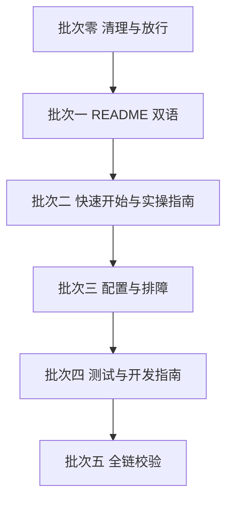

# README 与 docs 多语言支持执行计划

> 需求：README 与 docs/ 六件套支持中文 + 英文双语
> 范围：README.md + docs/{getting-started, configuration, troubleshooting, how-to-guides, testing, development}.md
> 不在范围：skills/workflow-authoring（skill 是给 LLM 读的操作规范，双语会翻倍 token 且引入不一致风险，不做）、代码内注释与日志（维持中文）、TUI 界面文案

## 一、方案选型

| 方案 | 做法 | 判定 |
|------|------|------|
| A. 双源直存 | 每语言一份 md，顶部语言切换行互链 | **采用**：6+1 个文档规模下最简单，GitHub/npm 原生渲染，零构建 |
| B. 单文件双语 | 一个 md 内中英并排 | 否决：文档长度翻倍，阅读体验差 |
| C. i18n 框架 | docusaurus / mdbook 多语言构建 | 否决：为 7 个静态文档引入构建链是过度设计 |

## 二、目标结构

```text
README.md                  英文（默认，npm 与 GitHub 首屏）
README.zh-CN.md            中文（现 README 内容迁移 + 保留徽章与英文标题区）
docs/
├── getting-started.md     英文（现有小写路径不动，README 旧链接零破坏）
├── configuration.md
├── troubleshooting.md
├── how-to-guides.md
├── testing.md
├── development.md
└── zh-CN/                 中文（现六件套内容迁移）
    ├── getting-started.md
    ├── configuration.md
    ├── troubleshooting.md
    ├── how-to-guides.md
    ├── testing.md
    └── development.md
```

语言切换器（每个文件标题下一行，两语言互指同主题文件）：

```markdown
[English](./how-to-guides.md) | [简体中文](./zh-CN/how-to-guides.md)
```

README 顶部：

```markdown
[English](./README.md) | [简体中文](./README.zh-CN.md)
```

## 三、关键决策（默认按推荐执行，有异议提出）

| 决策点 | 推荐 | 理由 |
|--------|------|------|
| README 默认语言 | 英文 | 刚加的英文标题区 + npm badge 已是国际化姿态；国际用户先见英文，中文一键可达 |
| 英文版路径 | 沿用现有小写 docs/*.md | README/docs 内全部现有链接零改动 |
| 中文版路径 | docs/zh-CN/ 子目录 | 业界惯例（GitHub 生态 zh-CN 命名） |
| assets 截图 | 两语言共用 | TUI 界面本身中文，重拍英文截图成本高；图注在中译本说明即可 |
| 术语表 | composite = 组合控制流 / checkpoint = 人工确认点 等固定对译 | 防六份文档各翻各的 |
| 维护策略 | 改英文必须同步中文，中文版头部标「同步基线：v0.11.x」 | 双源最大的风险是漂移，用基线标记暴露滞后 |

## 四、执行批次



**批次零：清理与放行**（预备）
- docs/ 里 3 个工作区杂文档移入 Docs/（profile功能、telemetry 分析、空的 P0-Readme和文档支持多语言.md）
- .gitignore 增加 `!docs/zh-CN/` 与 `!docs/zh-CN/*.md` 放行
- 建术语对照表（本文件附录），翻译全程对照

**批次一：README 双语**
- 现 README 中文内容迁移到 README.zh-CN.md（徽章与语言切换行保留在两份顶部）
- README.md 重写为英文（翻译现有全部章节，含组合控制流、Schedule 边界、文档地图）
- 文档地图里两语言互列

**批次二：快速开始 + 实操指南**（getting-started 130 行 + how-to-guides 325 行，最大头）
- 中文原稿迁 docs/zh-CN/，英文译稿落 docs/ 根

**批次三：configuration（141 行）+ troubleshooting（102 行）**

**批次四：testing（124 行）+ development（75 行）**

**批次五：全链校验**
- 链接检查：每文件语言切换行互指正确；README 文档地图双语言全通
- 一致性抽查：术语对照表全量核对；代码示例块两边一致（代码不翻译）
- npm 包预览（npm pack 后查 README 渲染）

每批次一个 commit（如 `docs(i18n): batch 2 getting-started + how-to-guides bilingual`），出问题可单批回滚。

## 五、工作量与节奏

| 批次 | 翻译量（中->英） | 说明 |
|------|------------------|------|
| 一 | ~230 行 | README |
| 二 | ~455 行 | 最重，可拆两个 commit |
| 三 | ~243 行 | |
| 四 | ~199 行 | |
| 五 | 0（纯校验） | |
| 合计 | ~1130 行 | 分 5 批渐进交付，每批完成即双语可用 |

## 六、风险与对策

1. **双源漂移**（最大长期风险）：对策 = 中文版头部基线标记 + 提交清单提醒「改了英文改中文没」；接受滞后但不接受静默分叉
2. **翻译腔损伤可读性**：英文版以「重写为母语文档」标准而非逐句直译；代码示例、命令、路径原样保留
3. **链接回归**：批次五全链点检 + 现有小写 docs 链接零改动的结构设计本身就规避了大半
4. **后续新文档忘了双语**：新建公开文档的检查项写进 CLAUDE.md 速查（发版教训清单同款）

## 七、类比理解

双语文档像产品包装里的两本说明书——不是扫码后机器实时翻译，而是两份各自排版、各自校对过的正式说明书装订在一起；每页右上角的「语言切换行」就是两本册子之间页对页的互相关联：中文第 3 页讲安装，翻过去英文也正好是安装。代价是以后改任何一页都要记得另一本的同名页同步改——所以每本封面都写了「同步基线版本」，一眼看出另一本落后了没有。

## 八、引用说明

- [GitHub 官方 README 多语言惯例](https://docs.github.com/en/repositories/managing-your-repositorys-settings-and-features/customizing-your-repository/about-readmes) —— README 互链与语言切换行做法参考
- [Vue 官方文档语言目录结构](https://github.com/vuejs-translations) —— zh-CN 子目录命名与社区翻译维护模式
- [shields.io 徽章](https://shields.io/) —— 现有徽章在两份 README 顶部共用

## 附录：术语对照表（翻译全程对照，新增术语随时补）

| 中文 | English |
|------|---------|
| 组合控制流 | Composite Control Flow |
| 组合节点 | composite node |
| 人工确认点 | checkpoint（Human-in-the-loop） |
| 确定性验证 | deterministic check |
| 对抗式验证 | adversarial verification |
| 评审团 | judge panel |
| 子工作流 | child workflow / nested workflow |
| 断点续跑 | resume（journal-based replay） |
| 强停止 | hard stop（Human Reject） |
| 结构性错误 | structural error |
| 可恢复失败 | recoverable failure |
| 并发上限 | concurrency limit |
| 工作树隔离 | git worktree isolation |
| 注册名 | registry name |
