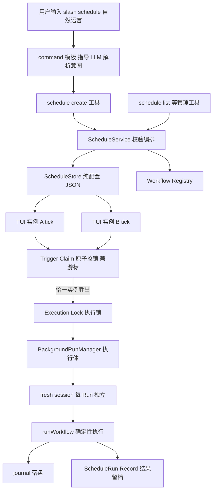
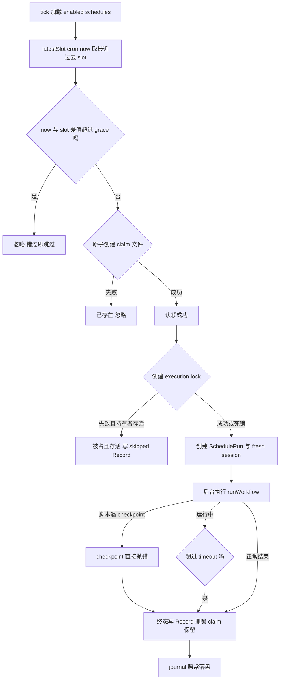

# Schedule 功能 P1 执行计划（In-Process 修订版 v4 · 开发版）

> 需求来源：《OpenCode Dynamic Workflows Schedule 功能开发需求文档》+ 四轮方向修订：
> ① P1 放弃 headless，改为 OpenCode 宿主运行期内 In-Process 调度；
> ② 增补多实例协调（同项目多 TUI，原子 claim）；
> ③ Phase 1 重排为 Vertical Slice（`/schedule` 最先跑通）；
> ④ 语义定案 at-most-once、删除 lastRunAt 游标、每 Run 独立 Session、claim 文件名 epoch 化、grace 收窄。
> 本版为正式开发版本。当前版本 0.6.1，目标发版 0.7.0。

## 1. P1 产品定义（先立边界）

> Schedule P1 提供 OpenCode 运行期间的 Workflow 定时执行能力；OpenCode 退出、系统休眠或未运行期间不保证任务执行。

产品边界（写入 README，是设计而非缺陷）：

1. **OpenCode 必须运行**：TUI 关闭则 Schedule 停摆，重开后自动恢复。
2. **错过的任务 = skip**：休眠/关机错过的时间点不补跑，下一个未来时间点正常触发。
3. **配置不依赖进程内存**：schedules 落盘 JSON，TUI 重启后自动重载恢复。
4. **多实例安全**：同一项目可同时开多个 OpenCode TUI，任一计划时间槽至多触发一次。

并发模型一句话（P1 定案）：

> **Multiple scheduler instances are allowed; P1 guarantees at-most-once execution attempt per scheduled slot through an atomic project-scoped claim.**

（每个时间槽 0 次或 1 次，绝不 2 次。claim 成功后进程崩溃属"0 次"，在承诺范围内；正常运行下验收仍要求每 slot 恰好 1 次。不对外承诺 exactly-once。）

语言边界（定案）：

> **自然语言只用于创建配置（一次性），执行链路零 LLM 判断。**

分层定位：

```
/schedule            用户体验层（自然语言入口）
schedule_create 等   稳定 API 层（Agent / 未来 UI / headless 复用）
ScheduleService      领域层
ScheduleRuntime      执行层（确定性）
```

核心对象（互相无重叠）：

```
Schedule       = 用户配置（纯配置，运行时不写入）
TriggerClaim   = 某个 slot 是否已被接管（兼持久化游标）
ExecutionLock  = 当前 Schedule 是否正在执行
ScheduleRun    = 一次真实执行记录（结果留档）
WorkflowRun    = Workflow Runtime 执行（journal）
Session        = 某次 Run 的 Agent 会话（每 Run 独立）
```

演进路线：P1 In-Process Schedule → P2 Headless Schedule → P3 System / Remote Schedule。

## 2. 为什么砍得动（仓库事实支撑）

- `BackgroundRunManager.start()` 是现成的"无 tool context 的 runWorkflow 装配器"：journal 落盘、运行快照、B1 血统、abort 控制全有。scheduled run ≈ 到点自动触发的后台 run（回传环节按 D5' 调整为不 prompt）。
- `OpenCodeSessionAdapter` 的 `parentSessionId` 本就可选，每 Run 的 fresh session 直接当 parent，adapter **零改动**。
- runtime（`runWorkflow`）宿主无关，`confirm` 注入缝现成。
- command 能力事实：OpenCode 的 command 来源仅 `command`/`mcp`/`skill` 三种（源码 `Command.Info.source`），v1 插件无法注册 command——`/schedule` 走分发层：npm 包带模板，安装器拷贝到项目 `.opencode/commands/`（与 skill 同模式）。

砍掉清单（相对最初的系统级方案）：headless spike、HeadlessClientFactory、`@opencode-ai/sdk` 依赖、spawn serve、schedule-exec CLI、schtasks/WindowsSchedulerAdapter、PATH 环境固化。跨平台自动成立。

## 3. 总体架构



tick 判定链（最终形态，Phase 1 先落地无锁版）：



## 4. 关键设计决策

### 4.1 领域与触发

| # | 决策 | 说明 |
|---|---|---|
| D1 | **tick 无状态重读**：每 30s 重读 `schedules/*.json`，无内存缓存 | 手改文件即时生效、TUI 重启天然恢复、无 register/unregister 同步 |
| D2' | **无游标，claim 即游标**：tick 对每条 schedule 用 `latestSlot(cron, now)`（cron-parser `prev()` 一步回退，无迭代成本）取最近过去 slot；`now - slot <= grace` 才进入 `tryClaim`；**不写回任何运行时状态到 schedule JSON** | 历史 claim 长期保留，天然防"同 TUI 多次 tick / 多 TUI / 重启后"对旧 slot 的重复触发。彻底消除 lastRunAt 读-改-写带来的 Lost Update race（TUI A 旧对象写回可覆盖 TUI B 刚更新的 cron），Schedule JSON 成为纯配置、运行时零写入 |
| D3' | **grace = 90 秒（3 × tick）**：`now - slot > 90s` 视为错过，忽略 | grace 只容忍 tick 延迟/事件循环卡顿，**不承担 catch-up**（产品定义错过=skip）。不采用 5 分钟：那会把"开机晚 4 分钟"变成补跑，与边界 2 矛盾 |
| D8 | **cron 子集四模式**：`*/n * * * *`、`m * * * *`、`m h * * *`、`m h * 周`；cron-parser 本地时区 | 同 cron 同 now 各实例算出的 slot 相同（claim key 一致前提）；非法表达式报 `INVALID_CRON` 并附支持格式 |
| D9 | **workflowId** = `meta.id ?? meta.name`，Registry 扫描 `.opencode-workflows/workflows/*.js` | 与现有脚本格式零冲突 |
| D10 | **目录**：`.opencode-workflows/` 根：`workflows/`、`schedules/`、`runs/schedules/<scheduleId>/<时间戳>.json`、`schedule-claims/`、`execution-locks/` | 全部 project-scoped |

### 4.2 多实例协调

| # | 决策 | 说明 |
|---|---|---|
| D11' | **Trigger Claim**：`schedule-claims/<scheduleId>/<epoch>.claim`，文件名 = `slot.getTime()`（epoch 毫秒），`fs.open(path, "wx")` 原子创建 | epoch 文件名唯一/稳定/可排序/跨平台（Windows 文件名禁 `:`，ISO 字符串不可用）；claim 内容写人读 JSON（scheduleId/scheduledAt ISO/claimedAt/pid/instanceId）供调试；一次解决多 TUI + 多 tick 两类重复；禁止 `exists → write` 两步式（TOCTOU） |
| D12 | **claim 失败静默**：不执行、不写 skipped Record | claim 失败 = 另一实例已负责本 slot，非 schedule 语义 skip；避免 1 success + N skipped 噪音。skipped Record 只属于真 overlap |
| D13 | **Execution Lock（overlapPolicy=skip）**：`execution-locks/<scheduleId>.lock`，`wx` 原子创建，内容 `{ pid, runId, startedAt }`，run 结束删除；key 用 **scheduleId 而非 workflowId**（Phase 3 落地） | 两个 schedule 引用同一 workflow 合法；手动 run 与 scheduled run 互不阻塞；内存标记跨进程失效 |
| D14 | **僵尸锁检测**：抢锁失败读内容，持有 pid 已死（`process.kill(pid, 0)` ESRCH）→ 删锁重抢（Phase 3 落地） | 防崩溃导致永久 skip |
| D15 | **claim 保留与清理**：长期保留（幂等记录兼游标），tick 顺手 prune 7 天前文件（epoch 文件名天然可排序） | 保留期内重开 TUI 不对历史 slot 补触发 |
| D16 | **claim 成功后执行前崩溃 = 丢一轮**：P1 不做接管 | 与 at-most-once 语义自洽（0 次在承诺内）；下周期自愈 |

### 4.3 执行体与用户体验层

| # | 决策 | 说明 |
|---|---|---|
| D4 | **执行体复用 BackgroundRunManager**，扩展可选 `confirm`（Phase 3） | checkpoint 即败注入；手动后台 run 行为不变 |
| D5' | **每 Run 独立 fresh Session**：每次 scheduled run 创建新顶层会话（title = schedule 名 + 时间），作为本 run 的 parent；run 结束**不 prompt 回传**，结果文本直接写入 ScheduleRun Record | ① 长期共用一个会话会导致 context 无限增长（与项目一贯的 Context Growth 控制相反）；② 多 TUI 交替赢 claim 会交替操作同一长期会话；③ prompt 回传会额外触发一轮 LLM（烧 token 转述死文本），Record 落盘零成本。Session 不入 Schedule Model，sessionId 只记在 Record 里；用户在 TUI 会话列表按时间找到该轮 run（agent 子树经 B1 血统挂在 fresh session 下），结果摘要看 Record / schedule_get |
| D7 | **timeout**：`setTimeout` → `manager.stop(runId)`，Record 记 timeout（Phase 3 落地） | 复用现有 abort 级联 |
| D17 | **`/schedule` 走分发层 command 模板**：npm 包 `commands/schedule.md`，安装器拷贝（与 skill 同模式，install/update/uninstall 同步） | v1 插件 API 无 command 注册能力（源码已核） |
| D18 | **创建回显必须含模式声明**：`Requires OpenCode running: Yes` | 边界认知从第一次使用建立 |

## 5. 分阶段执行计划（5.5~6 个工作日）

### Phase 1：Minimum Scheduled Workflow——Vertical Slice（约 2.5 天）

目标一句话：**`/schedule 每分钟执行 schedule-test.js` 真正跑起来，双 TUI 下每分钟至多一次（正常恰一次），结果可查。**

| # | 任务 | 说明 |
|---|---|---|
| 1.1 | `src/schedule/types.ts`：`Schedule`（id/name/workflowId/cron/enabled/args/createdAt/updatedAt——**纯配置，无 sessionId/lastRunAt**）、`ScheduleRun`、`RunStatus` | |
| 1.2 | `src/schedule/cron.ts`：四模式子集校验 + `nextRun(after)` + `latestSlot(cron, now)`（cron-parser `prev()`，新依赖） | |
| 1.3 | `src/schedule/store.ts`：schedules 目录 CRUD（原子写 tmp+rename；运行时只读不写） | |
| 1.4 | `src/schedule/registry.ts`：workflows 目录扫描，重复 id 报错 | 复用 `parseWorkflowScript` |
| 1.5 | `src/schedule/coordination.ts`：`tryClaim(scheduleId, slot)`（fs.open wx，epoch 文件名，内容 JSON）+ prune（按文件名数值排序） | execution lock 函数 Phase 3 填，骨架先立 |
| 1.6 | `src/schedule/service.ts`（最小）：create（校验 cron/workflowId/重复 id）+ list | |
| 1.7 | `src/schedule/runtime.ts`：30s tick、重读 enabled schedules、`latestSlot` + grace 90s 判定、tryClaim、fresh session 创建、`BackgroundRunManager.start`（parent = fresh session） | 构造注入 `{ client, directory, manager, store, now? }`，可 fake 时钟 |
| 1.8 | **Record 最小版**：`runs/schedules/<scheduleId>/<时间戳>.json`，字段 scheduleId/workflowId/workflowRunId/sessionId/status/startedAt/finishedAt/result 摘要/error | fresh session 不回传后，这是唯一结果留档与 lastRun 数据源，必须有；schedule_list 据此显示 lastRun |
| 1.9 | `src/tools/schedule.ts`（最小）：schedule_create + schedule_list | |
| 1.10 | `commands/schedule.md` 模板 + 安装器拷贝 | 模板要点：意图解析（每分钟/每小时/每天/每周四类句式）、调 schedule_create、回显规范（D18：ID/Workflow/Cron/Next run/Requires OpenCode running: Yes） |
| 1.11 | `src/index.ts`：装配 ScheduleRuntime start/stop | |
| 1.12 | 测试：cron 四模式/非法拒绝/latestSlot 边界、store、registry、runtime fake 时钟（准点触发/错过超 grace 忽略/grace 内触发/claim 竞争恰一胜出/重启后旧 slot 不补发）、跨进程 tryClaim 冒烟（双 node 子进程）、Record 落盘断言 | |

**Phase 1 MVP 验收**：
- `/schedule 每分钟执行 schedule-test.js` → 连续 3 个 slot 各跑一次，Record 三条 success，fresh session 三个（含 agent 树）
- 同项目双 TUI 并开，同上每 slot 至多一次（正常观察下恰一次）
- 重启 OpenCode：schedule 配置仍在、历史 slot 不补发、下个未来 slot 正常触发
- `schedule_list` 显示 nextRun 与 lastRun 状态

**Phase 1 已知限制（明示）**：无 overlap 防护（任务跑超一个周期会并行，Phase 3 补锁）、无 timeout、checkpoint 走后台默认值（Phase 3 改即败）。

### Phase 2：Schedule Management（约 1 天）

| # | 任务 | 说明 |
|---|---|---|
| 2.1 | Service 补全：get/update/delete/enable/disable + `runNow` | update 仅允许改 name/cron/args/timeoutMs/enabled；delete 只删 schedule 不删 workflow 文件 |
| 2.2 | 工具补全：schedule_get/update/delete/enable/disable/run_now | run_now 返回 runId 不阻塞，走同一执行路径 |
| 2.3 | `/schedule` 模板扩展子命令：list / get / disable / delete / enable / update / run-now | 复用同一批工具 |
| 2.4 | 状态展示增强：nextRun、lastRun 摘要（Record）、enabled、workflowMissing | |
| 2.5 | Schedule 类型补 overlapPolicy/timeoutMs | |
| 2.6 | 测试：全操作用例、workflowMissing、delete 不动 workflow 文件 | |

### Phase 3：Reliability（约 1.25 天）

| # | 任务 | 说明 |
|---|---|---|
| 3.1 | execution lock 实现（D13/D14）：wx 创建、pid 僵尸检测、run 结束释放；runtime 链接入 | |
| 3.2 | overlapPolicy=skip：锁被占且持有者存活 → 写 skipped Record、不执行 | |
| 3.3 | timeout：setTimeout → manager.stop，Record 记 timeout | |
| 3.4 | checkpoint 即败：BackgroundRunManager.start 加 confirm 透传，scheduled 注入抛 `INTERACTIVE_ACTION_REQUIRED` | |
| 3.5 | Record 补全：trigger/scheduledAt/slot epoch/tokens/durationMs/error 等完整字段 | |
| 3.6 | `WorkflowRunOptions` 加 `trigger?: { type, scheduleId?, scheduledAt? }` 元数据写入 run 日志 | 需求 26；runtime 保持宿主无关 |
| 3.7 | 测试：锁竞争/僵尸覆盖/skip 记录、timeout abort、checkpoint 失败态、Record 全字段 | |

### Phase 4：验收 + 文档发布（约 1 天）

| 项 | 方式 |
|---|---|
| 每 5 分钟自动执行 | `*/5`，等 2 周期，Record 各 success |
| TUI 重启恢复 | 触发前重启，到点仍执行；历史 slot 不补发 |
| **Multi-TUI（必做）** | 同项目双 TUI + 每分钟 schedule × 5 周期：**每 slot 至多 1 个 WorkflowRun，正常运行下恰 1 个**，无重复、无噪音 skipped |
| 错过 = skip（grace 验证） | 休眠/晚开机跨过 slot 超过 90s，该 slot 不执行不补跑 |
| overlap skip | 10 分钟长任务 + `*/5`，第二轮 Record 为 skipped |
| checkpoint 即败 | error 含 INTERACTIVE_ACTION_REQUIRED |
| timeout | 长任务 + 5 分钟 timeoutMs，Record 为 timeout |
| workflow 缺失 | run_now 报 WORKFLOW_NOT_FOUND，schedule_get 标 workflowMissing |
| disable 后不动 | disable 后跨触发点，无 Record |

收尾：README「Schedule 与产品边界」节（四边界 + at-most-once 并发模型 + 语言边界）、`skills/workflow-authoring/references/schedule.md`、`examples/sample-project/Schedule测试指南.md`（含 Multi-TUI 步骤）、v0.7.0 发布。

## 6. 新增/改动代码地图

```
src/
├── schedule/                      新增
│   ├── types.ts                   纯配置 Schedule + ScheduleRun
│   ├── cron.ts                    四模式校验 + nextRun + latestSlot
│   ├── registry.ts
│   ├── store.ts
│   ├── service.ts
│   ├── coordination.ts            claim（Phase 1）+ execution lock（Phase 3）
│   ├── record.ts                  ScheduleRun Record 读写（Phase 1 最小版）
│   └── runtime.ts
├── tools/
│   ├── schedule.ts                工具（Phase 1 起 2 个，Phase 2 补全 8 个）
│   └── background-runs.ts         微改：start 增加可选 confirm（Phase 3）
├── index.ts                       微改：装配 ScheduleRuntime
commands/schedule.md               新增：/schedule 模板（安装器拷贝）
src/cli/install|update|uninstall   微改：command 拷贝
tests/
├── schedule-domain.test.ts
├── schedule-coordination.test.ts
└── schedule-runtime.test.ts
```

runtime、vm、journal、adapter、TUI 零改动。新依赖仅 `cron-parser`。

## 7. 风险与对策

| 风险 | 等级 | 对策 |
|---|---|---|
| ~~多 TUI 重复执行~~ | 已解决 | D11' 原子 claim（Phase 1 落地 + 跨进程冒烟） |
| ~~lastRunAt Lost Update 覆盖用户更新~~ | 已消除 | D2' 删游标，schedule JSON 运行时零写入 |
| ~~长期会话 context 无限增长~~ | 已消除 | D5' 每 Run 独立 fresh session，不 prompt 回传 |
| claim 成功后执行前崩溃丢一轮 | 接受 | D16，与 at-most-once 自洽，下周期自愈 |
| Phase 1 无 overlap 防护 | 已知限制 | 明示 MVP 边界，测试用短任务，Phase 3 补锁 |
| `/schedule` 意图解析误判 | 低 | 回显 Cron/Next run 当场核对；模板限定四类句式 |
| 系统时间回调 | 低 | cron-parser 绝对时间；epoch claim key 收敛自愈 |
| fresh session 无回传导致用户不知道跑完 | 低 | Record + schedule_list 状态；TUI 会话列表可见该轮 run 会话 |

## 8. 工作量汇总

| 阶段 | 内容 | 估算 |
|---|---|---|
| Phase 1 | Vertical Slice（/schedule + tick + claim + fresh session + Record 最小版） | 2.5 天 |
| Phase 2 | Management | 1 天 |
| Phase 3 | Reliability | 1.25 天 |
| Phase 4 | 验收（含 Multi-TUI）+ 文档发布 | 1 天 |
| 合计 | | **5.75 个工作日** |

## 9. 类比理解

- **claim 即游标（账本格子里的签名）**：预约本每一格（时间槽）写谁的名字就永久归谁——格子本身就是记录，不需要另外夹书签（lastRunAt）。翻账本的人只看"现在之前最近的那一格"：格子空着且刚过饭点（90 秒内）就抢着签名下单；格子已有签名、或饭点已过太久，都直接翻篇。
- **配置是菜单不是台账**：schedules/*.json 只写"几点做什么菜"，从不记"今天做没做过"——做没做过看小票（Record）和格子里的签名（claim），菜单永远干净，多人同时改菜单也不会互相踩。
- **每单一张小票（fresh session + Record）**：不再把每天的出餐记录写进同一本越来越厚的流水账（context 无限增长），而是每单开一张新小票：菜做了什么（agent 会话）、味道如何（Record 结果摘要），按时间归档，查历史翻小票即可。
- **at-most-once**：每桌菜要么上一次、要么一次不上（接单厨师正好下班），绝不上两次——这是承诺的上限，也是账本能对账的底线。
- **`Requires OpenCode running: Yes`**：小票上印"营业时间才出餐"，关店不出餐是店规。

## 10. 引用说明

- 需求文档：《OpenCode Dynamic Workflows Schedule 功能开发需求文档》（用户本地提供）
- 修订依据：用户四轮方向调整（In-Process 化、多实例原子 claim、Vertical Slice、at-most-once/删游标/独立 Session/epoch claim/grace 收窄）+ 仓库事实核查
- command 能力事实：`thirdparties/opencode/packages/opencode/src/command/index.ts`（source 仅 command/mcp/skill）
- 复用实现：`src/tools/background-runs.ts`、`src/adapters/opencode-session-adapter.ts`、`src/runtime/workflow-runtime.ts`、`src/cli/install.ts`
- 架构约束：`AGENTS.md`
- Node.js fs `wx` 语义：https://nodejs.org/api/fs.html#file-system-flags
- Lost Update / TOCTOU：https://en.wikipedia.org/wiki/Time-of-check_to_time-of-use
- cron-parser（含 prev() 迭代）：https://www.npmjs.com/package/cron-parser
