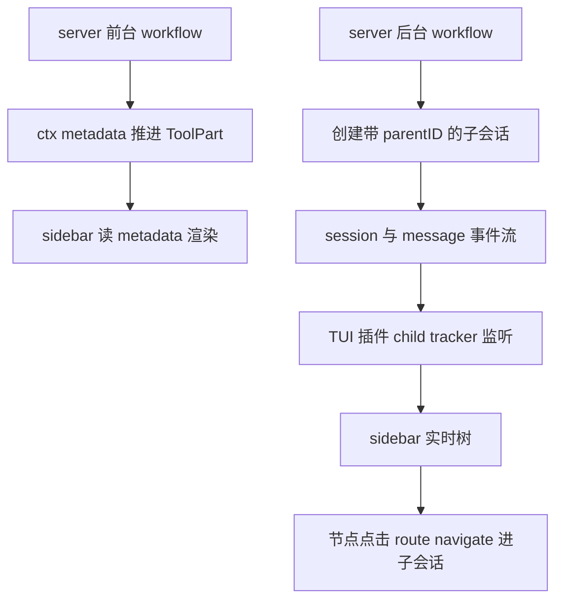

# TUI 增强需求文档 审查报告

> 审查对象：Docs/01_需求与规划/TUI增强需求文档.md（v0.1）
> 审查方式：文档中所有可核验的源码论断逐条对照 thirdparties/opencode（commit b578b7261f）与 4 个社区参考仓库实测
> 结论：**文档质量高，论断可信，但存在 1 个 P0 可行性缺口需在开工前补充决策，3 处内部不一致需修订**

---

## 1. 源码论断核验结果（全部通过）

| 文档论断 | 核验证据 | 结果 |
|----------|----------|------|
| `@opencode-ai/plugin/tui` 是 v1 包合法导出，非 v2 | packages/plugin/package.json `exports["./tui"]`；`TuiPluginModule = { id?, tui, server?: never }`（tui.ts:630-633） | 通过 |
| readV1Plugin 强制 server/tui 互斥 | shared.ts 报错原文 "must default export either server() or tui(), not both" | 通过 |
| 宿主插槽 12 个清单 | tui.ts TuiHostSlotMap 逐项一致 | 通过 |
| sidebar order 占位 Context100 / MCP200 / LSP300 / Todo400 / Files500 | feature-plugins/sidebar/*.tsx 逐文件核实 | 通过 |
| subagents-view 用 order:350 | plugin.tsx:128 原注释 "after built-in LSP (300), before Todo (400)" | 通过 |
| 主列表过滤 parentID 子会话 | dialog-session-list.tsx:190,212 | 通过 |
| "view subagents" 仅 task 工具触发 | index.tsx:1507-1509 | 通过 |
| metadata.sessionId 点击跳转只在 task 渲染分支 | index.tsx:2295-2315 | 通过 |
| Session 带 parentID 字段 | types.gen.ts:537 | 通过 |
| ToolContext.metadata 签名 | plugin/src/tool.ts:18 | 通过 |
| SDK tui.appendPrompt/executeCommand/showToast/publish | sdk.gen.ts:1030,1104,1118,1132 | 通过 |
| route.navigate("session", { sessionID }) 形状 | tui.ts TuiRouteCurrent session 分支一致 | 通过 |
| solid-js "node" condition 坑与 node_modules 逃逸方案 | subagents-view src/tui.tsx 有完整对应实现（require.resolve + tmpdir vendor 目录） | 通过 |
| AGENTS.md 合规性（./tui 非 v2，不违反 v1 only） | 核实成立，第 7 节约束扩展方案合理 | 通过 |

---

## 2. P0 问题：后台 workflow 的实时数据通道不成立

**这是文档唯一的可行性缺口，直接影响 TA-01（后台运行期间 sidebar 实时树）。**

文档 5.1 的数据流是：`background-runs.ts 的 onAgentUpdate → ctx.metadata → ToolPart.state.metadata → TUI 读取`。该链路对**前台** workflow 成立（执行期间推送正是 ctx.metadata 的设计用途，code-mode.ts:217 同款用法），但对**后台** run 有三层断裂：

### 2.1 断裂点一：background manager 根本拿不到 ToolContext

现状 `BackgroundStartDeps` 只有 `client / parentSessionId / directory`（background-runs.ts:48-53），workflow tool 调 `background.start()` 后立即返回 `{metadata: {runId, background: true}}`（workflow.ts:49-72）。要按文档方案做，得先把 ToolContext 传进 manager——文档未提这个改造。

### 2.2 断裂点二：晚到的 ctx.metadata 会把 part 改回 running（核心）

prompt.ts 中 metadata 回调的实现是闭包展开过期变量：

```ts
// session/prompt.ts:333-341
metadata: (val) =>
  Effect.gen(function* () {
    part = yield* sessions.updatePart({
      ...part,                                  // 闭包内的 part
      state: { ...part.state, ...val },         // 展开的也是闭包内的 state
    })
  })
```

而 tool 返回后的完成态写入**不回写闭包变量**（prompt.ts:399-411 是裸 `yield* sessions.updatePart(...)`，无 `part =` 赋值）。后果：后台 run 在 tool 返回后任何一次 ctx.metadata 推送，都会用闭包里的旧 state（status 永远是 "running"）整段覆盖存储里的完成态——**part 从 completed 翻回 running、output 被抹掉，TUI 永远转圈**。

### 2.3 断裂点三：SDK 无绕行通道

- SDK 无 session part 更新端点（sdk.gen.ts session 段只有 messages/revert 等）
- `client.tui.publish` 只能发 3 种固定事件（TuiPublishData body 类型限定为 EventTuiPromptAppend | EventTuiCommandExecute | EventTuiToastShow），**不能携带自定义 workflow 状态**
- 剩下的 `client.session.prompt` 注入就是现在的回传方式，写的是聊天消息，喂不了 sidebar

### 2.4 建议方案（开工前需二选一写进文档）

后台 run 的实时树改走 **TUI 侧子会话事件追踪**（subagents-view 的核心机制，文档 8.1 已列为母本但没用于这个场景）：



可行性依据（已在本地源码核实）：

1. 后台 run 的子会话都带 `parentID = 主会话`（adapter session.create body）——TUI 侧 `api.event.on` 订阅 session.created/status/idle + message.part.updated 即可构建实时树，**不依赖 server 推送**
2. 子会话 `title = agent label`（adapter create 时传入），sidebar 节点 label 天然可用
3. subagents-view 的 child-sessions-tracker.ts（192 行纯逻辑）就是这个实现，直接改造

已知代价：纯事件追踪拿不到 phase 分组与 workflow 级计数（那是 server 内存里的 records）。两个补法：
- 轻量：后台树的 phase 分组降级为"label + 状态 + 耗时"列表（MVP-1 验收标准放宽后台场景）
- 完整：server 侧把 records 快照落盘到 `.opencode-workflows/`（journal 已有落盘基础设施），TUI 侧轮询或事件触发时读取合并

**若不改方案，则 TA-01 必须拆成"前台实时树（metadata 通道）+ 后台实时树（事件追踪）"两条验收线，否则第一条验收就会卡死。**

---

## 3. P1 问题：三处内部不一致 / 实现细节缺失

### 3.1 目录结构（3.2 节）与单文件约束（9.3 节）自相矛盾

- 3.2 节列了 `index.tsx / sidebar.tsx / route.tsx` 多个 JSX 文件
- 9.3 节要求"所有 solid-js 用法集中在 `src/tui/plugin.tsx` 一个文件"——**这个文件根本不在 3.2 的目录结构里**
- 参考实现 subagents-view 的实际结构就是：`tui.tsx`（entrypoint bootstrap，含 solid patch 与逃逸）+ `plugin.tsx`（唯一碰 solid-js 的文件）+ 纯 ts 数据文件

建议修订 3.2 目录为：`index.ts`（entrypoint bootstrap）+ `plugin.tsx`（唯一 solid 文件，sidebar + /workflow 路由 UI 都在这）+ `workflow-store.ts`（纯 ts 数据提取）。9.1/9.2/9.3 三个坑的规避才有落点。

### 3.2 TA-02 在当前 tool 返回值下不成立

前台完成时 prompt.ts 用 tool 返回值覆盖 state（prompt.ts:399-411）：`metadata: result.metadata`。当前 workflow tool 只返回 `{title, output}`（workflow.ts 各 return 均无 metadata 字段）→ **完成后 state.metadata 被清成 undefined，sidebar 树随完成消失**，TA-02"完成后保持显示最终态"落空。

修法一行话：workflow tool 最终返回值带上 metadata 终态快照（`return {title, output, metadata: 最终records快照}`）。需写进 5.1。

### 3.3 依赖声明方式（6.2 节）与参考实现相反，且与 9.1 方案冲突

- 文档 6.2 提议 `@opentui/solid` / `solid-js` 走 **peerDependencies**
- 参考实现 subagents-view 用的是 **dependencies**，且 solid-js 精确 pin `1.9.12`
- 9.1 的规避方案靠 `require.resolve("solid-js", { paths: [自身] })` 定位**自己的副本**——peer 语义下解析到的是宿主提升的副本，与 `@opentui/solid` 内部解析的实例可能不同源，恰好踩中 9.3 要防的双实例问题

建议照抄参考实现：dependencies + solid-js 精确 pin。另外 opencode 宿主侧 plugin 包的 peer 是 `@opentui/*: >=0.4.5`，文档写 `>=0.4.3` 偏低，建议对齐。

---

## 4. P2 问题（小，修订时顺手改）

1. **MVP-3 的 /workflow 命令注册方式没写**。TA-04 说"/workflow 命令打开"，但全文未提命令怎么注册。机制是 `api.keymap.registerLayer({ commands, bindings })`（tui.ts 有，legacy `api.command` 已标 deprecated，别用）。补一句。
2. **running 节点的 sessionId 时序**。5.3 说"runtime 在 agent 完成时填入 sessionId"——意味着运行中的节点不可点击跳转。实际上 adapter 是先建会话再执行（adapter.ts:109-118），**running 时 sessionId 就已存在**，建议 onAgentUpdate 首次回调（status=running）就带上，sidebar 运行中节点也可进子会话围观。需改回调签名设计，文档应写明。
3. **纯事件追踪无法区分 workflow 子会话与 task 工具子会话**（若采纳 2.4 方案）：两者都带 parentID。MVP 可接受（都显示），进阶需 server 侧标记（如 session title 加前缀）或 metadata 关联。文档应把这个限制写明，避免验收争议。
4. 6.1 节"`opencode plugin <pkg> -g` 会同时写两个文件"引 README 而未实测，部署章节建议实测一次后再固化。
5. 5.2 示例 `findWorkflowToolPart` 未给实现来源，属示意可接受；但注意 ToolPart metadata 类型是 `any`，schema 校验（如 zod）建议在 TUI 侧做一层，防止旧 metadata 结构崩组件。

---

## 5. 总体评价

| 维度 | 评价 |
|------|------|
| 源码核查严谨度 | 优。抽查 14 组论断全部与本地源码一致，行号引用可用 |
| v1 边界判断 | 优。./tui 非 v2 的定性正确，AGENTS.md 扩展方案（第 7 节）合理 |
| 架构分层 | 优。server 写 / TUI 读经 metadata 解耦，runtime 不碰 opencode 包的约束保持 |
| 已知坑挖掘 | 优。9.1/9.2 两个坑是真实且已验证的，规避方案有参考实现背书 |
| 数据流可行性 | **中。前台成立、后台断裂（P0），需按第 2 节修订** |
| 内部一致性 | 中。3.2 与 9.3 矛盾、TA-02 与现状矛盾、6.2 与参考实现相反 |

**建议**：按第 2 节补后台通道决策、按第 3 节修三处不一致后，文档即可作为实施基线。MVP-1 范围建议明确写成"前台 metadata 通道 + 后台事件追踪通道"双轨，工作量比单通道多约一个 tracker 改造（subagents-view 已有 192 行母本，改造成本低）。

---

## 6. 引用说明

- 审查对象：Docs/01_需求与规划/TUI增强需求文档.md
- 源码基线：thirdparties/opencode commit b578b7261f
  - packages/opencode/src/session/prompt.ts:325-430（metadata 闭包与完成态覆盖，P0 证据）
  - packages/sdk/js/src/gen/types.gen.ts:3792-3801（TuiPublishData 仅 3 种事件，P0 证据）
  - packages/plugin/src/tui.ts:53-77,581-633（route/keymap/TuiPluginApi）
- 本项目现状：src/tools/workflow.ts:49-72（background 提前返回）、src/tools/background-runs.ts:48-53（无 ToolContext）、src/adapters/opencode-session-adapter.ts:109-118（parentID + title=label）
- 参考实现：thirdparties/opencode-subagents-view/src/child-sessions-tracker.ts（后台追踪母本）
