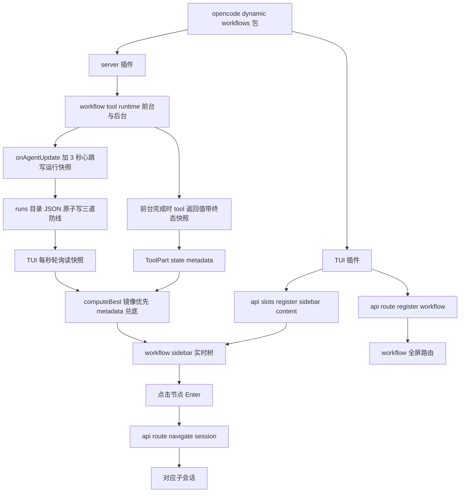
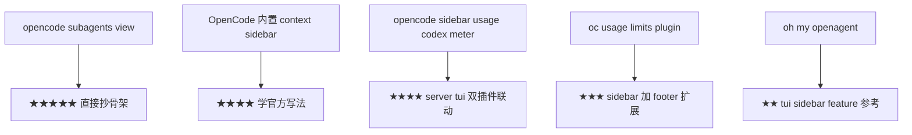

# TUI 增强需求文档

> 版本：v0.3（v0.2 基础上按 Docs/02_设计与说明/TUI实时通道优化方案.md 实施：执行期实时通道定稿为文件镜像（前台后台同源），ctx.metadata 执行期推送移除（实证不产生事件，见 9.8），后台实时树提前落地，已真机验收）
>
> **验收状态（2026-09-08）：MVP-1 与 MVP-2 与 MVP-3 全部真机验收通过**（TA-01a 与 TA-01b 与 TA-02 与 TA-03 与 TA-04 及中止与失败态与空态与键冲突），验收记录见 examples/sample-project/TUI测试指南.md；MVP-4（patch ToolPart）仍为可选非首期
> 关联：主需求文档 F-20 / 阶段 4；本文件把 TUI 增强从主文档拆出独立成篇
> 核查基线：thirdparties/opencode（commit b578b7261f）源码逐条核实，社区参考仓库均已本地化

---

## 目录

1. [项目背景与目标](#1-项目背景与目标)
2. [v1 能力边界核查结论](#2-v1-能力边界核查结论)
3. [目标架构：双插件形态](#3-目标架构双插件形态)
4. [功能需求](#4-功能需求)
5. [数据流设计](#5-数据流设计)
6. [配置与部署](#6-配置与部署)
7. [AGENTS.md 约束扩展](#7-agentsmd-约束扩展)
8. [参考实现与优先级](#8-参考实现与优先级)
9. [已知坑与规避](#9-已知坑与规避)
10. [验收标准](#10-验收标准)
11. [引用说明](#11-引用说明)

---

## 1. 项目背景与目标

### 1.1 背景

P0/P1/P2 已完成，动态工作流的核心能力（workflow runtime、journal resume、model tier、verify/judgePanel、worktree 隔离、后台工作流、workflow_control、token/cost 统计）均已落地并实测通过。但 **TUI 可见性** 一直是已接受的限制（R-01）：主上下文不爆炸的目标达成了，代价是 workflow 执行过程对用户是个黑盒——4 个 agent 并行跑的时候，用户在 TUI 里看不到哪个在跑、哪个完成、哪个卡住，只能等 workflow tool 返回后看汇总。

主需求文档 F-20 原文写"视 v2 API 稳定情况评估"，把 TUI 增强推迟到 v2。源码核查后发现：**v1 包内已经存在独立的 TUI 插件 entrypoint（`@opencode-ai/plugin/tui`），不需要等 v2**。社区已有成熟的 TUI 插件（opencode-subagents-view 等）在不 fork OpenCode 的前提下实现了 sidebar 实时面板。本文件据此重新定义 F-20。

### 1.2 目标

| 目标 | 说明 |
|------|------|
| 主目标 | workflow 执行期间在 TUI sidebar 实时展示 agent 树（状态/进度/耗时），可点击进入对应子会话 |
| 约束 | 不 fork OpenCode TUI 源码；走 v1 包内合法 entrypoint，不引入 v2 API |
| 非目标 | 不做 Pi 风格的独立 TUI Panel 窗口；不替换聊天区 ToolPart 的原生渲染（最后一步可选 patch） |

### 1.3 类比理解

类比：现在的 workflow 像一个"黑盒洗衣机"——你扔进去衣服（脚本），机器转起来你只听见响声，洗完才弹出一张清单。目标是给洗衣机装一块"透明观察窗"——你能看到内筒在转、哪个格子的衣服在洗、哪个洗完了，还能点开某格看细节。这块观察窗不是重新造一台洗衣机（不 fork TUI），而是装在原有洗衣机的观察位上（sidebar_content slot）。

---

## 2. v1 能力边界核查结论

> 以下结论全部对照 thirdparties/opencode 源码核实，每条带证据。

### 2.1 v1 插件的两种互斥形态

v1 插件有 **server 插件** 与 **TUI 插件** 两种互斥形态，由不同的 entrypoint 导出：

| 形态 | 导出路径 | default export 形状 | 证据 |
|------|----------|---------------------|------|
| server 插件 | `@opencode-ai/plugin` | `{ id?, server: Plugin }` | packages/plugin/src/index.ts:76-80 |
| TUI 插件 | `@opencode-ai/plugin/tui` | `{ id?, tui: TuiPlugin }` | packages/plugin/src/tui.ts:630-633 |

`readV1Plugin` 强制二者互斥（packages/opencode/src/plugin/shared.ts:293-295："must default export either server() or tui(), not both"）。一个 npm 包可以同时暴露两个 entrypoint（`exports["./server"]` 与 `exports["./tui"]`，shared.ts:103-114），运行时分别被 server 与 TUI 侧加载。

**关键澄清**：`@opencode-ai/plugin/tui` 是 v1 包内的合法导出，**不是 v2**。AGENTS.md 禁止的是 `@opencode-ai/plugin/v2/*` 与 `Plugin.define`，不涉及 `./tui`。引入 TUI 插件不违反"v1 only"原则，但需要扩展 AGENTS.md 的形态约束（见第 7 节）。

### 2.2 server 插件能做什么（TUI 相关）

server 插件本身 **不能直接渲染 TUI**（Hooks 接口无 panel/render/component/slot 字段，packages/plugin/src/index.ts:222-335）。但可经 `PluginInput.client` 的 SDK HTTP 端点 + `event` 钩子间接驱动 TUI：

1. **`ctx.metadata(input)`** 写 ToolPart 的 state.metadata（packages/plugin/src/tool.ts:18）——这是 server 端向 TUI 传递结构化 workflow 状态的主通道，**仅在 tool 执行期内可靠**；tool 返回后闭包过期、再推送会破坏完成态（见 9.6）
2. **`event` 钩子** 订阅 session.*/message.*/tui.* 事件（packages/plugin/src/index.ts:224）——监听子会话创建/完成
3. **`client.tui.showToast` / `client.tui.publish`** 推 toast 通知（packages/sdk/js/src/gen/sdk.gen.ts:1118,1132）；注意 tui.publish 仅能发 3 种固定 tui 事件（prompt.append / command.execute / toast.show，types.gen.ts:3792-3801），**不能携带自定义 workflow 状态**（见 9.7）
4. **`client.tui.appendPrompt` / `client.tui.executeCommand`** 向 prompt 注入文本或触发内置命令

### 2.3 TUI 插件能做什么

TUI 插件（packages/plugin/src/tui.ts:581-626 `TuiPluginApi`）有完整 UI 能力：

| 能力 | API | 证据 |
|------|-----|------|
| 插槽注入 | `api.slots.register({ slots: { sidebar_content, session_prompt, ... } })` | tui.ts:517,455-486 |
| 自定义路由 | `api.route.register / navigate / current` | tui.ts:594-598 |
| 对话框/toast | `api.ui.Dialog / DialogAlert / DialogConfirm / DialogSelect / toast` | tui.ts:599-609 |
| 键位层 | `api.keymap.registerLayer({ commands, bindings })` | tui.ts:592 |
| 事件订阅 | `api.event.on(...)` | tui.ts |
| 响应式状态 | `api.state.session.messages / part` | tui.ts |
| 主题/通知 | `api.theme / api.attention.notify` | tui.ts |

**宿主插槽清单**（TuiHostSlotMap，tui.ts:455-486）：`app` / `app_bottom` / `home_logo` / `home_prompt` / `home_prompt_right` / `home_bottom` / `home_footer` / `session_prompt` / `session_prompt_right` / `sidebar_title` / `sidebar_content` / `sidebar_footer`。

**内置 sidebar section 的 order 占位**（opencode-subagents-view 实测）：Context=100、MCP=200、LSP=300、Todo=400、Files=500。workflow sidebar 建议落在 order:350（LSP 之后、Todo 之前）。

### 2.4 事件清单（可被插件订阅）

经 EventV2Bridge 分发到 server 插件 `event` 钩子（packages/opencode/src/plugin/index.ts:255-262），按 `event.location?.directory` 过滤（同目录才分发）：

- **tui.\*** （3 个）：`tui.prompt.append` / `tui.command.execute` / `tui.toast.show`（types.gen.ts:614-656）
- **session.\*** （8 个）：`session.status` / `session.idle` / `session.compacted` / `session.created` / `session.updated` / `session.deleted` / `session.diff` / `session.error`（types.gen.ts:467-597）。**Session 带 parentID 字段**（types.gen.ts:537），可据此识别子会话
- **message.\*** （4 个）：`message.updated` / `message.removed` / `message.part.updated` / `message.part.removed`（types.gen.ts:145-421）

**v1 不支持** `tui.session.select` 事件（仅在 schema 与 v2 SDK，types.gen.ts:704-736 未列出）。

### 2.5 子会话在 TUI 的现状（R-02 限制）

- **主列表过滤所有 parentID 会话**（dialog-session-list.tsx:188-193,211-213）——子会话不能从主列表打开
- **父会话 children 导航**：`session.child.first/next/previous`、`session.parent` 隐藏命令（routes/session/index.tsx:1035-1083，均 hidden:true，仅 parentID 存在时 enabled）
- **"view subagents" 提示触发条件**：assistant 消息的 parts 含 `type === "tool" && tool === "task"` 的 part（index.tsx:1509-1531）。**插件自定义 tool 不触发此提示**——workflow tool 调用不会自动出现"view subagents"入口
- **子会话页脚**：parentID 真值时渲染 subagent-footer（index.tsx:1309-1311），显示标签/兄弟索引/token/cost/可点击 Parent/Prev/Next

### 2.6 tool 返回 metadata 的 UI 呈现

TUI 读 `props.part.state.metadata`（index.tsx:1720-1723）。**关键发现**：Task 工具的 metadata.sessionId 字段会被同一段 `onClick` 逻辑消费——点击即跳子会话（index.tsx:2305-2308）：

```ts
onClick: () => navigate({ type: "session", sessionID: metadata.sessionId })
```

但这段逻辑落在 Task 工具的渲染分支。**插件自定义 tool 若 metadata 含 sessionId**，只有当 display 落到 task 分支才生效；落到 GenericTool 分支（index.tsx:1783）则只 expand/collapse 文本，不导航。这是 MVP-2（点击进入子会话）要解决的点。

---

## 3. 目标架构：双插件形态

### 3.1 总体架构



### 3.2 包结构

参考 opencode-sidebar-usage（codex-meter）的双 entrypoint 结构（package.json `exports["."]` + `["./server"]` + `["./tui"]`），本包扩展为同时暴露 server 与 tui 两个入口：

```
opencode-dynamic-workflows/
├─ src/
│  ├─ index.ts                 # server 插件入口（现有，default export { id, server }）
│  ├─ tools/                   # workflow / workflow-control / background-runs / render（现有）
│  ├─ runtime/ ...             # 现有
│  └─ tui/                     # 新增：TUI 插件
│     ├─ index.tsx             # ./tui entrypoint bootstrap：solid-js patch 与 node_modules 逃逸后动态 import plugin.tsx（见 9.1 9.2）
│     ├─ plugin.tsx            # 唯一 solid-js 文件（见 9.3）：sidebar 树与 workflow 路由 UI 全部集中于此
│     ├─ child-sessions-tracker.ts # 后台通道：纯 ts，从 session 与 message 事件维护子会话记录（母本 subagents-view）
│     └─ workflow-store.ts     # 纯 ts：前台从 ToolPart.metadata 提取状态 加 形状校验（metadata 类型为 any）
├─ package.json                # exports 加 ./tui
└─ tsconfig.tui.json           # TUI 编译配置（jsxImportSource @opentui/solid）
```

### 3.3 分层约束

- server 插件（src/）：保持现有 AGENTS.md 约束，runtime 禁止 import opencode 包
- TUI 插件（src/tui/）：允许 import `@opencode-ai/plugin/tui`、`@opentui/solid`、`solid-js`；**禁止 import server 侧的 runtime/adapters**（TUI 只消费 metadata，不执行 workflow）
- 前台经 ToolPart.metadata 解耦：server 写、TUI 读，无直接调用；后台经子会话事件流解耦（TUI 只读事件，server 侧零改动）

---

## 4. 功能需求

### 4.1 MVP 分级


| 编号 | 需求 | 说明 |
|------|------|------|
| T-01 (MVP-1) | sidebar 实时 workflow 树（双通道） | 前台读 ToolPart.metadata（5.1），后台走 TUI 侧子会话事件追踪（5.2，因 ctx.metadata 在 tool 返回后不可用，见 9.6）。渲染：每 agent 一行（状态 + label + 耗时），前台 phase 分组、后台平铺，Running/Completed 计数；无运行中的 workflow 不渲染 |
| T-02 (MVP-2) | 节点点击进子会话 | 选中某 agent 节点按 Enter，`api.route.navigate("session", { sessionID })` 跳到对应子会话；前提是 workflow 脚本里 agent() 产生的子会话 ID 写进 metadata |
| T-03 (MVP-3) | /workflow 全屏路由 | `api.route.register` 注册 /workflow 路由，展示完整 workflow DAG（含 phase 层级、并行分组、每节点 sessionId/状态/耗时/token），支持上下选择 + Enter 进子会话；命令经 `api.keymap.registerLayer({ commands, bindings })` 注册进命令面板（legacy `api.command` 已 deprecated，不用） |
| T-04 (MVP-4 可选) | 聊天区原生 workflow renderer | patch OpenCode TUI 的 ToolPart 渲染分支，让 workflow tool 调用在聊天区直接展示树形 UI 而非折叠文本。**需改 OpenCode 源码，非首期**。2026-09-08 决策：跳过（与 TA-06 不 fork 约束冲突，维持现状） |

### 4.2 明确不做

- 不 fork OpenCode TUI 源码（首期）
- 不实现 Pi 风格的独立 TUI Panel 窗口
- 不替换聊天区 ToolPart 原生渲染（MVP-4 之前）
- 不引入 v2 API（`Plugin.define`、`@opencode-ai/plugin/v2/*`、`ctx.storage`、`session.next.*`）

---

## 5. 数据流设计

### 5.1 执行期实时通道：文件镜像快照（v0.3 定稿，前台后台同源）

workflow 执行期间（前台与后台同一套），server 把 records 快照原子写入：

```
<项目目录>/.opencode-workflows/runs/<runId>.json
{ version, runId, parentSessionId, name, status, time, phases, agents含sessionId, running/completed/failed/total }
```

- 写入时机：onAgentUpdate 每次状态迁移 + **3 秒心跳**（并行 agent 长时间无迁移时防 TUI 误判失联）+ 三处终态（completed/aborted/failed）
- 三道防线（照抄 oh-my-openagent）：原子写（tmp+rename，Windows unlink 兑底）、版本号、新鲜度（running 超 8 秒未更新视为失联降级）
- 清理：新 run 启动时删除同会话终态快照（活快照不动，支持并发后台 run）
- 实现代码：src/tools/run-snapshot.ts（server 写）与 src/tui/run-snapshot-reader.ts（TUI 读，跨进程契约两处同步）

设计依据与选型过程见 Docs/02_设计与说明/TUI实时通道优化方案.md 与 Docs/04_参考实现/00-05。

**完成态仍需 tool 返回值 metadata 兜底（C 通道）**：旧会话重开时快照可能已被清理，前台 tool 返回值的 metadata 终态快照是兑底数据源（prompt.ts 用 result.metadata 覆盖 state）。执行期 ctx.metadata 推送已移除——见 9.8。

**已有基础**：runtime 已有 `onAgentUpdate` 回调（workflow-runtime.ts 共 6 处调用点）；AgentRecord 已含 label/phase/status/tokens/cost/durationMs/model 与 sessionId（adapter 建会话即回填，running 态就有值）。

### 5.2 后台通道：同一镜像快照（v0.3 起与前台同源）

后台 run 与前台共用 5.1 的镜像通道：background-runs 的 onAgentUpdate 与三个终态分支写同一 runs 目录快照，心跳同款。后台因此直接获得与前台同构的实时树（含 phase 分组与计数）——原计划的事件追踪方案（subagents-view 同构）已降级为 Deferred 备选，触发条件见 Docs/02_设计与说明/TUI实时通道优化方案.md 第 11 节。

历史背景（v0.2 结论，保留作决策依据）：后台曾因三重断裂不能走 metadata——background manager 拿不到 ToolContext；tool 返回后 ctx.metadata 闭包持有过期 state（见 9.6）；SDK 无 part 更新端点且 tui.publish 仅 3 种固定事件（见 9.7）。镜像通道一次性绕开全部三条。

### 5.3 TUI 端：双通道合并渲染（computeBest）

```typescript
// 仅示意，实际位于 src/tui/plugin.tsx（见 9.3 单文件约束）与 workflow-store.ts（纯函数）
computeBest(session) =
  snapshots = listSessionSnapshots(会话 directory, session_id)   // B 通道 镜像快照
  latest 非失联 ? toProgress(latest)                               // 镜像优先
                 : parseWorkflowMetadata(findWorkflowMetadata(...))  // C 通道 兑底（tool 返回值 metadata）
```

- 驱动：1 秒轮询（主，B 通道）+ message 事件 30ms 去抖（辅，C 通道时效）；viewKey 差分不变不重渲
- C 通道读 part 的正确姿势：message 与 part 在 TUI sync store 分存，必须经 `api.state.part(messageID)` 取 part，不能读 message.parts（恒为空，踩坑记录）
- signal 按 session 缓存于模块级 Map（复用而非重建，subagents-view 真实 bug 教训）
- 镜像失联（running 超 8 秒）降级 C 通道；两者皆无则不渲染

### 5.4 MVP-2 导航

选中某 agent 节点按 Enter，调 `api.route.navigate("session", { sessionID: node.sessionId })`（与 TuiRouteCurrent 的 session 分支形状一致，tui.ts:53-62）。

- 前台：sessionId 来自 metadata.nodes[].sessionId（5.1，running 态即有值——adapter 先建子会话再执行，adapter.ts:109-118）
- 后台：sessionId 即 tracker 记录里的子会话 id，天然可得

---

## 6. 配置与部署

### 6.1 双配置文件

OpenCode 把 server 与 TUI 插件配置分离（opencode-sidebar-usage README 实测确认）：

```jsonc
// opencode.json（server 插件，现有）
{ "plugin": ["<包路径>"] }

// tui.json（TUI 插件，新增）
{ "plugin": ["<包路径>"] }
```

两个文件都指向同一个包，运行时分别加载 `./server` 与 `./tui` entrypoint。本地开发时两个文件都要配；`opencode plugin <pkg> -g` 命令会同时写两个文件（codex-meter README 记载，正式部署前实测一次确认）。

### 6.2 依赖

TUI 插件的 UI 依赖照抄 subagents-view 的声明方式：**dependencies + solid-js 精确 pin，不用 peerDependencies**：

```jsonc
{
  "peerDependencies": {
    "@opencode-ai/plugin": "1.18.27"
  },
  "dependencies": {
    "@opentui/solid": "^0.4.5",
    "solid-js": "1.9.12"
  }
}
```

原因：9.1 的规避方案靠 `require.resolve("solid-js", { paths: [自身] })` 定位自己的副本——peer 语义下解析到宿主提升的副本，可能与 `@opentui/solid` 内部解析的实例不同源，恰好踩 9.3 的双实例坑。@opentui 版本对齐宿主 plugin 包的 peer 要求（>=0.4.5）。server 入口不 import 这两个包即可（依赖装在包内不影响 server 路径）。

### 6.3 Desktop 端（GUI）说明：TUI 插件不加载，属预期

**现象**：OpenCode Desktop（Electron + solid-js GUI，基于 packages/app）里 workflow tool 正常可用，但 sidebar 不出现 Dynamic Workflow，tui.json 完全不生效。

**原因**（thirdparties/opencode packages/desktop 源码核实）：Desktop 连接同一 opencode server 进程（读 opencode.json，server 插件正常），但它不启动 TUI 进程，也就不读 tui.json；Desktop 的 GUI 是另一套 UI（packages/app + session-ui），目前没有第三方面板或插件扩展点（session-ui 的 BasicTool 等均为内置工具专用 UI）。**不是 bug，是两套 UI 运行时。**

**当前解法（零开发）**：Desktop 内置 PTY 终端面板（terminal-panel），在终端面板里直接运行 opencode（TUI）——TUI 从项目目录启动即读 tui.json，实时树与全屏路由与点击导航全部可用。

**远期**：Desktop GUI 原生面板等官方 GUI 扩展 API。本项目的文件镜像通道天然 GUI 友好（只读 JSON 文件，不依赖 TUI 事件），GUI 插件 API 一旦可用，src/tui/run-snapshot-reader.ts 的读取逻辑可几乎原样复用。不建议 fork Desktop。

**社区插件现状核查（2026-09-08，thirdparties 全量扫描）**：五个参考插件无一支持 Desktop GUI——subagents-view 与 sidebar-usage 与 oc-usage-limits 为纯 TUI 插件零 desktop 代码；oh-my-openagent 的 web 包是营销官网与插件无关；唯一涉及 desktop 的 magic-context 仅在 doctor 命令里检测安装形态（Desktop ships no invocable CLI，降级继续查配置与插件缓存），属兼容处理非 GUI 开发。opencode 官方文档快照亦无 Desktop 插件开发页（plugins.mdx 只讲 server 与 TUI 两种形态），desktop 主进程零 tui 引用（grep 实证）。社区共识与本文一致：Desktop 场景用内置终端面板跑 TUI。

### 6.4 编译

TUI 插件用 JSX（@opentui/solid），需独立 tsconfig：

- tsconfig.tui.json：`jsx: "react-jsx"` + `jsxImportSource: "@opentui/solid"`
- build 脚本加 `build:tui`（tsc -p tsconfig.tui.json）

参考 opencode-sidebar-usage 的 `npm run build:tui`（package.json:40）。

---

## 7. AGENTS.md 约束扩展

### 7.1 现有约束的边界

AGENTS.md 现有规则"v1 插件模块必须 default export `{ id, server: Plugin }`"限定的是 **server 插件形态**。引入 TUI 插件需扩展为：

> 本包同时暴露两个 v1 entrypoint：
> - `@opencode-ai/plugin`（`exports["."]` / `exports["./server"]`）：default export `{ id, server: Plugin }`，现有 server 插件
> - `@opencode-ai/plugin/tui`（`exports["./tui"]`）：default export `{ id, tui: TuiPlugin }`，新增 TUI 插件
>
> 二者经 readV1Plugin 互斥加载（shared.ts:293-295），不是 v2，不引入 Plugin.define / ctx.storage / session.next.*。

### 7.2 不变约束

- 仍然 v1 only，禁止 `@opencode-ai/plugin/v2/*` 导入与 `Plugin.define`
- server 插件侧（src/）架构约束不变：runtime 禁止 import opencode 包
- TUI 插件侧（src/tui/）允许 import `@opencode-ai/plugin/tui` 与 @opentui/solid，但禁止 import server 侧 runtime/adapters

### 7.3 测试

TUI 插件测试参考 opencode-subagents-view 的 `tests/child-sessions-tracker.test.ts`：纯逻辑（store/sidebar 数据提取）用 plain mock + solid-js `createRoot` 测，不启真实 opencode。server 侧 metadata 序列化用现有 node:test + fake runner 模式。

---

## 8. 参考实现与优先级



### 8.1 opencode-subagents-view（★★★★★，骨架母本）

- 目录：thirdparties/opencode-subagents-view
- 版本：0.3.0（package.json:3）
- License：MIT
- 重合度：与本项目需求重合 70%~80%
- 核心价值：
  - `src/child-sessions-tracker.ts`：监听 session.created/updated/status/idle/deleted + message.part.updated，维护子会话成员——**后台通道（5.2）的直接母本，改造复用**
  - `src/plugin.tsx`：`api.slots.register({ order: 350, slots: { sidebar_content } })`，唯一一个碰 solid-js 的文件（避免多实例导致信号失效）
  - 已踩并解决 solid-js / JSX 两大坑（见第 9 节）
- 借鉴方向：把它的 "Subagents" 改造成 "Dynamic Workflow"，session 级追踪改成 workflow 级（node = agent 调用，不是 child session 本身）

### 8.2 OpenCode 内置 context sidebar（★★★★，官方写法）

- 目录：thirdparties/opencode/packages/tui/src/feature-plugins/sidebar/context.tsx
- 核心价值：官方自己用同一套 `api.slots.register` 实现 Context/tokens/cost sidebar，学 theme/state/slot 的标准用法
- 借鉴方向：order 占位、折叠/展开信号、token/cost 展示样式

### 8.3 opencode-sidebar-usage / codex-meter（★★★★，双插件联动）

- 目录：thirdparties/opencode-sidebar-usage
- 版本：0.1.3（package.json:3）
- License：MIT
- 核心价值：**server 插件 + TUI 插件同时存在的标准范式**
  - package.json `exports` 同时暴露 `.` / `./server` / `./tui`（package.json:16-29）
  - README 明确"必须同时配 opencode.json 和 tui.json"
  - `codex_usage` tool（server）写状态 + sidebar panel（TUI）读状态，与本项目 workflow tool（server）写 metadata + sidebar（TUI）读 metadata 同构
- 借鉴方向：双 entrypoint 包结构、双配置文件、build:tui 脚本

### 8.4 oc-usage-limits-plugin（★★★，sidebar + footer）

- 目录：thirdparties/oc-usage-limits-plugin
- License：MIT
- 核心价值：同时往 `sidebar_content` 与 `session_prompt`（prompt footer）插 UI
- 借鉴方向：未来 workflow 状态在输入框下方加一行"Workflow: xxx | 3/7 | 2 running | 24.8s"

### 8.5 oh-my-openagent（★★，tui-sidebar feature）

- 目录：thirdparties/oh-my-openagent（即 oh-my-opencode 的重命名过渡）
- 核心价值：大型插件 monorepo，含 `packages/omo-opencode/src/features/tui-sidebar/` feature 模块
- 借鉴方向：复杂插件的 tui-sidebar feature 实现细节；但仓库过大，仅局部参考

---

## 9. 已知坑与规避

### 9.1 solid-js 的 node condition 在 bun 下解析错版本

**现象**：solid-js 的 exports map 有 "node" condition 指向 SSR 非响应式 build（createEffect 是 no-op，信号不通知订阅者）。bun 匹配 "node" condition，导致插件 import 的 solid-js 是 SSR 版，信号永远不更新——createSignal/createEffect/createMemo 都存在不报错，但渲染一次后不再变。

**根因**：opencode 动态 import 插件的未打包 node_modules（而非预 bundle），bun 的 condition 匹配对插件自身代码与 @opentui/solid 内部的 solid-js import 都生效。

**规避**（opencode-subagents-view 验证可行）：在 `./tui` entrypoint（src/tui/index.tsx）同步 patch solid-js 的 package.json——移除 "node" condition，用 `require.resolve("solid-js", { paths: [here] })` 相对自身定位 solid-js 副本（不受安装路径深度影响），再 dynamic import 实际实现文件。

**不可用方案**：
- postinstall 脚本（patch-package）：opencode 的 "Install Plugin" 命令安装时不跑 lifecycle scripts，postinstall 永远不执行
- bundle solid-js 进单文件：插件能注册但 sidebar 不渲染（@opentui/solid 的 bun 专用 build 必须运行时解析）

### 9.2 JSX 在 node_modules 内 @opentui/solid 解析失败

**现象**：src/tui/实现.tsx 用 JSX，jsxImportSource 设 @opentui/solid。但文件路径含 node_modules 段时，bun 忽略 tsconfig.json 与 per-file `@jsxImportSource` pragma，回退用 React 的 JSX runtime，插件注册成功但不渲染（无报错）。

**根因**：bun 对 node_modules 内的文件应用不同默认，忽略外部 tsconfig 与 pragma。

**规避**（opencode-subagents-view 验证可行）：`./tui` entrypoint 检测自身包根是否在 node_modules 内；若是，把实现文件复制到 OS temp 目录外（按包名 version 命名空间，node_modules 软链回包自身依赖），从复制位置 dynamic import；包根已在 node_modules 外（from source 开发流）则直接 import。

### 9.3 所有 solid-js 代码必须集中在单文件

**现象**：早期 createSignal/createEffect 跨文件分散，导致不同 solid-js 实例，信号跨文件不传播。

**规避**：所有 solid-js 用法（createSignal/createEffect/createMemo/JSX）集中在 src/tui/plugin.tsx 一个文件——sidebar 树与 workflow 路由的 UI 都写在这里（目录结构见 3.2）；纯 TypeScript 数据逻辑（store 提取、tracker、label 格式化）拆为独立 ts 文件。单文件 加 自持依赖副本（6.2 的 dependencies 与精确 pin）共同保证 solid-js 单实例。

### 9.4 主列表不显示子会话

**现象**：dialog-session-list.tsx:188-193,211-213 过滤所有 parentID 会话，子会话不能从主 Sessions 列表打开。

**规避**：MVP-2 的"进入子会话"走 `api.route.navigate("session", { sessionID })`，不依赖主列表。workflow sidebar 节点点击即跳，用户不需要先打开主列表。

### 9.5 workflow tool 不触发 view subagents 提示

**现象**："view subagents" 提示只在 assistant 消息含 `tool === "task"` 的 part 时出现（index.tsx:1509）。本项目 workflow tool 不叫 task，不触发该入口。

**规避**：自建 sidebar（MVP-1）与 /workflow 路由（MVP-3）作为进入子会话的主入口，不依赖原生提示。MVP-4 若要原生提示，需 patch index.tsx:1509 的判断条件（改 OpenCode 源码）。

### 9.6 tool 返回后的 ctx.metadata 会破坏完成态

**现象**：prompt.ts 的 metadata 回调按闭包展开写 part（prompt.ts:333-341：`state: {...part.state, ...val}`，part 是闭包变量），而 tool 返回后的完成态写入不回写该变量（prompt.ts:399-411 无赋值）。tool 返回后任何一次 ctx.metadata 推送，都会用闭包里的旧 state（status 恒为 running）整段覆盖存储完成态——part 从 completed 翻回 running、output 被抹掉，TUI 里该 tool 永远转圈。

**规避**：后台 run 禁用 ctx.metadata，改走 5.2 事件追踪；前台只在执行期内推送，终态经 tool 返回值的 metadata 快照落盘（5.1）。

### 9.7 server 没有自定义事件推送通道

**现象**：tui.publish 的 body 类型限定为 EventTuiPromptAppend / EventTuiCommandExecute / EventTuiToastShow 三种（types.gen.ts:3792-3801），不能携带自定义 workflow 状态；SDK 亦无 session part 更新端点。

**结论**：server 向 TUI 传结构化状态的合法通道只有两条——子会话事件流与文件镜像（9.8 实证后 ctx.metadata 执行期推送也从合法清单移除）。不要指望自定义事件广播。

### 9.8 插件 tool 的 ctx.metadata 执行期推送不产生事件（v0.3 实证）

**现象**：前台 workflow 执行期内，onAgentUpdate 里调用 context.metadata 写入的进度快照从未到达 TUI。opencode.db 的 event 表实证：该会话执行期 workflow part 只有 pending 与 running 与 completed 三次状态变化（均框架自身写入），无任何携带 metadata 的中间事件；TUI 侧诊断亦证实执行期 sync store 的 part 列表为空。

**影响**：执行期实时树不能依赖 ctx.metadata（5 个社区参考实现均未依赖它做实时，见参考实现 00 文档）。完成态经 tool 返回值 metadata 落盘仍然有效（prompt.ts 用 result.metadata 覆盖 state）。

**规避（v0.3 定稿）**：执行期实时一律走文件镜像快照（见 5.1）；TUI 侧读 part 必须经 api.state.part(messageID)（message 与 part 在 sync store 分存，message.parts 恒为空）。

**附带发现（TUI 排障记录）**：
- TUI 插件加载错误只打终端 stderr（[tui.plugin] 前缀），会被界面刷掉，日志文件查不到；排障可用文件落盘诊断
- TUI 插件启用状态持久化在 ~/.local/state/opencode/kv.json 的 plugin_enabled 键，面板里误触 deactivate 会持续 disabled；Install add 流程激活但不持久化（persist false），必须面板行 Enter 切换才写回
- solid-js 双实例：外部插件读宿主 api.state 无跨副本响应性，必须事件驱动镜像到自己的 signal；part 数据从事件本体 properties 取而非回读 store

---

## 10. 验收标准

| 编号 | 标准 |
|------|------|
| TA-01a | MVP-1 前台：workflow 执行期间 sidebar 出现 Dynamic Workflow section，实时 agent 树（状态 + label + 耗时 + phase 分组 + Running 与 Completed 计数） |
| TA-01b | MVP-1 后台：background workflow 运行期间 sidebar 实时显示子会话树（label + 状态 + 耗时，平铺不分组，分组为进阶项）；run 结束后显示终态 |
| TA-02 | MVP-1：workflow 不运行时 sidebar section 隐藏；前台 workflow 完成后 section 保持显示最终态可折叠（前提：tool 返回值携带 metadata 终态快照，见 5.1） |
| TA-03 | MVP-2：选中 agent 节点按 Enter，跳到对应子会话，能在子会话查看该 agent 的完整上下文 |
| TA-04 | MVP-3：`/workflow` 命令打开全屏路由，展示完整 DAG（phase 层级、并行分组、每节点 sessionId/状态/耗时/token） |
| TA-05 | 双插件配置：opencode.json + tui.json 都配同一包，server 与 TUI 两侧都 active（ctrl+p → Plugins 可见） |
| TA-06 | 不 fork OpenCode：TUI 插件经 tui.json 加载，无 OpenCode 源码改动 |
| TA-07 | 约束：不引入 v2 API（无 Plugin.define / ctx.storage / session.next.* / @opencode-ai/plugin/v2/* 导入） |

---

## 11. 引用说明

- 主需求文档 F-20 / 阶段 4（Docs/01_需求与规划/opencode-dynamic-workflows需求文档.md 第 4.3 节、第 9 节）
- v1 能力边界核查：thirdparties/opencode 源码（commit b578b7261f）
  - packages/plugin/src/index.ts:76-80,222-335 — server 插件形态与 Hooks
  - packages/plugin/src/tui.ts:455-486,517,581-633 — TUI 插件形态与 API
  - packages/opencode/src/plugin/shared.ts:103-114,293-295 — 双 entrypoint 互斥
  - packages/sdk/js/src/gen/types.gen.ts:145-656,704-736 — 事件联合
  - packages/tui/src/routes/session/index.tsx:1509-1531,1720-1723,2305-2308 — ToolPart 渲染与导航
  - packages/tui/src/component/dialog-session-list.tsx:188-213 — 主列表过滤
- 社区参考实现（均已本地化到 thirdparties/）：
  - opencode-subagents-view v0.3.0（giovannic96，MIT）— sidebar 骨架母本，solid-js patch 与 JSX escape 两大坑的解法来源
  - opencode-sidebar-usage v0.3.0 / codex-meter（SBakolis，MIT）— server + TUI 双插件联动范式
  - oc-usage-limits-plugin（mynameistito，MIT）— sidebar + prompt footer 扩展
  - oh-my-openagent / oh-my-opencode（code-yeongyu）— tui-sidebar feature 局部参考
- 可行性对话：《opencode v1 TUI 增强》（opencode补充说明tui.md，ChatGPT 对话记录，2026-09）
- OpenCode 官方插件文档：https://opencode.ai/docs/plugins/
- 审查报告：Docs/01_需求与规划/TUI增强需求审查报告.md（v0.2 修订依据，含全部源码证据行号）
