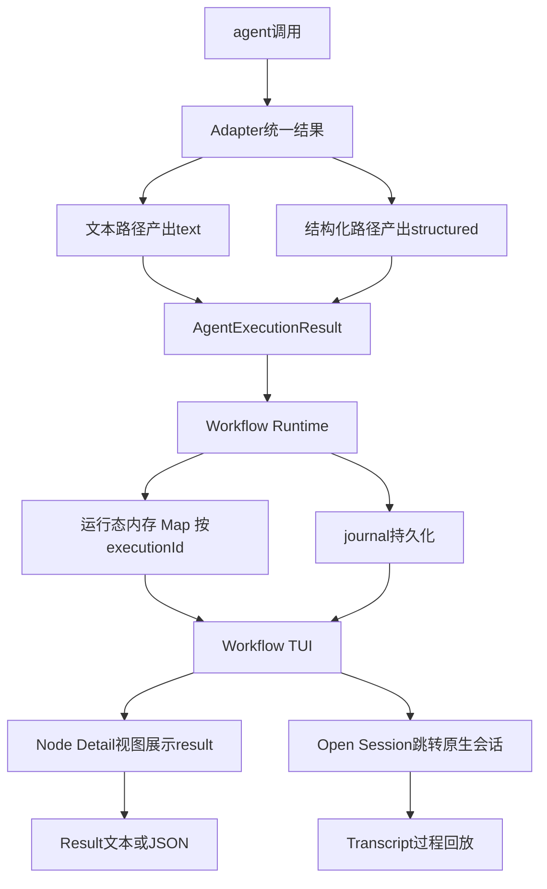

# TUI 节点详情与结果展示需求（Workflow Node Inspector）

> 来源：整理自 `Docs/05_问题与注意事项/opencode-dynamic-workflow关于schema返回空白的问题.md`（外部 AI 对话，三轮：方案概述 / 24 节详细设计 / 20 节测试方案）
> 背景：schema 正文空白问题已实验定案（见 `Docs/05_问题与注意事项/多模型编排agent详情内容为空问题-注意事项.md`），本需求是定案后的正式解决路径：不在 prompt/模型层修，改 TUI 展示层

## 一、背景与问题定性

### 已定案的事实

- `agent()` 传 schema → Adapter 走 `format: json_schema` → OpenCode 注入 StructuredOutput 工具 → 结果经 tool call 返回，assistant 消息无 text part（跨模型通用）
- workflow 变量、journal 里的结果完整无损；只有"点击节点进入原生 Session 看正文"这条观测路径失效

### 问题定性（架构层面）

当前 TUI 把两个本不相同的概念混为一谈：

```
Session Transcript = Agent 怎么执行的（reasoning、工具调用、过程文字）
Workflow Result    = Agent 最终产生了什么（结构化结果 / 文本结果）
```

点击节点直接 `route.navigate("session")`，等于用 Transcript 页面去承担 Result 展示职责。schema 场景下 Transcript 天然无正文，空白是必然。

### 三个数据面（Node Detail 设计的出发点）

```
1. Agent Session Transcript   执行过程（归 OpenCode Session 页面管）
2. Agent Result               最终产出（归 Workflow 自己管，本需求核心）
3. Workflow Node State        节点状态/耗时/模型/关联 session（快照已有）
```

## 二、需求目标与非目标

### 目标

1. 点击 workflow 节点进入**插件自己的 Node Detail 视图**，优先展示该节点的 result（文本直接显示、结构化 JSON 美化显示）
2. Node Detail 保留 **Open Session** 辅助入口，跳转原有原生 Session（sessionID 不变），用于排查执行过程
3. schema / 非 schema agent 在 TUI 中展示体验一致（不再出现"有的空白有的有字"）
4. result 成为 Workflow Runtime 的一等数据：runtime 内存态（live）与 journal（历史恢复）双通道可达

### 非目标（明确不做，均有实验或生态依据）

| 否决项 | 理由 |
|---|---|
| 给 assistant 人工补 text part | 伪造历史会随 continue/fork/compact 重新进入模型上下文，UI 污染推理层 |
| prompt 引导模型输出正文 | 三轮实验已否：flash v2 塞 summary 字段、v3 加强措辞仍 0 段正文，且不可靠 |
| 为 UI 去掉 schema | schema 是编排的执行契约（字段访问、类型校验），去掉是降级不是修复 |
| 注册自定义 Tool Renderer 魔改原生 Session 页 | OpenCode 官方无此插件 API，feature request 已被关闭为 not planned；且依赖内部实现极易随宿主升级漂移 |

## 三、总体架构



原则一句话：**Workflow Result 归 Dynamic Workflow 管；Agent Transcript 归 OpenCode Session 管。**

## 四、功能需求

### FR-1 executionId 体系

- 每次 `agent()` 执行生成唯一 `executionId`；`runId / nodeId / executionId / sessionId` 四级分离
- nodeId 是图上逻辑节点，executionId 是一次真实执行（retry/resume 会产生多个 execution）
- 禁止用 label 作索引（parallel 场景 label 必然重复）；result 存储按 executionId 映射

### FR-2 Adapter 统一结果（不 breaking）

- Adapter 返回内部统一类型：

```ts
type AgentExecutionResult =
  | { type: "text"; value: string; sessionId: string }
  | { type: "structured"; value: unknown; sessionId: string }
```

- **对 workflow 脚本的公开 API 保持原样**：`agent()` 仍直接返回 value（`result.ok`、`result.work_dir` 等字段访问不变）；`AgentExecutionResult` 仅在 runtime 内部流转给节点记录与 TUI

### FR-3 节点执行记录

```ts
interface WorkflowNodeExecution {
  id: string
  runId: string
  nodeId: string
  label: string
  status: "pending" | "running" | "completed" | "failed" | "cancelled"
  agentType?: string
  model?: string
  sessionId?: string
  prompt?: string
  output?: {
    type: "text" | "structured" | "unknown"
    value: unknown
  }
  error?: { message: string; stack?: string }
  startedAt?: number
  completedAt?: number
  usage?: { inputTokens?: number; outputTokens?: number }
}
```

### FR-4 Node Detail 视图（第一版）

第一版三块布局，不做 Tab：

```
Header：label、status、agent、model、duration、session
Result：文本原样 / 结构化 JSON pretty-print；区分三种空态：
        running 且无 result 显示 No result yet；
        completed 无结果显示 No result returned；
        failed 显示 Error 信息
操作：  [Open Session]（保留现 route.navigate("session")，sessionId 必须与节点一致）
        [Copy Result]（可选）
```

- 运行中点击可进入，完成后自动刷新（不允许"退回重进才能刷新"）

### FR-5 Result 展示约束

- **截断**：序列化超过 20KB 默认截断预览，提示 `Result truncated, original size: xx KB`（大 JSON 直接全量渲染会导致 TUI 卡顿/崩溃）
- **脱敏**：预留 `redactResult()`，对 `api_key/token/password/secret/authorization` 类键值打码；TUI 预览数据与 raw journal 数据分离
- **ResultView 单独抽象**：text / structured / raw 三种渲染分支，为后续（数组表格化、文件列表等）留扩展点，不在各处散落 `JSON.stringify`

### FR-6 数据通道与恢复

- live：TUI 优先读 runtime 内存态（nodeState Map，key 用 executionId）
- 历史：workflow 已结束或 OpenCode 重启后，从 journal 重建节点状态，result 仍可查看
- journal 现有 JSON 结构继续沿用；写入保证原子性（tmp 文件完整写入后 rename，或演进为 JSONL append-only），防半截 JSON

### FR-7 parallel 与 retry 支撑

- parallel 乱序完成时，各节点状态按 executionId 更新，不依赖完成顺序
- retry 产生多 execution 时底层保留全部执行记录（第一版 UI 只显示最新一次，但数据结构必须支持多条）

### FR-8 错误分类（预留）

Node Detail 错误展示区分 `Workflow Error / Provider Error / Structured Output Error / Schema Validation Error`，而非一律 "Agent failed"（OpenCode 的 StructuredOutput 路径存在 tool_choice 400 类 provider 报错的已知案例）

## 五、兼容性与边界

- **宿主升级隔离**：OpenCode 相关感知收敛在 adapters 层；runtime、节点模型、journal、ResultView 不得依赖 OpenCode 内部实现（TUI 生态已有 @opentui/solid 实例不匹配导致崩溃的先例）
- **原生 Session 保持只读**：不修改 assistant message、不注入合成内容；Transcript 空白在 schema 场景是合法形态
- 现有快照（runs/*.json）与进度通道不受本需求影响

## 六、验收标准与测试矩阵

### 核心验收（黄金测试 T01）

```
flash + schema 的节点：
assistant text part = 0        （合法，不做任何修改）
StructuredOutput 存在          = true
workflow result 存在           = true
journal result 存在            = true
Node Detail 中 result 可见     = true
```

五条同时满足才算 PASS。**不是让 Session 不再空白，而是让 Result 有正确的展示位。**

### A/B 定义

A = 旧展示路径（node → session → assistant text）；B = 新展示路径（node → Node Detail → result，可选 Open Session）。模型与 schema 只是测试维度。

### 数据一致性校验

每用例比对四处相等：`agent() 返回值 = runtime node.result = journal.result = TUI Node Detail 展示值`（不允许出现 `[object Object]` / `undefined`）

### 测试矩阵 T01~T12

| ID | Case | 核心验证 |
|---|---|---|
| T01 | Flash + Schema | 原始空白问题的修复（黄金测试） |
| T02 | Flash + No Schema | 普通文本 result 兼容 |
| T03 | GLM + Schema | 跨模型结构化输出 |
| T04 | GLM + No Schema | 普通文本 |
| T05 | Large Result（20KB+ / 1MB） | 截断、打开即响应、不卡死 |
| T06 | Parallel x20 且 label 重复 | executionId 映射正确、不错位 |
| T07 | Parallel 乱序完成（5s/1s/3s） | 状态按 executionId 更新、TUI 顺序仍按定义序 |
| T08 | Agent Failed（含 provider/schema 校验失败） | Error UI，不 crash、不显示 undefined |
| T09 | Running 时点击 | No result yet，完成后自动刷新 |
| T10 | Restart / History | 重启后从 journal 恢复，历史 result 可见 |
| T11 | Open Session 回归 | 跳转 sessionID 与节点一致，未新建会话 |
| T12 | Retry（预留） | 多 execution 不互相覆盖，UI 显示最新 |

### 回归资产

- AB 测试 workflow 固化到仓库（如 `tests/workflows/node-detail-ab-test.js`），沿用已验证的轻量任务（读 opencode.json 返回 ok/summary），作为 Structured Output Regression Test 长期保留
- 结果报告落 `.opencode-workflows/test-reports/node-detail-ab-test-<日期>.json`，含 expected/actual/passed，发布前跑
- 现有 `schema_ab_test.js`（xc-flow 工程）的 2x2 与 6-agent 实验即 T01~T04 的数据基线

### Release Gate

`npm test`（单元）+ runtime tests + T01~T12 全 PASS 方可发版；T01 永久保留为回归测试。

## 七、分期建议

- **第一版（本需求范围）**：FR-1 ~ FR-6 全部 + FR-7 的 executionId 数据结构；UI 只做 Header/Result/Open Session；截断 + 空态 + 一致性校验
- **后续**：ResultView 增强（表格、文件列表）、错误分类细化（FR-8 完整实现）、retry 多 execution UI、敏感信息脱敏策略完善

## 八、引用说明

- 需求来源对话：`Docs/05_问题与注意事项/opencode-dynamic-workflow关于schema返回空白的问题.md`（三轮：架构方案 / 24 节详细设计与风险 / 20 节测试方案）
- 问题排查与实验定案：`Docs/05_问题与注意事项/多模型编排agent详情内容为空问题-注意事项.md`（2x2 与 6-agent 对照实验数据）
- 本插件现状代码：`src/adapters/opencode-session-adapter.ts`（promptStructured/promptText 双路径）、`src/tools/run-snapshot.ts`、`src/persistence/journal.ts`、`src/tui/plugin.tsx`（现点击即 navigate session）
- OpenCode 生态参考（对话内引用）：自定义 Tool Renderer feature request 已关闭 not planned；TUI 插件 @opentui/solid 双实例崩溃案例；StructuredOutput tool_choice 400 兼容问题
