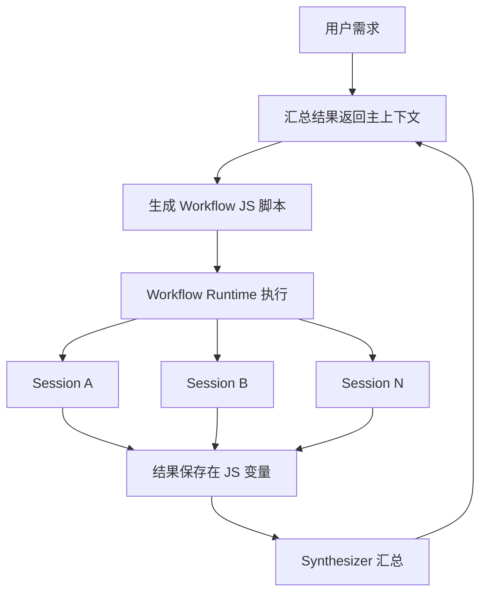
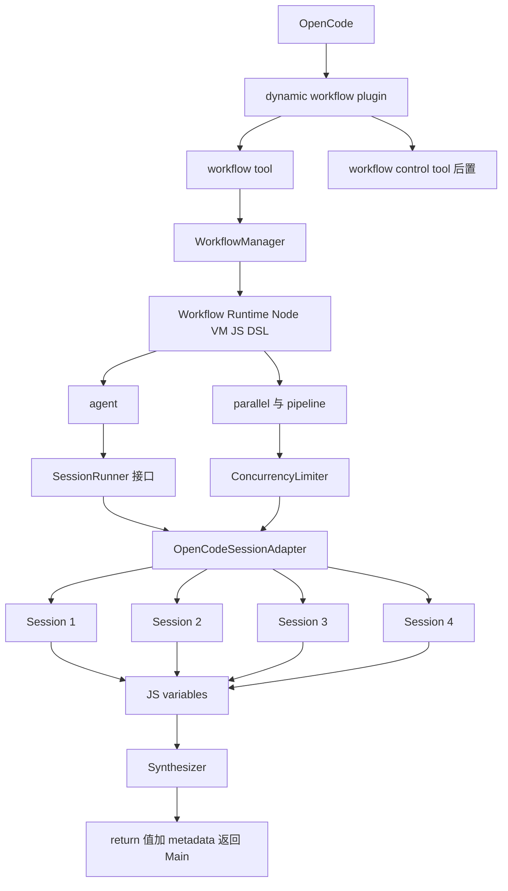
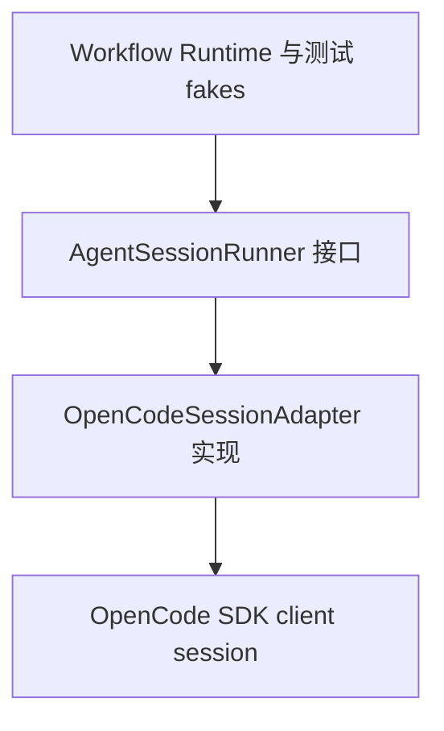
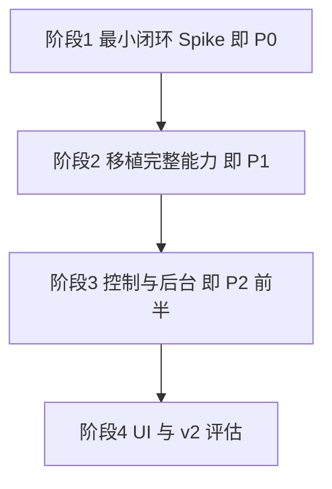

# opencode-dynamic-workflows 需求文档

> 版本：v0.2（v0.1 初稿经两轮设计拷问 + 4 组源码探查代理核查后全面修订）
> 来源：《opencode-dynamic-workflow分析插件可行性.md》可行性对话 + 决策拷问记录（见第 12 章决策记录）
> 核查基线：thirdparties 下三份本地源码（pi-dynamic-workflows v3.10.0、opencode commit b578b7261f、magic-context commit 1f0d8743）

---

## 目录

1. [项目背景与目标](#1-项目背景与目标)
2. [核心概念与工作原理](#2-核心概念与工作原理)
3. [可行性分析结论（源码核查版）](#3-可行性分析结论源码核查版)
4. [功能需求](#4-功能需求)
5. [非功能需求](#5-非功能需求)
6. [系统架构设计](#6-系统架构设计)
7. [关键技术方案](#7-关键技术方案)
8. [AI 开发约束](#8-ai-开发约束)
9. [开发阶段规划](#9-开发阶段规划)
10. [验收标准](#10-验收标准)
11. [风险与已知限制](#11-风险与已知限制)
12. [决策记录](#12-决策记录)
13. [参考资料](#13-参考资料)

---

## 1. 项目背景与目标

### 1.1 背景

公司日常编码主力工具为 OpenCode。参考 [QuintinShaw/pi-dynamic-workflows](https://github.com/QuintinShaw/pi-dynamic-workflows)（MIT License，本地 thirdparties/pi-dynamic-workflows，v3.10.0），为 OpenCode 开发同功能的动态工作流插件。

核心动机：解决**主上下文污染问题**。当需要并行分析大量文件（如 100 个文档）时，传统方式会让所有子 Agent 的完整上下文涌入 Main Agent，导致 token 爆炸。动态工作流让 Main Agent 只生成一次 Workflow JS 脚本，由 Runtime 接管执行，最终只把汇总结果返回主上下文。

### 1.2 项目目标

| 目标 | 说明 |
|------|------|
| 主目标 | Main Agent 动态生成 JavaScript Workflow，Runtime 并行创建大量独立 Session，只把汇总结果返回主上下文 |
| 运行逻辑 | 与 Pi 版本基本一致（源码核查确认可行性 90%+） |
| UI 体验 | 不追求与 Pi 版本一致；OpenCode 稳定版 v1 插件 API 不支持自由 TUI Panel（已接受，见 D-05 决策） |
| 架构定位 | 抽取 pi-dynamic-workflows 的 Workflow Runtime，在 `WorkflowAgentRunner` 注入缝上替换为 OpenCode Session Adapter |

### 1.3 第一验收用例

**10 个文档并行分析、主上下文不爆炸。** Main Session context 里只出现 workflow 调用与最终汇总，而不是 10 个 child session 的完整上下文。

---

## 2. 核心概念与工作原理

### 2.1 工作流程



### 2.2 参考项目能力（pi-dynamic-workflows v3.10.0，源码核查确认）

- DSL API 共 18 个运行时函数（workflow.ts:1371-1394）：`agent / parallel / pipeline / workflow(嵌套) / verify / judgePanel / loopUntilDry / completenessCheck / retry / gate / checkpoint / log / phase / args / cwd / process / budget / console`
- 并发：默认 `CPU核数-2`，上限钳制 16（config.ts:12 `MAX_CONCURRENCY`）；maxAgents 上限 1000 可覆盖（config.ts:6）
- Journal Resume：key = `runId:callIndex`，hash = sha256({prompt, tier, phase, agentType, thread, agentDef, schema})，model 展示值不参与 hash（workflow.ts:1680-1699）；最长未变前缀回放语义（firstMiss 机制）
- Determinism：node:vm 沙箱 + 解析期 blocklist 正则 + DETERMINISM_PRELUDE 运行时中和（Math.random / Date.now / new Date 抛错）；官方自述"VM is not a security sandbox"（workflow-capability-contract.ts:584）
- Structured Output：schema 校验失败后的 prose 兜底抽取 repair 位于 agent.ts（extractValidated），非 structured-output.ts
- Worktree：opt-in 按 agent 开启；失败静默降级共享目录；不自动合并结果；与 thread 互斥（worktree.ts:1-4, workflow.ts:699-705）
- Model Tier：无硬编码默认模型，按价格/名字启发式动态排序生成分层（model-tier-config.ts），配置文件 + 项目级 overlay

### 2.3 示例 DSL

```javascript
export const meta = { name: 'audit_routes', description: '...' }

phase('Scan')

const files = await agent(
  'List every route file under src/routes/.'
)

phase('Review')

const findings = await parallel(
  files.split('\n').map(file =>
    () => agent(`Audit ${file}`)
  )
)

phase('Verify')

return await agent(
  'Synthesize:\n' + findings.join('\n')
)
```

---

## 3. 可行性分析结论（源码核查版）

> 本章所有论断已对照本地 thirdparties/opencode 源码逐条核实，替代 v0.1 中来自 ChatGPT 对话的未验证声称。

### 3.1 总体结论

| 维度 | 可实现度 |
|------|----------|
| Runtime 运行能力 | 95% |
| Workflow 功能 | 90% |
| UI 展示能力 | 50%~60%（已接受限制，D-05） |
| **整体** | **80%~90%** |

### 3.2 已核实的关键 API 事实

| # | 事实 | 源码证据 |
|---|------|---------|
| 1 | `@opencode-ai/plugin` 当前版本 **1.18.27**（非 1.18.26） | packages/plugin/package.json:3 |
| 2 | v1 PluginInput 含 client / project / directory / worktree / experimental_workspace / serverUrl / $；**无 storage**（storage 是 v2 概念） | packages/plugin/src/index.ts:45-53 |
| 3 | v1/v2 两套插件 API 并存：v1 = `export const Plugin = async (ctx) => Hooks`；v2 = `Plugin.define({ id, setup })`，v2 又分 promise/effect 变体。本项目锁 v1 | packages/plugin/src/index.ts:99、src/v2/promise/plugin.ts:3-11 |
| 4 | `session.prompt` body 支持 `model`（{providerID, modelID}）、`parts`、`agent`、**`format`**（枚举 `"text" \| "json_schema"`，schema 字段 + retryCount 默认 2）；字段名是 format，**不是 outputFormat** | packages/opencode/src/session/prompt.ts:1499-1521、packages/schema/src/v1/session.ts:65-79 |
| 5 | json_schema 模式：服务端自动注入 StructuredOutput 工具、toolChoice required，结果落在 `info.structured` | prompt.ts:1243-1292 |
| 6 | `session.create` body 支持 parentID / title / agent / model / metadata / permission / workspaceID；**directory 不是 body 字段**，是 query 参数（路由到不同实例目录） | session/session.ts:246-257、middleware/workspace-routing.ts:87 |
| 7 | `session.prompt` 为**同步长请求**，响应体即最终 assistant 消息；无 tool 执行超时（30 分钟工作流不会被杀）；异步另有 prompt_async + SSE | handlers/session.ts:328-343、tool/registry.ts:154 |
| 8 | ToolContext.abort 为 AbortSignal，Esc 中断会话会触发（链路：session.abort → cancel → fiber 中断 → ctrl.abort → 工具 options.abortSignal） | packages/plugin/src/tool.ts:16、session/llm.ts:361-366 |
| 9 | **主会话 abort 不级联取消 child session**；原生 task tool 自行监听 ctx.abort 逐个 cancel（task.ts:321-357 为接线范本） | run-state.ts:77-88、tool/task.ts:321-357 |
| 10 | tool 输出默认截断 2000 行/50KB（opencode.json tool_output 可调），原文落盘 7 天，metadata 带 outputPath | tool/truncate.ts:13-14、registry.ts:159-168 |
| 11 | `session.prompt` 支持 **`agent` 参数**；内置 explore 子代理为只读分析型（`"*": "deny"` + 只读工具），内置 general 为通用型 | prompt.ts:461、agent/agent.ts:192-228 |
| 12 | TUI 主列表过滤所有带 parentID 的会话（不分来源）；子会话经父会话 children 导航可见；"view subagents"提示仅当 transcript 含 task tool part 时出现 | tui/component/dialog-session-list.tsx:190、routes/session/index.tsx:1509-1513 |
| 13 | v1 事件联合无 `tool.*` 事件（只有 session.\* / message.\* / tui.\*）；工具拦截走 Hooks 具名键 tool.execute.before/after | packages/sdk/js/src/gen/types.gen.ts:704、plugin/src/index.ts:215-239 |
| 14 | OpenCode 原生 skill 体系：`~/.claude/skills`、`~/.agents/skills`、项目 `.claude/.agents`、config `skills.paths` / `skills.urls`；skill 自动成为 command。v1 插件 Hooks 不能注册 skill/command | packages/opencode/src/skill/index.ts:25-27、command/index.ts:113-128 |
| 15 | 原生 worktree 服务 + experimental HTTP API（worktree.create/remove/reset/list）+ workspace 体系（session.create 的 workspaceID） | worktree/index.ts、experimental.ts:190-217 |
| 16 | tool description 无平台长度限制 | 全仓无截断逻辑命中 |

### 3.3 相对 Pi 的优势（已核实）

- **Structured Output**：OpenCode 原生 `format: json_schema` 全托管，无需 Pi 的 structured_output 工具 + extractValidated repair 链路
- **Model Routing**：单次 prompt 原生支持 model 指定
- **测试移植性**：Pi 的运行时/LLM 解耦缝 `WorkflowAgentRunner`（workflow.ts:166-168，`run(prompt, options?) => Promise<unknown>`）与本项目 Adapter 架构天然对齐，53 个测试文件的 fake runner 模式可近乎整体移植

---

## 4. 功能需求

### 4.1 P0 — 最小闭环（v0.1）

| 编号 | 需求 | 说明 |
|------|------|------|
| F-01 | workflow 自定义 tool | 参数 `{ script: string, args?: object }`；description 保持简短（指向 skill，见 F-09） |
| F-02 | Node VM 运行时 | 移植 Pi 的 vm 沙箱 + DETERMINISM_PRELUDE + 解析期 blocklist；注入全局：`agent / parallel / pipeline / phase / log / args`；脚本需 `export const meta` 信封 |
| F-03 | OpenCodeSessionAdapter | 实现 `AgentSessionRunner` 最小接口（run(prompt, options)）；内部 `client.session.create({ parentID, title })` + `client.session.prompt({ model, parts, agent, format })`；读类调用默认 `agent: "explore"`，写类显式 general（DSL 保留 agentType 选项映射） |
| F-04 | 原生 structured output | `agent(prompt, { schema })` 直接映射 `format: { type: "json_schema", schema }`，结果取 `info.structured`；**不移植** Pi 的 repair（观察点见 R-07） |
| F-05 | 并发 Semaphore | 照搬 Pi：默认 `CPU核数-2`，钳制上限 16，可配置覆盖 |
| F-06 | timeout / abort / retry | 含 **abort 级联接线**：抄 task.ts:321-357 模式，监听 ToolContext.abort，逐个 `client.session.abort` 取消在飞子会话 |
| F-07 | 汇总返回设计 | tool 返回 = 脚本 return 值 + metadata（每个 agent 的 label / 状态 / token 数 / 单行摘要）；完整结果只落盘；整体控制在默认 50KB 截断预算内 |
| F-08 | 上下文隔离验证 | Main Session context 只出现 workflow 调用与最终汇总 |
| F-09 | 精简 authoring skill | 从 Pi 的 28 文件 skill 语料裁出 8 文件以内（SKILL.md、runtime、pattern-selection、3-4 个 examples、review checklist）；插件仓库自带 `skills/workflow-authoring/`，部署说明写明 opencode.json 加 `skills.paths` 一行；不移植 Pi 的 SHA256 冻结与 release gate 管控 |

### 4.2 P1 — 从 pi-dynamic-workflows 移植

| 编号 | 需求 | 说明 |
|------|------|------|
| F-10 | journal + resume | 照搬 Pi：sha256 hash（prompt/tier/phase/agentType/thread/agentDef/schema，model 不参与）、key=`runId:callIndex`、最长未变前缀回放；journal 存项目级 `.opencode-workflows/journal/` |
| F-11 | model tier 分层 | 照搬 Pi：价格/名字启发式动态排序生成默认 small/medium/big + 配置文件覆盖（全局 `~/.config/opencode/workflows/model-tiers.json` + 项目 overlay） |
| F-12 | verify() | 对抗式投票校验 |
| F-13 | judgePanel() | 多 Agent 评审 |
| F-14 | retry() | DSL 级重试助手 |
| F-15 | checkpoint() | 确认点 + journal 集成 |
| F-16 | worktree 隔离 | opt-in 按 agent；优先用 OpenCode 原生 experimental worktree API + workspaceID，不稳则回落自建 `git worktree add` + `?directory=` query 路由；沿用 Pi 语义：失败静默降级、不自动合并 |

### 4.3 P2 — 后续增强

| 编号 | 需求 | 说明 |
|------|------|------|
| F-17 | workflow_control tool | pause / resume / stop |
| F-18 | background workflow | 基于原生 prompt_async + SSE 事件流，或后台 job 机制（run-state.ts 的 BackgroundJob 带 parentSessionId 传染取消） |
| F-19 | token / cost accounting | 从 prompt 响应与 usage 事件聚合 |
| F-20 | TUI 增强 | v1 双插件架构（server + `@opencode-ai/plugin/tui`，非 v2），不 fork OpenCode；详见 [TUI增强需求文档](TUI增强需求文档.md)。MVP-1 sidebar 实时树 / MVP-2 节点进子会话 / MVP-3 /workflow 路由 / MVP-4 可选 patch ToolPart |

### 4.4 明确不做

- DSL 函数：`loopUntilDry` / `completenessCheck` / `gate` / `budget` / 嵌套 workflow（等真实需求）
- Pi 的 skill 语料 SHA256 冻结、release gate、context 预算门禁等文档管控工具
- v2 插件 API（`Plugin.define` 等），以及 v1/v2 混用
- 公共 npm 发布（内网工具）
- Pi 风格独立 TUI Panel 窗口（v1 无自由 Panel API，阶段 4 走 sidebar_content slot 与 /workflow 路由替代）；patch ToolPart 聊天区原生 renderer 在 MVP-4 前不做

---

## 5. 非功能需求

| 编号 | 需求 | 说明 |
|------|------|------|
| N-01 | 主上下文保护 | 子 Agent 上下文不得进入 Main Agent，仅返回汇总 |
| N-02 | 确定性重放 | VM 内禁 Math.random / Date.now / new Date()（解析期 blocklist + prelude 中和，移植 Pi）；注意 VM 非安全沙箱，防的是意外非确定，不是攻击 |
| N-03 | 并发上限 | 默认 `CPU核数-2` 钳 16，可配置；真正瓶颈是 Provider rate limit / TPM / RPM，默认值保守起步 |
| N-04 | 版本锁定 | `@opencode-ai/plugin` 固定 `1.18.27`（peerDependencies 与 devDependencies 均不带 `^`）；升级由人工操作 |
| N-05 | Runtime 宿主无关 | `src/runtime/` 禁止 import `@opencode-ai/plugin` / `@opencode-ai/sdk`；OpenCode API 只允许出现在 `src/adapters/`、`src/plugin/`、`src/tools/` |
| N-06 | 可测试性 | **node:test + tsx**（与 Pi 一致，非 vitest）；测试用 fake runner 注入（照搬 Pi 的 countingAgent / deferredAgent / deferred gate 模式），不 mock HTTP；worktree 测试跑真实 git（mkdtemp 临时仓库） |
| N-07 | 输出预算 | tool 返回值控制在默认 50KB 截断预算内；超限依赖平台截断机制（原文落盘 + metadata.outputPath 可读回） |

---

## 6. 系统架构设计

### 6.1 总体架构



### 6.2 关键分层约束



**只有 `OpenCodeSessionAdapter` 允许依赖 OpenCode SDK。** 该接口与 Pi 的 `WorkflowAgentRunner`（workflow.ts:166-168）同构，Pi 的 runtime 测试可直接在此缝注入 fake。未来 OpenCode 1.x → 2.x，只换 Adapter，Runtime 不动。

### 6.3 目录结构

```
opencode-dynamic-workflows/

src/
├─ index.ts                    # 插件入口，薄层
├─ plugin/
│  ├─ context.ts
│  └─ hooks.ts
├─ adapters/
│  └─ opencode-session-adapter.ts   # 唯一允许依赖 OpenCode SDK 的层
├─ tools/
│  ├─ workflow.ts
│  └─ workflow-control.ts           # P2
├─ runtime/                         # 禁止 import opencode 包
│  ├─ workflow-runtime.ts
│  ├─ vm.ts
│  ├─ parallel.ts
│  ├─ pipeline.ts
│  └─ semaphore.ts
├─ agent/
│  ├─ session-runner.ts             # AgentSessionRunner 接口定义
│  ├─ model-routing.ts
│  └─ usage.ts
├─ persistence/
│  ├─ journal.ts
│  ├─ run-store.ts
│  └─ resume.ts
├─ isolation/
│  └─ worktree.ts                   # P1
└─ types/
   └─ index.ts

skills/
└─ workflow-authoring/              # 精简 skill（≤8 文件），经 skills.paths 挂载

tests/                              # node:test + tsx，照搬 Pi fake 模式
```

### 6.4 与 pi-dynamic-workflows 的复用对照

| pi-dynamic-workflows 源文件 | OpenCode 版本 | 复用程度 |
|------|------|:---:|
| src/workflow.ts | runtime/workflow-runtime.ts | ★★★★★ |
| src/workflow-manager.ts | WorkflowManager | ★★★★★ |
| src/run-persistence.ts、fs-persistence.ts | persistence/* | ★★★★★（改路径常量） |
| src/model-tier-config.ts | agent/model-routing.ts | ★★★★★（改配置路径） |
| src/model-routing.ts | 同上合并 | ★★★★ |
| src/worktree.ts | isolation/worktree.ts | ★★★★（优先试原生 API） |
| src/workflow-tool.ts | tools/workflow.ts | ★★★ |
| src/agent.ts 的 WorkflowAgent | adapters/opencode-session-adapter.ts | 重写（落 WorkflowAgentRunner 缝） |
| src/structured-output.ts + agent.ts repair | 不移植（用原生 format） | ★ |
| src/task-panel.ts、workflow-ui.ts | 不做（P2 视 v2 评估） | ★ |
| tests/*.test.ts（53 个） | tests/ | fake 模式整体照搬 |
| skills/workflow-authoring（28 文件） | skills/（裁至 ≤8 文件） | 精简移植 |

---

## 7. 关键技术方案

### 7.1 agent() 到 OpenCode Session 的映射（v0.2 修正版）

```typescript
// 仅示意，实际代码位于 adapters/opencode-session-adapter.ts
async function runAgent(prompt: string, options: AgentRunOptions) {
  // 1. 创建子会话（parentID 使其在父会话 subagent 视图可导航）
  const session = await client.session.create({
    body: {
      parentID: parentSessionId,
      title: options.label
    }
  })

  // 2. 同步长请求，响应体即最终 assistant 消息（无超时限制）
  const result = await client.session.prompt({
    path: { id: session.id },
    body: {
      model: resolveModel(options.tier),          // {providerID, modelID}
      agent: options.agentType ?? "explore",      // 读类默认只读 explore
      parts: [{ type: "text", text: prompt }],
      format: options.schema                      // 注意：字段名是 format
        ? { type: "json_schema", schema: options.schema }
        : undefined
    }
  })

  // 3. 结构化结果取 info.structured；普通文本取 parts 中 type === "text"
  return options.schema ? result.info.structured : extractText(result.parts)
}
```

### 7.2 并发控制

照搬 Pi：`Promise.all` 语义 + Semaphore，默认 `hardwareConcurrency - 2`，钳 16，maxAgents 上限 1000（可配置覆盖）。

### 7.3 Model Tier（照搬 Pi 动态分层）

无硬编码默认模型。按注册表模型价格排序（无价格时按 mini/flash/haiku/nano = small，opus/pro/ultra = big 等名字启发式，再按 contextWindow）自动生成 small/medium/big；配置文件覆盖：全局 `~/.config/opencode/workflows/model-tiers.json` + 项目 overlay（项目覆盖全局）。tier 请求未配置时回退会话默认模型并一次性警告。

### 7.4 Journal / Resume（照搬 Pi）

- key：`runId:callIndex`
- hash：sha256(JSON({prompt, tier, phase, agentType, thread, agentDef, schema}))，model 展示值不参与（换模型不破缓存）
- 语义：最长未变前缀回放——任何一处 hash 不匹配，其后全部调用 live 重跑
- 存储：项目级 `.opencode-workflows/journal/`（建议 gitignore）；复用 Pi 的 run-persistence / fs-persistence，仅改路径常量

### 7.5 Worktree 隔离（P1，两段式）

1. 优先：OpenCode 原生 experimental worktree API（worktree.create/remove/reset）+ session.create 的 workspaceID
2. 回落：自建 `git worktree add -b <branch> <path>` + `?directory=` query 路由
3. 语义照搬 Pi：opt-in 按 agent、确定性命名（runId-callIndex-label）、失败静默降级共享目录、结果不自动合并、与 thread 互斥

### 7.6 Abort 级联接线（照抄 task.ts 范式）

平台事实：主会话 abort 不级联取消 child session。插件在 workflow tool execute 内：

```typescript
// 范式来自 thirdparties/opencode packages/opencode/src/tool/task.ts:321-357
const onAbort = () => { /* 逐个 client.session.abort({ path: { id } }) */ }
context.abort.addEventListener("abort", onAbort)
try {
  return await runWorkflow(/* ... */)
} finally {
  context.abort.removeEventListener("abort", onAbort)
}
```

同时在 Runtime 层用 AbortSignal 停止派发新 agent、取消 Semaphore 队列。注意：被中断的原生 Promise 无法真正取消，已发出的 prompt 由 session.abort 终止。

### 7.7 Tool 返回与截断预算

- 返回：`{ title, output: <脚本return值渲染>, metadata: { agents: [{label, status, tokens, preview}], totals } }`
- 预算：整体控制在默认 2000 行 / 50KB 内；超限由平台截断兜底（原文落盘，metadata.outputPath 可读回）
- 完整 per-agent 结果只写入 journal / run store，Main Agent 需要时用 read 工具按路径查

### 7.8 DSL 指导（skill 机制）

- tool description 保持简短（Pi 预算 4.3KB 量级），参数 description 内嵌 meta 信封与禁用项等关键规则
- 详细语料走 OpenCode 原生 skill：插件仓库 `skills/workflow-authoring/`（≤8 文件），部署时 opencode.json 加 `skills.paths` 一行
- skill 自动成为 command（command/index.ts:113-128），不依赖插件 Hooks

---

## 8. AI 开发约束

### 8.1 参考源优先级

| 优先级 | 参考源 | 位置 | 用途 |
|:---:|------|------|------|
| 1 | pi-dynamic-workflows v3.10.0 | 本地 thirdparties/pi-dynamic-workflows | 移植母本 |
| 2 | OpenCode 官方仓库 commit b578b7261f | 本地 thirdparties/opencode | API 真值来源（packages/plugin、packages/sdk、packages/opencode/src/plugin、packages/web/src/content/docs/plugins.mdx） |
| 3 | magic-context commit 1f0d8743 | 本地 thirdparties/magic-context | 复杂插件分层架构参考 |
| 4 | opencode-subagents-view v0.3.0 | 本地 thirdparties/opencode-subagents-view | TUI 插件骨架母本（阶段 4，sidebar_content + solid-js patch 方案） |
| 5 | opencode-sidebar-usage v0.1.3 / codex-meter | 本地 thirdparties/opencode-sidebar-usage | server + TUI 双插件联动范式 |
| 6 | oc-usage-limits-plugin | 本地 thirdparties/oc-usage-limits-plugin | sidebar + prompt footer 扩展参考 |
| 7 | oh-my-openagent | 本地 thirdparties/oh-my-openagent | tui-sidebar feature 局部参考 |
| 8 | opencode-wakatime | 远程 | 工程模板参考 |

本地源码目录索引见 `thirdparties/reference.md`。**不建 Golden Template**（D-04）：约束直接写入本插件仓库的 AGENTS.md 与 package.json；公司出现第二个插件时再抽模板。

### 8.2 AGENTS.md 核心规则（写入插件仓库根目录）

1. **Source of truth**：目标 `@opencode-ai/plugin` 1.18.27 / TypeScript / v1 插件 API。权威参考为本地 thirdparties/opencode 的 plugin、sdk 包与官方文档
2. **禁止发明 API**：API 在已安装 `@opencode-ai/plugin` / `@opencode-ai/sdk` 类型中找不到，就不允许使用
3. **v1 only**：禁止使用 v2 API（`Plugin.define`、`src/v2/*` 导入、`ctx.storage`、`session.next.*` 事件）；禁止 v1/v2 混用
4. **已核实 API 事实表**（写入 AGENTS.md 防跑偏）：
   - structured output 字段名是 `format`（非 outputFormat），结果在 `info.structured`
   - v1 PluginInput 无 `storage` 字段
   - v1 事件无 `tool.*`；工具拦截用 Hooks 的 tool.execute.before/after
   - `session.create` 的 directory 是 query 参数不是 body 字段
   - 主会话 abort 不级联 child session，需按 task.ts 范式自行接线
5. **架构约束**：OpenCode API 只允许出现在 `src/adapters/`、`src/plugin/`、`src/tools/`；`src/runtime/` 禁止 import opencode 包；正确链路 `runtime → AgentSessionRunner → OpenCodeSessionAdapter → client.session.*`
6. **入口薄层**：`src/index.ts` 只做依赖初始化与注册，不放业务逻辑
7. **Session 创建**：child session 一律经 Adapter；Adapter 之外禁止直接调用 client.session.create
8. **测试**：node:test + tsx；runtime 测试注入 fake runner（照搬 Pi tests/ 的 countingAgent、deferredAgent 模式），不 mock HTTP
9. **注释与日志用中文**（遵循公司规范），代码标识符用英文

### 8.3 package.json 版本锁定

```json
{
  "name": "opencode-dynamic-workflows",
  "version": "0.1.0",
  "type": "module",
  "main": "./dist/index.js",
  "types": "./dist/index.d.ts",
  "scripts": {
    "build": "tsc",
    "typecheck": "tsc --noEmit",
    "test": "tsx --test tests/**/*.test.ts"
  },
  "peerDependencies": {
    "@opencode-ai/plugin": "1.18.27"
  },
  "devDependencies": {
    "@opencode-ai/plugin": "1.18.27",
    "typescript": "^5.0.0",
    "tsx": "^4.0.0"
  }
}
```

### 8.4 安装分发

公司 git 仓库托管；使用方在 opencode.json 配置：

```json
{
  "plugin": ["<公司git地址或本地克隆路径>"],
  "skills": { "paths": ["<插件目录>/skills"] }
}
```

不发公共 npm；私有 registry 等 CI 需求出现再评估。

---

## 9. 开发阶段规划



> v0.1 的"阶段 0 建 Golden Template"已删除（D-04 决策），约束直接进插件仓库。

### 阶段 1：最小闭环 Spike（P0，本阶段完成即证明方案成立）

1. 插件骨架 + workflow tool（F-01）
2. VM Runtime 移植：meta 信封 + agent/parallel/pipeline/phase/log/args（F-02）
3. OpenCodeSessionAdapter：3 个 agent 并行分析 3 个文件（F-03/F-04）
4. 验证上下文隔离：Main context 只见 workflow 调用与汇总（F-08）
5. 并发扩展 3 → 10 + Semaphore + timeout/abort/retry + abort 级联（F-05/F-06）
6. 汇总返回设计（F-07）
7. 精简 skill 语料 + 部署说明（F-09）

### 阶段 2：完整能力移植（P1）

journal/resume → model tier → verify/judgePanel/retry/checkpoint → worktree（两段式）

### 阶段 3：控制与后台（P2 前半）

workflow_control、background（prompt_async + SSE 或 BackgroundJob）、token/cost accounting

### 阶段 4：TUI 增强（v1 双插件）

基于 v1 包内合法 entrypoint `@opencode-ai/plugin/tui`（非 v2）实现，不 fork OpenCode。详见 [TUI增强需求文档](TUI增强需求文档.md)。

- MVP-1：sidebar_content 实时 workflow 树（ctx.metadata 驱动）
- MVP-2：节点 Enter 进子会话（sessionId 导航）
- MVP-3：/workflow 全屏路由
- MVP-4（可选）：patch ToolPart renderer

参考实现（均已本地化到 thirdparties/）：opencode-subagents-view（骨架母本）、opencode-sidebar-usage / codex-meter（双插件联动）、oc-usage-limits-plugin（footer 扩展）、oh-my-openagent（tui-sidebar feature）。

Golden Template 抽取仍为条件性子项（公司出现第二个插件时）。

---

## 10. 验收标准

### 10.1 阶段 1 验收（核心验收）

| 编号 | 标准 |
|------|------|
| A-01 | Main Agent → 生成 JS → workflow tool → 10 OpenCode Sessions → workflow 内部结果 → 1 Synthesizer Session → Main Agent，整条链路跑通 |
| A-02 | Main Session context 中**只**出现 workflow 调用与最终汇总，无 child session 完整上下文 |
| A-03 | 10 个文档并行分析全部完成，无超时雪崩；tool 返回含全部 10 个 agent 的 label/状态/token/单行摘要，未超 50KB 截断预算 |

### 10.1.1 阶段 1 验收记录（实测，2026-09）

环境：公司 bailian 网关（glm-5.2），opencode 1.18.27，Windows。

| 项 | 结果 | 实测数据 |
|------|:---:|------|
| 冒烟 | 通过 | 3 agent 全部成功，11.6s，612 tokens |
| A-01 | 通过 | 12 agent（1 Scan + 10 Analyze + 1 Synthesize）整链路，95.6s |
| A-02 | 通过 | 主上下文仅有 tool 输出（含 ## 结果 JSON 与 12 行摘要），无 findings 原文；findings 与 synthesizer 输入只存在于子会话 |
| A-03 | 通过 | 12 行摘要（label=文件名）+ token 统计，最大单 agent config.mdx 9777 tok，总计 49742 |
| A-07 | 挂起 | provider 依赖：bailian 网关对 json_schema（StructuredOutput 工具 + toolChoice required）返回 400，见 R-07；失败传播链经此反向验证通过（0 token 失败，return null，工作流正常结束） |
| A-08 | 通过 | Esc 中断后子会话全部停止，无孤儿会话 |

过程中发现并修复：文件源插件 default export 运行时强制要求 id 字段（shared.ts:315，日志实测 must export id），类型可选是假象；已修复并加 tests/plugin-module.test.ts 兜底。

结论：P0 最小闭环成立，主上下文不爆炸核心目标达成，进入 P1。

**标准验收集**：thirdparties/opencode/packages/web/src/content/docs 下排序取前 10 个 mdx（共 614 个可用），清单固定写入验收脚本，可重复执行。公司真实项目文档留作上线前一次性手动验证，不进自动化验收。后续需要压测更大规模时再升级到 50 或 100。

### 10.2 后续验收

| 编号 | 标准 |
|------|------|
| A-04 | journal resume：中断后重跑，已完成 agent 不重复调用 LLM（fake runner 计数断言，照搬 Pi 测试） |
| A-05 | model tier：动态分层生效；tier 请求正确路由；未配置 tier 回退并告警 |
| A-06 | worktree：两个 agent 同时修改同一文件互不覆盖；非 git 目录静默降级 |
| A-07 | structured output：schema 返回合法 JSON（info.structured）；text 模式返回纯文本 |
| A-08 | abort：Esc 中断主会话后，在飞子会话全部被取消，无孤儿 session |
| A-09 | determinism：脚本使用 Date.now / Math.random 被解析期拒绝 |

---

### 10.2.1 P1 实施记录（2026-09，commit 9940b91..912ecfd）

全部五项落地，52/52 单测通过（node:test + tsx），已推送。

| 项 | 实现 | 状态 |
|------|------|------|
| F-10 journal/resume | sha256 身份哈希（prompt/model/tier/phase/agentType/schema/isolation）+ 最长未变前缀回放；.opencode-workflows/journal/<runId>.json 逐 agent 落盘，中断可续跑；tool 增 resumeFromRunId | 完成，A-04 单测通过 |
| F-11 model tier | 全局 + 项目 overlay 配置文件；优先级 model > tier > 默认；未配置回退告警 | 完成，A-05 单测通过 |
| F-12~15 verify/judgePanel/retry/checkpoint | 照搬 Pi 实现；checkpoint 确认型映射 ToolContext.ask | 完成 |
| F-16 worktree | 自建 git worktree + query.directory 路由（回落路径）；opt-in/静默降级/自动拆除/不自动合并 | 完成，A-06 单测通过（真实 git） |
| R-07 schema 降级 | Adapter 捕获 400/invalid_parameter/info.error -> 去 format + prompt JSON + 宽松解析 + 必填校验；降级事件进日志 | 完成，待真机复测 bailian |

实施偏差（相对需求原文）：
1. D-08 的 Pi 价格启发式动态分层未移植（插件上下文无价格注册表），tier 仅配置文件解析（model-tiers.ts 头注）
2. F-16 两段式中原生路径不可用：v1 SDK 未暴露 experimental worktree API，直接走回落路径；SDK 暴露后可切换
3. checkpoint 仅确认型（允许/拒绝布尔）；input/select 无 UI 通道未实现
4. 关键坑记录：v1 SDK 返回 {data,error} 联合不抛错；文件源插件 id 运行时必填；worktree 拆除必须从主仓库根执行

真机验证（2026-09-04 全部完成）：schema 降级在 bailian 网关实测通过（run-mtmhe201，14.6s）；resumeFromRunId 双向实测通过（变更重跑 + 原样回放 0 token）；worktree 隔离实测——directory query 路由三验未生效（SDK 已确认发送 query，session.directory 落库恒为共享目录，服务端路由面未定位到尊重该 query 的路径），最终方案改为 prompt 注入工作目录（653b587），run-mtmr20xe 实测通过：agent 在 wf/ 分支创建文件、共享目录零残留、自动拆除。另：网关 format 支持探测缓存（a4071ff）消除重复 400 噪音；发现并落档 Main Agent 会复读旧总结的现象——验收一律以 tool 原始输出与磁盘证据为准。

### 10.3.1 P2 实施记录（2026-09）

F-17/F-18/F-19 三项落地（F-20 UI 按 v1 约束跳过，阶段 4 视 v2 评估），59/59 单测。

| 项 | 实现 | 说明 |
|------|------|------|
| F-18 后台工作流 | workflow tool 增 background 参数；BackgroundRunManager 内存注册表；完成后结果渲染为一条消息 prompt 回主会话 | 后台 run 与 OpenCode 进程同生命周期；checkpoint 走 headless 默认 |
| F-17 workflow_control | 新 tool：status（进度 X/N）/ stop（abort 级联 + journal 保留） | pause 不单独做：stop + resumeFromRunId 的 journal 回放语义等价（与 Pi 同思路） |
| F-19 cost 统计 | Adapter 提取 info.cost -> record.cost -> 汇总渲染（成本 $X.XXXX）| provider 不上报成本时不显示 |

新增模块：src/tools/background-runs.ts（管理器）、src/tools/workflow-control.ts、src/tools/render.ts（渲染抽共享）；runtime 增 onAgentUpdate 回调（后台进度）。测试：tests/background.test.ts 5 个集成用例（真实 tool 工厂 + fake client）。

## 11. 风险与已知限制

| 编号 | 风险/限制 | 影响 | 应对 |
|------|------|------|------|
| R-01 | 稳定版 v1 插件 API 不支持自由 TUI Panel | 无 Pi 风格实时进度面板 | 已接受（D-05）；可见性靠 tool 返回 metadata + workflow_control status；阶段 4 已规划 v1 双插件 TUI（见 [TUI增强需求文档](TUI增强需求文档.md)），经 `@opencode-ai/plugin/tui` entrypoint 走 sidebar_content slot，不 fork OpenCode，不再视 v2 |
| R-02 | 插件 child session 在主列表不可见，且无 "view subagents" 入口提示 | 用户不便逐个查看子会话 | 已接受；children 导航仍可达；汇总靠 F-07 设计 |
| R-03 | experimental worktree API 稳定性未知 | P1 worktree 方案主路径可能失效 | 两段式：原生 API 失败回落自建 git worktree + directory query |
| R-04 | v1/v2 插件 API 并存，AI 易混用 | 编码跑偏 | AGENTS.md 明令 v1 only + 已核实事实表（8.2 节第 4 条） |
| R-05 | 真正瓶颈是 Provider rate limit / TPM / RPM，而非 OpenCode | 高并发失败 | 并发默认 cores-2 钳 16，保守起步 |
| R-06 | OpenCode API 演进（1.x → 2.x） | Adapter 失效 | 架构上只换 Adapter，Runtime 不动 |
| R-07 | json_schema 实现依赖 toolChoice required（prompt.ts:1243-1292），provider 支持不全；retryCount 服务端未见消费点 | 结构化输出在部分网关不可用。已实测：bailian 网关 + glm 对 schema 请求返回 400 invalid_parameter_error，agent 0 token 失败，workflow 正确返回 null（失败传播链验证通过） | schema 为可选能力，不支持时脚本不传 schema 即可；需兼容时 P1 在 Adapter 层加 400 降级（去 format 改 prompt 要 JSON + 脚本侧 parse，即 Pi extractValidated 思路）；换支持 tool_choice required 的 provider 可直接验证 |
| R-08 | tool 输出 2000 行/50KB 截断 | 超大汇总被截 | F-07 预算设计 + 平台原文落盘 outputPath 兜底 |
| R-09 | 被中断的原生 Promise 无法真正取消（Effect.promise 下的 JS promise 后台仍在跑） | abort 后可能有残留计算 | session.abort 终止子会话即可；残留结果被丢弃不影响正确性 |
| R-10 | 主会话 abort 不级联 child session（平台事实） | 不接线则留孤儿 session | F-06 强制按 task.ts 范式接线；A-08 验收 |

---

## 12. 决策记录

> 两轮设计拷问（Round 1 九问、Round 2 六问）产生的全部决策，均已按源码证据核实。

### Round 1

| 编号 | 决策 | 依据 |
|------|------|------|
| D-01 | 项目成立：公司主力工具为 OpenCode，动态工作流需进主力工具 | 用户确认 |
| D-02 | 锁 v1 插件 API（1.18.27），禁 v2/混用 | v1 为稳定对外契约；v2 演进中（PLAN.md） |
| D-03 | structured output 只用原生 `format: json_schema`，不移植 Pi repair | 平台全托管（注入工具 + toolChoice required）；retryCount 留观察点（R-07） |
| D-04 | v0.1 跳过 worktree（P0 场景只读无冲突）；P1 两段式（原生 API 优先，自建回落） | Pi 本身 opt-in + 静默降级；directory 是 query 路由 |
| D-05 | 接受 TUI 限制，可见性靠 tool 返回 metadata | v1 无 Panel API；主列表过滤所有 parentID 会话 |
| D-06 | 分析类 agent 默认内置 explore（只读）；写类显式 general；DSL 保留 agentType | prompt 支持 agent 参数；explore 为 `*` deny 只读型 |
| D-07 | P0 DSL = agent/parallel/pipeline/phase/log（pipeline 近乎免费顺手带）；P1 加 verify/judgePanel/retry/checkpoint；loopUntilDry/completenessCheck/gate/budget/嵌套不做 | pipeline 实现仅约 40 行；其余等真实需求（YAGNI） |
| D-08 | 并发与 tier 默认值照搬 Pi（cores-2 钳 16；动态排序分层 + 配置覆盖） | ★★★★★ 复用代码，重造无增益；v0.1 的 gpt-5.4-mini 示例系 ChatGPT 虚构，删除 |
| D-09 | journal 项目级 `.opencode-workflows/journal/`；tier 配置全局 + 项目 overlay | v1 无 ctx.storage；跨项目 run 状态天然按项目隔离 |

### Round 2

| 编号 | 决策 | 依据 |
|------|------|------|
| D-10 | DSL 指导 = 精简 skill（≤8 文件）+ opencode.json skills.paths 挂载；tool description 保持短；不移植 SHA256 冻结/release gate | OpenCode 原生 skill 体系（skill 自动成 command）；Pi 语料 79KB 中大半对应我们不做的函数 |
| D-11 | 测试框架改 node:test + tsx（弃 vitest） | 与 Pi 53 个测试的 runner/fake 模式一致，近乎直接复制；零额外依赖 |
| D-12 | 标准验收集 = opencode docs 排序前 100 个 mdx，固定进验收脚本 | 本地 614 个可用，可重复；真实项目文档仅上线前手验 |
| D-13 | 不建 Golden Template，约束直接进插件仓库；第二个插件出现时再抽 | 为单项目建模板是双仓库开销（YAGNI） |
| D-14 | 分发 = 公司 git 仓库 + opencode.json plugin/skills 配置；不发公共 npm，私有 registry 缓议 | 内网工具，零发布流程 |
| D-15 | tool 返回 = 脚本 return 值 + per-agent metadata（label/状态/token/单行摘要）；完整结果只落盘 | 50KB 截断预算内放得下；符合上下文不爆炸初衷 |

---

## 13. 参考资料

- [QuintinShaw/pi-dynamic-workflows](https://github.com/QuintinShaw/pi-dynamic-workflows) — 移植母本（MIT，本地 thirdparties/pi-dynamic-workflows，v3.10.0）
  - src/workflow.ts — VM 沙箱、并发、journal hash、DSL 实现
  - src/agent.ts — WorkflowAgent、extractValidated repair
  - src/model-tier-config.ts — 动态分层
  - src/worktree.ts — worktree 生命周期
  - tests/ — 53 个 node:test 测试与 fake runner 模式
- [OpenCode 官方插件文档](https://opencode.ai/docs/plugins/) — Plugin 类型、自定义 Tool、hook、client 上下文
- [OpenCode SDK 文档](https://opencode.ai/docs/sdk/) — session API、format、model 指定
- [anomalyco/opencode 官方仓库](https://github.com/anomalyco/opencode) — API 真值（本地 thirdparties/opencode，commit b578b7261f）
  - packages/plugin/src/ — PluginInput / Hooks / tool() 定义
  - packages/opencode/src/session/prompt.ts — format 与 structured 实现
  - packages/opencode/src/tool/task.ts — abort 级联接线范本
  - packages/opencode/src/tool/truncate.ts — 输出截断常量与行为
  - packages/opencode/src/skill/index.ts — skill 发现与 command 转换
  - packages/opencode/src/worktree/index.ts — 原生 worktree 服务
- [OpenCode V2 插件文档](https://opencode.ai/v2/docs/build/plugins/) — Plugin.define / storage（阶段 4 备查，当前禁用）
- [cortexkit/magic-context](https://github.com/cortexkit/magic-context) — 分层架构参考（本地，commit 1f0d8743）
- [giovannic96/opencode-subagents-view](https://github.com/giovannic96/opencode-subagents-view) — TUI 插件骨架母本（本地 thirdparties/opencode-subagents-view，v0.3.0，MIT）
  - src/child-sessions-tracker.ts — 子会话成员追踪（session.*/message.part.updated 订阅）
  - src/plugin.tsx — sidebar_content slot 注册 + solid-js 单文件约束
  - src/tui.tsx — solid-js runtime patch 与 JSX escape 两大坑的解法（见 TUI增强需求文档 第 9 节）
- [SBakolis/opencode-sidebar-usage](https://github.com/SBakolis/opencode-sidebar-usage) / codex-meter — server + TUI 双插件联动范式（本地，v0.1.3，MIT）
  - package.json exports 同时暴露 `.` / `./server` / `./tui`
  - 双配置文件（opencode.json + tui.json）接线
- [mynameistito/oc-usage-limits-plugin](https://github.com/mynameistito/oc-usage-limits-plugin) — sidebar + prompt footer 扩展（本地，MIT）
- [code-yeongyu/oh-my-openagent](https://github.com/code-yeongyu/oh-my-openagent)（oh-my-opencode 重命名过渡）— tui-sidebar feature 局部参考（本地 thirdparties/oh-my-openagent）
- [angristan/opencode-wakatime](https://github.com/angristan/opencode-wakatime) — 工程模板参考（远程）
