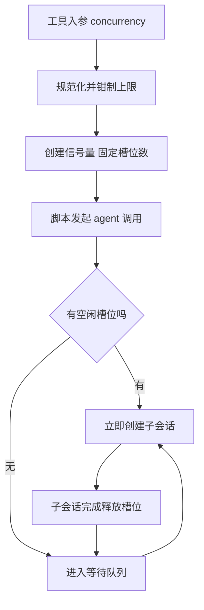
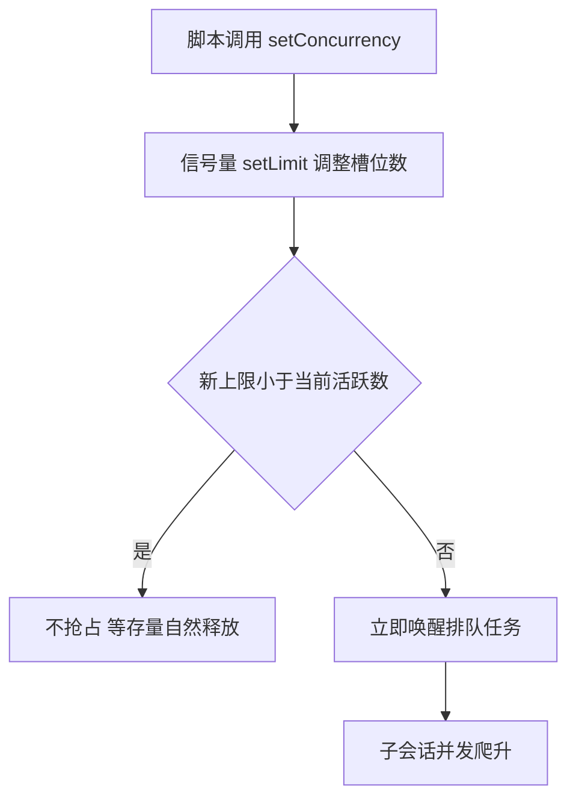

# 动态并发控制需求与现状分析

> 背景：实测 run-mtv4x237-1（24 探针、concurrency=16、35.9s、有效并发 13.69）后，
> 讨论"为什么并发上限是 16 而不是 100"，进一步澄清出真实需求：脚本运行时实时调节并发上限。
>
> 状态（2026-09）：方案 A 已实施——`createLimiter` 增加 `setLimit`（调大立即唤醒排队者、调小不抢占存量），
> runtime 注入全局 `setConcurrency(n)`（正整数、缺 16；变更写入 run 日志）；测试见 tests/set-concurrency.test.ts。
> 方案 B（分池）/ C（AIMD 自适应）未实施，按真实需求与 429 频次再评估。

## 1. 当前模型：并发是 run 级常量

一次 workflow run 的并发在启动那一刻定死，之后整个 run 不再变化：

- 工具入参 `concurrency`（缺省 CPU 核数 - 2，钳制上限 16）
- runtime 用它创建信号量（createLimiter），所有 agent() 调用共用这一个闸门
- 脚本内部没有任何调节并发的手段



实测验证：本机 6 核，缺省并发是 4；显式传 16 时 24 个探针 35.9 秒跑完，
有效并发 13.69（平均口径），信号量全程饱和、槽位随释放即补，钳制行为正确。

## 2. 为什么默认上限是 16（设计依据回顾）

| 编号 | 依据 | 内容 |
|---|---|---|
| D-08 | 复用已验证设计 | cores-2 钳 16 照搬 Pi 已验证量级，重造新数无增益 |
| R-05 | 真瓶颈识别 | 真正瓶颈是 Provider rate limit（TPM / RPM），不是本地资源 |
| N-03 | 保守起步原则 | 默认值放安全侧，放大留给显式决策，避免人人先撞一次 429 |

关键认知：每个 agent() 是一次真实 LLM API 调用，属于重 IO 等待，
本机 CPU 与内存几乎无压力；把本地并发开到 100 只会更快撞上 Provider 配额，
引发 429 风暴与重试级联，成本线性上升而吞吐收益递减。

## 3. 真实需求：运行时实时调节并发上限

预期形态（原话整理）：JS 脚本可以实时控制并发上限，最大效率地执行任务。

拆成三层诉求：

| 层 | 诉求 | 场景举例 |
|---|---|---|
| L1 手动调节 | 脚本内随时 setConcurrency(n) | 重任务阶段压到 4，轻探针阶段放开到 16 |
| L2 分池隔离 | 不同任务不同并发池 | 写文件类任务限 2 并发防冲突，纯分析类放开 |
| L3 自适应 | 按 429 与时延反馈自动升降 | 遇限流乘性退避，平稳后加性恢复（AIMD） |

## 4. 现状与预期的差距

| 需求点 | 现状 | 差距影响 |
|---|---|---|
| 运行中调并发 | concurrency 是 run 级常量，信号量 limit 不可变 | 混合负载 run 只能迁就最重的任务，整体偏慢 |
| 分池隔离 | 全 run 一个全局信号量 | 写类任务与分析类任务互相抢槽 |
| 自适应退避 | 无；仅 agentRetries 上限 3 的被动重试 | 429 后继续满速重试，容易越撞越狠 |

一个对动态并发有利的事实：并发只影响调度顺序，不影响调用编号与哈希身份
（callSeq 按调用发起顺序分配，journal 按位置匹配），因此动态调节并发
对 resume 确定性是安全的，改动面可以收敛在 semaphore 与全局注入两层。

## 5. 方案设想（按最小可用排序）

### 方案 A：setConcurrency 全局函数（推荐先行）

脚本注入新全局函数，信号量暴露 setLimit：

```js
phase('Heavy')
setConcurrency(4)                        // 重任务阶段保守
await parallel(heavyTasks)

phase('Fanout')
setConcurrency(16)                       // 轻探针阶段放开
await parallel(probeTasks)
```

实现要点：

- semaphore.ts 的 createLimiter 增加 setLimit(n)：调大时立即唤醒排队者，
  调小时不抢占已运行任务，等存量自然释放
- runtime 注入 setConcurrency 并写入 run 日志（可观测）
- VM 沙箱确定性不受影响（调节动作本身进 journal 语境可忽略）



### 方案 B：按池隔离（A 落地后再评估）

agent 增加可选项 pool，runtime 维护多个 limiter：

```js
agent(prompt, { pool: 'write', concurrency: 2 })
agent(prompt, { pool: 'probe', concurrency: 16 })
```

适用场景：写类与分析类任务混跑时避免抢槽。复杂度中等，需求明确再加。

### 方案 C：自适应 AIMD（观察 429 信号后演进）

- 收到 429 或时延恶化：limit 乘性下降（如乘 0.5，下限 1）
- 平稳窗口内无失败：limit 加性恢复（加 1，上限为配置上限）
- 类似 TCP 拥塞控制，目标是逼近但不击穿 Provider 配额

前置条件：需要 adapter 层把 HTTP 429 信号上抛为结构化错误（当前错误信息
在文本里，不可靠识别），改动面大于 A，收益依赖真实限流频次，建议先埋点观察。

### 推荐路径

A 先行（约几十行，覆盖 L1 大部分价值），B 与 C 按真实需求与 429 频次决定。

## 6. 类比理解

餐厅出菜口类比：

- 固定并发 16 = 出菜口固定开 16 个窗口，无论早高峰还是深夜
- setConcurrency = 店长看客流随时开关窗口：备菜慢的时段开 4 个精工细作，
  上了预制菜立刻开 16 个窗口放行
- AIMD 自适应 = 门口保安发现后厨堵了（429）就立刻关一半窗口，
  后厨顺了再一个一个开回来；目标是从不把后厨打爆的前提下窗口永远开满

关键：窗口数（本地并发）再大，后厨产能（Provider 配额）不变；
动态控制的价值是把允许的窗口数用满，而不是把窗口砌到 100 个。

## 7. 引用说明

- 本仓库需求文档：Docs/01_需求与规划/opencode-dynamic-workflows需求文档.md（F-05、N-03、R-05、D-08）
- 源码：src/runtime/workflow-runtime.ts（MAX_CONCURRENCY 与 normalizeConcurrency）、src/runtime/semaphore.ts（createLimiter）
- 实测数据：examples/sample-project/.opencode-workflows/runs/run-mtv4x237-1.json
- Little's Law（并发数 = 吞吐 x 时延，评估有效并发的理论基础）：https://en.wikipedia.org/wiki/Little%27s_law
- AIMD 拥塞控制（方案 C 的算法原型）：https://en.wikipedia.org/wiki/Additive_increase/multiplicative_decrease
- OpenAI 速率限制指南（Provider 配额是真实天花板的官方说明）：https://platform.openai.com/docs/guides/rate-limits
