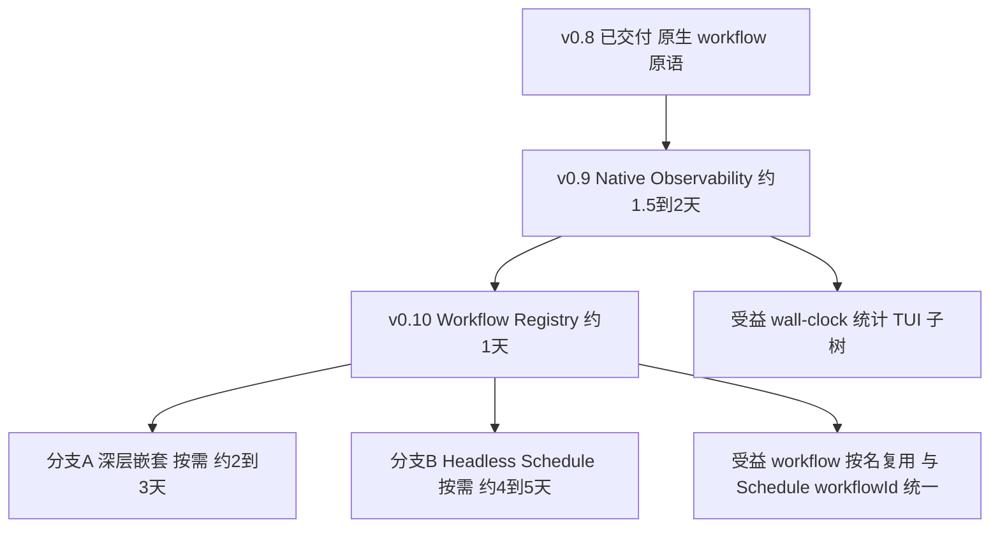

# 后续需求执行计划：Native P1.5 / Registry / Deep / Headless（v2）

> 承接已交付：Schedule P1（v0.7.0）、Native workflow() 原语 P1（v0.8.x）。
> **进度（2026-09-18）：v0.9 Observability 已完成（提交 2726289）、v0.10 Registry 已完成（提交 4db7bea），
> 待发版；分支 A（Deep Workflow + Nested Resume）已完成（见提交记录）；剩分支 B（Headless Schedule，Backlog）按真实需求启动。**
> v2 变更（第三轮评审采纳）：P1.5 三处数据模型调整（AgentRecord 双身份字段 / workflowId / TUI 递归建模）；
> P2 拆为三个独立版本能力且 Registry 提前；registry 路径判定改显式前缀；Schedule P2 补 executionMode 路由语义并锁定 Backlog。
> 路线：**v0.9 Observability → v0.10 Registry → 分支 A（Deep Workflow）/ 分支 B（Headless Schedule）按真实需求择一**。

## 0. 路线图（v2 定稿）



一句话路线：

```
现在    -> 让 Workflow 看得见（v0.9 Observability）
下一步  -> 让 Workflow 可以按名复用（v0.10 Registry）
真需要时 -> 让 Workflow 嵌套得更深（分支 A）或让 Schedule 离开 OpenCode 也能跑（分支 B）
```

四身份模型（本次起全线统一，防三种体系漂移）：

```
workflowId = Definition Stable Identity（meta.id，可选）
name       = Definition Display Name（meta.name）
label      = Invocation Display Name（调用方传入，缺省 name）
scopePath  = Invocation Stable Runtime Identity（keySegment 链，机器识别/去重）
```

---

## 1. v0.9：Native Observability（原 P1.5，1.5-2 天）

### 1.1 目标与受益

三模型对比场景现状仍靠 phase 前缀（`▸ deepseek / 生成代码`）文本辨识，统计要自己拼 agent 记录。v0.9 后：

```
TUI 树（workflowPath 分组）                统计（wall-clock）
code_model_comparison                     deepseek  wall=662s  tokens=123k
├─ deepseek / 清理旧产物                    gpt       wall=655s  tokens=98k
├─ deepseek / 并行双端                     claude    wall=701s  tokens=111k
└─ ...                                    （agent 时长总和 ≠ wall：并行时 wall 才是真实耗时）
```

多模型对比的正确口径是 **wall-clock + tokens + cost + 质量**，不是 agent duration 求和。

### 1.2 数据模型（v2 定稿，三处调整已并入）

```ts
/** shared.workflows：每个 workflow invocation 一条（root 也生成，作 TUI 树顶） */
interface WorkflowExecutionRecord {
  /** Definition Stable Identity：meta.id（可选；旧脚本无则 undefined，现在开始记录，将来免迁移） */
  workflowId?: string
  /** Definition Display Name：meta.name */
  name: string
  /** Invocation Display Name：调用方 label 或 name */
  label: string
  keySegment: string   // root 为 "root"，child 为 wfN
  /** 展示身份：scope 链 label 数组（给人看；同名冲突时靠 scopePath 区分） */
  displayPath: string[]
  /** 稳定身份：scope 链 keySegment 数组（给机器识别；如 ["root","wf0","wf2"]） */
  scopePath: string[]
  startedAt: number
  endedAt?: number
  durationMs?: number   // wall-clock
  status: "running" | "ok" | "failed" | "aborted"
  error?: string
}

/** AgentRecord 同时携带双身份（点击 TUI 节点反查、按 invocation 聚合 token 不用二次反推） */
interface AgentRecord {
  /** 展示身份（label 链）；root 的 agent 为 undefined（旧数据兼容） */
  workflowPath?: string[]
  /** 稳定身份（keySegment 链）；与 workflowPath 同生同灭 */
  workflowScopePath?: string[]
}
```

硬约束（不得违反）：
- **status 只描述 runtime 执行态**：child `return {ok:false}` 仍是 status="ok"；runtime 不解析返回值业务字段
- **数据层按 scopePath 递归建模，UI 第一版只渲染两级**（workflow 一级 + phase 二级）——P2 深层时 renderer 递归即可，snapshot reader 不再重构

### 1.3 任务分解（1.5-2 天）

| # | 任务 | 说明 |
|---|------|------|
| 1 | types：WorkflowExecutionRecord（含 workflowId）+ AgentRecord 双字段 + WorkflowRunResult.workflows | 可选字段，旧快照/journal 零迁移 |
| 2 | runtime：executeWorkflow 入口 push running record（root 与 child 统一）；finally 终态；agent 记录回填双身份字段 | scope 构造处带 workflowId（parse meta.id） |
| 3 | TUI 数据层：snapshot 按 scopePath 递归建模（workflow 节点树 + 挂 agent）；renderer 第一版渲染两级 | 遵守 TUI 单文件约束（solid-js 只在 plugin.tsx） |
| 4 | render：WorkflowRunResult.workflows 渲染"子流程耗时与 token"段（wall-clock 与 agent sum 并列展示差异） | result-view.ts |
| 5 | 测试（约 8 用例）：record 生成/终态/status 语义（ok:false 仍 ok）/双身份字段一致性/workflowId 记录与缺省/旧 journal 无新字段兼容/TUI 快照递归结构 | |
| 6 | 实机：三模型对比脚本重跑，核对 wall-clock 与 TUI 子树 | 对照手工计时 |

**验收**：compare run 结果含三子流程 wall-clock；TUI 显示真子树；`{ok:false}` 子流程 status=ok；scopePath 支持同 label 去重。

### 1.4 风险

| 风险 | 对策 |
|------|------|
| TUI 分组键变更破坏旧快照渲染 | workflowPath 不存在时回落 phase 分组（旧快照兼容读） |
| root record 与 WorkflowRunResult 语义重复 | root record 仅服务 TUI 树顶；统计口径以 RunResult 为准 |

---

## 2. v0.10：Workflow Registry（约 1 天，原 P2-c 提前）

**提前理由**：`workflow("deepseek-codegen", args)` 对日常复用的提升远大于三层嵌套（后者仍是未来需求）——Workflow 立刻像真正的可复用组件，且与 Schedule 的 workflowId 体系统一。

### 2.1 引用规则（v2 修正：显式路径前缀判定，不用 contains "/"）

```ts
function isExplicitPath(ref: string): boolean {
  return ref.startsWith("./") || ref.startsWith("../") || path.isAbsolute(ref)
}
```

- `./x.js`、`../y/x.js`、绝对路径 → 路径语义（现状不变）
- 其余（`daily-review`、`ui/main-menu`、`code/deepseek` 等**含斜杠的名字也合法**）→ 查 registry

> 不采用"含 / 即路径"：registry id 天然可能是层级名（ui/main-menu）。也不引入 `id:`/`file:` scheme 前缀（P2 无必要搞这么重）。

### 2.2 任务分解

| # | 任务 | 说明 |
|---|------|------|
| 1 | registry 查找：`.opencode-workflows/workflows/` 扫描（复用 Schedule 的 loadRegistry，workflowId = meta.id ?? meta.name） | 含斜杠名匹配目录内文件的 meta |
| 2 | registry 缓存：per-run 缓存到 SharedRunContext（首查扫描） | 防每次 workflow() 调用扫目录 |
| 3 | 未找到报错并列出已知名（复用现有错误格式） | |
| 4 | 与 Schedule 的 workflowId 统一文档化：同名脚本既能被定时也能被组合引用 | |
| 5 | 测试：名字/路径判定边界（含斜杠名）、缓存、未找到报错、与 scriptPath 语义共存 | |

---

## 3. 分支 A：Deep Workflow + Nested Resume（按需，约 2-3 天）

### 3.1 A-1 Nested Resume Hardening（约 1 天，可与 A-2 解耦）

| 语义场景 | 定案 |
|----------|------|
| child 内 agent 内容变更 | hash 不匹配处起全 scope 重跑（补组合场景测试锚定） |
| child 脚本编排变更 | 同上：resume 只认 agent 调用内容 |
| **父编排调换 child 顺序** | **接受"后续 child 全部 miss 重跑"**（childSeq 按调用顺序编号）。不做内容寻址 keySegment——会破坏 journal 兼容且引入 hash 碰撞面；resume 的首要品质是可理解、确定、可调试，不是最大 reuse ratio |
| child 脚本被删除/改名 | 直接报"子脚本不存在"；journal entry 增补 workflowName 字段（label）辅助断点反查 |
| journal 可观测性 | onAgentJournal 的 entry 增补 label（哪个子流程的哪一步） |

### 3.2 A-2 Deep Nesting（约 1-2 天，依赖 v0.9 的 scopePath 树）

| # | 任务 | 说明 |
|---|------|------|
| 1 | MAX_WORKFLOW_DEPTH 放开（默认 3）+ WorkflowRunOptions.maxWorkflowDepth 覆盖 | 环检测已具备（沿链 canonical 比对） |
| 2 | journal key 多段（runId:wf0:wf1:N）深层回放验证 | 数据结构 P1 已定型，补测试 |
| 3 | phase 前缀只保留一级（层级显示交给 v0.9 的 scopePath 树，不再嵌套拼接前缀） | 消除 `▸ a / ▸ b / x` 堆积 |
| 4 | TUI renderer 递归渲染 scopePath（数据层 v0.9 已备） | |
| 5 | 深层统计递归正确性（workflows 数组含全部层） | 组合测试矩阵：深度 × 串/并 × resume |

---

## 4. 分支 B：Schedule Headless（Backlog，按需 4-5 天）

**定位锁定：Backlog**——P1 已解决"OpenCode 开着定时跑"；P2 仅为"OpenCode 不开"多一个场景，工程复杂度（OS Scheduler → CLI → serve → SDK）大幅上升。等真实需求出现再启动。

### 4.1 executionMode 路由语义（v2 新增定案，开发时不得偏离）

```text
executionMode = "attached"（默认）
  → 仅 In-Process Scheduler 负责该 schedule；OS 侧无任务

executionMode = "headless"
  → In-Process Scheduler 的 tick 忽略该 schedule；仅 OS Scheduler 负责
```

> **claim 不是 routing 机制**。虽然 claim 技术上防得住双跑（谁先抢到谁执行），但"OpenCode 开着时 attached 与 headless 随机争抢"会造成同一 schedule 的执行环境不稳定——产品行为不可接受。claim 仅作为**最后一道幂等保护**（手工 run_now 与到点重叠、异常场景），路由由 executionMode 一票决定。

### 4.2 复用盘点（P1 已白拿）

| v1 方案组件 | 现状 |
|-------------|------|
| 跨进程 claim（原子 wx + epoch） | ✅ 现成 |
| 磁盘 execution lock + pid 僵尸检测 | ✅ 现成 |
| Run Record / journal / TUI 快照 | ✅ 现成 |
| fresh session + 不回传 + Record 落盘 | ✅ 现成 |
| Schedule 领域层/工具面 | ✅ 加 executionMode 字段即可 |

### 4.3 任务分解（启动时）

| # | 任务 | 说明 |
|---|------|------|
| 0 | **Spike（0.5 天，闸门）**：spawn `opencode serve` + SDK client + 一条 prompt 全链路；验证认证继承与启动耗时 | 不通过则继续 Backlog |
| 1 | Schedule.executionMode 字段 + 工具参数 + tick 路由（headless 被忽略） | 默认 attached 零破坏 |
| 2 | headless runner CLI（schedule-exec）：读配置 -> claim/lock -> spawn serve -> 复用 Adapter 执行 -> Record -> kill serve | 注册时固化 node 绝对路径 |
| 3 | Windows schtasks Adapter：cron 四模式映射、命令行固化、enable/disable/delete | 跨平台跳过标记 |
| 4 | 测试 + 实机：关 OpenCode 到点执行、重启保留、attached/headless 各自路由正确（互不争抢） | 原 v1 Test 2/3 回归 |

---

## 5. 类比理解

- **v0.9（Observability）**是给工地装"工位计时牌与项目看板"：每支施工队进场/收工自动打卡（wall-clock），看板按工位分栏（scopePath 树），工牌（displayPath）给人看、工位号（scopePath）给考勤机识别——而不再靠安全帽贴纸文字（phase 前缀）辨认谁是谁。
- **v0.10（Registry）**是给常用施工队发"固定番号"：喊一声"水电三组"（workflowId）就能叫到人，不必每次报完整住址（./scripts/...）；同一番号白天排班（Schedule）和临时调派（组合）通用。
- **分支 A（Deep）**是放开"总包只能管一层分包"，并写清"调换分包顺序 = 后面的活重干"的施工规矩（resume 语义钉死，不为了省工引入复杂的图纸指纹寻址）。
- **分支 B（Headless）**是给餐厅装夜间自动炒菜机——但白天的真人服务照旧，且谁值班由排班表（executionMode）说了定，不是谁先抢到灶台谁做（claim 只防重复开火，不管排班）。

## 6. 引用说明

- 本文档 v1：`Docs/01_需求与规划/后续需求P1.5-P2执行计划.md`（v2 替代）
- 第三轮评审采纳：AgentRecord 双身份字段 / workflowId 四身份模型 / TUI 数据层递归建模 / Registry 提前为 v0.10 / 显式路径前缀判定 / executionMode 路由语义（claim 非路由）/ P2 拆独立版本能力
- Native v2 执行计划：`Docs/01_需求与规划/Native子工作流workflow原语执行计划.md`
- Schedule v4 执行计划：`Docs/01_需求与规划/Schedule功能P1执行计划.md`
- 实现现状：`src/runtime/workflow-runtime.ts`（WorkflowScope/SharedRunContext）、`src/schedule/registry.ts`（loadRegistry 复用点）、`src/tui/run-snapshot-reader.ts`（分组键）、`src/types/index.ts`
- 手测基线：`examples/sample-project/Native子工作流测试指南.md`、`Schedule测试指南.md`
