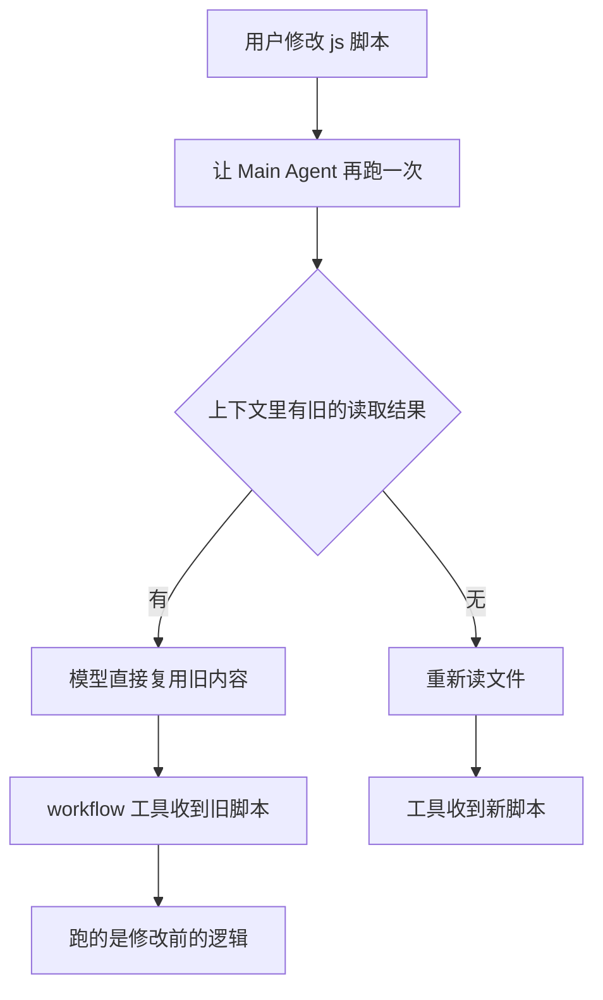
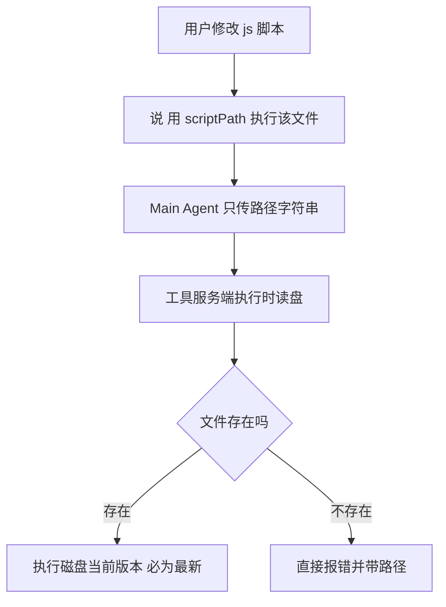

# 工作流脚本陈旧缓存风险与解决方案

> 需求来源：手工验收时的实际痛点。
> 原话：每次修改完 js 脚本，在 OpenCode 中执行时，模式在脚本被修改后有缓存风险——
> Main Agent 会沿用上轮记忆的文件内容。以后凡改过脚本再跑，口令都要带「已修改，请重新读取」。
>
> 状态（2026-09）：方案 A 已实施（双参数 scriptPath）——实施时收敛为 src/tools/script-source.ts 单点解析，
> workflow.ts 前台与后台路径同经此入口（background-runs 无需改签名）；二选一校验、服务端读盘、
> 错误带路径完整暴露；示例脚本头注释话术已升级为 scriptPath 口令。测试见 tests/script-source.test.ts。

## 1. 问题描述

工作流测试脚本是迭代式的：改一轮、跑一轮、看结果再改。当前执行方式是让
Main Agent「读取 scripts/xxx.js 的内容，用 workflow 工具原样执行」。修改文件后
再跑时，Main Agent 常直接复用上一轮 Read 到上下文里的旧内容，工具拿到的是
改之前的脚本，跑出似是而非的结果，且从输出上很难察觉（runId 不同、结果正常）。

## 2. 根因分析

三个事实叠加，导致该风险是结构性的而非偶发：

1. workflow 工具的 `script` 参数是原文粘贴型：内容必须经过 Main Agent 的上下文
   （src/tools/workflow.ts 与 src/tools/background-runs.ts 两处，`script: string`）
2. 上一轮的 Read 结果仍在会话上下文里，LLM 出于惯性（也省 token）倾向直接引用，
   而不是重新执行一次文件读取
3. OpenCode 会话层没有文件新鲜度提醒机制（已核实 session/prompt.ts 无
   file changed since read 类检查），宿主侧无兜底

## 3. 现状 workaround 及其缺陷

口令约定：改完脚本必须说「已修改，请重新读取」。

缺陷：依赖人记得说 + 模型听话，两个环节都不可靠；忘了说或模型忽略，
就拿到旧脚本且无任何报错提示。属于用纪律补系统缺陷。

## 4. 方案对比

| 方案 | 思路 | 优点 | 缺点 |
|---|---|---|---|
| A scriptPath（推荐） | 工具新增可选参数 scriptPath，服务端执行时自己读盘 | 根因修复，零缓存可能；附带省 token（脚本不再进主上下文） | 需要改两个工具的入参与文档 |
| B hash 校验 | 口令带上次结果的 contentHash，工具比对不符报错 | 防呆明确 | 依赖人拿得到并记得传 hash，体验差 |
| C 提示词强化 | workflow-authoring skill 里强调每次执行前必须重读 | 零代码 | 治标，仍依赖模型自觉 |

## 5. 方案 A 设计要点

### 5.1 入参变更（workflow 与 workflow background 两处同步）

- 新增可选 `scriptPath: string`
- `script` 与 `scriptPath` 二选一：都传报错、都缺报错（错误完整暴露，不做静默降级）
- 服务端执行前 `readFileSync(resolve(cwd, scriptPath), "utf8")`，
  文件不存在或不可读直接抛错，报错信息含路径

### 5.2 兼容性

- resume 语义不变：scriptPath 只是 script 的来源，journal 哈希照旧对
  读到的实际内容计算；修改脚本后续跑，首个变更调用起全量重跑的行为一致
- meta 信封校验、VM 沙箱、并发控制均不感知来源差异，零影响
- 示例脚本头注释的用法话术同步升级为：
  「用 workflow 工具执行 scripts/xxx.js，scriptPath 传 scripts/xxx.js，
  不要粘贴脚本内容」

### 5.3 附带收益

脚本原文不再需要进入主上下文。以并发探针脚本为例约 1KB 一份，
复杂编排脚本更大；每次执行省一份完整脚本 token，且杜绝了
「粘贴时被模型自行改写」的第二类失真。

## 6. 类比理解

口头传菜谱 vs 把菜谱本递进厨房：

- 现状是每上一道菜都让服务员背一遍菜谱再口头传进去——背错一版（上下文里的旧读取）
  厨房照做不误，客人吃到的是旧菜
- 「已修改请重新读取」相当于叮嘱服务员这次务必再背一遍——还是会忘
- scriptPath 是把菜谱本直接钉在厨房门上，每道菜开工前厨师自己翻最新一页：
  菜谱本永远是最新版，背谱环节整个消失，还省了传话的口舌（token）

## 7. 引用说明

- src/tools/workflow.ts（script 参数定义与 execute）
- src/tools/background-runs.ts（BackgroundStartInput 的 script 字段）
- examples/sample-project/scripts/（17 个验收脚本的现行用法话术）
- 本仓库 Docs/01_需求与规划/（需求文档目录惯例）
