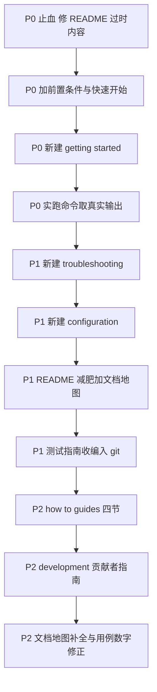

# opencode-dynamic-workflows 文档改造计划（文档审计报告）

> 审计方法：docs-writing skill（Diataxis 类型门控 + 分级规则）全量审计，本阶段只审计不改文件。
> 所有命令与 API 均已对照代码或实跑验证：npm 包实查 0.2.1、`npm test` 实跑 106 pass、CLI 四命令与 src/cli/index.ts 对照、workflow/workflow_control 工具注册与 src/index.ts 对照。
>
> 目标用户：完全不了解本项目、甚至不熟悉 OpenCode 的新用户。
> 最终目标：小白可以从 0 开始：理解项目 → 环境准备 → 安装 → 配置 → 跑通第一个 workflow → 看懂结果 → 学会基础 DSL → 知道去哪排障。

**类比理解**：现在的 README 像一本"工程师内部手册"塞在了产品包装盒里——买到产品的新用户打开盒子，看到的是流水线装配图（架构约束）、内部工程代号（P0/F-20）和研发计划表（阶段规划），唯独找不到一页"开箱三步走"。本计划做的事：把包装盒里的说明书换成"开箱指南"（README），工程手册另放一格（docs/development.md），质检清单单独装订（docs/testing.md）。

---

## 〇、十个重点检查的结论

| # | 问题 | 结论 |
|---|------|------|
| 1 | README 面向谁 | 贡献者/作者本人。功能清单用 P0/F-20 内部里程碑语言，"阶段规划/开发/架构约束"三节纯贡献者内容；仅"安装/配置"面向用户但术语未清理 |
| 2 | 真实可用安装方式 | 三种均属实：① `npx @mickorz/opencode-dynamic-workflows install`（npm 实查 0.2.1，bin 已定义，install/update/uninstall/doctor 四命令实现在 src/cli/）② 配置里写包名，OpenCode 启动自动拉包 ③ 项目 node_modules 相对路径引用 |
| 3 | 第一次使用必须步骤 | 装 OpenCode v1 → 配 provider/model（本仓库完全未覆盖的外部前提）→ npx install 或手动写两份 json → 重启 OpenCode → 验证 → 说自然语言触发 workflow |
| 4 | 必须的配置 | `opencode.json` 的 `plugin` + `tui.json` 的 `plugin`（两份，TUI 侧漏配只丢实时树不丢功能）；skill 可选但强烈推荐；provider/model 在 OpenCode 层必须已配 |
| 5 | 最小可运行 workflow | examples/sample-project/scripts/smoke-test.js（已验证存在，2 agent）；还可更小为单 agent hello-world |
| 6 | 过时说明 | "阶段规划"整节所列"后续"功能全部已实现（workflow_control、后台、journal/resume、worktree、质量 DSL、model tier 均在 src/ 中）；"v0.1 最小闭环"vs 实际 v0.2.1；"18 个用例"实际 106 |
| 7 | 缺少内容 | OpenCode 前置安装与模型配置、快速开始、可复制脚本+预期输出、结果怎么读（token/runId/子会话导航）、面向用户的 FAQ、workflow-optimize skill 介绍、bash 版清理命令（只有 PowerShell） |
| 8 | README 应保留 | 一句话定位、功能亮点（压缩）、主推安装方式、5 分钟快速开始、文档地图、License |
| 9 | 应拆到 docs/ | 三种配置长文、DSL 细节、开发/架构约束、排障 FAQ、验收指南、各 how-to |
| 10 | 新用户最易卡点 | ① OpenCode 没装/没配模型（最大卡点，零覆盖）② 不知道不需要自己写脚本，跟 Main Agent 说人话即可 ③ 漏配 tui.json / 改配置没重启 ④ npm CDN 缓存 404 ⑤ explore 缺省只读导致写任务"没效果" ⑥ agent 可恢复失败静默返回 null ⑦ Docs/ 死链找不到验收清单 |

---

## A. 当前文档问题（按文件，含 docs-writing 规则定级）

### README.md

- [CRITICAL] `structure-diataxis`：单文件混合四种类型——用户安装教程 + DSL 参考 + 贡献者架构 + 时间性路线图，任何一类读者都要在无关内容里翻找。Fix：按 C/B 拆分。
- [CRITICAL] `structure-quick-start` + `structure-conditions-first`：没有快速开始；"验证安装"在全文末尾，且前提条件（OpenCode 已装、provider/model 已配）全文未声明。Fix：前置条件 + 5 分钟快速开始提到安装之后立即出现。
- [CRITICAL] `voice-no-jargon`：F-20、P0/P1/P2、readV1Plugin、Temp vendor、journal、"bun 直读 TSX"、`exports["./tui"]`——新用户无一能懂。Fix：用户文档改说"实时树/后台任务/断点续跑"，内部术语留在贡献者文档。
- [CRITICAL] `review-verify-links`：README 第 165 行引用 `Docs/01_需求与规划/opencode-dynamic-workflows需求文档.md`，而 `Docs/` 整体被 .gitignore 排除（git ls-files 确认 0 个文件）——新克隆用户拿到的是死链。
- [HIGH] `hygiene-delete-outdated`：三处过时——① "阶段规划"整节（所列功能全部已发布）；② "v0.1 为最小闭环（P0）"（实际 0.2.1，且已含交互式安装器）；③ "npm test 18 个用例"（实跑 106；本地 CLAUDE.md 写 94 也过时，顺带修）。
- [HIGH] `code-runnable-examples`：全文没有一个可运行的 workflow 脚本示例，用户装完不知道第一步说什么。Fix：放一个 10 行内的 hello-world + 一句自然语言触发话术。
- [HIGH] `structure-procedures`：三种配置方式等权罗列近 60 行，新用户无法决策。Fix：README 只留推荐方式 + 对比表，全文迁 docs/。
- [MEDIUM] `code-placeholders`：`cd E:/WorkProjects/xc-flow` 硬编码作者个人路径进公共文档。
- [MEDIUM] `hygiene-no-temporal`："阶段规划"是时间性内容，放 README 必然持续腐烂。Fix：移到 CHANGELOG/Release 或删除。
- [MEDIUM] 排障节混入内部实现（1.18.29 安装位置、Temp vendor 目录清单）：对排障有价值但属深度内容，应下沉到 troubleshooting 文档，README 留 `npx ... doctor` 一条即可。
- [LOW] 闲置资产：assets/resume.png、assets/tui_workflowtree.png 两张截图已入库但零引用——快速开始配 tui_workflowtree.png 即可让用户知道"成功长什么样"。

### examples/README.md

- 内容准确（12 个脚本与 git 追踪一致；plugin/skills.paths 两个相对路径基准的源码级说明是全仓最好的段落之一）。
- [MEDIUM] 受众错位：定位是"插件测试工程"验收索引，不是新用户入口；提到 Docs/ 本地目录（对克隆用户不可达，虽已括号注明）。
- Fix：保持现状 + 在 README 文档地图中链接为"本地联调环境"。

### skills/workflow-authoring/SKILL.md + references/runtime.md

- 全仓质量最高的文档：DSL API 准确（与 src/tools/workflow.ts 的 args schema、runtime 实现逐一相符）、有范例、有错误处理约定。
- [MEDIUM] `nav-every-doc-linked`（反向问题）：它客观上就是最好的用户参考，但 README 完全不知道它存在，没有一条链接指向它。workflow-optimize skill 同样零提及。
- Fix：README/getting-started 以 GitHub 绝对链接指向 runtime.md（不能用相对路径——npm 包 files 里虽含 skills/，但 npmjs.com 渲染 README 时仓库相对链接会 404）。

### Docs/（本地目录，不入 git）

- [CRITICAL] `hygiene-docs-directory` + `review-verify-links`：全部验收标准（P0 测试指南、P1/P2 指南）只存在于作者本机，公仓用户拿不到；README 还在链接它。
- 测试指南正文质量不错（mermaid 总览、检查点清单、FAQ），但"npm test 预期：18 pass"过时，受众写的是验收开发者而非用户。
- Fix：用户需要的部分收编入 git 的 docs/testing.md，贡献者部分进 docs/development.md。

### CLAUDE.md / AGENTS.md

- 面向 AI 贡献者，不属用户文档，本次不展开。仅顺带：CLAUDE.md "94 个用例"应更新为 106（本地文件，改 CLAUDE.md 时一并处理）。

---

## B. 推荐文档目录结构

原则：入 git 的 `docs/`（小写；现有本地 `Docs/` 是作者工作区，不作为公仓文档面）；不复制 skill 内容（runtime.md 随 npm 包分发且质量已达标，用户文档链接之）；每文件单一 Diataxis 类型。

```
README.md                          # 定位 + 安装 + 5分钟快速开始 + 文档地图（见 C）
docs/
  getting-started.md               # Tutorial：从 0 到第一个 workflow（见 D）
  configuration.md                 # Reference：三种安装方式、配置字段权威表、升级/卸载、跨平台命令
  troubleshooting.md               # How-to：面向用户 FAQ（doctor、缓存 404、tui.json、null 结果、只读缺省）
  how-to-guides.md                 # How-to 合集：后台运行 / resume / 质量 DSL / worktree（四节，长了再拆）
  testing.md                       # How-to：验收清单（自本地 Docs/03 收编入 git，修正数字）
  development.md                   # Explanation：架构约束、测试注入缝、本地联调（贡献者）
skills/…                           # 不动（随 npm 包分发，服务 Main Agent）
examples/…                         # 不动（本地联调工程）
assets/                            # 截图
```

---

## C. README 推荐结构

1. 标题 + 一句话定位（现有首段保留，已经不错）
2. 30 秒了解：解决什么问题 + tui_workflowtree.png 截图（"成功长这样"）
3. 前提条件：OpenCode v1 已安装且配好 provider/model（链 opencode.ai 官方文档），Node 最低版本（见 G-1，需定值）
4. 安装：只主推 `npx @mickorz/opencode-dynamic-workflows install` 一条命令 + 一句"交互式完成配置与 skill 安装"；其余两种方式一行链接 docs/configuration.md
5. 5 分钟快速开始：重启 OpenCode → 说一句自然语言 → 看到实时树和汇总结果（配真实输出样例，见 E）
6. 核心概念 5 行：你不用写脚本，Main Agent 按需加载 skill 自动生成 / 子 agent 缺省只读 explore / 长任务可后台、断了可续跑
7. 文档地图：一张表链到 B 的全部页面 + skills/workflow-authoring/references/runtime.md（GitHub 绝对链接）
8. License

移除：阶段规划（删或进 Release notes）、开发/架构约束（→ docs/development.md）、三种配置长文（→ docs/configuration.md 留对比表）、全部内部编号术语。

---

## D. Getting Started 推荐结构（docs/getting-started.md）

0. 你将完成什么：一段预期结果预览（真实输出摘录）
1. 前提条件（`structure-conditions-first`）：OpenCode 安装与 provider/model 配置——这是目前全仓最大的文档空洞，需给可操作的最短路径
2. 安装插件：npx install（选全局）→ `npx ... doctor` 看 [OK] 清单
3. 重启并验证：问 Main Agent "你有哪些工具？"应看到 workflow；TUI 侧 ctrl+p → Plugins 应 active（配截图）
4. 第一个 workflow：给出 hello-workflow 可复制脚本 + 触发话术（"用 workflow 工具原样执行以下脚本：…"），再给一个纯自然语言版（"用 workflow 并行分析 XX"）
5. 读懂结果：主会话只收到汇总 + 每个 agent 单行摘要与 token；子会话在父会话 subagent 导航里；实时树在 sidebar；runId 在返回的 metadata 里
6. 下一步：链接 how-to-guides 四节
7. 卡住了？：链接 troubleshooting

---

## E. 需要新增的示例

1. hello-workflow.js：单 agent 最小脚本（比 smoke-test 更小，专门给第一次）
2. 预期输出样例：真实 tool 返回文本的摘录（必须实跑截取，禁止编造）
3. 触发话术对照：同一任务"粘贴脚本版"与"自然语言版"各一句
4. 后台运行对话示例：background true → workflow_control status → stop（skill/runtime.md 已有 API 描述，缺用户视角对话样例）
5. resume 对话示例：改脚本 + resumeFromRunId 续跑
6. doctor 输出样例：实跑一次截取 [OK]/[WARN] 清单

---

## F. 需要验证的命令（写作时逐条实跑并抄录输出）

| 命令 | 用途 | 本次审计状态 |
|------|------|------------|
| `npx @mickorz/opencode-dynamic-workflows install / doctor / --help` | 安装/排障文档 | 代码已核对，未实跑 install（会写配置），doctor 可安全实跑 |
| `npm run build` / `npm run typecheck` / `npm test` | 开发文档 | typecheck+build 未跑，npm test 已实跑 106 pass |
| `npm view @mickorz/opencode-dynamic-workflows version` | 排障第一步 | 已实跑，0.2.1 |
| `Remove-Item -Recurse -Force $env:USERPROFILE\.cache\opencode\packages\@mickorz` | 升级文档 | 未实跑；且缺 bash 等价命令，需补 |
| examples/sample-project 启动 OpenCode → smoke-test.js 全链路 | 快速开始样例 | 需要 OpenCode 环境，改造实施阶段必须实跑 |
| 缓存路径 `~/.cache/opencode/packages/` 在 Linux/mac 的实际位置 | configuration.md | 仅 Windows 已验证，跨平台需注明 |

---

## G. 可能耗时或不确定的信息（写文档前必须澄清）

1. Node 最低版本：package.json 无 `engines` 字段，全仓无人声明。tsx 4.x 需 Node ≥ 18——需实测后写死并建议补 engines。
2. npm CDN 缓存 404"几分钟"窗口：README 的说法无依据，改写为"若 404 请稍后重试或用 doctor 确认"。
3. 版本绑定描述：排障节写死"1.18.29 实际安装位置"，随 OpenCode 版本会腐烂——用户文档避免写死第三方版本号，细节留给 troubleshooting 并注明观察日期。
4. journal 落盘路径 `.opencode-workflows/journal/<runId>.json`：来自 src/tools/workflow.ts 错误文案，文档引用前以实跑目录为准。
5. 缺省并发"CPU核数-2、上限 16、maxAgents 1000"：与 tool args describe 一致，但容器/cgroup 下核数检测行为未验证。
6. `explore`/`general` 内置代理名：属 OpenCode 内置，随版本变化风险，文档注明"以所用 OpenCode 版本为准"。
7. `workflow_control stop` 后 journal 可 resume：runtime.md 已声明，实施时实跑验证再写入用户文档。
8. Windows/Linux/mac 的 tui.json 行为一致性：TUI vendor 机制踩过坑（本地 Docs 有注意事项），跨平台表述需保守。

---

## H. 按优先级排列的执行步骤



**P0 —— 解除新用户卡点（纯删改 + 一个新页面）**
1. 修 README 过时内容：删"阶段规划"节、改"v0.1"表述、改"18 个用例"为实跑数字、Docs/ 死链改指向（半小时级，先止血）
2. README 加"前提条件"+"5 分钟快速开始"（含 hello-workflow 脚本与真实输出）
3. 新建 docs/getting-started.md（按 D 结构）
4. 实跑 F 清单中可安全执行的命令，截取真实输出与 doctor 样例

**P1 —— 文档骨架成型**
5. 新建 docs/troubleshooting.md（README 排查节 + 测试指南第 9 节 FAQ 合并，转用户视角）
6. 新建 docs/configuration.md（三种方式 + 配置字段表 + bash/PowerShell 双版本命令；删 README 个人路径）
7. README 按 C 减肥（配置长文与开发节迁出，加截图与文档地图）
8. 新建 docs/testing.md：本地 Docs/03 测试指南收编入 git（修正数字，验收语言改用户视角）

**P2 —— 补全与长期维护**
9. 新建 docs/how-to-guides.md（后台/续跑/质量 DSL/worktree 四节）
10. 新建 docs/development.md（README 开发节 + AGENTS.md 面向人的部分）
11. 文档地图补 workflow-optimize skill 与 examples/ 联调入口
12. 顺带修本地 CLAUDE.md "94 个用例" → 106；（可选、暂缓）llms.txt/agent-readable 路由

---

## 引用说明

本计划依据以下材料与知识来源：

- 审计方法：docs-writing skill（Diataxis 文档类型门控与 51 条文档规则），本地路径 `C:/Users/zhangqi95/.claude/skills/docs-writing/SKILL.md`；Diataxis 框架出自 https://diataxis.fr/
- 项目内核对文件：
  - README.md（被审计主体）
  - package.json（包名 0.2.1、bin、exports、files 字段）
  - src/cli/index.ts、src/cli/config.ts、src/cli/doctor.ts（安装/卸载/升级/doctor 四命令实现）
  - src/index.ts、src/tools/workflow.ts（workflow 与 workflow_control 工具注册、tool 参数 schema）
  - skills/workflow-authoring/SKILL.md 与 references/runtime.md（DSL API 权威描述）
  - examples/README.md、examples/sample-project/（测试工程、12 个脚本、双 json 配置示例）
  - Docs/03_测试指南/测试指南.md（本地验收指南，收编来源）
  - .gitignore 与 git ls-files（确认 Docs/ 与 thirdparties/ 不入 git）
- 外部参考：
  - OpenCode 官方文档（前置条件指引）：https://opencode.ai/docs/
  - 移植来源项目 pi-dynamic-workflows：https://github.com/QuintinShaw/pi-dynamic-workflows
  - npm 包页（版本实查 0.2.1）：https://www.npmjs.com/package/@mickorz/opencode-dynamic-workflows

---

## 执行记录（2026-09-09 完成）

按 P0/P1/P2 全部执行完毕，变更清单：

| 文件 | 变更 |
|------|------|
| README.md | 重写：前置条件、30 秒了解（含截图）、5 分钟快速开始、核心概念、文档地图；删除阶段规划/开发/配置长文/内部术语；修复 18 用例、v0.1 表述、Docs 死链 |
| Docs/getting-started.md | 新建：0~7 步教程（前提、安装、验证、首个工作流、读结果、自然语言版、下一步） |
| Docs/configuration.md | 新建：三种安装方式、配置字段权威表、升级/卸载、缓存与日志位置（bash/PowerShell 双版本） |
| Docs/troubleshooting.md | 新建：安装/运行/现象确认三类 FAQ（doctor 优先，含 git-bash、npx 钉旧版、后台不受 Esc 影响等新卡点） |
| Docs/how-to-guides.md | 新建：后台运行、断点续跑、质量 DSL、worktree 隔离四节 |
| Docs/testing.md | 新建：验收清单收编入 git（原 Docs/03 测试指南用户向改写，20/20 与 18 pass 数字修正） |
| Docs/development.md | 新建：贡献者指南（命令、架构速览、测试注入缝、本地联调、发布流程） |
| .gitignore | Docs/ 改为 Docs/* + 6 个公开文档显式放行（Windows 大小写不敏感，docs 与 Docs 共用物理目录）；examples/sample-project/docs 仅放行 10 个 mdx 语料 |
| examples/README.md | 检查点清单指针从本地 Docs/03 改为 docs/testing.md |
| CLAUDE.md（本地） | 94 用例改 106；文档结构节改为 Docs/* 白名单机制说明 |
| examples/sample-project/docs/*.mdx | 10 个验收语料首次纳入 git 跟踪（修复 examples 自包含承诺） |

验证结果：typecheck 三配置通过；npm test 106 pass 0 fail；git check-ignore 逐项核对放行/忽略正确。未提交，待人工 review 后 git add + commit。

实施中发现并修正的两个计划外问题：

1. 计划中的 docs/ 目录在 Windows 上与被忽略的 Docs/ 是同一物理目录（core.ignorecase=true，git check-ignore 实证），公开文档以 Docs/* 白名单方式落地。
2. examples/sample-project/docs 的 10 个 mdx 语料从未被 git 跟踪，克隆用户拿不到验收语料（examples/README 自包含承诺落空），已随本次修复。
