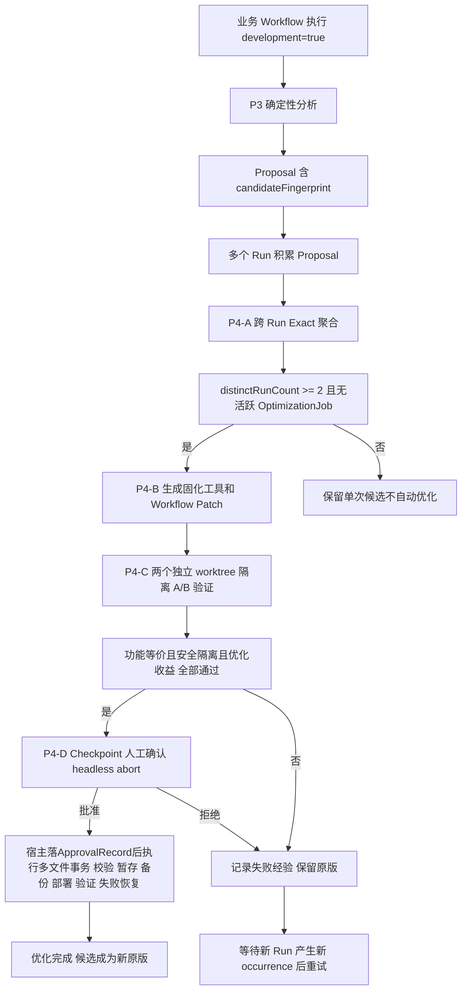

# P4 执行文档 v2 - Workflow 自优化闭环

> P3 已完成：Workflow 执行 → 记录历史 → 自动分析 → 生成优化建议。
> P4 目标：跨 Run 识别重复优化机会 → 自动生成候选版本 → 隔离验证 → A/B 对比 → 人工确认 → 应用或回退。
>
> 基线提交：`29a1a0f`（P3.2 + dev-examples 入库）
> P3 端到端联调已通过：development=true Workflow → 五类规则分析 → Optimizer Job completed
>
> v1 评审意见全部采纳（5 个源码声明已核实），本文档为修订版。
>
> 第三轮评审（对 v2）：4 个 P0 已逐条核实成立并采纳，不推翻架构与阶段划分，修订直接落入本文档。
> 批准 P4-0 与 P4-A 开发；P4-B 先做真实样本原型；P4-C/D 在四类契约（WorkflowSource / ABExecutor+ABEvaluator / ApprovalRecord / Candidate Bundle Apply）落地后实施。
> 评审核实记录见 `新增Workflow追踪分析-评审修订-v3.md`。

## 一、设计约束

1. **第一版不自动覆盖原 Workflow**：候选版本在隔离环境验证后，必须经 Checkpoint 人工确认才应用
2. **复用已有能力**：不另建优化框架，复用 `check()`/`verify()`/`checkpoint()`/`fallback()`/`judgePanel()` DSL 函数和 `workflow-optimize` Skill 的七步迭代流程
3. **防递归**：候选 Workflow 不触发二次分析。禁止标记由 Runtime 启动参数强制传入（验证执行不带 development），不依赖候选脚本 meta 字段自声明（脚本内声明无法被 Runtime 强制信任）
4. **成本上限**：单次优化迭代设最大 token 预算和最大优化尝试次数（按候选维度，非 Run 扫描数）
5. **候选隔离**：候选版本在 worktree 隔离环境执行，产物快照隔离，不污染原项目
6. **强隔离失败不降级**：worktree 创建失败时拒绝执行候选，不降级到原项目目录
7. **应用动作由确定性代码完成**：不通过 Agent bash cp 覆盖原文件，由 TypeScript 代码做原子替换

## 二、P3 遗留问题（P4-前置修复）

| 问题 | 修复方式 | 影响范围 | 状态 |
|------|---------|---------|------|
| Rule 3 Dependency 对 `./` 路径前缀漏检 | `detectDependencies` 的 bash 命令匹配改为 token 化比对：`pathsMatch` 归一化 + `getBaseName` 兑底（`commandReferencesPath`），附带修复后缀文件误判 | `rules.ts` | 已完成（含 3 个新测试；typecheck 存量 17 错误一并清理） |
| Proposal `suggestedChange` 使用固定模板文案 | P4-B 根据脚本实际代码生成具体改动描述 | `report-builder.ts` | 待 P4-B |

## 三、OptimizationJob 状态机

P4 新增独立的 OptimizationJob 状态机，与已有 DevJob 分开职责。DevJob 负责 P3 单次 History 分析，OptimizationJob 负责跨 Run 聚合到应用的全生命周期。

```
discovered
    │  P3 Proposal 生成时
    v
aggregated
    │  P4-A 聚合后 distinctRunCount 达标
    v
planned
    │  P4-B 生成 OptimizationPlan
    v
generated
    │  P4-B 产出固化工具 + Workflow Patch
    v
validating
    │  P4-C worktree A/B 验证中
    v
awaiting_approval
    │  P4-C 验证通过，等待人工确认
    v
applied / rejected / failed
    │  P4-D 结果
```

| 字段 | 说明 |
|------|------|
| optimizationId | 候选内容 fingerprint + 优化轮次 |
| candidateFingerprint | 来自 P3 的稳定指纹 |
| baselineScriptHash | 原版 Workflow JS 的 sha256，应用前校验未被修改 |
| candidateScriptHash | 候选 Workflow JS 的 sha256 |
| abResultHash | A/B 验证结果的 sha256，绑定批准 |
| optimizationAttempt | 该候选的第几轮优化（从 1 开始，上限 3） |
| totalTokenUsed | 累计真实 token 用量（跨阶段累计） |
| tokenBudget | 该候选的 token 预算上限 |
| state | 上述状态机中的当前状态 |
| lastUpdatedTs | 最后状态变更时间戳 |

**防重复触发**：同一 fingerprint 的 OptimizationJob 处于 `aggregated` 到 `awaiting_approval` 之间的任何状态时，不创建新的 OptimizationJob。只有 `applied`/`rejected`/`failed` 终态后，才允许新一轮优化（optimizationAttempt + 1）。

**失败重试条件**：`failed` 状态的候选，需等新 Run 产生新的 occurrence 后才能重试（即 distinctRunCount 再次增长）。

## 四、阶段设计

### P4-0：可行性验证与契约锁定

**目标**：在开发前锁定关键架构决策，避免实现阶段发现阻断问题。

第三轮评审要求 P4-0 产出四类契约，P4-C/D 在其落地后才实施：

| 契约 | 内容 | 实现落点 | 状态 |
|------|------|---------|------|
| Workflow Source Provenance | 顶层脚本路径、哈希与 Patch 资格门槛（4.0.1） | `src/trace/types.ts`（WorkflowSource + manifest 字段）、`src/development/workflow-source.ts`、workflow.ts 前后台透传 | 已代码化 |
| ABExecutor / ABEvaluator | 宿主隔离执行与实际指标计算（4.3.2、4.3.5） | `src/development/ab.ts`（executeInWorktree + evaluateAB） | 已代码化，Agent 目录绑定待 P4-C Adapter 接入 |
| ApprovalRecord | 可信人工批准记录，审批与应用解耦（4.3.6） | `src/development/candidate-apply.ts`（ApprovalStore） | 已代码化 |
| Candidate Bundle Apply | Workflow Patch 与固化工具的多文件事务部署与恢复（4.3.6） | `src/development/candidate-apply.ts`（applyCandidate） | 已代码化 |

状态：四类契约已代码化并通过单元测试（tests/p4-contracts.test.ts，16 用例 + finalizer manifest 写入用例）；
OptimizationJob 状态机定义在 `src/development/optimization-job.ts`，持久化与触发接入在 P4-A 落地。

#### 4.0.1 原版 Workflow 源码定位（P0-1：Workflow Source Provenance）

P4 优化的核心对象是 **Workflow JS 脚本的编排方式和 Agent 职责**，不只是 Agent 产生的临时脚本。

**源码核实（第三轮评审）**：现有数据链路没有可靠的顶层脚本来源记录：
- `run-finalizer.ts` 写入的 `TraceManifest` 无 `workflowScriptPath` / `scriptHash` 字段（`src/trace/types.ts:12-33`）
- `AnalysisToolEvent` 记录的是 Agent Session 内的工具事件，不保证包含顶层 workflow 工具调用参数
- `workflow.ts` 虽接收 `scriptPath` 或内联 `script`，但两者均未落盘溯源

**P4-0 契约：顶层源码溯源**。RunFinalizer 在 manifest 写入：

```typescript
interface WorkflowSource {
  kind: "file" | "inline"
  scriptPath?: string
  scriptHash: string          // 顶层脚本原文 sha256
  gitTracked?: boolean
  gitCommit?: string
}
```

**Patch 资格门槛（第一版）**：仅 `kind: "file"`、路径可读、且应用前哈希校验通过的 Workflow 进入自动 Patch；内联脚本只产出优化建议，不自动应用。

**按目标 Workflow 分离**：两个 Run 即使产生相同脚本，也可能来自不同 Workflow。聚合候选（P4-A）可跨 Workflow 共享 fingerprint，但 OptimizationPlan / Patch 必须按目标 Workflow（originalScriptPath + scriptHash）分开生成，禁止把 A Workflow 的 Patch 应用到 B Workflow。

#### 4.0.2 纯确定性 Workflow 的合法性

当前 Runtime 要求 **至少一次 Agent 或 Checkpoint dispatch**（`workflow-runtime.ts:302-309`，`shared.agentCount === 0` 抛 `SCRIPT_VALIDATION_ERROR`）。

如果 P4-B 将一个 Agent 重复生成脚本的节点优化为纯工具调用，候选 Workflow 可能被 Runtime 拒绝。

**架构决策**：候选 Workflow 必须保留至少一个 Agent 或 Checkpoint 节点。纯确定性工具调用作为 Agent 节点的前置或后置步骤，不替代最后一个 Agent/Checkpoint。

**临时约束声明（第三轮评审）**：这是 P4 MVP 的临时限制，不是长期架构。优化目标要求不得为满足 Runtime 限制而保留无意义的 Agent 调用——候选中确需推理的 Agent 保留，纯确定性逻辑不靠添加 Agent 凑数。长期方向（P4.1+）：增加可调用确定性脚本并返回结构化输出的原生确定性节点（比 `check()` 更适合承载优化后的业务逻辑），届时移除此限制并记录为架构决策变更。

#### 4.0.3 Checkpoint 语义锁定

已核实（`workflow-runtime.ts:1264-1271`）：
- `checkpoint()` 人工拒绝时 **抛出** `CHECKPOINT_REJECTED`（`recoverable: false`），不返回 `false`
- 无确认通道时 **默认自动批准**（`checkpointOptions.default ?? true`，line 1256）

**约束**：
- P4-D 的应用确认必须设 `headless: "abort"`，无确认通道时直接终止
- 拒绝通过 `try/catch` 捕获 `CHECKPOINT_REJECTED` 处理，记录为 `rejected` 状态
- 批准落盘为 ApprovalRecord（绑定 originalScriptHash + candidateBundleHash + abResultHash，见 4.3.6），批准后目标文件哈希变化则拒绝应用

#### 4.0.4 Worktree 强隔离

已核实（`src/isolation/worktree.ts:54-71`）：
- 文件位于 `src/isolation/`，非 `src/runtime/`（v1 文档路径错误）
- `createWorktree()` 失败时 **降级到原项目目录**（`{ isolated: false, cwd: baseCwd }`）
- `git worktree add ... HEAD` 不包含主工作区未提交文件

**约束**：
- P4-C 必须检查 `WorktreeInfo.isolated === true`，否则拒绝执行候选
- `isolated === true` 只代表 git 工作树隔离，不代表 Agent 写入路径被强制约束（能力边界见 4.3.2）
- 候选文件必须显式部署到 worktree，不依赖 git 跟踪
- worktree 执行完毕后立即销毁（创建到销毁全流程 try/finally，见 4.3.2）

#### 4.0.5 自动触发时机

- P3 DevJob 完成后，检查是否有新的 `script-extraction` Proposal
- 如有，触发 P4-A 聚合扫描（扫描全部 history，非仅最近 3 个 Run）
- 聚合后检查是否有 OptimizationJob 已处理该 fingerprint，避免重复
- OptimizationJob 创建必须持久化、幂等：多个 Run 并发完成时只创建一次（创建动作走 createOnce 式原子写入，与 DevJob 同机制）

### P4-A：跨 Run Exact 聚合

**状态：已完成**（实现：`src/development/aggregator.ts` + `src/development/optimization-jobs.ts`；触发接线：DevJobManager 构造回调 `onJobCompleted` -> `runAggregationCycle`；测试：`tests/aggregator.test.ts` 14 用例；实机验收记录见下）

**目标**：利用 `candidateFingerprint` 识别多个 Run 中 **完全相同** 的候选，合并为单一聚合候选。

**重要限制**：当前 `candidateFingerprint` = `sha256(category + sourceTool + filePath + contentHash)`（`report-builder.ts:100-104`）。

这是 **Exact Match**：同一脚本在同一路径、内容完全相同时才匹配。不同路径（`temp/validate.py` vs `tmp/check_config.py`）或不同内容（变量名不同）不会合并。

**Similar Match**（代码规范化、AST 分析或 LLM 复核识别逻辑相似脚本）留到 P4.1，不在本版实现。

#### 4.1.1 跨 Run 聚合器

**新建文件：`src/development/aggregator.ts`**

```typescript
/**
 * 跨 Run 候选聚合器（Exact Match）
 *
 * 输入：多个 Run 的 proposals.json（含 candidateFingerprint）
 * 输出：聚合候选列表（同一 fingerprint 的多个 occurrence 合并）
 *
 * 聚合逻辑：
 *  1. 遍历 history/<runId>/attempts/*/analysis/proposals.json
 *  2. 按 candidateFingerprint 分组（Exact Match）
 *  3. 同 fingerprint 的候选合并为 AggregatedCandidate
 *  4. 记录每个 occurrence 的 runId/runAttemptId/ts
 *  5. Resume 的多个 Attempt 算作同一 Run 的独立执行证据，
 *     但不增加 distinctRunCount
 *
 * 宿主无关：不依赖 SDK
 */

export interface AggregatedCandidate {
  /** 跨 Run 稳定指纹（来自 P3 Proposal.candidateFingerprint） */
  fingerprint: string
  /** 聚合类别 */
  category: string
  /** 候选标题 */
  title: string
  /** 各 Run 的出现记录（保留全部，非仅最近一次） */
  occurrences: Array<{
    runId: string
    runAttemptId: string
    proposalId: string
    ts: number
    confidence: string
    integrity: string
    /** 该 occurrence 的脚本内容（每个都保留，不取最近一次） */
    sourceScript?: string
    suggestedTarget?: string
    /** Workflow 脚本路径（P4-B 定位原版用；来自 manifest.workflowSource 溯源字段，非 AnalysisToolEvent） */
    workflowScriptPath?: string
    /** 顶层脚本原文 sha256（与 scriptPath 共同构成 Patch 目标身份） */
    workflowScriptHash?: string
  }>
  /** 总出现次数（含同 Run 多次） */
  occurrenceCount: number
  /** 跨独立业务 Run 出现的 Run 数（Resume 不增加此计数） */
  distinctRunCount: number
  /** 聚合证据引用（合并所有 occurrence 的 evidenceRefs） */
  aggregatedEvidenceRefs: EvidenceRef[]
  /** 最高置信度 */
  bestConfidence: CandidateConfidence
}

/**
 * 扫描 history 目录，聚合所有 Run 的 Proposal
 * @param historyDir history 根目录
 * @param excludeFingerprints 已处于非终态的 OptimizationJob 的 fingerprint 列表（防重复触发）
 */
export function aggregateCandidates(
  historyDir: string,
  excludeFingerprints?: string[],
): AggregatedCandidate[]
```

#### 4.1.2 聚合条件

| 条件 | 说明 |
|------|------|
| fingerprint 精确匹配 | sha256(category + sourceTool + filePath + contentHash) 相同 |
| distinctRunCount >= 2 | 至少在 2 个 **独立业务 Run** 中出现才自动创建 OptimizationJob |
| occurrenceCount | 同一 Run 内多次出现（含 Resume）算多次证据，但不增加 distinctRunCount |
| Resume 去重 | 同一 runId 的多个 attempt 合并为同一 Run 的多条证据 |

**按目标 Workflow 分离（P0-1 补充）**：聚合候选按 fingerprint 共享，但 occurrence 记录各自的 `workflowScriptPath + workflowScriptHash`；P4-B 为每个目标 Workflow 单独生成 OptimizationPlan，不因脚本相同而合并不同 Workflow 的 Patch。

#### 4.1.3 聚合产物

**新增文件：`history/.aggregated/candidates.json`**

```json
{
  "schemaVersion": 1,
  "generatedAt": 0,
  "matchMode": "exact",
  "candidates": [
    {
      "fingerprint": "e5f6a7b8c9d0e1f2",
      "category": "script-extraction",
      "title": "固化脚本 validate.py",
      "occurrences": [
        {
          "runId": "run-a",
          "runAttemptId": "run-a:att1",
          "proposalId": "run-a:script-extraction:a1b2c3d4",
          "ts": 1718472000000,
          "confidence": "high",
          "integrity": "complete",
          "sourceScript": "import sys\nimport json\n...",
          "suggestedTarget": "tools/validate.py",
          "workflowScriptPath": "scripts/p3/p3-analyzer-verify.js",
          "workflowScriptHash": "a1b2c3d4e5f6a7b8"
        },
        {
          "runId": "run-b",
          "runAttemptId": "run-b:att1",
          "proposalId": "run-b:script-extraction:e5f6a7b8",
          "ts": 1718473000000,
          "confidence": "high",
          "integrity": "complete",
          "sourceScript": "import sys\nimport json\n...",
          "suggestedTarget": "tools/validate.py",
          "workflowScriptPath": "scripts/other/other-workflow.js"
        }
      ],
      "occurrenceCount": 2,
      "distinctRunCount": 2,
      "bestConfidence": "high"
    }
  ]
}
```

### P4-B：候选版本自动生成（单一场景）

**状态：已完成**（实现：`src/development/candidate-generator.ts`；测试：`tests/candidate-generator.test.ts` 8 用例；
策略：write 节点 replace-with-tool（Agent -> 零 token check(commandSuccess)），execute 节点路径替换；
确定性定位（括号配对扫描 + 文件名特征）+ 歧义拒绝 + 语法/dispatch 校验；plan 记 resultKey 与 deterministicCheck 命令对）

**目标**：基于聚合候选，自动生成 **固化工具** + **Workflow Patch** 两份产物，保持原文件不变。

**第一版仅支持一种场景**：Agent 重复生成 Python/JS 校验脚本 → 将其固化为独立工具 → 修改 Workflow 中调用该 Agent 的节点。

不支持 Repeat/Retry/Dependency 的自动改写（留到 P4.1+）。

#### 4.2.1 两份产物

| 产物 | 说明 |
|------|------|
| 固化工具 | 将临时脚本提取为独立文件，保留参数、退出码、输出契约 |
| Workflow Patch | 修改原 Workflow 的具体节点，使其引用固化工具，收窄原 Agent 的重复工作 |

```typescript
export interface OptimizationPlan {
  /** 触发此计划的聚合候选 */
  fingerprint: string
  /** 原版 Workflow 脚本路径 */
  originalScriptPath: string
  /** 原版脚本 sha256（应用前校验基线） */
  originalScriptHash: string
  /**
   * 需要修改的 Agent 节点定位（P0 补充契约）。
   * phase + label 不足以唯一定位（重名节点会导致歧义改写），
   * 必须同时绑定：源码位置（行号或唯一语句片段）、节点调用序（callIndex）、
   * originalScriptHash；应用时三者对不上即拒绝自动 Patch，转人工。
   */
  targetNodes: Array<{
    phase: string
    label: string
    /** 改动类型 */
    changeType: "replace-with-tool" | "narrow-scope" | "add-pre-check"
    /** 改动描述（基于脚本实际代码生成） */
    description: string
    /** 预期输入输出契约 */
    inputContract: string
    outputContract: string
  }>
  /** 固化工具信息 */
  solidifiedTool: {
    toolPath: string
    toolContent: string
    /** 参数化状态 */
    parameterized: boolean
    /** 函数封装状态 */
    hasFunctionWrapper: boolean
  }
  /** 候选 Workflow 脚本路径 */
  candidateScriptPath: string
  /** 候选脚本 sha256 */
  candidateScriptHash: string
  /** 预期改进 */
  expectedImprovement: string
  /** 验证计划 */
  validationPlan: string
}

export function generateOptimizationPlan(
  originalScriptPath: string,
  candidate: AggregatedCandidate,
  outputDir: string,
): OptimizationPlan
```

#### 4.2.2 改动描述生成

P3 的 `suggestedChange` 使用固定模板。P4-B 改为根据脚本实际代码生成：

```typescript
function generateChangeDescription(candidate: AggregatedCandidate): string {
  if (candidate.category !== "script-extraction") {
    return candidate.title
  }
  // 取所有 occurrence 中最近一次的脚本内容
  const latest = candidate.occurrences[candidate.occurrences.length - 1]
  const script = latest.sourceScript ?? ""
  // 字符串线索作为提示，不作为自动修改代码的唯一依据
  const usesArgv = script.includes("sys.argv") || script.includes("process.argv")
  const hasFunction = script.includes("def ") || script.includes("function ")

  const parts: string[] = []
  parts.push(`将 ${latest.suggestedTarget ?? "临时脚本"} 固化为独立工具`)

  if (usesArgv && hasFunction) {
    parts.push("已有参数化和函数封装，直接提取为可复用工具")
  } else if (usesArgv) {
    parts.push("已有参数化，补充函数封装后提取")
  } else {
    parts.push("需补充参数化（当前硬编码路径）")
  }

  parts.push(`修改 ${latest.workflowScriptPath ?? "原 Workflow"} 中对应的 Agent 节点，改为调用固化工具`)

  return parts.join("，")
}
```

注意：`script.includes("sys.argv")` 等字符串判断仅作为 **提示线索**，不作为自动修改代码的可靠依据。实际的 Workflow Patch 生成需要 LLM 辅助，但 Patch 必须经过确定性校验（语法正确性、节点引用完整性）。

#### 4.2.3 候选 Workflow 合法性

候选 Workflow 必须满足 Runtime 约束：
- 至少保留一个 Agent 或 Checkpoint 节点（`shared.agentCount >= 1`，MVP 临时约束，见 4.0.2）
- 防递归由 Runtime 启动参数强制传入：OptimizationJob 驱动的验证执行统一不带 development（或等效禁止分析开关），Runtime 层生效，不依赖候选脚本 meta 自声明

#### 4.2.4 原型验证

P4-B 开发前，先用 P3 端到端测试样本（`p3-analyzer-verify.js` + `p3_validate.py`）手动完成一次：
1. 将 `p3_validate.py` 固化为 `tools/validate.py`
2. 修改 `p3-analyzer-verify.js` 中对应的 Agent 节点
3. 执行修改后的 Workflow，验证行为等价

只有手动原型通过，才扩展为自动生成器。

### P4-C：独立隔离 A/B 验证

**状态：已完成**（实现：`src/development/ab-runner.ts`；测试：`tests/ab-runner.test.ts` 5 用例；
双 worktree + 业务目录镜像（businessDir = workflowsDir 父目录，cwd 不用 worktree 根）；
realpathSync.native 归一 Windows 8.3 短名；功能等价对比物 = 确定性命令 stdout（plan.deterministicCheck），
LLM 自由文本不进哈希比对；tools 层 makeRealRunner（src/tools/optimization.ts）接 OpenCode Adapter，
Agent Session directory 绑定 worktree cwd）

**目标**：在两个独立 worktree 隔离环境中分别执行原版和候选版，对比结果。

#### 4.3.1 独立隔离环境（非同环境串行）

v1 文档的原版和候选版在同一执行上下文串行执行，原版产生的副作用会污染候选版环境。

**v2 改为**：创建两个独立 worktree，分别执行。

```
固定源码与测试数据基线
    |
    +-- worktree A：执行原版 Workflow
    |       |
    |       v
    |   原版产物快照
    |
    +-- worktree B：执行候选版 Workflow
            |
            v
        候选产物快照
    |
    v
确定性差异检查 + 质量/成本/耗时比较
    |
    v
A/B 证据报告
```

#### 4.3.2 worktree 强隔离与执行契约（P0-3）

**源码核实（第三轮评审）**：`src/isolation/worktree.ts` 只负责 worktree 创建/删除；`workflow-runtime.ts:494-507` 的 Agent worktree 目录约束靠提示词拼接（"全部文件操作必须在以下目录内进行"），非强制约束。

**隔离能力边界（不得夸大）**：

| 能力 | Git worktree 能否保证 |
|------|---------------------|
| 独立的 Git 工作树 | 能 |
| 原版、候选使用不同工作目录 | 可以实现 |
| Agent 必然只在指定目录写文件 | 不能单独保证 |
| 禁止访问项目外路径 | 不能单独保证 |
| 防止执行脚本修改原始工作区 | 不能单独保证 |

**P4-C 契约：executeInWorktree() 宿主执行**。Agent Session、脚本执行目录、产物根目录三者必须绑定到隔离环境：

```typescript
interface ABExecutorContract {
  // 1. Agent Session 的 directory 绑定 worktree cwd（Adapter 层传入，非提示词约定）
  // 2. 脚本执行目录（shared.cwd）= worktree cwd
  // 3. 产物快照根目录固定在 worktree 内
  executeInWorktree(worktree: WorktreeInfo, scriptPath: string): Promise<RunResult>
}
```

- 若 OpenCode Adapter 无法保证 Agent Session 目录约束，P4-C 降格为 **受信任代码的隔离测试**：文档与实现都不得宣称安全隔离，`worktree.isolated === true` 只代表 git 工作树隔离，不代表沙箱
- 安全隔离闸门保留"原项目文件哈希对比"，定位为 **检测手段而非保证手段**：检出修改即判失败且不进入审批（验收项 V-P4-14）

**生命周期**：worktree 创建、执行、快照、删除全部放入 `try/finally`，候选执行失败也必须清理：
```typescript
// P4-C 隔离执行（伪代码，try/finally 保证清理）
const worktreeA = await createWorktree(originalCwd, "ab-original")
const worktreeB = await createWorktree(originalCwd, "ab-candidate")

// 强隔离检查：创建失败则拒绝执行
if (!worktreeA.isolated) {
  throw new Error("worktree A 创建失败，拒绝在非隔离环境执行候选")
}
if (!worktreeB.isolated) {
  await removeWorktree(worktreeA) // 清理已创建的
  throw new Error("worktree B 创建失败，拒绝在非隔离环境执行候选")
}

try {
  // 显式部署候选文件包到 worktree B（Workflow Patch + 固化工具全部文件）
  for (const file of candidateBundle) {
    await fs.copyFile(file.sourcePath, path.join(worktreeB.cwd, file.relativePath))
  }

  // 分别执行（宿主 ABExecutor 绑定目录，非提示词约定）
  const originalResult = await executeInWorktree(worktreeA, originalScriptPath)
  const candidateResult = await executeInWorktree(worktreeB, candidateScriptPath)

  // 快照产物（根目录固定在各自 worktree 内）
  await snapshotArtifacts(worktreeA, `quality-compare/original/`)
  await snapshotArtifacts(worktreeB, `quality-compare/candidate/`)
} finally {
  // 无论成功/失败/中断都拆除 worktree
  await removeWorktree(worktreeA)
  await removeWorktree(worktreeB)
}
```

#### 4.3.3 三道独立闸门

A/B 验证设为三道独立闸门，全部通过才进入 `awaiting_approval` 状态：

| 闸门 | 通过条件 | 实现方式 |
|------|---------|---------|
| 功能等价 | 原有需求、测试、关键产物均不退化 | ABEvaluator 宿主预计算产物对比，`check()` 消费结果（见 4.3.5） |
| 安全隔离 | 原始文件和原项目未被候选执行修改 | 宿主对比原项目文件哈希（检测手段，检出修改即失败且不进入审批） |
| 优化收益 | 真实 Token、耗时、失败率至少一项改善且其他关键指标不退化 | ABEvaluator 计算 Run 结果指标对比 |

**`judgePanel()` 仅提供辅助质量排名，不得推翻确定性检查失败的结论。**

**"候选产物文件数不少于原版"不作为通用正确性条件**——优化后的 Workflow 可能恰好减少了不必要的临时文件。

#### 4.3.4 verify() 参数修正

v1 文档 `threshold: 2` 是错误用法。已核实 `verify()` 的 threshold 是比例（`realCount / votes.length >= threshold`，workflow-runtime.ts:1125），`threshold: 2` 要求 200% 不可能通过。

```javascript
// 正确用法：3 名 reviewer，至少 2 名同意
const review = await verify(
  "候选版本产物质量不劣于原版本",
  { reviewers: 3, threshold: 2 / 3 }  // 比例，非票数
)

// 必须显式检查返回值，verify() 不自动抛错
// 分母陷阱（P0-2）：分母是实际返回票数 votes.length，reviewer 失败/超时会缩水。
// 3 名 reviewer 若 2 名失败，1 票赞成即 1/1 >= 2/3 通过。
// 要求"至少 2 名赞成"必须比例 + 绝对数双重校验：
const review = await verify(
  "候选版本产物质量不劣于原版本",
  { reviewers: 3, threshold: 2 / 3 }  // 比例，非票数
)
const passed = review.real && review.realCount >= 2
if (!passed) {
  // 功能等价闸门失败，禁止进入应用阶段
  return { passed: false, gate: "functional-equivalence", review }
}
```

#### 4.3.5 check() 真实断言与 ABEvaluator（P0-2）

**源码核实（第三轮评审）**：`workflow-runtime.ts` 注入脚本的全局函数为 check / fileExists / commandSuccess / agent 等，VM 沙箱无 fs/child_process（line 879 注释）。v2 草案中 `await fs.readFile(...)` 的 check 示例在 Workflow JS 内会 ReferenceError，不得使用。

**职责分离契约（ABExecutor / ABEvaluator）**：

| 组件 | 运行位置 | 职责 |
|------|---------|------|
| ABExecutor | 宿主 TypeScript | 绑定 worktree 执行原版/候选、产物快照（见 4.3.2） |
| ABEvaluator | 宿主 TypeScript | 读产物、JSON Schema 检查、哈希对比、指标计算，产出结构化布尔结果 |
| `check()` | Workflow JS | 消费 ABEvaluator 预计算结果做闸门判定，不直接读宿主文件系统 |
| `verify()` | Workflow JS | AI 评审 fan-out（辅助，不推翻确定性结论，需 realCount 绝对数校验） |

```javascript
// ABEvaluator 在宿主侧预计算后经 args 注入验证脚本
const gates = args.abEvaluation
const checks = await check(
  () => gates.functionalEquivalence && gates.isolationSafe && gates.benefitPositive,
  "三道闸门判定（消费宿主预计算结果）"
)
```

`check()` 失败抛 CHECK_FAILED（可恢复），需在 fallback 或外层处理。

### P4-D：显式人工审批与安全应用

**状态：已完成**（实现：`src/tools/optimization.ts`（optimization_control 工具 + advanceOptimizationJobs 自动链）；
审批与应用在同一工具调用内闭环：context.ask 即人工批准事件（approvalChannel=ask:session），
ApprovalStore 落盘 -> applyCandidate 多文件事务（新文件 <absent> 基线 + 失败回滚含新文件删除）；
文档 4.3.7 的 checkpoint 脚本模式为备选（共享 ApprovalRecord 契约）；实机验收记录见下）

**目标**：验证通过后进入待批准状态，收到有效人工批准才应用。

#### 4.3.6 应用流程由确定性代码完成（P0-4：ApprovalRecord + Candidate Bundle Apply）

v1 文档通过 Agent bash cp 备份和覆盖原文件，不适合正式应用事务（Windows 兼容性、原子性、审计链）。

**v2 草案仍有两处断点（第三轮评审指出，已修正）**：
1. 草案在 Workflow 脚本内用 `agent("调用 applyCandidate TypeScript 函数")` 执行应用——当前 DSL 没有调用宿主 TypeScript 函数的通道，Agent 无法凭提示词可靠执行指定的宿主函数
2. 草案的 `applyCandidate()` 只替换 Workflow JS 单文件——候选包含 Workflow Patch + 固化工具双文件，只替换 JS 会导致候选无法运行

**修正一：ApprovalRecord（可信人工批准记录）**。`applyCandidate()` 只比对调用方传入的哈希，不能证明批准真实发生。新增持久化审批记录，应用前必须存在：

```typescript
interface ApprovalRecord {
  optimizationId: string
  originalScriptHash: string
  candidateBundleHash: string   // 候选全文件包哈希（非仅 Workflow JS）
  abResultHash: string
  approvedAt: number
  approvalChannel: string       // 批准事件来源（checkpoint 批准事件 ID 等）
}
```

**修正二：Candidate Bundle 多文件事务**。应用定义为多文件事务：预检查 → 全部暂存 → 备份 → 部署 → 验证 → 失败恢复。单文件 rename 不等于候选应用成功：

```typescript
export interface ApplyResult {
  applied: boolean
  reason?: string
  backupPaths?: string[]
}

/**
 * 安全应用候选文件包（多文件事务）
 *
 * 由宿主（OptimizationJob 状态机驱动）执行，不在 Workflow 脚本内；
 * 仅接受已落盘的 ApprovalRecord，不接受调用方裸传哈希。
 */
export async function applyCandidate(
  optimizationJob: OptimizationJob,
  approvalRecord: ApprovalRecord,
  bundle: Array<{ sourcePath: string; targetPath: string }>, // 候选全文件清单（Workflow Patch + 固化工具）
): Promise<ApplyResult> {
  // 1. 批准校验：optimizationId 对应的 ApprovalRecord 存在，
  //    candidateBundleHash / abResultHash / originalScriptHash 三者一致
  // 2. 预检查：全部目标文件的当前哈希 == 基线记录（任一不符拒绝应用）
  // 3. 暂存：全部源文件写入同目录 .staging/
  // 4. 备份：全部目标文件复制到 backup/<optimizationAttempt>/
  // 5. 部署：逐文件临时文件 -> rename 原子替换
  // 6. 验证：全部目标文件哈希 == 候选哈希；任一不符 -> 用备份恢复全部文件 -> 失败
  // 7. 台账：记录应用结果与备份路径
}
```

#### 4.3.7 Checkpoint 正确用法

```javascript
// P4-D 应用确认脚本：只负责人工决定与批准凭证，不执行应用事务（P0-4）
export const APPLY_CONFIRM_SCRIPT = `
export const meta = {
  name: "apply_candidate",
  phases: [{ title: "人工确认" }],
}

phase("人工确认")
// headless: "abort" 确保无确认通道时不自动批准
// 拒绝时抛 CHECKPOINT_REJECTED，需在外层 try/catch 处理
try {
  await checkpoint(
    "候选版本验证通过。是否应用优化？\\n" +
    "原版: " + args.originalPath + "\\n" +
    "候选文件包: " + args.candidateBundlePath + "\\n" +
    "改进: " + args.expectedImprovement,
    { title: "优化应用确认", headless: "abort" }
  )
} catch (e) {
  // CHECKPOINT_REJECTED 是正常拒绝，记录为 rejected 状态
  return { approved: false, reason: "用户拒绝", state: "rejected" }
}

// 批准：只返回凭证，应用事务不在本脚本内执行。
// 当前 DSL 无法调用宿主 TypeScript 函数，agent() 凭提示词无法可靠执行 applyCandidate()。
// 宿主续接链路（审批与应用解耦）：
//   checkpoint 批准 -> 宿主持久化 ApprovalRecord ->
//   OptimizationJob 状态机驱动宿主 applyCandidate 多文件事务 ->
//   成功后由宿主单独发起"记录经验"任务（agent 写台账与 playbook 回填）
return { approved: true, optimizationId: args.optimizationId }
`
```

**Agent 在 P4-D 的职责边界**：Agent 负责生成优化候选和审阅报告，不负责调用真正的应用事务；应用后的经验记录由宿主在应用成功后单独发起 agent 任务完成。

## 五、完整执行链路



## 六、目录结构

```
.opencode-workflows/
├── history/
│   └── <runId>/
│       └── attempts/
│           └── <safeId>/
│               ├── manifest.json
│               ├── traces/
│               ├── history.jsonl
│               └── analysis/
│                   ├── report.md
│                   ├── proposals.json      ← 含 candidateFingerprint
│                   └── enrichment.md
├── development/
│   ├── jobs.json                           ← DevJob 生命周期（P3）
│   ├── optimization-jobs.json              ← OptimizationJob 状态机（P4）
│   ├── approval-records/                   ← ApprovalRecord 可信人工批准（P4-D）
│   │   └── <optimizationId>.json
│   └── aggregated/
│       └── candidates.json                 ← P4-A 聚合产物
├── candidates/
│   └── <fingerprint前8位>/
│       ├── solidified-tool.py              ← P4-B 固化工具
│       ├── candidate.js                    ← P4-B 候选 Workflow
│       ├── optimization-plan.json          ← P4-B 优化计划
│       ├── ab-result.json                  ← P4-C A/B 对比结果
│       ├── apply-log.jsonl                  ← P4-D 应用台账（JSONL，事务成功后追加）
│       └── backup/                         ← P4-D 应用前全文件备份（多文件事务恢复用）
└── journal/
    └── <runId>.json
```

## 七、执行顺序

```
P4-前置  修复 P3 遗留
        改 detectDependencies 路径归一化
        改 Proposal suggestedChange 生成逻辑
        回归测试
          |
          v
P4-0    可行性验证与契约锁定（四类契约）
        Workflow Source Provenance（manifest 顶层脚本溯源 + Patch 资格门槛）
        ABExecutor / ABEvaluator 契约（宿主执行与评估，DSL 消费预计算结果）
        ApprovalRecord 契约（可信人工批准记录，审批与应用解耦）
        Candidate Bundle Apply 契约（多文件事务部署与恢复）
        确认纯确定性 Workflow 合法性约束（MVP 临时限制）
        锁定 checkpoint headless abort 语义
        锁定 worktree 强隔离（失败不降级 + 能力边界声明）
        定义 OptimizationJob 状态机（持久化 幂等 并发防重）
          |
          v
P4-A    跨 Run Exact 聚合
        新建 src/development/aggregator.ts
        新建 tests/aggregator.test.ts
        测试：2 Run fixture 聚合、Resume 去重、不同路径不聚合
        npm run typecheck && npx tsx --test tests/aggregator.test.ts
          |
          v
P4-B    单一场景候选生成（先原型后自动）
        手动原型：p3_validate.py 固化 + Workflow Patch
        新建 src/development/candidate-generator.ts
        新建 tests/candidate-generator.test.ts
        测试：原文件不动、候选写入隔离目录、改动描述基于实际代码
        npm run typecheck && npx tsx --test tests/candidate-generator.test.ts
          |
          v
P4-C    独立隔离 A/B 验证
        两个独立 worktree、相同测试数据
        三道闸门：功能等价、安全隔离、优化收益
        verify threshold 2/3、check 真实断言
        worktree 创建失败拒绝执行
          |
          v
P4-D    显式人工审批与安全应用
        checkpoint headless abort
        try/catch CHECKPOINT_REJECTED
        确定性代码 applyCandidate（哈希校验+原子替换）
        记录台账
        全量验证 + 联调
```

## 八、验收标准

### P4-A 实机验收记录（dev-examples/development-trace）

### P4 全链路实机验收记录（B/C/D）

三轮实机迭代修复后全链路通过（p4-full-check 全部通过；详细操作手册见 `dev-examples/development-trace/P4手动测试指南.md`）：

| 验证项 | 结果 |
|--------|------|
| 候选生成：replace-with-tool 产物 + 原文件不动 + resultKey 三方绑定 | 通过 |
| A/B：双 worktree 隔离执行（真实 Agent，directory 绑定 worktree 业务目录） | 通过 |
| 三闸门：确定性命令 stdout 哈希一致 + 原项目未修改 + token 1260->1087 | 通过 |
| 审批：ask 前台批准 -> ApprovalRecord（approvalChannel=ask:session） | 通过 |
| 应用：多文件事务（Workflow 替换 + 固化工具部署 + 备份 + apply-log） | 通过 |
| 效果：优化版 4 Agent（原 5）成功，项目根不再产生临时脚本 | 通过 |

实机发现并修复的问题：
1. suggestedTarget 为绝对路径时定位用裸文件名（basename）
2. worktree 内 cwd 应为业务目录镜像（worktree 根导致 ./相对引用断链）
3. 功能等价对比物改为确定性命令 stdout（LLM 文本哈希永不相等）
4. write 节点策略 narrow-scope -> replace-with-tool（收益闸门才能过）
5. 模板字符串正则反斜杠双写（单写被转义吃掉致命令提取失败）
6. approve 固化工具部署目录用 workflowsDir 父目录（与 ab-runner 同一推导）
7. approval-record 落 approval-records/ 子目录

三次 `opencode run` 驱动 p3-analyzer-verify.js（development=true，scriptPath 调用）+ verify 脚本（scripts/p4/verify-p4-aggregation.ts）：

| 验证项 | 结果 |
|--------|------|
| manifest.workflowSource 写入（file 型含绝对路径 + sha256） | 通过（三次 run 均有，同 scriptHash） |
| Optimizer inline 脚本溯源（修复后） | 通过（kind=inline + scriptHash） |
| Run 1 后：候选 runs=1 不创建 Job | 通过 |
| Run 2 后（DevJob completed 自动触发）：runs=2 创建 Job 4b3fa726-17b9bb-a1（aggregated） | 通过 |
| Run 3 后（幂等）：occ=3 runs=3 仍只有 1 个 Job（createOnce 返回既有） | 通过 |
| 中断恢复：run1 的 DevJob 被 run2 启动时标 failed | 通过 |
| 实机发现并修复：candidates.json 落盘层级（aggregated -> development/aggregated）；Job 防重改由 createOnce 幂等承担（candidates.json 保持全量视图） | 已修复 |
| 经验：opencode run 进程退出会杀后台 Optimizer，验收 prompt 需让 Main Agent 轮询 DevJob 终态保活 | 记录 |

| 编号 | 验收项 | 验证方式 |
|------|--------|---------|
| V-P4-0 | 纯确定性 Workflow 保留至少一个 Agent/Checkpoint | 单元测试 |
| V-P4-0 | worktree 创建失败时不降级执行 | 单元测试 |
| V-P4-1 | Exact 聚合：同 fingerprint 候选合并 | 单元测试（2 Run fixture） |
| V-P4-2 | distinctRunCount >= 2 才创建 OptimizationJob | 单元测试 |
| V-P4-2 | Resume 不增加 distinctRunCount | 单元测试 |
| V-P4-2 | 不同路径不聚合（Exact Match 限制） | 单元测试 |
| V-P4-3 | 候选版本生成：原文件不动，候选写入隔离目录 | 单元测试 |
| V-P4-3 | 改动描述基于脚本实际代码（不用固定模板） | 单元测试 |
| V-P4-4 | 候选 Workflow 保留至少一个 Agent/Checkpoint | 单元测试 |
| V-P4-4 | 验证执行由 Runtime 启动参数禁用分析（防递归，不依赖脚本 meta） | 单元测试 |
| V-P4-5 | 两个独立 worktree 执行，非同环境串行 | 联调验证 |
| V-P4-5 | worktree 创建失败拒绝执行候选 | 单元测试 |
| V-P4-5 | 候选文件显式部署到 worktree | 联调验证 |
| V-P4-6 | 功能等价闸门：真实 check 断言（非 check(() => true)） | 联调验证 |
| V-P4-6 | verify threshold 2/3（非 2） | 单元测试 |
| V-P4-6 | judgePanel 不推翻确定性检查失败 | 单元测试 |
| V-P4-7 | checkpoint headless abort 无通道时终止 | 单元测试 |
| V-P4-7 | CHECKPOINT_REJECTED 捕获后记录为 rejected | 单元测试 |
| V-P4-7 | 批准绑定 ApprovalRecord（candidateBundleHash + abResultHash + originalScriptHash） | 单元测试 |
| V-P4-8 | 应用由宿主确定性代码完成（非 Agent bash cp，非脚本内 agent 调宿主函数） | 单元测试 |
| V-P4-8 | 原版基线变化时拒绝应用 | 单元测试 |
| V-P4-8 | 原子替换失败时回滚 | 单元测试 |
| V-P4-9 | 防递归：候选 Workflow 不触发二次分析 | 单元测试 |
| V-P4-10 | OptimizationJob 状态机防重复触发 | 单元测试 |
| V-P4-10 | token 预算累计真实用量超限中止 | 单元测试 |
| V-P4-10 | failed 候选需新 Run 产出新 occurrence 才重试 | 单元测试 |
| V-P4-11 | typecheck + build + 全量测试不回归 | CI |
| V-P4-12 | 两个 Run 来源于不同 Workflow JS：聚合机会可共享，不修改另一个 Workflow | 单元测试 |
| V-P4-13 | 内联 script 的 Workflow：可分析，无溯源落盘则不自动应用 | 单元测试 |
| V-P4-14 | A/B 的 Agent 写入原项目路径：隔离检测失败，不进入审批 | 联调验证 |
| V-P4-15 | 3 名 Reviewer 仅 1 名返回赞成：不通过 2/3 质量闸门（realCount 绝对数校验） | 单元测试 |
| V-P4-16 | 用户拒绝或无确认通道：不执行应用事务，原文件完全不变 | 单元测试 |
| V-P4-17 | Workflow JS 部署成功但固化工具部署失败：整体失败，恢复全部原始文件 | 单元测试 |

## 九、核心验收标准

两个独立业务 Run 各自创建相同的 `validate.py` 后，系统：
1. Exact Match 识别为同一 fingerprint 的聚合候选（distinctRunCount=2）
2. 生成固化工具 + Workflow Patch（原文件不变）
3. 两个独立 worktree 隔离执行 + 三道闸门全部通过
4. Checkpoint 确认（headless abort，拒绝时正常记录），批准落 ApprovalRecord
5. 宿主多文件事务应用（ApprovalRecord 校验 + Workflow Patch 与固化工具整体部署 + 失败恢复 + 台账记录）
6. 优化经验回填到 workflow-optimize Skill 台账

## 十、与已有能力的关系

| 已有能力 | P4 复用方式 |
|---------|------------|
| `candidateFingerprint`（P3） | 跨 Run Exact 聚合的稳定键（不含 sourceTool 则不同路径不匹配，v1 需明确此限制） |
| `workflow-optimize` Skill 七步流程 | P4-C/D 复用备份→执行→快照→评审→报告→回填 |
| `check()` + `fileExists`/`commandSuccess` | 三道闸门判定（消费 ABEvaluator 预计算结果，沙箱无 fs） |
| `verify()` | A/B 对比的 AI 评审 fan-out（threshold 2/3 + realCount >= 2 绝对数校验） |
| `judgePanel()` | A/B 对比的辅助质量排名（不推翻确定性检查） |
| `checkpoint()` | 应用确认点（headless abort，拒绝抛 CHECKPOINT_REJECTED） |
| `fallback()` | 候选失败降级 |
| worktree（`src/isolation/worktree.ts`） | 隔离执行环境（失败不降级；隔离能力边界见 4.3.2） |
| 优化台账 + playbook（ledger-schema.md） | 优化经验记录与跨版记忆 |

## 十一、风险与降级

| 风险 | 影响 | 降级 |
|------|------|------|
| Exact Match 漏检相似脚本 | 不同路径/变量名的相似脚本不聚合 | v1 明确限制，Similar Match 留到 P4.1 |
| 聚合误报 | 生成不必要的候选 | distinctRunCount >= 2 门槛 + 人工确认 |
| 候选版本执行失败 | 无法对比 | worktree 自动清理，记录失败原因 |
| LLM 评审波动 | A/B 判定不稳定 | 3 reviewer + threshold 2/3 + 确定性 check 优先 |
| 候选质量退化 | 应用后比原版差 | 备份原版 + Checkpoint 可拒绝 + 原子替换回滚 |
| 递归优化 | 候选 Workflow 触发二次分析 | Runtime 启动参数强制禁用（验证执行不带 development，见 4.2.3） |
| Token 超限 | 验证中断 | OptimizationJob 累计真实 token 用量，超预算中止 |
| worktree 创建失败 | 无法隔离执行 | 拒绝执行候选（不降级到原项目） |
| 原版文件被修改 | 应用错误版本 | baselineScriptHash 校验，不匹配则拒绝应用 |
| 纯确定性 Workflow 被拒 | 候选无法执行 | 候选保留至少一个 Agent/Checkpoint 节点（MVP 临时约束，见 4.0.2） |
| verify 分母缩水 | reviewer 失败后单票即可过比例阈值 | realCount 绝对数双重校验（realCount >= 2，见 4.3.4） |
| 只部署 Workflow JS 未部署固化工具 | 候选运行失败 | Candidate Bundle 多文件事务，任一文件失败整体恢复（见 4.3.6） |
| 虚假批准调用 applyCandidate | 未获人批即覆盖文件 | 只接受已落盘 ApprovalRecord，不接受调用方裸传哈希（见 4.3.6） |

## 十二、引用说明

- P3 Analyzer（candidateFingerprint 来源）：`src/development/analyzer/types.ts`
- P3 Proposal 生成（待修正 suggestedChange）：`src/development/analyzer/report-builder.ts`
- P3 规则（待修正 Dependency 路径）：`src/development/analyzer/rules.ts`
- DevJobManager（P4 接入点）：`src/development/job-manager.ts`
- workflow-optimize Skill：`skills/workflow-optimize/SKILL.md`
- 优化迭代流程：`skills/workflow-optimize/process/optimize-iteration-flow.md`
- 修复手法与踩坑库：`skills/workflow-optimize/reference/optimize-playbook.md`
- 优化档案 Schema：`skills/workflow-optimize/reference/ledger-schema.md`
- DSL 函数 check/verify/checkpoint/fallback/judgePanel：`src/runtime/workflow-runtime.ts`
  - verify threshold 比例判定：line 1125 `realCount / votes.length >= threshold`
  - checkpoint 拒绝抛错：line 1264-1271 `throw CHECKPOINT_REJECTED`
  - checkpoint headless 默认：line 1256 `checkpointOptions.default ?? true`
  - Runtime 至少一个 Agent/Checkpoint：line 302-309 `shared.agentCount === 0`
- worktree 隔离：`src/isolation/worktree.ts`（非 `src/runtime/worktree.ts`）
  - 创建失败降级：line 59, 68 `{ isolated: false, cwd: baseCwd }`
- Agent worktree 提示词路由（P0-3 核实）：`src/runtime/workflow-runtime.ts:494-507`
- VM 沙箱注入全局，无 fs（P0-2 核实）：`src/runtime/workflow-runtime.ts:879`
- verify 实际返回票数作分母（P0-2 核实）：`src/runtime/workflow-runtime.ts:1128-1131`
- TraceManifest 无脚本溯源字段（P0-1 核实）：`src/trace/types.ts:12-33`
- 第三轮评审核实记录：`dev-docs/planning/新增Workflow追踪分析-评审修订-v3.md`
- P3 v3 执行文档：`dev-docs/planning/新增Workflow追踪分析-P3执行文档-v2.md`
- P4 v1 执行文档（已废弃）：`dev-docs/planning/新增Workflow追踪分析-P4执行文档.md`
