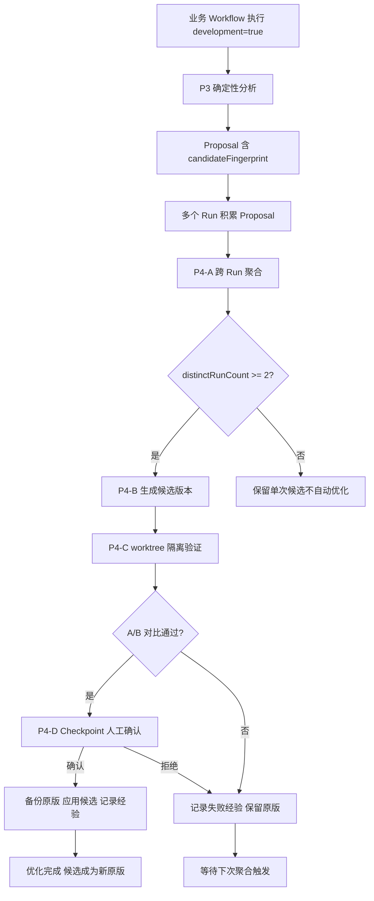

# P4 执行文档 - Workflow 自优化闭环

> P3 已完成：Workflow 执行 → 记录历史 → 自动分析 → 生成优化建议。
> P4 目标：跨 Run 识别重复优化机会 → 自动生成候选版本 → 隔离验证 → A/B 对比 → 人工确认 → 应用或回退。
>
> 基线提交：`29a1a0f`（P3.2 + dev-examples 入库）
> P3 端到端联调已通过：development=true Workflow → 五类规则分析 → Optimizer Job completed

## 一、设计约束

1. **第一版不自动覆盖原 Workflow**：候选版本在隔离环境验证后，必须经 Checkpoint 人工确认才应用
2. **复用已有能力**：不另建优化框架，复用 `check()`/`verify()`/`checkpoint()`/`fallback()`/`judgePanel()` DSL 函数和 `workflow-optimize` Skill 的七步迭代流程
3. **防递归**：Optimizer 产出的候选 Workflow 标记 `developmentForbidden: true`，不触发二次分析
4. **成本上限**：单次优化迭代设最大 token 预算和最大迭代次数
5. **候选隔离**：候选版本在 worktree 隔离环境执行，产物快照隔离，不污染原项目

## 二、P3 遗留问题（P4 前置修复）

| 问题 | 修复方式 | 影响范围 |
|------|---------|---------|
| Rule 3 Dependency 对 `./` 路径前缀漏检 | `detectDependencies` 的 bash 命令匹配改用 `getBaseName` + `pathsMatch` | `rules.ts` |
| Proposal `suggestedChange` 使用固定模板文案 | P4-B 根据脚本实际代码生成具体改动描述 | `report-builder.ts` |

## 三、阶段设计

### P4-A：跨 Run 机会聚合

**目标**：利用 `candidateFingerprint` 识别多个 Run 中重复出现的相似脚本和优化机会，合并为单一聚合候选。

**核心问题**：三个不同 Run 都创建了 `validate.py`，系统不应生成三个孤立 Proposal，而应识别为同一个可复用工具机会。

#### 3.1 跨 Run 聚合器

**新建文件：`src/development/aggregator.ts`**

```typescript
/**
 * 跨 Run 候选聚合器
 *
 * 输入：多个 Run 的 proposals.json（含 candidateFingerprint）
 * 输出：聚合候选列表（同一 fingerprint 的多个 occurrence 合并）
 *
 * 聚合逻辑：
 *  1. 遍历 history/<runId>/attempts/*/analysis/proposals.json
 *  2. 按 candidateFingerprint 分组
 *  3. 同 fingerprint 的候选合并为 AggregatedCandidate
 *  4. 记录每个 occurrence 的 runId/runAttemptId/ts
 *
 * 宿主无关：不依赖 SDK
 */

export interface AggregatedCandidate {
  /** 跨 Run 稳定指纹（来自 P3 Proposal.candidateFingerprint） */
  fingerprint: string
  /** 聚合类别 */
  category: string
  /** 候选标题 */
  title: string
  /** 各 Run 的出现记录 */
  occurrences: Array<{
    runId: string
    runAttemptId: string
    proposalId: string
    ts: number
    confidence: string
    integrity: string
  }>
  /** 出现次数 */
  occurrenceCount: number
  /** 跨 Run 出现的 Run 数 */
  distinctRunCount: number
  /** 聚合证据引用（合并所有 occurrence 的 evidenceRefs） */
  aggregatedEvidenceRefs: EvidenceRef[]
  /** 最高置信度 */
  bestConfidence: CandidateConfidence
  /** 脚本内容（取最近一次 occurrence 的 sourceScript） */
  sourceScript?: string
  suggestedTarget?: string
}

/**
 * 扫描 history 目录，聚合所有 Run 的 Proposal
 */
export function aggregateCandidates(historyDir: string): AggregatedCandidate[]
```

#### 3.2 聚合条件

| 条件 | 说明 |
|------|------|
| fingerprint 匹配 | sha256(category + canonicalFields) 相同的候选归为一组 |
| 跨 Run 出现 ≥ 2 | 至少在 2 个不同 Run 中出现才聚合为优化机会 |
| 单 Run 多次出现 | 同一 Run 内多次出现也算（但 distinctRunCount=1） |

#### 3.3 聚合产物

**新增文件：`history/.aggregated/candidates.json`**

```json
{
  "schemaVersion": 1,
  "generatedAt": 0,
  "candidates": [
    {
      "fingerprint": "e5f6a7b8c9d0e1f2",
      "category": "script-extraction",
      "title": "固化脚本：validate.py",
      "occurrences": [
        { "runId": "run-a", "runAttemptId": "run-a:att1", "proposalId": "run-a:script-extraction:a1b2c3d4", "ts": 1718472000000, "confidence": "high", "integrity": "complete" },
        { "runId": "run-b", "runAttemptId": "run-b:att1", "proposalId": "run-b:script-extraction:e5f6a7b8", "ts": 1718473000000, "confidence": "high", "integrity": "complete" }
      ],
      "occurrenceCount": 2,
      "distinctRunCount": 2,
      "bestConfidence": "high"
    }
  ]
}
```

### P4-B：候选版本自动生成

**目标**：基于聚合候选，自动生成优化版 Workflow JS 脚本，保持原文件不变。

#### 3.4 候选生成器

**新建文件：`src/development/candidate-generator.ts`**

```typescript
/**
 * 候选版本生成器
 *
 * 输入：原 Workflow JS 路径 + AggregatedCandidate[]
 * 输出：候选 Workflow JS 文件路径 + 改动描述
 *
 * 生成策略：
 *  1. Script Extraction：将临时脚本固化为独立文件，Workflow 改为调用固化后的脚本
 *  2. Repeat：串行重复读取改为并行或缓存
 *  3. Retry：加错误处理和重试逻辑
 *  4. Latency：仅作为诊断参考，不自动改写
 *
 * 安全约束：
 *  - 候选文件写入 .opencode-workflows/candidates/ 隔离目录
 *  - 原文件不动
 *  - 候选文件名：<原名>.candidate-<fingerprint前8位>.js
 */
export interface CandidateVersion {
  /** 候选文件路径 */
  candidatePath: string
  /** 原始文件路径 */
  originalPath: string
  /** 改动描述（基于脚本实际代码生成，不用固定模板） */
  changeDescription: string
  /** 触发此候选的 fingerprint */
  fingerprint: string
  /** 预期改进 */
  expectedImprovement: string
  /** 验证计划 */
  validationPlan: string
}

export function generateCandidate(
  originalScriptPath: string,
  candidate: AggregatedCandidate,
  outputDir: string,
): CandidateVersion
```

#### 3.5 改动描述生成

P3 的 `suggestedChange` 使用固定模板"将临时脚本固化为可复用工具，参数化输入路径"。

P4-B 改为根据脚本实际代码生成：

```typescript
function generateChangeDescription(candidate: AggregatedCandidate): string {
  // Script Extraction 类
  if (candidate.category === "script-extraction") {
    const script = candidate.sourceScript ?? ""
    const usesArgv = script.includes("sys.argv") || script.includes("process.argv")
    const hasFunction = script.includes("def ") || script.includes("function ")

    if (usesArgv && hasFunction) {
      return `将脚本 ${candidate.suggestedTarget} 固化为独立模块，已有参数化和函数封装，直接提取为可复用工具`
    } else if (usesArgv) {
      return `将脚本 ${candidate.suggestedTarget} 固化为独立文件，已有参数化，补充函数封装后提取`
    } else {
      return `将脚本 ${candidate.suggestedTarget} 固化为独立文件，需补充参数化（当前硬编码路径）`
    }
  }
  // 其他类别...
  return candidate.title
}
```

### P4-C：隔离验证与 A/B 对比

**目标**：在 worktree 隔离环境执行候选版本，与原版本对比结果。

#### 3.6 隔离执行

复用已有的 worktree 能力（`src/runtime/worktree.ts`）：

```typescript
/**
 * 隔离验证 Workflow
 *
 * 1. 创建 worktree（已有能力）
 * 2. 在 worktree 中执行候选版本
 * 3. 快照产物到 quality-compare/candidate-<fingerprint>/
 * 4. 对比原版本产物
 */
```

#### 3.7 A/B 对比

复用 `workflow-optimize` Skill 的第 4 步并行评审模式：

```javascript
// 候选验证 Workflow（内置脚本）
export const CANDIDATE_VERIFY_SCRIPT = `
export const meta = {
  name: "candidate_verify",
  phases: [
    { title: "执行原版" },
    { title: "执行候选版" },
    { title: "A/B 对比" },
  ],
}

phase("执行原版")
const originalResult = await workflow({ scriptPath: args.originalPath })

phase("执行候选版")
const candidateResult = await workflow({ scriptPath: args.candidatePath })

phase("A/B 对比")
// 复用 check() + verify() + judgePanel()
const checks = await check(() => {
  // 确定性验证：产物结构一致性、关键指标不退化
  return true // 简化示例
}, "候选版本产物完整性检查")

const review = await verify(
  "候选版本 " + args.candidatePath + " 的产物质量不劣于原版本 " + args.originalPath,
  { reviewers: 3, threshold: 2 }
)

const ranking = await judgePanel(
  [originalResult, candidateResult],
  { judges: 3, rubric: "产物完整性, 执行效率, 输出质量" }
)

return { checks, review, ranking, originalResult, candidateResult }
`
```

#### 3.8 对比指标

| 指标 | 来源 | 对比方式 |
|------|------|---------|
| 执行耗时 | Run 结果 | 候选 ≤ 原版 × 1.2（允许 20% 波动） |
| Token 用量 | Run 结果 | 候选 ≤ 原版 × 1.1 |
| 产物文件数 | 文件系统 | 候选 ≥ 原版（不丢产物） |
| 关键内容一致性 | `check()` 复算 | 候选产物含原版全部关键字段 |
| LLM 评审 | `verify()` 3 reviewer | ≥ 2 票认为候选不劣于原版 |

### P4-D：Checkpoint 确认与应用

**目标**：人工确认后应用候选版本，备份原版，记录优化经验。

#### 3.9 应用流程

```javascript
// 应用确认 Workflow（内置脚本）
export const APPLY_CANDIDATE_SCRIPT = `
export const meta = {
  name: "apply_candidate",
  phases: [
    { title: "人工确认" },
    { title: "备份原版" },
    { title: "应用候选" },
    { title: "记录经验" },
  ],
}

phase("人工确认")
const approved = await checkpoint(
  "候选版本验证通过。是否应用优化？\\n" +
  "原版: " + args.originalPath + "\\n" +
  "候选: " + args.candidatePath + "\\n" +
  "改进: " + args.expectedImprovement,
  { title: "优化应用确认" }
)

if (!approved) {
  return { applied: false, reason: "用户拒绝" }
}

phase("备份原版")
// 复用 workflow-optimize Skill 的备份格式：<name>.v<N>-<标记>-<YYYYMMDD>.js
const backupPath = await agent(
  "用 bash 工具执行命令：cp " + args.originalPath + " " + args.backupPath,
  { agentType: "general", label: "备份原版" },
)

phase("应用候选")
const applied = await agent(
  "用 bash 工具执行命令：cp " + args.candidatePath + " " + args.originalPath,
  { agentType: "general", label: "应用候选" },
)

phase("记录经验")
// 回填到 workflow-optimize Skill 的优化台账和 playbook
const recorded = await agent(
  "用 write 工具在优化台账中追加当版记录，并在 playbook 中记录新经验（如有）",
  { agentType: "general", label: "记录经验" },
)

return { applied: true, backupPath, originalPath: args.originalPath }
`
```

#### 3.10 防递归与成本控制

| 控制项 | 限制 | 实现方式 |
|--------|------|---------|
| 候选 Workflow developmentForbidden | true | DevJobManager 不处理 forbidden 标记的 Run |
| 最大迭代次数 | 3 | 聚合器只处理最近 3 个 Run 的 Proposal |
| Token 预算 | 20000 | 候选验证 Workflow 的 token 总量超限则中止 |
| Worktree 清理 | 每次验证后 | worktree 自动销毁 |

## 四、完整执行链路



## 五、目录结构

```
.opencode-workflows/
├── history/
│   └── <runId>/
│       └── attempts/
│           └── <safeId>/
│               ├── manifest.json
│               ├── traces/
│               ├── history.jsonl
│               └── analysis/
│                   ├── report.md
│                   ├── proposals.json      ← 含 candidateFingerprint
│                   └── enrichment.md
├── development/
│   ├── jobs.json                           ← DevJob 生命周期
│   └── aggregated/
│       └── candidates.json                 ← P4-A 聚合产物
├── candidates/
│   └── <fingerprint前8位>/
│       ├── candidate.js                    ← P4-B 候选版本
│       ├── change-description.md           ← 改动描述
│       └── ab-result.json                  ← P4-C A/B 对比结果
└── journal/
    └── <runId>.json
```

## 六、执行顺序

```
P4-前置  修复 P3 遗留
        改 detectDependencies 路径归一化
        改 Proposal suggestedChange 生成逻辑
        回归测试
          |
          v
P4-A    跨 Run 聚合器
        新建 src/development/aggregator.ts
        新建 tests/aggregator.test.ts
        npm run typecheck && npx tsx --test tests/aggregator.test.ts
          |
          v
P4-B    候选版本生成
        新建 src/development/candidate-generator.ts
        新建 tests/candidate-generator.test.ts
        npm run typecheck && npx tsx --test tests/candidate-generator.test.ts
          |
          v
P4-C    隔离验证 + A/B 对比
        新建候选验证内置脚本
        接入 worktree 隔离执行
        复用 check/verify/judgePanel
          |
          v
P4-D    Checkpoint 确认 + 应用
        新建应用确认内置脚本
        接入 workflow-optimize Skill 台账
        全量验证 + 联调
```

## 七、验收标准

| 编号 | 验收项 | 验证方式 |
|------|--------|---------|
| V-P4-1 | 跨 Run 聚合：同 fingerprint 候选合并 | 单元测试（2 Run fixture） |
| V-P4-2 | 聚合条件：distinctRunCount >= 2 才生成聚合候选 | 单元测试 |
| V-P4-3 | 候选版本生成：原文件不动，候选写入隔离目录 | 单元测试 |
| V-P4-4 | 改动描述基于脚本实际代码（不用固定模板） | 单元测试 |
| V-P4-5 | worktree 隔离执行候选版本不污染原项目 | 联调验证 |
| V-P4-6 | A/B 对比：check + verify + judgePanel 全部通过 | 联调验证 |
| V-P4-7 | Checkpoint 拒绝时不应用候选 | 单元测试 |
| V-P4-8 | 防递归：候选 Workflow 不触发二次分析 | 单元测试 |
| V-P4-9 | 成本控制：token 超限中止 | 单元测试 |
| V-P4-10 | typecheck + build + 全量测试不回归 | CI |

## 八、核心验收标准

两个不同 Run 各自创建 `validate.py` 后，系统：
1. 识别为同一 fingerprint 的聚合候选（distinctRunCount=2）
2. 生成候选版本（原文件不变）
3. worktree 隔离执行 + A/B 对比通过
4. Checkpoint 确认后应用，备份原版
5. 优化经验回填到 workflow-optimize Skill 台账

## 九、与已有能力的关系

| 已有能力 | P4 复用方式 |
|---------|------------|
| `candidateFingerprint`（P3） | 跨 Run 聚合的稳定键 |
| `workflow-optimize` Skill 七步流程 | P4-C/D 复用备份→执行→快照→评审→报告→回填 |
| `check()` + `fileExists`/`commandSuccess` | A/B 对比的确定性验证 |
| `verify()` | A/B 对比的 AI 评审 fan-out |
| `judgePanel()` | A/B 对比的奖牌排名 |
| `checkpoint()` | 应用确认点 |
| `fallback()` | 候选失败降级 |
| worktree（`src/runtime/worktree.ts`） | 隔离执行环境 |
| 优化台账 + playbook（ledger-schema.md） | 优化经验记录与跨版记忆 |

## 十、风险与降级

| 风险 | 影响 | 降级 |
|------|------|------|
| 聚合误报 | 生成不必要的候选 | distinctRunCount >= 2 门槛 + 人工确认 |
| 候选版本执行失败 | 无法对比 | worktree 自动清理，记录失败原因 |
| LLM 评审波动 | A/B 判定不稳定 | 3 reviewer + threshold=2 + 确定性 check 优先 |
| 候选质量退化 | 应用后比原版差 | 备份原版 + Checkpoint 可拒绝 |
| 递归优化 | 候选 Workflow 触发二次分析 | developmentForbidden 标记 |
| Token 超限 | 验证中断 | 20000 token 预算 + 中止逻辑 |

## 十一、引用说明

- P3 Analyzer（candidateFingerprint 来源）：`src/development/analyzer/types.ts`
- P3 Proposal 生成（待修正 suggestedChange）：`src/development/analyzer/report-builder.ts`
- P3 规则（待修正 Dependency 路径）：`src/development/analyzer/rules.ts`
- DevJobManager（P4 接入点）：`src/development/job-manager.ts`
- workflow-optimize Skill：`skills/workflow-optimize/SKILL.md`
- 优化迭代流程：`skills/workflow-optimize/process/optimize-iteration-flow.md`
- 修复手法与踩坑库：`skills/workflow-optimize/reference/optimize-playbook.md`
- 优化档案 Schema：`skills/workflow-optimize/reference/ledger-schema.md`
- DSL 函数（check/verify/checkpoint/fallback/judgePanel）：`src/runtime/workflow-runtime.ts`
- worktree 隔离：`src/runtime/worktree.ts`
- P3 v3 执行文档：`dev-docs/planning/新增Workflow追踪分析-P3执行文档-v2.md`
