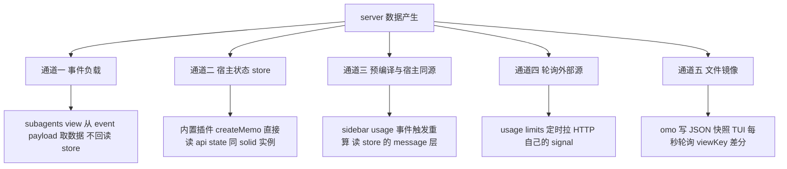

# 参考实现 00 总览 五种数据通道对比与本项目选型结论

> 对应需求文档第 8 节（参考实现与优先级）的深度研读总纲
> 详细解析见同目录 01-05 五份文档
> 研读动机：当前 TUI 实现"完成态可见、执行期不实时"，需要从参考实现中找可靠的数据通道

---

## 1. 五个参考实现的定位

| 实现 | 形态 | star 级 | 本项目主要借鉴点 | 详细文档 |
|------|------|---------|------------------|----------|
| opencode-subagents-view | 纯 TUI 插件 | 五星 | 事件负载数据流 单 solid 文件 bootstrap 双坑规避 | 01 |
| OpenCode 内置 sidebar | 宿主内置 TUI 插件 | 四星 | 官方 slot 写法 最小实现基准 | 02 |
| opencode-sidebar-usage codex-meter | server 与 TUI 双插件 | 四星 | 双 entrypoint 工程化 事件驱动重算 store 读取 | 03 |
| oc-usage-limits-plugin | 纯 TUI 插件 | 三星 | 双插槽 sidebar 加 footer 轮询协调器 | 04 |
| oh-my-openagent tui-sidebar | 大型 monorepo 局部 | 二星 | 文件镜像跨进程通道 轮询加 viewKey 差分 | 05 |

## 2. 核心对比 server 到 TUI 的实时数据通道

五个实现用了五种完全不同的通道：

### 通道对比表

| 通道 | 代表 | 延迟 | 对宿主依赖 | 风险点 |
|------|------|------|-----------|--------|
| 事件负载 event properties | subagents-view | 事件级即时 | api.event 总线 | 事件形状跨版本变化 |
| 宿主 state 直读 | 内置插件 | 即时 | 同进程同 solid 实例 | 跨 solid 副本依赖追踪失效 外部插件不可用 |
| 事件触发 + store 回读 | sidebar-usage | 事件级 | api.event 与 api.state | store 时序差 回读路径必须踩准 message 与 part 分存 |
| 轮询外部源 | oc-usage-limits | 秒级 | 无 | 与宿主数据无关 仅适合自己的场景 |
| 文件镜像轮询 | oh-my-openagent | 1 秒级 | 仅文件系统 | 跨进程最稳 不依赖任何宿主 API 事件 |

## 3. 对本项目 TUI 实时性的诊断结论

当前实现"执行期不实时"的两个独立根因（详见 Docs 内排障记录）：

1. **server 侧** 插件 tool 的 context.metadata 推送未产生 message.part.updated 事件（数据库 event 表证实 执行期 part 状态只有 pending 与 completed 两次变化 无中间 metadata 写入） 而 5 个参考实现没有一个依赖插件 tool metadata 做实时更新
2. **TUI 侧** 读 store 的时机与路径脆弱（part 与 message 分存 执行期 store part 可能为空） subagents-view 的做法是从事件本体 properties part 取数据 从不回读 store

### 参考实现给出的三条可行路（按贴合度排序）

| 方案 | 来源 | 覆盖场景 | 说明 |
|------|------|----------|------|
| A 事件负载追踪 | subagents-view | 前台与后台通用 | 我们的子会话已带 parentID 与 title label 事件级实时 零 server 依赖 |
| B 文件镜像 | oh-my-openagent | 前台与后台通用 | 我们已有 .opencode-workflows journal 落盘基础设施 可写 workflow 快照 TUI 轮询 1 秒粒度 |
| C 继续 metadata 通道 | 需求文档 5.1 原方案 | 仅完成态可靠 | 执行期推送需先查清 opencode 对插件 tool 的 updateToolCall 链路 完成态走 tool 返回值已验证可用 |

**建议** A 为主（agent 级实时树 状态与耗时来自 session 事件） B 为辅（workflow 级 phase 分组与计数 来自快照文件） C 保留完成态兜底 三者合流进同一 signal。

## 4. 工程规范共识（五个实现全部遵守）

- solid-js 用法集中单文件（subagents 9.3 坑）或预编译消掉（sidebar-usage）
- 信号按 session 缓存于模块级 Map 复用而非重建（subagents 真实 bug 教训）
- 事件订阅必须配套 onDispose 反订阅
- 一切失败降级为不渲染 不抛错不崩 TUI
- 图标用几何符号（● ◐ ✖ ○）非 emoji
- 依赖声明 dependencies 加 solid-js 精确 pin（subagents 结论）

## 5. 引用说明

- 各实现详细解析 见本目录 01 至 05 文档
- 源码位置 thirdparties/ 下对应仓库
- 关联文档 Docs/01_需求与规划/TUI增强需求文档.md 第 8 节 Docs/01_需求与规划/TUI增强需求审查报告.md

> 选型更新（2026-09-08）：第 3 节建议的 A 为主 B 为辅已在实施阶段修正为 B 镜像为唯一执行期主通道（决策依据见 Docs/02_设计与说明/TUI实时通道优化方案.md 2.1 节），前台后台同源，真机验收 V-01 V-02 V-04 通过
