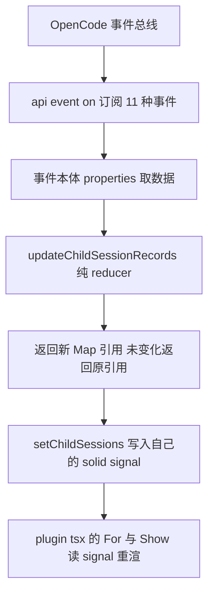

# 参考实现 01 opencode-subagents-view 实现解析

> 仓库 thirdparties/opencode-subagents-view v0.3.0 MIT 作者 giovannic96
> 定位 纯 TUI 插件 在 sidebar 展示当前会话的子代理实时列表
> 需求文档评级 五星 骨架母本 本项目后台通道的直接母本

---

## 1. 包结构与加载形态

```
src/
  tui.tsx                     141 行  ./tui 入口 bootstrap 含双坑规避 无插件逻辑
  plugin.tsx                  142 行  唯一 solid 文件 插槽注册 与 折叠信号 与 JSX 渲染
  child-sessions-tracker.ts   192 行  纯 ts 事件到记录的 reducer 与 订阅接线
  child-sessions-types.ts     114 行  纯 ts 事件类型与记录类型 CHILD_SESSION_EVENT_TYPES 单一定义
  labels-ui.ts                118 行  纯 ts 标签与活动格式化 图标映射
tests/
  child-sessions-tracker.test.ts  544 行  追踪规则 + 响应式接线联合测试 纯 mock 不启 opencode
  tui.test.ts                     213 行  信号缓存复用防回归（真实 bug 固化）
  solid-js-dist.d.ts              类型垫片 测试用 dist solid build
package.json
  exports {"./tui" "./src/tui.tsx"}   直出 TSX 源码 无 build 步骤
  dependencies @opentui/solid 与 solid-js 1.9.12 精确 pin
```

加载链 tui.json 写包名或绝对路径 -> TUI 读 exports 点斜杠 tui -> bun 直读 TSX 源码。

## 2. 数据流 事件负载驱动（核心）



**最关键设计 从不回读 api.state** 所有数据取自事件本体：

- session 点 created 与 updated 事件 properties 点 info 携带完整 session 对象 含 parentID 与 title 与 agent
- session 点 status 与 idle 事件 properties 点 sessionID 与 status
- message 点 part 点 updated 事件 properties 点 part 携带完整 part 对象
- 活动标签 getPartActivity 直接消费事件里的 part 不查 store

这与本项目当前实现（事件触发后回读 api.state）的根本差异 是排障发现的执行期 store 可能滞后或为空时的免疫方案。

### reducer 规则表（updateChildSessionRecords）

| 事件 | 行为 |
|------|------|
| session.created | parentID 匹配则加入 active 记录 label 为 agent 加 title |
| session.updated | 仍属于本父会话则保持已有状态 否则移除 |
| session.status | busy 转 active idle 转 idle retry 转 retry |
| session.idle | 保留记录 标 idle 清空活动 |
| session.next.step.ended 与 failed | 标 idle 或 error 清空活动 |
| session.next.tool.input.started 与 called 与 retried | 更新活动标签 如 searching src 或 running shell |
| message.part.updated | 按 part 类型生成活动摘要 文本片段或工具摘要 |
| session.deleted | 从 Map 移除 |

新 run 语义 有 active 记录时出现新子会话 先清掉全部 idle 记录再展示新 run。

### 状态模型

```
ChildSessionRecord { id label status activity }
status = active 或 idle 或 retry 或 error
ChildSessionRecords = ReadonlyMap sessionID 到 record  不可变更新 未变化返回原引用让 solid 跳过
```

## 3. plugin.tsx 渲染层（唯一 solid 文件）

- 插槽 api.slots.register 点 order 350 在 LSP 300 之后 Todo 400 之前
- 两个模块级 Map 缓存 childSessionRecords 与 collapsed 按 sessionID 键
- getOrCreateChildSessions 首渲染创建 signal 加订阅 onDispose 里反订阅与删缓存 后续渲染直接复用
- **缓存的是 signal 的读函数而非数据** 函数闭包 signal 变化时旧函数仍读到新值 这就是缓存函数即足够的原因（README 专节强调的真实 bug）
- 折叠 onMouseDown 切换 标题 Subagents 括号 N active
- 行渲染 固定 2 列宽图标列 加 flexGrow 文本列 换行文字对齐文本列（终端无悬挂缩进）

## 4. tui.tsx bootstrap 双坑规避

### 坑一 solid-js node condition

- 现象 bun 匹配 solid-js exports 的 node condition 解析到 SSR build createEffect 是 no-op 信号不更新
- 规避 加载时同步 patch solid-js 的 package.json 删除点导出的 node 键
- 为什么不能 postinstall OpenCode 的 Install Plugin 安装不跑 lifecycle scripts

### 坑二 node_modules 内 JSX 解析

- 现象 路径含 node_modules 段时 bun 忽略外部 tsconfig 与 jsxImportSource pragma JSX 回退 React runtime 插件注册成功但不渲染无报错
- 规避 检测包根在 node_modules 内时 把实现文件复制到 tmpdir 按版本命名目录 软链 node_modules 回包父目录 从复制位置动态 import 源码开发流直接 import

两个修复都放在入口模块自身加载路径 保证任何安装方式每次加载必执行。

## 5. 测试策略

- bun test 加 conditions browser 参数 原因 bun test 预扫描模块图会破坏运行时 patch 真实加载不受影响
- mock api event on 收集 handler 手动 emit 驱动 reducer 全分支
- createRoot 包裹 signal 断言响应式接线
- tui.test.ts 固化信号缓存复用（防回归 曾因每次渲染重建信号导致反馈循环）

## 6. 对本项目的借鉴清单

| 借鉴点 | 应用方式 |
|--------|----------|
| 事件负载数据流 | 修复执行期实时性 主数据源改为 event properties 不回读 store |
| 纯 reducer 可测 | workflow 树更新逻辑拆纯函数 node:test 直测 |
| signal 按 session 缓存读函数 | 已采用 保持 |
| v2 事件名可用 | session.next.step.ended 等事件在 TUI 总线存在 可用于 agent 粒度状态 |
| 双坑 bootstrap | 已照搬 保持 |
| 新 run 清 idle | workflow 重跑时旧树清理语义可参考 |

## 7. 引用说明

- 源码 thirdparties/opencode-subagents-view/src 与 tests 与 README
- 事件总线能力对照 thirdparties/opencode packages/plugin/src/tui.ts TuiEventBus
- 本项目采用记录 Docs/01_需求与规划/TUI增强需求文档.md 8.1 与 9.1 至 9.3
