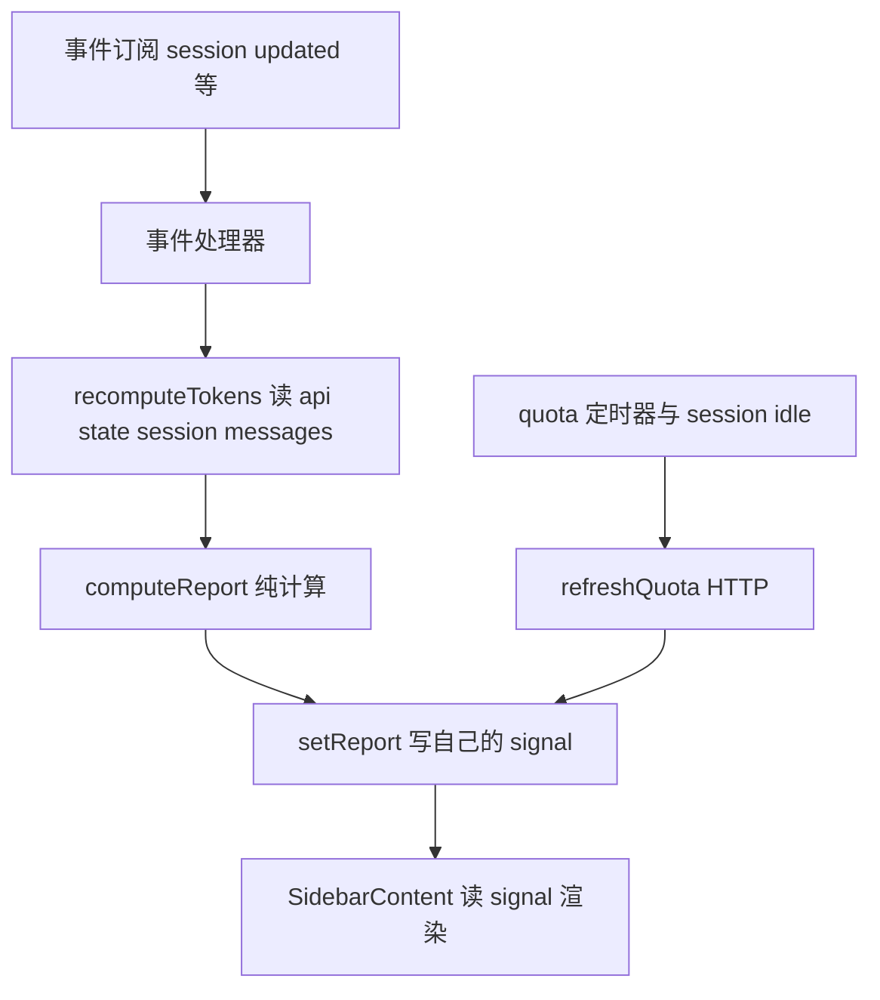

# 参考实现 03 opencode-sidebar-usage codex-meter 实现解析

> 仓库 thirdparties/opencode-sidebar-usage v0.1.3 MIT 作者 SBakolis
> 定位 server 与 TUI 双插件联动 server 收集 token 用量 TUI sidebar 展示配额条与用量表
> 需求文档评级 四星 双插件联动范式（与本包形态最接近的参考）

---

## 1. 双 entrypoint 工程结构

```
package.json
  exports
    点 与 点斜杠 server  都指向 dist/index.js        server 插件
    点斜杠 tui                          指向 dist/tui/index.js  TUI 插件
  scripts build:tui 存在  TUI 侧 tsc 预编译
src/
  index.ts            server 插件 事件收集器 加 codex_usage tool
  tui/index.tsx       TUI 插件入口
  tui/signals.ts      三个 signal 的创建工厂
  tui/sidebar.tsx     JSX 渲染 配额条 加 token 表
  tui/compute.ts      纯计算 messages 到 report
  tui/theme.ts        主题色解析
  session/ quota/ report/ cli/   可注入依赖的领域模块
```

**关键差异 与 subagents-view 相反** 本包走预编译 dist 路线 TSX 在构建期编译掉 运行时无 JSX 解析问题 因此不需要 node condition patch 与 node_modules 逃逸 代价是必须维护 build:tui 与产物同步。

依赖注入风格 server 与 TUI 两侧各自 new 一套 fs env clock http 适配器 注释明确 两进程不共享模块实例 配置与 provider 链在 tui/index.tsx 完整重建一份。

## 2. server 侧实现（src/index.ts）

- event 钩子接收全部 SdkEvent 交给 SessionCollector 维护 SessionStore（upsert remove hydrate）
- 注册 codex_usage tool execute 里 collector.getUsage(sid) 加 quotaProvider.fetch() 组装报告返回 title 与 output 无 metadata
- 配额 provider 链 WhamProvider 外包 CachedProvider TTL 与 负 TTL 与 stale 兜底
- 所有子系统失败在边界捕获 不让 OpenCode 崩

## 3. TUI 侧实现（src/tui/index.tsx）

### 数据流



### 事件订阅清单

- session.updated 会话切换时 setSessionID 加重算
- message.part.updated 与 message.updated 直接重算 token
- session.idle 重算加刷新配额
- session.deleted 清当前会话状态
- setInterval 按 quotaTtlMs 定时刷配额
- 全部 disposer 收集 onDispose 统一清理

### 插槽注册的特殊点

```
api.slots.register 未传 order
sidebar_content renderer 里先比对 props.session_id 与 自己的 sessionID signal
不同则 setSessionID 加重算（renderer 兼职会话切换同步）
返回 SidebarContent 时直接取 report() 值传入 props
```

即渲染数据在 renderer 调用时刻求值 而非组件内部响应式读取 这依赖宿主对 sidebar 的重渲频率 是一种务实但响应式较弱的模式。

### api.state 读取的边界

recomputeTokens 只读 message 层 tokens 字段 不碰 part 层 避开了 message 与 part 分存的复杂性 也因此它的重算粒度是整场会话汇总 而非单工具实时状态。

## 4. 信号设计（signals.ts）

- createTuiSignals 工厂返回 report 与 quota 与 sessionID 三个 signal
- 注释定位明确 signal 是事件处理器（写）与 JSX 组件（读）之间的桥
- 插件 init 时创建一次全组件共享

## 5. 对本项目的借鉴清单

| 借鉴点 | 应用方式 |
|--------|----------|
| 双 entrypoint package.json exports | 已照抄 点 与 点斜杠 tui |
| 双配置文件 opencode.json 加 tui.json | 已照抄 |
| 事件驱动重算 + 自己的 signal | 已采用 与 subagents 殊途同归 |
| renderer 里同步 sessionID | 我们的 per session Map 等价 已采用 |
| 全 disposer 收集统一清理 | 已采用 offs 数组模式 |
| 预编译 dist 路线 | 备选 若 bootstrap 双坑在真机再出问题 可切换成 build:tui 方案 |

## 6. 引用说明

- 源码 thirdparties/opencode-sidebar-usage/src/index.ts 与 src/tui/
- 需求文档 8.3 节与 6 节配置部署
- 本项目 package.json exports 对照
