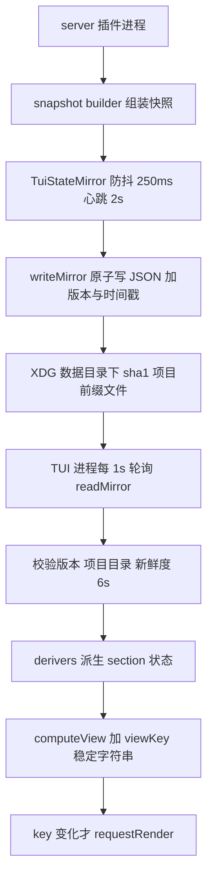

# 参考实现 05 oh-my-openagent tui-sidebar 实现解析

> 仓库 thirdparties/oh-my-openagent（oh-my-opencode 更名过渡） code-yeongyu
> 定位 大型插件 monorepo 中 tui-sidebar feature server 与 TUI 两进程经文件镜像通信
> 需求文档评级 二星 仅局部参考 但其文件镜像通道对解决本项目实时性问题价值极高

---

## 1. 架构总览 进程间只靠一个 JSON 文件



两侧 24 个文件 12 实现 12 测试 互不 import 内存 唯一通道是镜像文件。

## 2. server 侧写入端

| 模块 | 职责 |
|------|------|
| mirror-manager.ts | TuiStateMirror 事件触发防抖 flush 250ms 2s 心跳保活 单飞写防并发 start 与 stop 生命周期 |
| snapshot-builder.ts | 从 session statuses 组装 active agents 从 BackgroundManager 取 job board 从 .omo 读 loop 状态 goal 文本写前脱敏 |
| snapshot-schema.ts | Zod schema 版本字面量 1 加 parseSnapshot |
| mirror-io.ts | writeMirror 原子写 0600 权限 readMirror 拒绝解析失败 项目不符 超过 6s 过期 |
| mirror-path.ts | XDG data 目录 加 sha1 projectDir 前缀文件名 realpath 规范化 |

写入的三道防线 原子写 版本校验 新鲜度校验 读端不信任任何旧数据。

## 3. TUI 侧读取端（src/tui.ts 摘录逻辑）

```
const directory = api.state.path.directory
配置关则 return
currentView = await readView(directory)  当前 key = viewKey(view)
registerSidebarContentSlot renderSidebar = () => materialize(buildViewNodes(currentView 主题))
tick 每 POLL_INTERVAL_MS 1s
  readView 再算 viewKey
  key 变了才更新 currentView 并 api.renderer.requestRender()
inFlight 标志防重入 onDispose 清 timer
```

关键点：

- **requestRender 手动驱动重渲** 不依赖 solid 响应式传播 读了新数据后主动要求宿主重画插槽
- viewKey 是视图的稳定字符串摘要 差分避免无变化重渲
- buildViewNodes 产出渲染器无关的 ViewNode 树（element helpers 的 box 与 text 构造器）再 materialize 到 opentui

## 4. 工程约定（其 AGENTS.md 原文要点）

- 状态一律 kind 标签联合 穷尽 switch 结尾 assertNever
- 失败即降级不抛 坏 JSON 缺文件 过期 全部塌缩为 null 或 none
- 快照形状变化必须 bump MIRROR_SCHEMA_VERSION 旧读者静默丢弃
- 全部计时常量集中在 constants.ts（STALE 6s HEARTBEAT 2s POLL 1s DEBOUNCE 250ms LOOP FRESH 120s）
- 反模式明示 不许两进程共享内存 不许绕过 TuiStateMirror 直接写文件

## 5. 对本项目的借鉴清单（解决当前实时问题的 B 方案）

| 借鉴点 | 应用方式 |
|--------|----------|
| 文件镜像通道 | server 侧 workflow 执行期把 records 快照写 .opencode-workflows runs 目录 TUI 轮询读取 不依赖 context metadata 与事件形状 |
| journal 基础设施复用 | 我们已有 JournalStore 逐 agent 落盘 扩一个轻量 snapshot JSON 即可 |
| viewKey 差分 | TUI 轮询侧防无谓重渲 |
| requestRender 手动驱动 | 与 solid signal 并用的兜底手段 |
| 版本与新鲜度三防线 | 快照加 version 与 time 与 runId 校验 |
| 防抖 250ms 单飞写 | metadata 推送节流同款参数可直接复用 |

通道延迟 1s 级 满足 workflow 进度展示（agent 粒度秒到十秒级变化）。

## 6. 引用说明

- 源码 thirdparties/oh-my-openagent/packages/omo-opencode/src/features/tui-sidebar/ 全部 24 文件
- 读取端 thirdparties/oh-my-openagent/packages/omo-opencode/src/tui.ts
- 该 feature 自带 AGENTS.md 文档（生成于 2026-08-17）本解析大量直接引用其结论
- 需求文档 8.5 节
