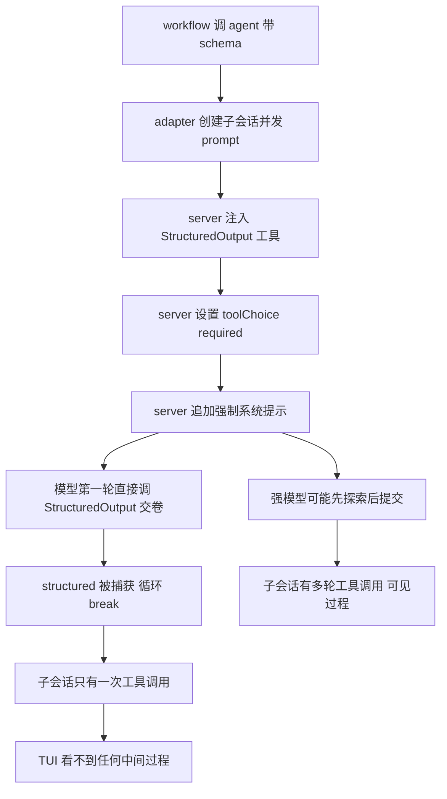

# Schema 格式看不到中间执行过程的分析

> 现象：workflow 中带 schema 的 agent()，在子会话里看不到任何中间执行过程（读文件、搜索等），
> 直接出现最终结构化结果；文本模式的 agent 则能看到完整的工具调用过程。
> 结论先行：**这不是 TUI 显示问题，是模型在 toolChoice required 强制下第一轮就直接调用
> StructuredOutput 工具"交卷"，中间根本没有发生任何探索性工具调用**。显示链路本身无差异。

---

## 1. 两种模式的机制对比

### 文本模式（能看到过程）

OpenCode server 的 prompt 循环（session/prompt.ts:1082 起 `while (true)`）每轮 = 一次模型调用：

```
while(true)
  -> 本轮模型调用（agent 工具集：read grep bash 等）
  -> 模型输出 tool call（如 read 某文件）
  -> 工具执行，结果回写会话
  -> 下一轮（模型带着工具结果继续）
  -> 模型输出纯文本 finish 且无 tool call
  -> break
```

每个工具调用都是子会话消息流的一个 tool part，TUI 流式显示——这就是我们看到的"中间过程"。

### schema 模式（看不到过程）

同样的循环，但每轮多三个注入（session/prompt.ts:1243-1285）：

1. 工具集追加 `StructuredOutput` 工具（带 execute，捕获结果到 `structured` 变量）
2. `toolChoice: "required"`——**每一轮**都强制模型必须调用至少一个工具
3. system prompt 追加强指令（prompt.ts:82）：

```
You MUST use the StructuredOutput tool to provide your final response.
Do NOT respond with plain text - you MUST call the StructuredOutput tool...
```

循环出口（prompt.ts:1288）：模型一旦调了 StructuredOutput，`structured !== undefined`，本轮结束后 break。

### 模型面临的选择

`required` 只要求"调一个工具"，任选。理论上模型可以：

```
轮1 调 read 探索 -> 轮2 调 grep -> 轮3 调 StructuredOutput 提交最终答案
```

工具描述（prompt.ts:74-80）也确实写了 "Complete all necessary research and tool calls
BEFORE calling this tool"。但**系统提示的 MUST 语气 + 每轮 required 的硬约束**，
让相当一部分模型（尤其网关后的模型）选择立即满足约束：第一轮直接把答案（哪怕是编的）
塞进 StructuredOutput 交卷。于是：

```
轮1 调 StructuredOutput -> structured 捕获 -> break
```

子会话里只有一个 StructuredOutput tool part + 两个 step part，没有任何 read grep——
"完全看不到中间执行过程"，因为确实没有中间过程。

## 2. 全链路机制图



同一模型同一任务走哪条分支，取决于模型对 MUST 指令与 required 约束的权衡，
弱模型几乎必然走左边。文本模式没有 C D E 三个注入，模型自然多轮探索。

## 3. 影响评估

| 影响面 | 说明 |
|--------|------|
| 可观测性 | agent 的调查过程不可见，无法人工核查它是怎么得出结论的 |
| **结果质量** | 更严重：agent 没读代码没跑命令就编 JSON，结构化输出从"调查结论"退化为"凭印象作答" |
| token | 配合已修的 step-finish 求和（见 TUI-token统计口径说明.md 第 6 节），token 数字已准确，但消耗本身因零探索而异常偏小 |

## 4. 修复方向对比

| 方案 | 做法 | 代价 | 评价 |
|------|------|------|------|
| A prompt 强化 | promptStructured 里给用户 prompt 追加一段"先使用工具完成调查，确认结论后再调用 StructuredOutput，禁止在调查完成前提交" | 极小（几行字符串） | 先试这个；server 的 MUST 是通用语气，具体任务指令对模型约束力通常更强，但**不保证**所有模型听话 |
| B 两阶段 | 先跑一轮文本 prompt 探索，再跑一轮 schema prompt 格式化 | token 翻倍、两次会话、第二阶段仍是 required 交卷风 | 不推荐 |
| C 强制降级路径 | 有 schema 时直接走现有降级实现（去 format，prompt 要求 JSON，本地宽松解析 + required 校验），跳过原生 json_schema | JSON 规范性靠宽松解析兜底；server 不做完整 schema 校验 | 中间过程完整可见、模型正常多轮探索、token 正常；降级机制已存在（P1-2），等于把降级路径转正为 schema 的默认路径 |
| D 上游修复 | OpenCode 把 required 改为首轮 auto / 仅靠系统提示引导 | 不可控，需提 PR 等版本 | 长期正解，短期不依赖 |

推荐顺序：A 先验证（最小改动），若网关模型仍交卷过快则切 C。两者不冲突，可叠加。

### 实施记录

- 2025-12-08 方案 A 已实施：promptStructured 在用户 prompt 尾部追加 INVESTIGATE_FIRST
  指令（先调查后提交，见 opencode-session-adapter.ts），测试断言指令注入。
- 2026-09-15 方案 A 真实网关验证通过（glm-5.2-high + explore agent，硬事实抽取脚本
  scripts/schema-test.js）：server 日志显示 glob 定位 -> read 两文件 -> bash rg 搜标题
  与数行数 -> 最后 StructuredOutput，共 5+ 轮，无一步交卷。子会话可完整查看中间过程。
  备注：running 中打开子会话可能空白（模型长思考阶段无新 parts，原生 TUI 不实时刷新），
  完成后进入可看到全部工具条目，数据不丢。方案 C 暂不需要，留作后备。

## 5. 验证方法

在 examples/sample-project 里跑一个带 schema 的最小 workflow（如 01-basic 示例），
跑完后导航进该 agent 的子会话（F-20 树上回车进入），看消息 parts：

- 只有 1 个 StructuredOutput 工具调用 -> 命中本分析（模型一步交卷）
- 有 read grep 等多轮调用后才 StructuredOutput -> 模型行为正常，问题另查

也可直接看 server 日志的 loop step 计数：schema 模式通常 step=1 即 exiting loop。

## 6. 引用说明

- thirdparties/opencode/packages/opencode/src/session/prompt.ts:74-90（工具描述与强系统提示）
- thirdparties/opencode/packages/opencode/src/session/prompt.ts:1082-1300（while true 循环、
  StructuredOutput 注入、toolChoice required、structured 捕获 break）
- thirdparties/opencode/packages/opencode/src/session/prompt.ts:1565-1594（createStructuredOutputTool，
  execute 捕获 structured，toModelOutput 返回固定文本）
- thirdparties/opencode/packages/llm/src/llm.ts:59-70（toolChoice 透传 provider）
- 本仓 src/adapters/opencode-session-adapter.ts（promptStructured：唯一注入 format 的位置，
  方案 A 的改动点；promptDegradedJson：方案 C 的现成实现）
