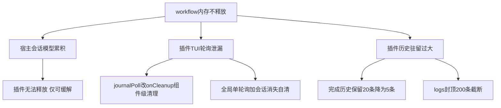

# Workflow 内存不释放问题分析与修复

> 现象来源：用户实测反馈。workflow js 执行派发多个 agent 后，脚本已完成，内存不回落；执行次数越多占用越高。

## 一、问题现象

- 一次 workflow（含多个 agent 子会话）执行完成后，OpenCode 进程内存不回落
- 反复执行 workflow，内存占用阶梯式上涨，长时间不释放

## 二、根因分析

按「插件真泄漏 / 插件有界累积 / 宿主模型行为」三类梳理，影响从大到小：

### 类别 C：宿主模型行为（最大头，插件侧无法释放）

每个 `agent()` 调用经 `OpenCodeSessionAdapter.run` 创建一个独立 child session
（`client.session.create` + `session.prompt`）。OpenCode 本体会把全部会话的消息与
part 常驻内存（同时落盘存储）。每次 run N 个 agent 就是 N 个会话的消息累积，
随执行次数线性增长。

这是 OpenCode 会话模型的设计（TUI 需要能导航子会话、回看过程），插件没有
「释放会话消息」的 API 可调，不属于本插件可修复范围。缓解手段：

- 减少 run 内 agent 数量（脚本层面扇出收敛）
- 用 journal 回放（`resumeFromRunId`）复用历史结果，不重跑已完成的 agent
- 定期重启 OpenCode 进程回收（宿主自身无会话卸载机制）

### 类别 A：插件真泄漏（本次修复）

宿主 TUI 插件运行时（thirdparties/opencode/packages/opencode/src/plugin/tui/runtime.ts
`createPluginScope`）证实：`api.lifecycle.onDispose` 注册的清理函数挂在**插件进程级**
list 上，只在插件卸载/reload 时执行，不是组件级清理。

1. **NodeDetailView journal 轮询泄漏**（src/tui/plugin.tsx）

   每次进入节点详情视图创建一个 1s `setInterval` 读 journal 文件，注册到
   `api.lifecycle.onDispose`。路由切换销毁组件后 interval 继续跑，直到插件卸载。
   点 N 次节点详情 = N 个常驻每秒读盘轮询。

2. **getOrCreateProgress 每会话轮询与事件监听无淘汰**（src/tui/plugin.tsx）

   每个渲染过的新会话注册 1 个 1s poll（每秒 readdirSync + 全量快照 JSON.parse）
   + 4 个全局事件监听器，全部挂在插件级 onDispose，会话关了也不清。
   `progressBySession` Map 无淘汰，缓存的 WorkflowProgress 数据随会话数累积。

### 类别 B：插件有界累积（本次瘦身）

3. **BackgroundRunManager 完成历史驻留**（src/tools/background-runs.ts）

   注册表保留最近 20 条（`KEEP_COMPLETED = 20`）完成 run 的全量 records
   （每条 AgentRecord 带 2KB outputPreview）+ 全量 logs（无上限，脚本
   console.log 多少留多少）。大 run（数百 agent、日志刷屏）单条历史可达
   数 MB，20 条常驻可达数十 MB。

4. **workflow_control status 的 metadata 全量透出**（src/tools/workflow-control.ts）

   status 查询把全部 runs 的全量 records 写进 tool 返回值 metadata，
   随消息存储持久化。量级受 20 条历史上限约束，随类别 B 瘦身同步受益。

## 三、修复内容

### 修复 1：journalPoll 改 solid onCleanup（组件级）

`NodeDetailView` 中 `props.api.lifecycle.onDispose(() => clearInterval(journalPoll))`
改为 `onCleanup(() => clearInterval(journalPoll))`。solid 的 `onCleanup` 在组件销毁
（路由切走）时立即执行，轮询不再累积。

### 修复 2：进度轮询合并为全局单例 + 会话消失自清

- `progressBySession` 改存 `{ progress, recompute, onEvent }`，signal 保持每会话独立
- 模块级**一个** 1s interval 驱动全部缓存会话重算；缓存为空自停
- 模块级**一套**（4 个）事件监听分发给全部缓存会话（原每会话 4 个）
- 全局 tick 时检测 `api.state.session.get(sessionId)`，会话已从宿主 store 消失
  （被删除）即清缓存并退出轮询；内存不再随历史会话累积
- 附带消除旧实现的共享缓存双 dispose 竞态（多个组件共用缓存时，第一个组件
  dispose 会清掉其他组件还在用的 poll）

### 修复 3：BackgroundRunManager 瘦身

- `KEEP_COMPLETED` 20 -> 5（完成历史最多驻留 5 条）
- run 结束（finally）时 logs 封顶：超过 200 条只保留最后 200 条
- records 保留完整（TUI 快照与 workflow_control 展示依赖），量级由历史条数约束

## 四、验证

- `npx tsc --noEmit -p tsconfig.tui.json`（TUI 侧类型检查）
- `npx tsx --test tests/*.test.ts` 全量回归
- `tests/background.test.ts` 补两条用例：完成历史裁剪到 5 条；logs 封顶截断
- 实机验收（可选）：同一会话连续跑多次含 agent 的 workflow，对比修复前后
  OpenCode 进程 RSS；进入节点详情 N 次后确认 journal 轮询不再累积

## 五、遗留与边界

- 宿主侧每个 agent 子会话的消息驻留（类别 C）本插件无法释放，属 OpenCode
  会话模型设计；如需彻底回收要等宿主提供会话卸载/归档能力
- 快照文件、journal 文件为落盘数据，不计入进程内存
- `collapsedBySession` 折叠信号缓存条目极小（布尔 signal），保留现状

## 参考

- 宿主 onDispose 语义：thirdparties/opencode/packages/opencode/src/plugin/tui/runtime.ts `createPluginScope`（list 仅在 scope.dispose 执行）
- 轮询来源：src/tui/plugin.tsx `getOrCreateProgress` / `NodeDetailView`
- 历史驻留：src/tools/background-runs.ts `KEEP_COMPLETED` / `prune`
