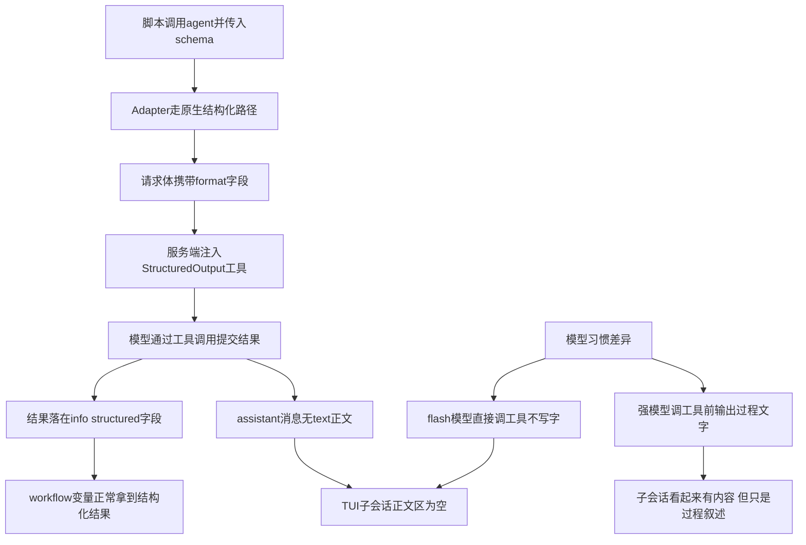

# 多模型编排 agent 详情内容为空问题

> 状态：已实验确认（2026-02-11）。根因是 schema 结构化输出，与模型差异无关，2x2 对照实验实锤。
> 复现工程：`E:\WorkProjects\xc-flow`
> workflow 脚本：`.opencode/skills/sdd/3-design/client/4-design-detail-client-fgui-skill/workflow/fgui_design_detail.js`

## 一、问题结论（一句话）

workflow 脚本给每个 `agent()` 调用都传了 `schema`，插件 Adapter 走 OpenCode 的
`format: json_schema` 原生结构化输出，模型结果通过 StructuredOutput 工具调用返回，
assistant 消息里没有 text 正文。TUI 点击节点进入子会话后，正文区自然为空。
**这不是 bug，是结构化输出的固有形态**；workflow 变量拿到的结果完好无损。

## 二、现象与误判过程

- 现象：主 agent 用 glm-5.2，workflow 里部分 agent 用 bf-glm-5.3-flash，
  TUI 中点击 flash 的 agent 节点，子会话显示内容为空；glm-5.2 的节点有内容。
- 初步怀疑：模型不同导致（5.3-flash 有问题）。
- 排查后排除模型因素：两个模型的 agent 都执行成功（快照 status ok、有 tokens、
  journal 结果完整），差异只出在"子会话里有没有可见文字"。

## 三、2x2 对照实验（最终定案）

实验脚本：xc-flow 工程 workflow 目录 `schema_ab_test.js`。4 个轻量 agent 并行执行，
task 与 prompt 完全相同（读 opencode.json 写两三句总结），唯一变量是模型与 schema 有无。
run: run-mtuwapx9-1，全部成功，耗时 44s。

数据库实测 assistant 正文（part 表 text part 计数）：

| 节点 | 模型 | schema | assistant 正文 | StructuredOutput 调用 | 返回类型 |
|---|---|---|---|---|---|
| A1 | flash | 有 | **0 段（空）** | 1 次 | JSON |
| A2 | flash | 无 | 1 段 | 0 | 纯文本 |
| B1 | 5.2 | 有 | 1 段（过程文字） | 1 次 | JSON |
| B2 | 5.2 | 无 | 1 段 | 0 | 纯文本 |

两条对照同时成立：

- **A1 vs A2**（同为 flash，只差 schema）：空 vs 有正文 → schema 是根因
- **A1 vs B1**（同为带 schema，只差模型）：空 vs 有过程文字 → 模型差异只是话痨程度的观感干扰
- A1/B1 返回 JSON（走 StructuredOutput），A2/B2 返回纯文本 → schema 决定路径，与模型无关

### v3 综合实验（run-mtux5828-1）：最终定案

6 个 agent 同屏对照（A 组无引导句基准、B 组 5.2 基准、C 组加引导句），数据库实测：

| 节点 | 模型 | schema | 引导句 | assistant 正文 | 快照 tokens |
|---|---|---|---|---|---|
| A1 | flash | 有 | 无 | **0 段** | 731 |
| A2 | flash | 无 | 无 | 324 字 | 21809 |
| B1 | 5.2 | 有 | 无 | 189 字 | 771 |
| B2 | 5.2 | 无 | 无 | 170 字 | 460 |
| C1 | flash | 有 | 有（加强措辞） | **仍 0 段** | 30410 |
| C2 | 5.2 | 有 | 有 | 357 字 | 1107 |

定案结论：

1. **根因确认**：schema 使结果走 StructuredOutput 工具调用，最终结果不再进正文——跨模型通用（A1/B1 同样受抑）
2. **模型差异是真实但次要的干扰项**：同样的 schema，5.2 习惯写过程文字（B1 189 字），flash 一字不写（A1 0 字）——这就是"5.2 节点有内容、flash 节点空白"的全部原因
3. **方案 A 出局**：引导句 v2 被 flash 钻空子（总结塞进 summary 字段），v3 加强措辞（必须作为正文输出）后仍 0 段——prompt 引导救不了 flash
4. **token 口径不可靠**：C1 实测 output 仅 419 tokens（与 A1 的 425 几乎相同），30410 的 total 是 input/cache 计量波动；同一任务 flash 两次运行 total 分别为 25639 与 731，差 35 倍——该网关 usage 口径噪声大，勿据 total 下成本结论

**最终出路**（按推荐排序）：

- a) 接受现状：结构化结果完好地存在于 journal、workflow 返回值与 StructuredOutput 工具条目里，正文空白只是展示形态
- b) 可见性要求高的节点用 5.2（会写过程文字）或换无 schema 的文本路径
- c) 方案 B：插件侧 TUI 节点详情展示 journal 结果摘要（新功能，按需做）

注意：TUI 中工具调用条目展开可见 summary 内容，容易被感知为"有正文了"，与数据库实测的 text part 为空不矛盾——判断正文有无以 part 表 text 类型为准。

## 四、早期证据链

| 层 | 检查点 | 结果 |
|---|---|---|
| 快照 `.opencode-workflows/runs/` | flash 节点 status / tokens | 全部 ok，有 tokens，执行成功 |
| journal `.opencode-workflows/journal/` | flash agent 的 result | 内容完整（JSON 都在） |
| OpenCode 数据库 `~/.local/share/opencode/opencode.db` 的 part 表 | assistant 消息的 parts 类型 | 见下 |

数据库对比（part 表，按 message 分组）：

```text
flash-5.3 会话（初始化工作目录）:
  user       text: "执行以下 Python 脚本并解析输出..."   ← 这是 prompt，不是回答
  assistant  reasoning + bash + StructuredOutput 工具调用   ← 零正文

glm-5.2 会话（DSL DingQueUI）:
  user       text: "你是 ui-dsl-builder 子 Agent..."     ← 同样是 prompt
  assistant  reasoning + text("我已找到 DingQueUI 任务...") + write
  assistant  reasoning + text("现在验证生成的文件：") + read
  assistant  reasoning + text("校验完成：...") + StructuredOutput 工具调用
```

关键事实：**glm-5.2 会话里看到的文字全部是过程叙述，最终结果在两个模型里都一样
藏在 StructuredOutput 工具调用的 input 里**（flash 的 `fgui_workpath_path, game_info...`、
5.2 的 `node_count, ok, screen_name`）。glm-5.2 只是习惯在调工具前"唠几句"，
flash 不唠，所以看起来一个有内容一个空。

## 五、结合 js 代码逻辑解析

### 5.1 脚本侧：每个 agent 都带 schema

`fgui_design_detail.js` 中全部 11 处 `agent()` 调用都传了 schema，无一例外：

```js
const MODEL = 'biangfeng-gateway/bf-glm-5.3-flash'
const MODEL_STRONG = 'biangfeng-gateway/glm-5.2'

// 弱模型干杂活，强模型写 DSL
const initResult = await agent(
  pythonRunPrompt(SKILL_DIR + '/scripts/init_workspace.py', ...),
  { agentType: 'general', label: '初始化工作目录', model: MODEL, schema: INIT_SCHEMA }
)

const dslResults = await parallel(
  tasks.map(function (task) {
    return function () {
      return agent(
        buildDslBuilderPrompt(task.screen_name, dslTasksPath, workDir),
        {
          agentType: 'general',
          label: 'DSL ' + task.screen_name,
          model: MODEL_STRONG,          // 强模型节点"看起来有内容"
          schema: DSL_BUILDER_SCHEMA,   // 但最终结果同样在 StructuredOutput 里
        }
      )
    }
  })
)
```

schema 定义示例（脚本依赖结构化结果做后续编排判断）：

```js
const INIT_SCHEMA = {
  type: 'object',
  properties: {
    ok: { type: 'boolean' },
    workspace_json_path: { type: 'string' },
    work_dir: { type: 'string' },
    game_info: { type: 'object', properties: { /* ... */ } },
    screen_filter: { type: 'array', items: { type: 'string' } },
    error: { type: 'string' },
  },
  required: ['ok'],
}
```

脚本拿到 `initResult.workspace_json_path` 等字段继续编排——这个链路完全正常，
schema 的价值（字段级契约 + 类型校验）也真实生效了。

### 5.2 插件侧：schema 触发 json_schema 路径

`src/adapters/opencode-session-adapter.ts` 的分支逻辑：

```ts
if (options?.schema) {
  // 原生结构化路径：format: json_schema，结果取 info.structured
  return await this.promptStructured(sessionId, prompt, model, options)
  //   body = { model, agent, parts: [{type:"text", text: prompt}],
  //            format: { type: "json_schema", schema } }
}
return await this.promptText(sessionId, prompt, model, options)
```

`format: json_schema` 时 OpenCode server 会注入一个 StructuredOutput 工具并强制
模型调用它提交结果。模型的"最终回答"变成了一次 tool call：

```text
assistant 消息 parts = [step-start, reasoning, tool(StructuredOutput), step-finish]
                          ↑ 无 text part，正文为空
```

插件取结果走的是 `message.info.structured`（服务端从工具调用里提取的结构化值），
与 text part 无关，所以 workflow 拿到的结果不受影响。

### 5.3 TUI 侧：正文只渲染 text part

`src/tui/plugin.tsx` 点击节点执行 `api.route.navigate("session", { sessionID })`，
后续渲染是 OpenCode 宿主的会话视图，正文取 assistant 的 text part。
schema 会话没有 text part，于是只剩 user prompt 和工具调用条目，观感"内容为空"。

### 5.4 全链路流程图



## 六、解决方案

### 结论先说

结果没丢、编排没坏，纯粹是"点进子会话看正文"这个观测手段对 schema 会话失效。
按需选择，不选也完全能用。

### 方案 A：prompt 引导模型输出过程文字（实验后出局：flash 不理会，见第三节 v3）

给 `fgui_design_detail.js` 里构造 prompt 的公共函数（如 `pythonRunPrompt` /
`buildDslBuilderPrompt` 等）末尾统一追加一句：

```text
调用 StructuredOutput 提交结果前，先用一两句话总结你做了什么、关键文件在哪。
```

效果：每个子会话都有正文可看，glm-5.2 本来就这么干，flash 被显式要求后也会写。
代价：每 agent 多几十个输出 token。
优点：不碰插件、不碰 schema 契约，脚本一处公共函数改动覆盖全部 agent。

### 方案 B：TUI 节点详情展示 journal 结果（插件侧，成本较高）

在 workflow 全屏路由里加一个详情面板，选中节点时展示
`.opencode-workflows/journal/run-*.json` 对应 entry 的 result 摘要。
优点：不依赖子会话正文，弱模型也稳。
缺点：新 UI 面、跨进程读文件、result 可能很大需要截断，属于新功能而非修 bug，
建议等真实需求再做。

### 方案 C：部分 agent 去掉 schema（不推荐）

让 agent 返回纯文本、脚本自己 JSON.parse。会失去字段级契约与类型校验，
脚本里 `initResult.workspace_json_path` 这类字段访问全要加防御，编排可靠性下降。
仅当某个 agent 的结果本来就是自由文本（如评审报告）时才值得这么做。

## 七、注意事项

- 判断"子会话空白"类问题，直接查 `~/.local/share/opencode/opencode.db` 的
  part 表，看 assistant 消息有没有 text 类型 part，一查一个准。
- 带 schema 的 agent 子会话"看起来内容少"是结构化输出的固有形态，不是 bug。
- schema 会话的最终结果在 StructuredOutput 工具调用的 input 里，正文里永远没有。
- 快照 json 在 Windows GBK 控制台直接 print 中文 label 会乱码，用 python 读时注意
  `encoding='utf-8'`；控制台乱码不代表数据坏了。
- journal 里 result 有值 + 快照 status ok = 执行链路正常，问题只能出在展示层。

## 八、引用说明

- 本插件 Adapter 结构化输出实现：`src/adapters/opencode-session-adapter.ts`
  （promptStructured / promptDegradedJson / format 字段注释，含本地源码证据
  session/prompt.ts:1499-1521、schema/src/v1/session.ts:65-79）
- 本插件 TUI 点击导航实现：`src/tui/plugin.tsx`（route.navigate 至子会话）
- 复现 workflow 脚本：xc-flow 工程
  `.opencode/skills/sdd/3-design/client/4-design-detail-client-fgui-skill/workflow/fgui_design_detail.js`
- OpenCode 结构化输出机制（StructuredOutput 工具注入）：本地参考源码
  `thirdparties/opencode/packages/opencode/src/session/prompt/`（format 处理与
  StructuredOutput 工具注入逻辑）
