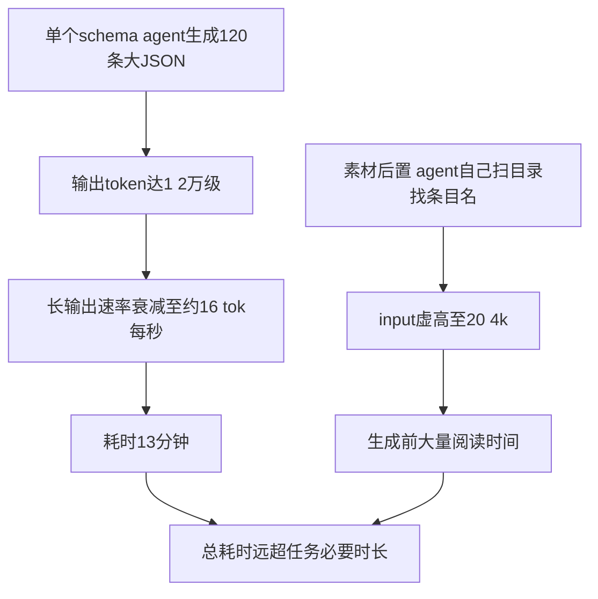

# 大 JSON 结构化输出长耗时问题

> 状态：已定性（2026-09-10）。属模型/网关侧长输出特性，插件链路健康，非 bug。
> 复现：T05 大结果验收（examples/sample-project/scripts/node-detail-large-result-test.js）
> run：run-mtv4g1oq（journal 与快照均在 examples/sample-project/.opencode-workflows/）

## 一、一句话结论

让单个 schema agent 一次生成 120 条 x 60 词的大 JSON（紧凑口径 51.3KB，输出 12540 token），
耗 时 13m14s（速率约 16 tok/s）且 input 虚高 20.4k token（模型自行扫描目录取素材）——
**这不是插件问题，是「大单体输出 + 素材后置」的编排方式问题**；正确做法见第五节：
分片并行 + 素材前置，同样的产出预期 2 分钟级、总 token 还更省。

## 二、现象（T05 实测）

| 节点 | outputType | result 体积（紧凑） | in / out token | 耗时 |
|---|---|---|---|---|
| long-output | text | 33.9KB | 2029 / 8036 | 3m11s |
| long-structured | structured | 51.3KB | 20398 / 12540 | **13m14s** |

插件链路健康证据（磁盘核验）：status ok、attempt 1（无重试）、executionId 正常
（run-mtv4g1oq:1:1）、usage 拆分与 tokens 合计口径自洽（33057 = 20398 + 12540 + reasoning）、
journal result 完整落盘、快照 outputPreview 干净截断在 2KB。

另：最终 `return { bigText, bigStructured }` 汇总约 85KB，被平台 tool 输出上限
（50KB，原文落盘 tool-output 目录）截断——预期行为，完整结果经 Node Detail / journal 始终可看。

## 三、根因分析



1. **输出体积是耗时主因**：结构化路径经 StructuredOutput 工具调用生成，12540 输出 token 的
   单体 JSON 在网关上速率随生成长度衰减（实测均值约 16 tok/s，起段快、后段慢）。
2. **素材后置推高 input**：prompt 只说「返回 120 个条目」，模型自行扫描项目 skills 目录
   取材（条目名确实来自真实 skill 清单），input 20398 token 花在找素材上。
3. **schema 约束本身不慢**：同 run 的 text 路径（8036 out）3 分钟完成，schema 的额外开销
   主要体现在「必须一次成型、无法分段喘息」，而非结构化本身。

类比理解：让一位作家一口气写 120 段作文，越写到后面手越慢；而且每动笔前还要自己去图书馆
查一遍资料。正确做法是把资料清单直接发到手里（素材前置），再请 6 位写手各写 20 段（分片并行）——
每位只写短篇保持手速，6 人同时开工，总时间约等于最慢的那一位。

## 四、定性边界（什么不是问题）

- 网关 usage 口径波动大（同任务 total 可差数倍），勿据 total 下成本结论，
  见 `Docs/02_设计与说明/TUI-token统计口径说明.md`
- 汇总输出被平台 50KB 截断是 OpenCode 既有机制（tool/truncate.ts，原文落盘 + metadata 带
  outputPath），与插件无关；Node Detail / journal 是完整结果的正确查看途径
- 13m14s 内快照心跳正常、无失联判定，B 通道工作正常

## 五、优化意见：生成大体积结构化数据的最优编排

### 核心原则：分片并行 + 素材前置 + 小输出单元

1. **分片**：把 N 条拆成若干片，每片 agent 输出控制在 2-3k token（速率不衰减区间）
2. **素材前置**：条目清单（名字/路径/索引）由脚本或 Main Agent 先整理好，写进各片 prompt；
   agent 只负责「写描述」，不负责「找东西」——input 从 20k 级降到 1k 级
3. **并行**：parallel() 天然保序（结果数组按定义序），汇总时按序拼接即可
4. **模型选型**：批量填充型任务用 flash 级小模型即可（写描述不需要旗舰推理）
5. **schema 精简**：字段够用就好；description 类长文本单字段，不做多层嵌套
6. **超时**：长输出任务显式传 `timeoutMs: null`（或给足预算），避免误杀

### 范式脚本（120 条拆 6 片，素材前置）

```js
export const meta = { name: 'big_structured_parallel', description: '大体积结构化输出的分片并行范式' }

// 素材前置：清单由编排方准备（这里是示意；实际可由 Main Agent 先读目录生成）
const ITEMS = ['skill-a', 'skill-b', /* ... 共 120 项 */]
const CHUNK = 20
const chunks = []
for (let i = 0; i < ITEMS.length; i += CHUNK) {
  chunks.push({ index: chunks.length, names: ITEMS.slice(i, i + CHUNK) })
}

phase('Fill')
// 每片 20 条：输出约 2k token（高速率区间），prompt 含清单（input 约 1k）
const partials = await parallel(chunks.map((chunk) => () =>
  agent(
    '给下列条目各写一段 60 词的中文描述，只输出本清单内的条目：\n' + chunk.names.join('\n'),
    {
      label: 'chunk-' + chunk.index,
      agentType: 'general',
      model: 'provider/flash级模型',
      schema: {
        type: 'object',
        properties: {
          items: {
            type: 'array',
            items: {
              type: 'object',
              properties: { name: { type: 'string' }, description: { type: 'string' } },
              required: ['name', 'description'],
            },
          },
        },
        required: ['items'],
      },
    }
  )
))

// 汇总：parallel 保序，直接拼接；失败片塌缩为 null 时可按需补跑
phase('Merge')
const items = partials.filter((p) => p && p.items).flatMap((p) => p.items)
return { title: '清单', items }
```

### 预期收益（对照本次实测推算）

| 维度 | 单体方案（本次实测） | 分片方案（推算） |
|---|---|---|
| wall-time | 13m14s | 约 2 分钟（最慢一片 1.5-2 分钟，6 片并行） |
| 总 input | 20.4k（重复扫目录） | 约 6k（6 x 1k，清单直给） |
| 总 output | 12.5k | 约 12.5k（产出不变） |
| 失败半径 | 整体重来（12.5k 白写） | 单片重试（resume 还能回放已完成片） |

补充：若某片失败，`retries` 自动重试单片；run 中断后 `resumeFromRunId` 续跑时已完成片
直接从 journal 回放不重烧——分片同时缩小了失败半径与续跑成本。

## 六、注意事项

- 判断「结构化输出慢」类问题先查三处：journal 的 usage 拆分（in/out 谁大）、durationMs、
  attempt 次数——input 大是素材后置，output 大且耗时长是单体输出衰减，多次 attempt 是重试
- 该网关长输出速率衰减明显，单体输出建议控制在 3-4k token 内；超过就考虑分片
- 速率与口径以实测为准（本文件数据为 2026-09-10 单次实测，网关行为可能变化）

## 七、引用说明

- 复现脚本：`examples/sample-project/scripts/node-detail-large-result-test.js`（T05）
- 实测数据：`examples/sample-project/.opencode-workflows/journal/run-mtv4g1oq.json` 与
  `runs/run-mtv4g1oq.json`（usage 拆分 / durationMs / executionId / outputPreview）
- token 口径说明：`Docs/02_设计与说明/TUI-token统计口径说明.md`
- 相关定案：`Docs/05_问题与注意事项/多模型编排agent详情内容为空问题-注意事项.md`
  （schema 路径经 StructuredOutput 工具调用返回，正文为空是合法形态）
- 平台截断机制：thirdparties/opencode 中 tool/truncate.ts（2000 行 / 50KB，原文落盘 + outputPath）
- 验收指南：`examples/sample-project/NodeDetail测试指南.md` 第 6 节（T05 判定表）
