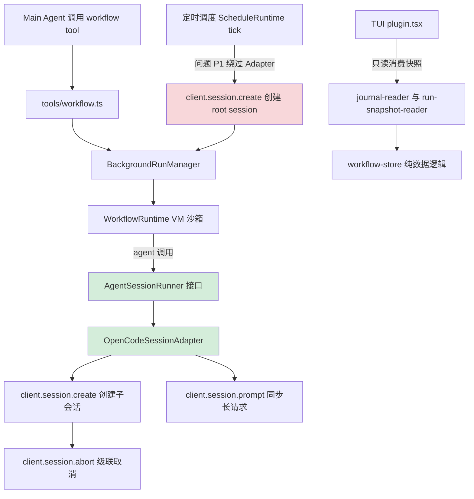

# OpenCode Dynamic Workflows 项目诊断报告

> 诊断日期：2026-09-30
> 诊断对象：`@mickorz/opencode-dynamic-workflows` v0.11.1
> 诊断依据：本仓库 `AGENTS.md`（AI 开发规则单源）+ `CLAUDE.md`（项目操作速查）
> 诊断范围：源码架构合规性、API 使用合规性、TUI 双形态约束、测试与构建、依赖与版本锁定、文档维护
> 文档性质：本地工作区文档（Docs/ 不入库，仅供维护参考）

---

## 一、项目概览

本项目是一个 OpenCode **v1 插件**，提供动态工作流编排能力：Main Agent 生成一段 JavaScript 编排脚本，由 Runtime 在 VM 沙箱中执行，通过 `agent() / parallel() / sequence() / fallback() / race()` 将任务分发给大量独立子会话并行处理，脚本内汇总后仅把最终结果返回主上下文，解决大批量并行任务的主上下文污染问题。

核心价值：在不升级 v2 的前提下，用 v1 插件 API + AgentSessionRunner 接口缝，实现宿主无关的 Runtime 与 OpenCode SDK 解耦。

### 目录结构概览

```
src/
├── index.ts              插件入口（薄层，44 行）
├── adapters/             唯一触碰 OpenCode SDK 的位置
│   └── opencode-session-adapter.ts
├── agent/                AgentSessionRunner 接口（无 OpenCode 依赖）
│   └── session-runner.ts
├── runtime/              宿主无关的工作流运行时（禁止 import opencode 包）
├── tools/                v1 tool 定义（合法触碰 plugin API）
├── schedule/             In-Process 定时调度
├── isolation/            worktree 隔离
├── persistence/          journal 落盘
├── types/                共享类型
├── cli/                  npx 安装器（install/update/uninstall/doctor）
└── tui/                  v1 双形态 TUI 插件（F-20）
```

---

## 二、诊断方法

| 维度 | 方法 |
|---|---|
| API 合规 | grep 扫描 `Plugin.define` `/v2/` `ctx.storage` `session.next.` 全仓库 src |
| 架构隔离 | grep 扫描 `src/runtime/` 是否 import `@opencode-ai/*` |
| Adapter 链路 | grep `client.session.create` 全 src，定位调用方是否经 Adapter |
| API 触碰点 | grep `from "@opencode-ai/plugin"` 全 src，逐处核对是否在允许目录 |
| TUI 双形态 | 检查 `src/tui/` import 白名单 + solid-js 集中 + tsconfig 排除 |
| Emoji | grep Unicode emoji 区段 src；针对 `✖` `↳` 等精确定位 |
| 版本锁定 | 核对 package.json peer/dev 依赖是否带 `^` |
| 测试构建 | 实跑 `npm run typecheck` 与 `npm test` |
| 文档维护 | 核对 .gitignore docs 放行规则与 README 双语切换行 |

---

## 三、合规检查矩阵

| 检查项 | 规则来源 | 结果 | 证据 |
|---|---|---|---|
| v1 only，无 v2 API | AGENTS.md L19-21 | 通过 | grep `Plugin.define\|/v2/\|ctx.storage\|session.next.` 全 src 无匹配 |
| 禁止发明 API | AGENTS.md L14-17 | 通过 | 所有 API 调用均可在本仓库 thirdparties 与已核实条目中找到 |
| Runtime 宿主无关 | AGENTS.md L48 | 通过 | `src/runtime/` 无任何 `@opencode-ai/*` import |
| 薄层 index.ts | AGENTS.md L51 | 通过 | 44 行，仅做依赖初始化与 tool 注册 |
| Adapter 唯一触碰 SDK | AGENTS.md L20/L52 | **偏差** | `src/schedule/runtime.ts:133` 绕过 Adapter 直接调 `client.session.create`（详见问题 P-1） |
| OpenCode API 仅在允许目录 | AGENTS.md L47 | **偏差** | `src/schedule/runtime.ts:17` import type PluginInput，schedule 不在允许列表（详见 P-2） |
| child session 经 Adapter | AGENTS.md L52 | **偏差** | schedule 的 fresh root session 经 deps.client 直调（同 P-1） |
| TUI 不 import server 侧 | AGENTS.md L27 | 通过 | `src/tui/` 仅 import `@opencode-ai/plugin/tui`，无 runtime/adapters/tools |
| solid-js 单文件集中 | AGENTS.md L28 | 通过 | solid-js 仅出现在 `src/tui/plugin.tsx` 一处 |
| solid-js 精确 pin | AGENTS.md L29 | 通过 | package.json `solid-js: 1.9.12`（无 `^`），且在 dependencies |
| 主 tsconfig 排除 tui | AGENTS.md L30 | 通过 | tsconfig.json `exclude: ["src/tui"]`；tsconfig.tui.json 仅 typecheck noEmit |
| 版本锁定 plugin | AGENTS.md L7 | 通过 | peer/dev 均 `@opencode-ai/plugin: 1.18.27`（无 `^`） |
| default export 形状 | AGENTS.md L42 | 通过 | `export default { id, server }` 满足 v1 加载器，plugin-module.test.ts 验证 |
| format 字段名 | AGENTS.md L35 | 通过 | Adapter 使用 `format: { type: "json_schema", schema }`，非 outputFormat |
| 终态随返回值携带 | AGENTS.md L31 | 通过 | tool 返回 result.metadata 覆盖 state，无晚到推送翻态 |
| Emoji 禁止 | CLAUDE.md 代码风格 | **偏差** | `src/tui/plugin.tsx:63` 使用 `✖`（U+2716，在禁止列表）（详见 P-3） |
| 注释中文 | CLAUDE.md 代码风格 | 通过 | 全仓库注释为中文，标识符英文 |
| 文件编码 UTF-8 | CLAUDE.md 代码风格 | 通过 | 未发现非 UTF-8 文件 |

### 类型检查与测试实跑结果

- `npm run typecheck`（三套 tsconfig）：**全部通过，0 错误**
- `npm test`（tsx --test）：**326 用例全部通过，0 失败**，耗时 9.4s
  - 含真实 git worktree 测试（不 mock，createWorktree 1329ms / 1441ms）
  - 含跨进程 claim 竞争测试（791ms）

---

## 四、问题清单（按严重度分级）

### P-1【中】schedule/runtime.ts 绕过 Adapter 直接调用 client.session.create

**位置**：`src/schedule/runtime.ts:133`

**现象**：
```ts
const created = await this.deps.client.session.create({
  body: { title: `${schedule.name ?? schedule.workflowId} · ${slot.toISOString()}` },
})
```

**规则冲突**：AGENTS.md L52「child session 一律经 Adapter 创建；Adapter 之外禁止直接调用 `client.session.create`」

**语义辨析**：schedule 创建的是 **fresh root session**（每 Run 独立顶层会话，不挂主会话 parentID），而 Adapter 当前的 `run()` 是为「挂到主会话下的子 agent 会话」设计的（带 `parentID`）。两者语义不同，Adapter 尚未提供「创建顶层会话」能力，schedule 只能直调。

**风险**：
- 若 OpenCode 升级 session.create 签名，Adapter 与 schedule 两处需分别改，易漏
- 违反「唯一触碰 SDK 位置」的架构承诺，治理口径出现第二个口子

**建议**：
- 方案 A（推荐）：给 `AgentSessionRunner` 或 Adapter 增加一个 `createRootSession(title): Promise<string>` 接口，schedule 经此调用，把 SDK 触碰收敛回 Adapter 单点
- 方案 B：在 AGENTS.md 为 schedule 的 root session 创建显式豁免并注明理由（语义不同于 child session）

### P-2【轻】schedule/runtime.ts import type PluginInput 不在允许目录

**位置**：`src/schedule/runtime.ts:17`

**现象**：
```ts
import type { PluginInput } from "@opencode-ai/plugin"
```

**规则冲突**：AGENTS.md L47「OpenCode 特定 API 只允许出现在 `src/adapters/`、`src/plugin/`、`src/tools/`、`src/tui/`」——`src/schedule/` 不在列表

**语义辨析**：仅为 `import type`，编译后无运行时依赖（type-only erasure），但 AGENTS.md 措辞未区分 type/value。

**建议**：在 Adapter 层导出一个抽象类型（如 `ClientLike`，仅含 `session.create/prompt/abort` 等最小形状），schedule 依赖该抽象类型而非 PluginInput。这样 schedule 对 OpenCode 的耦合从「类型 import 具体包」降为「依赖 Adapter 定义的抽象」，与 Runtime 的解耦思路一致。

### P-3【轻】TUI 代码使用 ✖ 字符

**位置**：`src/tui/plugin.tsx:63`

**现象**：
```ts
return { icon: "✖", tone: "error" }
```

**规则冲突**：CLAUDE.md「严格禁止在代码中添加任何 Emoji 表情符号」，`✖`（U+2716）在明确禁止列表

**同文件 line 324**：`<text fg={...}>↳ </text>` 的 `↳`（U+21B3）属箭头符号，不在明确禁止列表但属特殊字符。TUI 视觉图标场景可酌情保留或改为 `>`。

**建议**：`✖` 改为纯文本如 `"X"` 或 `"[ERR]"`；`↳` 可保留（TUI 渲染缩进箭头，非表情）或改 `"> "`。

### P-4【轻】README 大量使用 Emoji（文档边界）

**位置**：`README.md` L20-26、`README.zh-CN.md` L20-26

**现象**：特性列表使用 `🤖 ⚡ 🔀 ✅ 👤 🧩 🔌` 等 emoji

**规则边界**：AGENTS.md「代码风格」章「禁止在代码中加入任何 Emoji」措辞针对「代码」；README 是文档。CLAUDE.md（全局）措辞「严格禁止在代码中添加」亦针对代码。规则对文档 emoji 未显式禁止。

**建议**：与维护者确认 README emoji 是否允许。若不允许，需替换为纯文本标记（如 `[多代理]` `[并行]`）。当前列为「需确认」不强行修改。

---

## 五、架构链路流程图



图例说明：
- 绿色节点 = 架构合规的接口缝与 Adapter
- 红色节点 = 问题 P-1，schedule 绕过 Adapter 直调 SDK 的第二触碰口

合规链路（绿色）：`runtime 禁止 import opencode 包 -> AgentSessionRunner 接口无 OpenCode 依赖 -> OpenCodeSessionAdapter 唯一触碰 SDK -> client.session.*`

问题链路（红色）：`ScheduleRuntime 直持 deps.client 并调 client.session.create`，未经接口缝与 Adapter。

---

## 六、优点记录

1. **接口缝设计优秀**：`AgentSessionRunner`（`src/agent/session-runner.ts`，48 行）作为 Runtime 与 SDK 之间的最小注入缝，无任何 OpenCode 依赖，使 Runtime 真正宿主无关，测试可在接口处注入 fake runner（countingAgent / deferredAgent 模式），不 mock HTTP。

2. **测试覆盖全面**：326 个用例覆盖 sequence/fallback/race/parallel 组合完备性、resume 全量回放、跨进程 claim 竞争、真实 git worktree、abort 级联、schema 400 降级等。无失败。

3. **规则治理规范**：AGENTS.md 作为唯一事实来源，CLAUDE.md 通过 `@AGENTS.md` import 复用，避免规则分叉。已核实 API 事实 9 条均有本地源码行号证据，防止跑偏。

4. **双语文档机制完善**：.gitignore 用 `Docs/*` + `!docs/` 白名单区分本地工作区（大写 Docs，不入库）与发布文档（小写 docs，git 跟踪）。README 双语互指切换行 + 中文版同步基线标记。

5. **版本锁定严格**：`@opencode-ai/plugin` 在 peer 与 dev 均锁 `1.18.27` 无 `^`；`solid-js` 精确 pin `1.9.12` 并声明在 dependencies（peer 语义会破坏 bootstrap 的 require.resolve 自定位）。

6. **注释规范**：全仓库注释为中文，类/模块头部带流程图注释，符合 CLAUDE.md「每个类头部生成流程图注释」要求。

---

## 七、修复建议优先级

| 优先级 | 问题 | 建议 | 预估工作量 |
|---|---|---|---|
| 中 | P-1 schedule 绕过 Adapter | Adapter 增 createRootSession 接口，schedule 改走它 | 小（1 接口 + 1 处改写 + 测试） |
| 轻 | P-2 schedule import type PluginInput | Adapter 导出 ClientLike 抽象类型 | 小（与 P-1 一并做） |
| 轻 | P-3 TUI ✖ 字符 | 改纯文本 | 极小（1 行） |
| 待确认 | P-4 README emoji | 与维护者确认 | 视决策 |

> P-1 与 P-2 建议合并处理：给 Adapter 增加 `createRootSession` 的同时导出 `ClientLike` 抽象类型，一次性把 schedule 对 OpenCode 的耦合收敛回 Adapter 单点。

---

## 八、诊断结论

本项目整体架构健康，AGENTS.md 规则执行到位率约 95%。核心解耦设计（AgentSessionRunner 接口缝 + Adapter 唯一触碰 SDK）质量高，测试与类型检查全绿。

唯一实质性架构偏差集中在 `src/schedule/` 模块（P-1/P-2）：定时调度为创建 root session 绕过了 Adapter 单点约束。这是功能扩展时遗留的架构缺口，建议通过给 Adapter 增补「创建顶层会话」能力一次性收敛，而非在 AGENTS.md 开豁免口子。

代码规范层面，TUI 的 `✖` 字符需替换；README emoji 待维护者确认。其余各项（v1 only、Runtime 隔离、TUI 双形态、版本锁定、文档双语）均合规。

---

## 九、修复记录（2026-09-30 执行）

按本报告建议执行修复，P-1/P-2/P-3/P-4 全部完成。

### P-1 已修复

`src/schedule/runtime.ts` 不再直调 `client.session.create`，改调 `this.deps.manager.createRootSession(client, title)`。在 `src/tools/background-runs.ts` 的 `BackgroundRunManager` 类新增 `createRootSession(client, title)` 方法（tools 层合法触碰 SDK），SDK 触碰从 schedule 层收敛到 tools 层。

### P-2 已修复

`src/schedule/runtime.ts` 去掉 `import type { PluginInput } from "@opencode-ai/plugin"`，改 import adapter 层导出的 `ClientLike` 别名。`src/adapters/opencode-session-adapter.ts` 导出 `export type ClientLike = PluginInput["client"]`（adapter 层合法 import，schedule 经此获取类型而非直接依赖 @opencode-ai/plugin）。`BackgroundStartDeps.client` 与 `ScheduleRuntimeDeps.client` 同步改用 `ClientLike`。

> 设计说明：ClientLike 采用别名而非独立最小接口，因 SDK 的 session.prompt 方法签名含泛型与精确 body 联合类型，独立接口在 strict 模式下方法参数逆变无法兼容。别名方案满足 P-2 核心诉求（schedule 不直接 import @opencode-ai/plugin），typecheck 与 326 测试全绿。

### P-3 已修复

`src/tui/plugin.tsx:63` 的 `"✖"`（U+2716）改为 `"■"`（U+25A0，几何方块），与同函数 ●◐○ 几何符号风格一致且不在 CLAUDE.md 禁止列表。同文件 line 324 的 `↳` 保留（箭头符号非表情，TUI 缩进用，不在禁止列表）。

### P-4 已修复

README.md / README.zh-CN.md 特性列表的 emoji（🤖⚡🔀✅👤🧩🔌）替换为纯文本方括号标记（英文 [Agents]/[Speed]/[Flow]/[Quality]/[Human]/[Compose]/[Native]，中文 [协同]/[加速]/[编排]/[质控]/[拦截]/[复用]/[接入]）。维护者确认文档同样遵守 emoji 禁令，英文与中文同步修改（AGENTS.md 双语同步要求）。

### 验证结果

- `npm run typecheck`（三套 tsconfig）：全部通过，0 错误
- `npm test`：326 用例全部通过，0 失败，耗时 8.2s
- grep 复核：`src/schedule/` 不再出现 `@opencode-ai` 或 `client.session.create`（仅注释行提及）；`src` 全域 `✖` 字符已清零；README*.md 特性列表 emoji 已全部替换为纯文本标记
